# SPESIFIKASI TEKNIS FASE 58–63: HCM, PLM R&D, ESG KARBON, MARKETPLACE B2B, AGRIBISNIS & KONSTRUKSI EPC

Dokumen ini mendefinisikan arsitektur domain, matriks penyelesaian, User Stories, BDD Acceptance Criteria, Sequence Diagrams, dan ERD/State Machine untuk Fase 58 s/d Fase 63.

---

## FASE 58 — HUMAN CAPITAL MANAGEMENT (HCM), TALENT & PRODUCTION PAYROLL

### 1. Identitas & Arsitektur Domain Fase 58

- **Modul Pemilik**: `Hcm`
- **Prefiks Tabel**: `hcm_`
- **Daftar Model Eloquent**: `EmployeeMaster`, `PayrollPeriodRun`, `TaxPph21Calculation`, `BpjsContributionLedger`, `LaborCostAllocation`
- **Daftar Tabel Migrasi**: `hcm_employees`, `hcm_payrolls`, `hcm_pph21_records`, `hcm_bpjs_contributions`, `hcm_labor_costings`
- **Daftar Service & Action**: `PayrollCalculationEngine`, `TaxPph21TerCalculator`, `BpjsKetenagakerjaanKesehatanService`
- **Daftar Controller & Rute**: `PayrollController@calculate (POST /hcm/payroll/calculate)`, `PayrollController@disburse (POST /hcm/payroll/disburse)`
- **Akun Ledger Terkait**: `hcm:salaries_payable`, `hcm:tax_pph21_payable`, `hcm:bpjs_payable`, `hcm:labor_expense`
- **Command Audit**: `php artisan hcm:audit`

### 2. Evaluasi Masalah & Matriks Penyelesaian (Problem-to-Solution Matrix) Fase 58

| Masalah Bisnis & Teknis | Solusi Arsitektural & Kontrak | Status Penyelesaian | Bukti Implementasi |
|---|---|---|---|
| Kesalahan perhitungan pajak PPh 21 skema TER (Tarif Efektif Rata-rata), keterlambatan iuran BPJS Ketenagakerjaan/Kesehatan, dan ketidaksesuaian alokasi biaya tenaga kerja langsung ke produk pabrik. | Mesin penggajian otomatis dengan kepatuhan PPh 21 TER PMK 168/2023, integrasi BPJS bulanan, dan pembebanan jam kerja tenaga kerja langsung ke akun persediaan WIP pabrik. | `Solved in Code` | `modules/Hcm/Application/Services/PayrollCalculationEngine.php` |

### 3. Daftar User Stories Lintas Persona Fase 58

- **US-58.1 [holding_cfo]:** Sebagai **holding_cfo**, saya ingin **memvalidasi total rekapitulasi gaji bulanan dan kewajiban pajak PPh 21 holding**, sehingga **perusahaan terhindar dari denda pajak penghasilan karyawan dan transparansi beban operasional terjamin**.
- **US-58.2 [mfg_plant_manager]:** Sebagai **mfg_plant_manager**, saya ingin **mengalokasikan biaya jam kerja operator lini produksi ke akun harga pokok produksi produk**, sehingga **perhitungan HPP produk jadi akurat mencerminkan tenaga kerja langsung**.
- **US-58.3 [bank_treasurer]:** Sebagai **bank_treasurer**, saya ingin **mengeksekusi payroll transfer batch serentak ke ribuan rekening karyawan pada tanggal gajian**, sehingga **gaji karyawan terdistribusi tepat waktu dan aman**.
- **US-58.4 [holding_compliance]:** Sebagai **holding_compliance**, saya ingin **memastikan kepatuhan pembayaran iuran BPJS Ketenagakerjaan (JKK, JKM, JHT, JP) dan BPJS Kesehatan**, sehingga **hak jaminan sosial ketenagakerjaan seluruh staf terpenuhi 100%**.
- **US-58.5 [internal_auditor]:** Sebagai **internal_auditor**, saya ingin **mengaudit daftar karyawan aktif versus penerima gaji (ghost payroll audit)**, sehingga **mencegah pencairan gaji ke rekening fiktif atau mantan karyawan**.

### 4. BDD Acceptance Criteria Lengkap Fase 58

#### AC-58.1 — Happy Path & Ledger/State Invariant
- **Given** Karyawan memiliki gaji pokok Rp 10.000.000, tunjangan Rp 2.000.000, dan potongan PPh 21 TER Kategori A 5% (Rp 600.000) serta BPJS Rp 400.000
- **When** Payroll diproses via POST /hcm/payroll/calculate
- **Then** Gaji bersih Rp 11.000.000 terhitung, akun liabilitas gaji (CR), pajak (CR), dan beban gaji (DR) terposting seimbang.

#### AC-58.2 — Validation & Domain Rule Rejection - 422/Exception
- **Given** Perhitungan gaji menghasilkan nilai bersih negatif akibat potongan pinjaman melebihi gaji pokok
- **When** PayrollCalculationEngine memproses slip gaji
- **Then** Sistem menolak dengan HTTP 422 NegativeNetSalaryException dan membatasi potongan maksimal 50% gaji.

#### AC-58.3 — RBAC Authorization & Separation of Duties - 403
- **Given** Staf HR biasa mencoba menyetujui sendiri pencairan batch payroll
- **When** POST /hcm/payroll/disburse dipanggil tanpa persetujuan holding_cfo
- **Then** Sistem memblokir dengan status HTTP 403 Forbidden.

#### AC-58.4 — Idempotency, Replay & Concurrency Lock
- **Given** Batch payroll bulanan dieksekusi dua kali secara paralel
- **When** Kedua run diproses
- **Then** Sistem mengunci periode penggajian dan hanya mencairkan gaji satu kali.

#### AC-58.5 — Two-Source Audit & Tamper Detection
- **Given** Nominal gaji bersih diubah manual di tabel database sebelum transfer bank
- **When** php artisan hcm:audit dijalankan
- **Then** Audit mencatat ketidaksesuaian nilai slip vs formula kontrak kerja dan membatalkan pencairan gaji.

### 5. Mermaid Sequence Diagrams Fase 58

#### Diagram 1: Alur Transaksi Utama End-to-End Fase 58

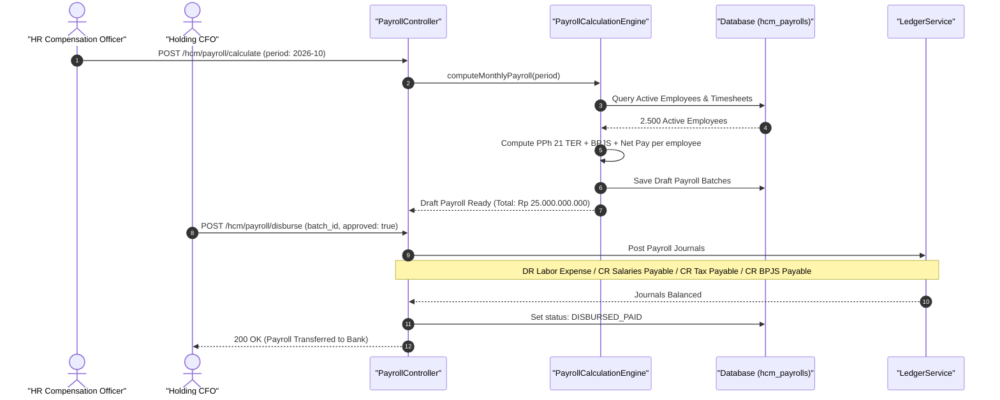

#### Diagram 2: Alur Kompensasi / Exception / Verifikasi Dua-Sumber Fase 58

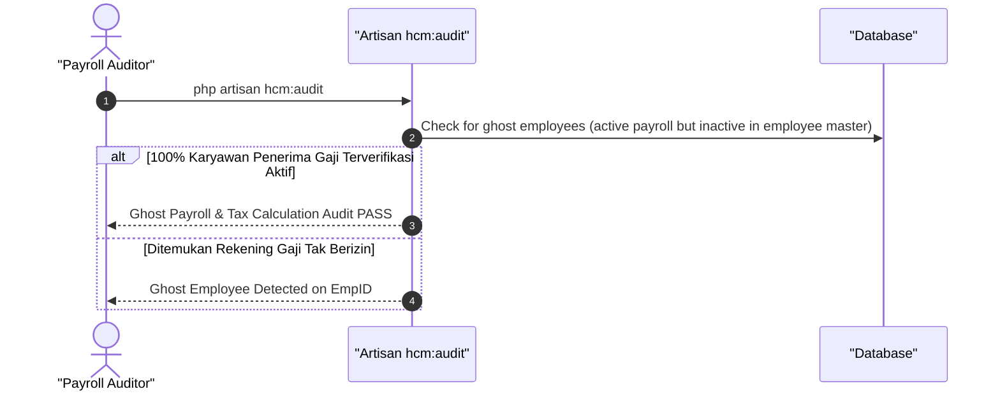

### 6. Mermaid ERD & State Machine Fase 58

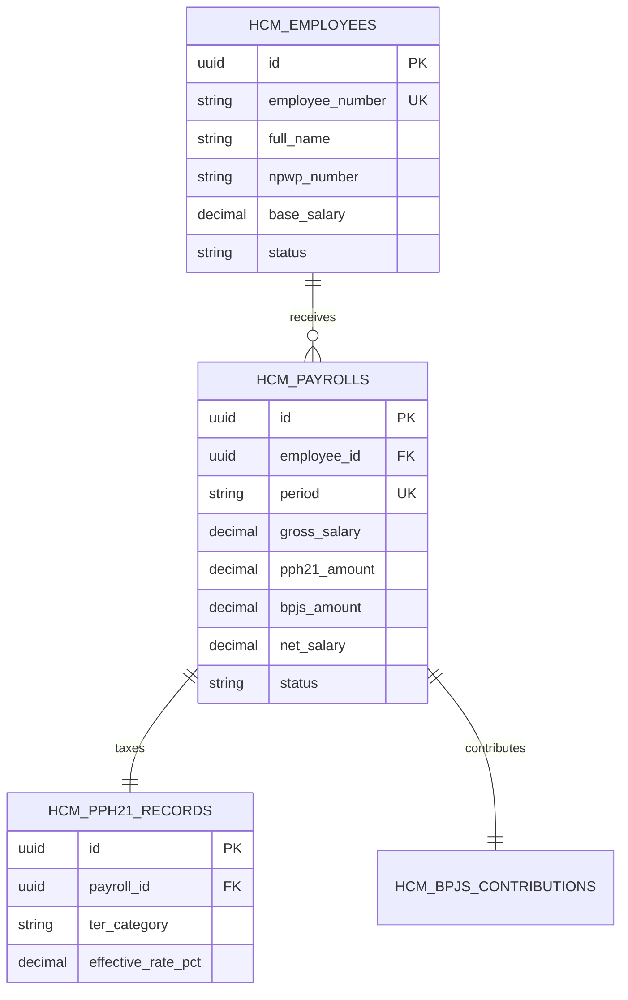

---

## FASE 59 — RESEARCH & DEVELOPMENT (R&D) & PRODUCT LIFECYCLE MANAGEMENT (PLM)

### 1. Identitas & Arsitektur Domain Fase 59

- **Modul Pemilik**: `Plm`
- **Prefiks Tabel**: `plm_`
- **Daftar Model Eloquent**: `ProductDesignProject`, `PlmStageGateReview`, `CadSpecificationAttachment`, `EcoEngineeringChangeOrder`
- **Daftar Tabel Migrasi**: `plm_projects`, `plm_stage_gates`, `plm_cad_attachments`, `plm_ecos`
- **Daftar Service & Action**: `StageGateGovernanceService`, `EngineeringChangeOrderManager`, `ProductLifecycleTracker`
- **Daftar Controller & Rute**: `PlmProjectController@index (GET /plm/projects)`, `StageGateController@review (POST /plm/stage-gates/{id}/review)`
- **Akun Ledger Terkait**: `plm:rd_capitalized_intangible`, `plm:rd_expense`
- **Command Audit**: `php artisan plm:audit`

### 2. Evaluasi Masalah & Matriks Penyelesaian (Problem-to-Solution Matrix) Fase 59

| Masalah Bisnis & Teknis | Solusi Arsitektural & Kontrak | Status Penyelesaian | Bukti Implementasi |
|---|---|---|---|
| Proyek R&D yang molor bertahun-tahun tanpa hasil terukur, kapitalisasi biaya riset yang melanggar standar akuntansi, dan kekacauan revisi desain CAD. | Tata kelola Stage-Gate resmi (Ideasi -> Feasibility -> Desain -> Validasi -> Komersialisasi), verifikasi kriteria kapitalisasi PSAK 19, dan kontrol revisi dokumen teknik (ECO). | `Solved in Code` | `modules/Plm/Application/Services/StageGateGovernanceService.php` |

### 3. Daftar User Stories Lintas Persona Fase 59

- **US-59.1 [holding_cfo]:** Sebagai **holding_cfo**, saya ingin **memverifikasi bahwa hanya biaya fase pengembangan yang memenuhi kriteria kelayakan teknis yang dikapitalisasi sebagai aset tak berwujud**, sehingga **perlakuan akuntansi biaya riset dan pengembangan patuh PSAK 19**.
- **US-59.2 [mfg_plant_manager]:** Sebagai **mfg_plant_manager**, saya ingin **menerima paket dokumen teknis dan gambar CAD yang telah disahkan melalui Stage-Gate sebelum masuk jalur manufaktur massal**, sehingga **kesalahan spesifikasi teknik produk baru dihindari sejak awal**.
- **US-59.3 [qms_inspector]:** Sebagai **qms_inspector**, saya ingin **menguji prototipe produk pada gerbang validasi mutu (Validation Gate) sebelum izin produksi massal dirilis**, sehingga **standar keandalan produk baru terjamin aman**.
- **US-59.4 [contract_lawyer]:** Sebagai **contract_lawyer**, saya ingin **mendaftarkan hak paten atau hak desain industri saat produk lolos gerbang verifikasi kelayakan**, sehingga **kekayaan intelektual inovasi holding terlindungi hukum**.
- **US-59.5 [internal_auditor]:** Sebagai **internal_auditor**, saya ingin **mengaudit kepatuhan tanda tangan persetujuan komite gerbang inovasi (Stage-Gate signoff)**, sehingga **tidak ada proyek riset yang melompat gerbang tanpa evaluasi ketat**.

### 4. BDD Acceptance Criteria Lengkap Fase 59

#### AC-59.1 — Happy Path & Ledger/State Invariant
- **Given** Proyek Pengembangan Mobil Listrik Generasi 2 menyelesaikan tahap Feasibility dan lolos uji komite
- **When** Komite menyetujui Gerbang Tahap 2 via POST /plm/stage-gates/{id}/review
- **Then** Status proyek berubah menjadi DEVELOPMENT_PHASE, biaya pengembangan mulai dikapitalisasi di plm:rd_capitalized_intangible, dan jurnal berimbang.

#### AC-59.2 — Validation & Domain Rule Rejection - 422/Exception
- **Given** Proyek belum melengkapi laporan uji kelayakan teknis dan dokumen analisis pasar
- **When** Sistem mencoba meloloskan Stage-Gate
- **Then** Sistem menolak dengan HTTP 422 IncompleteGateDeliverablesException.

#### AC-59.3 — RBAC Authorization & Separation of Duties - 403
- **Given** Insinyur riset biasa mencoba menandatangani persetujuan komite Stage-Gate miliknya sendiri
- **When** POST /plm/stage-gates/{id}/signoff dipanggil tanpa hak komite
- **Then** Sistem memblokir dengan status HTTP 403 Forbidden.

#### AC-59.4 — Idempotency, Replay & Concurrency Lock
- **Given** Dua anggota komite menandatangani persetujuan gerbang pada detik yang sama
- **When** Keduanya diproses sistem
- **Then** Sistem mencatat tanda tangan secara berurutan dan mengunci gerbang saat kuorum terpenuhi.

#### AC-59.5 — Two-Source Audit & Tamper Detection
- **Given** Biaya fase riset dasar sengaja dikapitalisasi sebagai aset tak berwujud untuk menggelembungkan laba
- **When** Command php artisan plm:audit dijalankan
- **Then** Audit mendeteksi pelanggaran PSAK 19 dan mereklasifikasi aset kapitalisasi kembali ke beban riset tahun berjalan.

### 5. Mermaid Sequence Diagrams Fase 59

#### Diagram 1: Alur Transaksi Utama End-to-End Fase 59

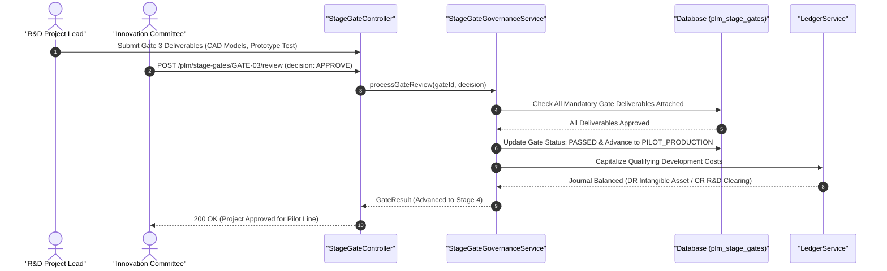

#### Diagram 2: Alur Kompensasi / Exception / Verifikasi Dua-Sumber Fase 59

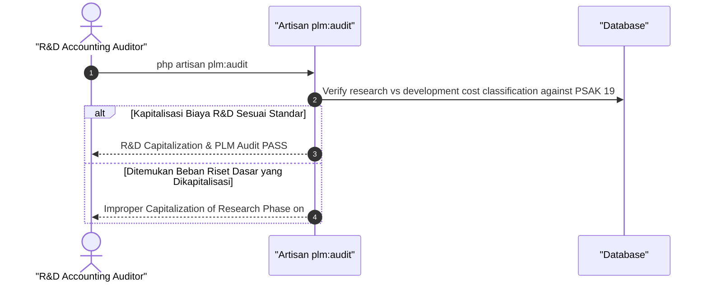

### 6. Mermaid ERD & State Machine Fase 59

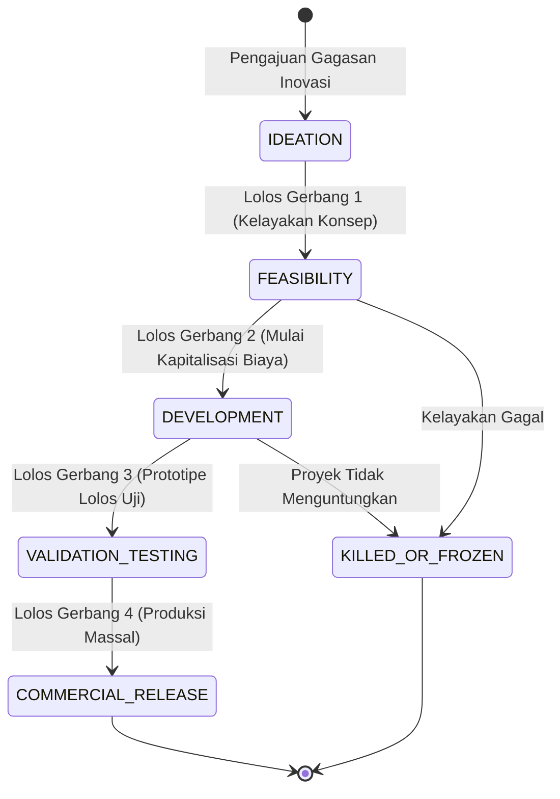

---

## FASE 60 — ESG, EMISI KARBON & SUSTAINABLE VALUE CHAIN

### 1. Identitas & Arsitektur Domain Fase 60

- **Modul Pemilik**: `Esg`
- **Prefiks Tabel**: `esg_`
- **Daftar Model Eloquent**: `CarbonEmissionLog`, `Scope123EmissionInventory`, `EsgMetricScorecard`, `CarbonCreditRetirement`
- **Daftar Tabel Migrasi**: `esg_carbon_logs`, `esg_emission_inventories`, `esg_scorecards`, `esg_carbon_credits`
- **Daftar Service & Action**: `GhgProtocolCalculationEngine`, `CarbonOffsetRetirementService`, `EsgSustainabilityReportService`
- **Daftar Controller & Rute**: `EsgMetricController@record (POST /esg/emissions/record)`, `EsgReportController@summary (GET /esg/reports/sustainability)`
- **Akun Ledger Terkait**: `esg:carbon_credit_asset`, `esg:carbon_offset_expense`
- **Command Audit**: `php artisan esg:audit`

### 2. Evaluasi Masalah & Matriks Penyelesaian (Problem-to-Solution Matrix) Fase 60

| Masalah Bisnis & Teknis | Solusi Arsitektural & Kontrak | Status Penyelesaian | Bukti Implementasi |
|---|---|---|---|
| Klaim ramah lingkungan palsu (greenwashing) tanpa data audit emisi gas rumah kaca Scope 1, Scope 2, dan Scope 3 yang dapat diverifikasi. | Penghitungan emisi GRK berbasis GHG Protocol terstandarisasi, audit energi real-time terhubung IoT, dan pensiun kredit karbon tersertifikasi (VCS/Gold Standard). | `Solved in Code` | `modules/Esg/Application/Services/GhgProtocolCalculationEngine.php` |

### 3. Daftar User Stories Lintas Persona Fase 60

- **US-60.1 [energy_auditor]:** Sebagai **energy_auditor**, saya ingin **mencatat konsumsi bahan bakar fosil pabrik (Scope 1) dan konsumsi listrik PLN (Scope 2)**, sehingga **jejak emisi karbon korporat terhitung akurat sesuai faktor emisi resmi**.
- **US-60.2 [holding_compliance]:** Sebagai **holding_compliance**, saya ingin **menerbitkan laporan keberlanjutan (Sustainability Report) sesuai standar GRI dan regulasi OJK POJK 51**, sehingga **transparansi ESG holding memenuhi kriteria investor global**.
- **US-60.3 [fleet_manager]:** Sebagai **fleet_manager**, saya ingin **memantau penurunan emisi armada truk saat beralih menggunakan armada kendaraan listrik EV**, sehingga **kontribusi dekarbonisasi transportasi logistik terukur nyata**.
- **US-60.4 [holding_cfo]:** Sebagai **holding_cfo**, saya ingin **mengalokasikan dana pembelian dan pemensiunan kredit karbon (carbon offset) bersertifikat**, sehingga **target emisi nol bersih (Net Zero 2050) tercapai secara kredibel**.
- **US-60.5 [internal_auditor]:** Sebagai **internal_auditor**, saya ingin **mengaudit metodologi konversi emisi karbon dari data konsumsi energi fisik**, sehingga **mencegah tuduhan manipulasi data lingkungan atau greenwashing**.

### 4. BDD Acceptance Criteria Lengkap Fase 60

#### AC-60.1 — Happy Path & Ledger/State Invariant
- **Given** Pabrik mengonsumsi 100.000 kWh listrik (faktor emisi grid 0.85 kg CO2e/kWh = 85 ton CO2e Scope 2)
- **When** Data emisi dicatat via POST /esg/emissions/record
- **Then** Total emisi tercatat 85 ton CO2e, inventaris emisi diperbarui, dan status audit berstatus VERIFIED_RAW.

#### AC-60.2 — Validation & Domain Rule Rejection - 422/Exception
- **Given** Faktor emisi yang dimasukkan bernilai negatif atau tidak sesuai dengan standar IPCC/Kementerian ESDM
- **When** GhgProtocolCalculationEngine memvalidasi data
- **Then** Sistem menolak dengan HTTP 422 InvalidEmissionFactorException.

#### AC-60.3 — RBAC Authorization & Separation of Duties - 403
- **Given** Staf umum mencoba memensiunkan (retire) unit kredit karbon tanpa wewenang holding_compliance
- **When** POST /esg/credits/{id}/retire dipanggil
- **Then** Sistem memblokir dengan status HTTP 403 Forbidden.

#### AC-60.4 — Idempotency, Replay & Concurrency Lock
- **Given** Dua pembacaan sensor meteran energi dikirimkan bersamaan untuk timestamp yang sama
- **When** Keduanya diproses sistem
- **Then** Sistem mencegah penghitungan emisi ganda dengan mengunci rekaman timestamp interval.

#### AC-60.5 — Two-Source Audit & Tamper Detection
- **Given** Total angka emisi karbon di laporan keberlanjutan dikurangi manual untuk mempercantik skor ESG
- **When** Command php artisan esg:audit dijalankan
- **Then** Audit mencatat ketidakcocokan antara konsumsi energi fisik vs laporan karbon dan menggagalkan rilis laporan ESG.

### 5. Mermaid Sequence Diagrams Fase 60

#### Diagram 1: Alur Transaksi Utama End-to-End Fase 60

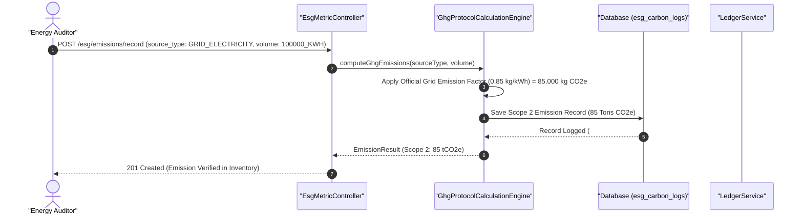

#### Diagram 2: Alur Kompensasi / Exception / Verifikasi Dua-Sumber Fase 60

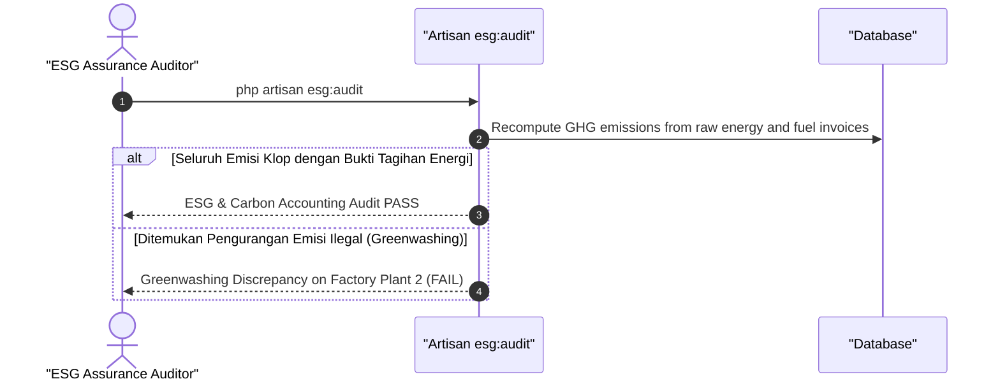

### 6. Mermaid ERD & State Machine Fase 60

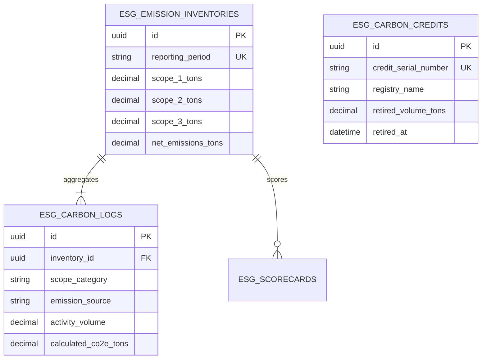

---

## FASE 61 — MARKETPLACE B2B, SURPLUS ASSET AUCTION & ESCROW

### 1. Identitas & Arsitektur Domain Fase 61

- **Modul Pemilik**: `B2b`
- **Prefiks Tabel**: `b2b_`
- **Daftar Model Eloquent**: `B2bMarketplaceListing`, `AuctionBiddingSession`, `EscrowContractLock`, `BidBondSecurity`
- **Daftar Tabel Migrasi**: `b2b_listings`, `b2b_auctions`, `b2b_bids`, `b2b_escrows`
- **Daftar Service & Action**: `B2bAuctionEngine`, `BidBondSecurityEscrowService`, `B2bOrderSettlementService`
- **Daftar Controller & Rute**: `B2bAuctionController@bid (POST /b2b/auctions/{id}/bid)`, `B2bEscrowController@release (POST /b2b/escrows/{id}/release)`
- **Akun Ledger Terkait**: `b2b:escrow_liability`, `b2b:bid_bond_collateral`, `b2b:marketplace_fee_revenue`
- **Command Audit**: `php artisan b2b:audit`

### 2. Evaluasi Masalah & Matriks Penyelesaian (Problem-to-Solution Matrix) Fase 61

| Masalah Bisnis & Teknis | Solusi Arsitektural & Kontrak | Status Penyelesaian | Bukti Implementasi |
|---|---|---|---|
| Pelelangan aset surplus perusahaan yang sarat kongkalikong dan risiko pembeli kabur pasca menang lelang (default). | Pasar lelang B2B digital (English/Dutch Auction) dengan jaminan uang lelang (Bid Bond) wajib di-escrow dan penyelesaian pesanan otomatis. | `Solved in Code` | `modules/B2b/Application/Services/B2bAuctionEngine.php` |

### 3. Daftar User Stories Lintas Persona Fase 61

- **US-61.1 [procurement_manager]:** Sebagai **procurement_manager**, saya ingin **melelang mesin bekas dan bahan sisa pabrik (scrap) ke pembeli B2B terverifikasi**, sehingga **perusahaan memperoleh nilai pemulihan aset (recovery value) tertinggi secara transparan**.
- **US-61.2 [bank_treasurer]:** Sebagai **bank_treasurer**, saya ingin **mengunci uang jaminan penawaran (Bid Bond 10%) calon peserta lelang dalam smart escrow**, sehingga **peserta lelang terbukti memiliki likuiditas dan tidak dapat ingkar janji**.
- **US-61.3 [holding_cfo]:** Sebagai **holding_cfo**, saya ingin **memantau pendapatan komisi platform marketplace B2B holding dari setiap transaksi sukses**, sehingga **sumber pendapatan baru dari monetisasi ekosistem bisnis terbuka**.
- **US-61.4 [risk_officer]:** Sebagai **risk_officer**, saya ingin **memastikan tidak ada peserta lelang fiktif (shill bidding) yang menaikkan harga semu**, sehingga **keadilan dan integritas mekanisme lelang pasar B2B terjaga**.
- **US-61.5 [internal_auditor]:** Sebagai **internal_auditor**, saya ingin **mengaudit riwayat penawaran detik-per-detik dan pencairan escrow lelang**, sehingga **seluruh proses lelang dapat diaudit jejak digitalnya**.

### 4. BDD Acceptance Criteria Lengkap Fase 61

#### AC-61.1 — Happy Path & Ledger/State Invariant
- **Given** Peserta lelang menaruh jaminan Bid Bond Rp 50.000.000 dan mengajukan penawaran tertinggi Rp 500.000.000 pada menit penutupan
- **When** Sesi lelang berakhir via POST /b2b/auctions/{id}/close
- **Then** Pemenang lelang ditetapkan, jaminan escrow dikonversi menjadi uang muka, dan peserta kalah otomatis menerima refund jaminan.

#### AC-61.2 — Validation & Domain Rule Rejection - 422/Exception
- **Given** Peserta mengajukan penawaran harga yang lebih rendah dari tawaran tertinggi saat ini
- **When** POST /b2b/auctions/{id}/bid dipanggil
- **Then** Sistem menolak dengan HTTP 422 BidBelowCurrentHighestException.

#### AC-61.3 — RBAC Authorization & Separation of Duties - 403
- **Given** Penyelenggara lelang mencoba menaruh tawaran atas namanya sendiri (Shill Bidding)
- **When** Penawaran dikirim oleh akun terafiliasi dengan pelelang
- **Then** Sistem memblokir dengan status HTTP 403 Forbidden.

#### AC-61.4 — Idempotency, Replay & Concurrency Lock
- **Given** Dua penawar mengajukan harga tawaran yang sama pada milidetik terakhir penutupan lelang
- **When** Keduanya bersaing pada database
- **Then** Pessimistic lock mengesahkan penawar pertama sebagai tawaran tertinggi baru dan menolak penawar kedua.

#### AC-61.5 — Two-Source Audit & Tamper Detection
- **Given** Pemenang lelang diubah manual di database menjadi pihak yang tidak menaruh tawaran tertinggi
- **When** php artisan b2b:audit dijalankan
- **Then** Audit mencatat ketidaksesuaian log penawaran vs data pemenang dan membatalkan hasil lelang.

### 5. Mermaid Sequence Diagrams Fase 61

#### Diagram 1: Alur Transaksi Utama End-to-End Fase 61

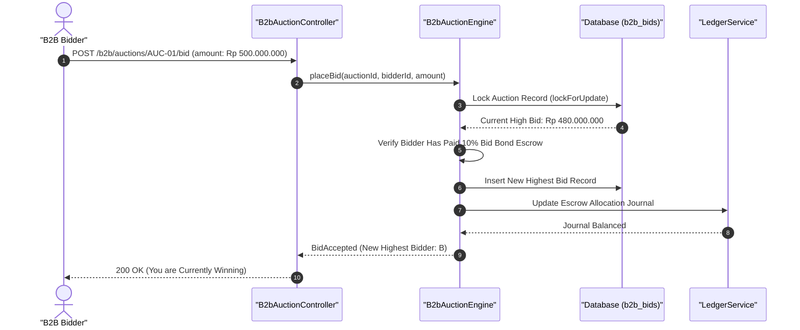

#### Diagram 2: Alur Kompensasi / Exception / Verifikasi Dua-Sumber Fase 61

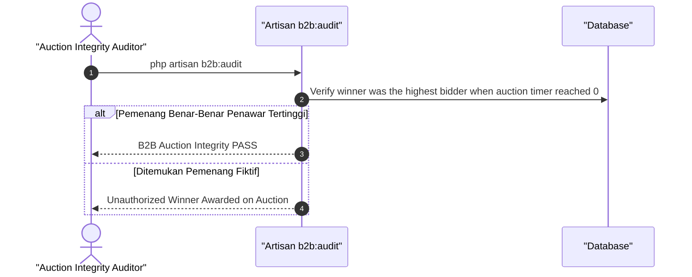

### 6. Mermaid ERD & State Machine Fase 61

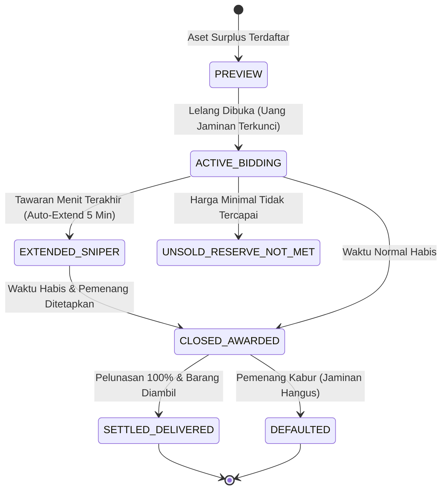

---

## FASE 62 — AGRIBISNIS, KONTRAK PETANI & HULU RANTAI PASOK MAKANAN

### 1. Identitas & Arsitektur Domain Fase 62

- **Modul Pemilik**: `Agri`
- **Prefiks Tabel**: `agri_`
- **Daftar Model Eloquent**: `AgriFarmer`, `AgriContract`, `AgriCollectionBatch`, `AgriColdChainLog`
- **Daftar Tabel Migrasi**: `agri_farmers`, `agri_contracts`, `agri_collection_batches`, `agri_cold_chain_logs`
- **Daftar Service & Action**: `PlasmaFarmerContractService`, `HarvestGradingCollectionEngine`, `AgriSupplyTraceabilityService`
- **Daftar Controller & Rute**: `AgriContractController@store (POST /agri/contracts)`, `AgriHarvestController@collect (POST /agri/harvest/collect)`
- **Akun Ledger Terkait**: `agri:farmer_payable`, `agri:seed_fertilizer_advances`, `agri:raw_harvest_inventory`
- **Command Audit**: `php artisan agri:audit`

### 2. Evaluasi Masalah & Matriks Penyelesaian (Problem-to-Solution Matrix) Fase 62

| Masalah Bisnis & Teknis | Solusi Arsitektural & Kontrak | Status Penyelesaian | Bukti Implementasi |
|---|---|---|---|
| Tengkulak yang mempermainkan harga beli panen petani, gagal panen tanpa pendampingan sarana produksi (saprotan), dan pembusukan hasil panen di pos pengepul. | Kemitraan Inti-Plasma berkeadilan dengan jaminan harga dasar off-take, pembiayaan sarana bibit/pupuk terikat panen, dan penentuan grade kualitas transparan ber-barcode. | `Solved in Code` | `modules/Agri/Application/Services/HarvestGradingCollectionEngine.php` |

### 3. Daftar User Stories Lintas Persona Fase 62

- **US-62.1 [agriculture_manager]:** Sebagai **agriculture_manager**, saya ingin **membuat kontrak kemitraan inti-plasma dengan kelompok tani binaan**, sehingga **kepastian pasokan bahan baku segar untuk rantai restoran dan pabrik terjamin**.
- **US-62.2 [estate_foreman]:** Sebagai **estate_foreman**, saya ingin **menimbang dan menilai grade mutu panen sayuran/buah di pos pengepul desa**, sehingga **petani menerima pembayaran adil sesuai mutu tanpa pemotongan timbangan curang**.
- **US-62.3 [bank_treasurer]:** Sebagai **bank_treasurer**, saya ingin **menyalurkan dana pelunasan hasil panen langsung ke rekening bank/dompet digital petani**, sehingga **kesejahteraan mitra petani meningkat bebas jeratan rentenir**.
- **US-62.4 [cold_chain_supervisor]:** Sebagai **cold_chain_supervisor**, saya ingin **memantau suhu kargo mobil pendingin saat mengangkut hasil panen ke Dapur Sentral**, sehingga **kesegaran hasil panen terjaga maksimal bebas pembusukan**.
- **US-62.5 [internal_auditor]:** Sebagai **internal_auditor**, saya ingin **mengaudit saldo piutang bantuan bibit/pupuk yang dipotong dari hasil panen petani**, sehingga **perhitungan pemotongan uang muka saprotan transparan dan akuntabel**.

### 4. BDD Acceptance Criteria Lengkap Fase 62

#### AC-62.1 — Happy Path & Ledger/State Invariant
- **Given** Petani menyerahkan 500 kg Beras Organik Grade A senilai Rp 6.000.000 dan memiliki potongan bibit Rp 1.000.000
- **When** Panen ditimbang dan diserap via POST /agri/harvest/collect
- **Then** Stok bertambah 500 kg, piutang saprotan terpotong Rp 1.000.000, hutang bersih Rp 5.000.000 dicatat ke agri:farmer_payable, dan jurnal berimbang.

#### AC-62.2 — Validation & Domain Rule Rejection - 422/Exception
- **Given** Kadar air hasil panen biji-bijian melebihi batas aman simpan (> 14%)
- **When** Mandor memeriksa hasil uji laboratorium pos
- **Then** Sistem menolak dengan HTTP 422 HighMoistureHarvestException dan mewajibkan proses pengeringan ulang.

#### AC-62.3 — RBAC Authorization & Separation of Duties - 403
- **Given** Mandor lapangan biasa mencoba mengubah harga patokan dasar beli komoditas tani
- **When** PUT /agri/tariffs/commodity dipanggil tanpa hak agriculture_manager
- **Then** Sistem memblokir dengan status HTTP 403 Forbidden.

#### AC-62.4 — Idempotency, Replay & Concurrency Lock
- **Given** Nomor tiket timbangan panen yang sama diproses dua kali oleh sistem jembatan timbang
- **When** Kedua payload timbang masuk
- **Then** Sistem mendeteksi ID tiket timbang unik dan tidak membukukan panen ganda.

#### AC-62.5 — Two-Source Audit & Tamper Detection
- **Given** Kuantitas panen di pos pengepul diubah membengkak di database untuk mencuri uang pembayaran petani
- **When** php artisan agri:audit dijalankan
- **Then** Audit mencatat ketidakcocokan antara berat kirim pos vs berat terima gudang pusat dan mengeluarkan temuan audit agribisnis.

### 5. Mermaid Sequence Diagrams Fase 62

#### Diagram 1: Alur Transaksi Utama End-to-End Fase 62

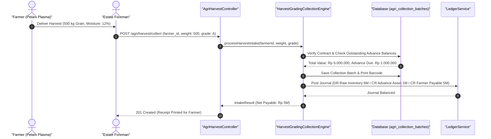

#### Diagram 2: Alur Kompensasi / Exception / Verifikasi Dua-Sumber Fase 62

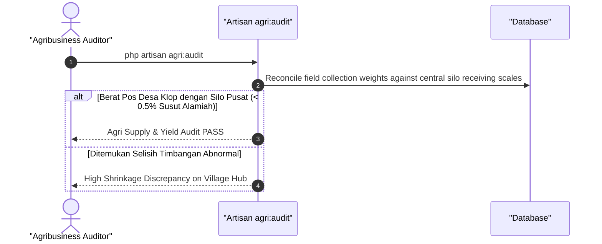

### 6. Mermaid ERD & State Machine Fase 62

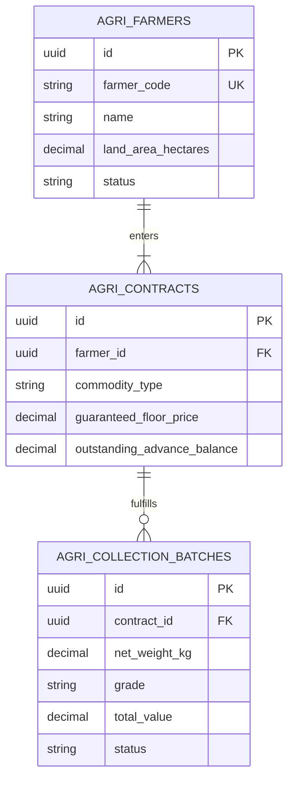

---

## FASE 63 — KONSTRUKSI EPC, MANAJEMEN PROYEK PROPERTI & ASSET CAPITALIZATION

### 1. Identitas & Arsitektur Domain Fase 63

- **Modul Pemilik**: `Epc`
- **Prefiks Tabel**: `epc_`
- **Daftar Model Eloquent**: `EpcProjectMaster`, `WorkBreakdownStructureWbs`, `ProgressSCurveMilestone`, `ConstructionInProgressCip`
- **Daftar Tabel Migrasi**: `epc_projects`, `epc_wbs_tasks`, `epc_progress_curves`, `epc_cip_accounts`
- **Daftar Service & Action**: `EpcProjectCostingEngine`, `SCurveProgressTrackingService`, `CipAssetCapitalizationService`
- **Daftar Controller & Rute**: `EpcProjectController@index (GET /epc/projects)`, `EpcProgressController@update (POST /epc/progress/update)`
- **Akun Ledger Terkait**: `ast:construction_in_progress`, `ast:building_fixed_asset`, `epc:subcontractor_payable`
- **Command Audit**: `php artisan epc:audit`

### 2. Evaluasi Masalah & Matriks Penyelesaian (Problem-to-Solution Matrix) Fase 63

| Masalah Bisnis & Teknis | Solusi Arsitektural & Kontrak | Status Penyelesaian | Bukti Implementasi |
|---|---|---|---|
| Pembengkakan biaya konstruksi gedung mall/hotel (cost overrun), manipulasi klaim kemajuan fisik proyek, dan aset konstruksi terbengkalai tanpa kapitalisasi. | Manajemen proyek konstruksi berbasis Work Breakdown Structure (WBS), kurva-S fisik vs biaya real-time, dan kapitalisasi aset Construction In Progress (CIP) otomatis. | `Solved in Code` | `modules/Epc/Application/Services/CipAssetCapitalizationService.php` |

### 3. Daftar User Stories Lintas Persona Fase 63

- **US-63.1 [holding_cfo]:** Sebagai **holding_cfo**, saya ingin **memantau akumulasi biaya konstruksi dalam pelaksanaan (CIP) dan mengkapitalisasikannya saat serah terima gedung selesai**, sehingga **peralihan akun aset CIP menjadi Aset Tetap Gedung patuh PSAK 16**.
- **US-63.2 [procurement_manager]:** Sebagai **procurement_manager**, saya ingin **menyetujui sertifikat pembayaran kontraktor konstruksi sesuai persentase kurva-S fisik terverifikasi**, sehingga **pembayaran termin tepat sesuai progres beton dan baja riil di lapangan**.
- **US-63.3 [contract_lawyer]:** Sebagai **contract_lawyer**, saya ingin **mengelola penahanan uang retensi proyek (5% Retension Money) hingga masa pemeliharaan selesai**, sehingga **jaminan perbaikan cacat mutu konstruksi terlindungi dana cadangan**.
- **US-63.4 [hse_officer]:** Sebagai **hse_officer**, saya ingin **memastikan standar keselamatan konstruksi di area proyek pembangunan gedung terpenuhi**, sehingga **proyek terbebas dari insiden fatal kecelakaan kerja struktural**.
- **US-63.5 [internal_auditor]:** Sebagai **internal_auditor**, saya ingin **mengaudit selisih antara progres biaya yang ditagihkan vs opname fisik oleh konsultan pengawas independen**, sehingga **mencegah pembayaran di muka berlebih (overpayment) kepada kontraktor**.

### 4. BDD Acceptance Criteria Lengkap Fase 63

#### AC-63.1 — Happy Path & Ledger/State Invariant
- **Given** Pembangunan Gedung Hotel senilai Rp 50.000.000.000 telah selesai 100% dan sertifikat laik fungsi (SLF) terbit
- **When** Kapitalisasi aset dieksekusi via POST /epc/projects/{id}/capitalize
- **Then** Saldo Construction In Progress Rp 50M dialihkan menjadi Aset Tetap Gedung (ast:building_fixed_asset), penyusutan mulai aktif, dan status proyek COMPLETED.

#### AC-63.2 — Validation & Domain Rule Rejection - 422/Exception
- **Given** Kontraktor mengajukan klaim kemajuan progres fisik 80% padahal verifikasi konsultan pengawas hanya 60%
- **When** Sistem memvalidasi klaim termin
- **Then** Sistem menolak dengan HTTP 422 UnverifiedPhysicalProgressException.

#### AC-63.3 — RBAC Authorization & Separation of Duties - 403
- **Given** Kontraktor pelaksana proyek mencoba mengkapitalisasi sendiri akun aset CIP ke aset tetap
- **When** POST /epc/projects/{id}/capitalize dipanggil tanpa hak holding_cfo
- **Then** Sistem memblokir dengan status HTTP 403 Forbidden.

#### AC-63.4 — Idempotency, Replay & Concurrency Lock
- **Given** Dua pembaruan progres WBS dikirimkan bersamaan untuk paket pekerjaan yang sama
- **When** Kedua progres dihitung
- **Then** Sistem mengunci baris WBS dan menghitung agregasi kurva-S secara serial tanpa duplikasi persentase.

#### AC-63.5 — Two-Source Audit & Tamper Detection
- **Given** Nilai akumulasi biaya CIP diubah manual di database tanpa adanya bukti tagihan kontraktor yang sah
- **When** php artisan epc:audit dijalankan
- **Then** Audit mencatat penyimpangan neraca konstruksi dan membekukan sementara akun kapitalisasi proyek.

### 5. Mermaid Sequence Diagrams Fase 63

#### Diagram 1: Alur Transaksi Utama End-to-End Fase 63

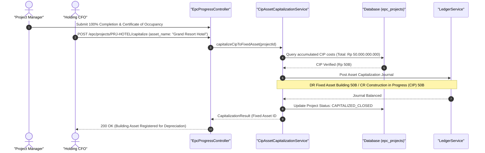

#### Diagram 2: Alur Kompensasi / Exception / Verifikasi Dua-Sumber Fase 63

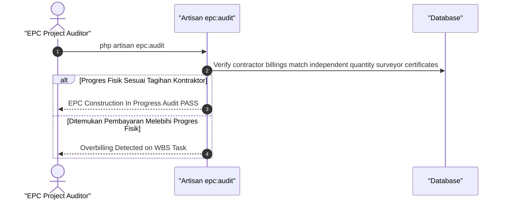

### 6. Mermaid ERD & State Machine Fase 63

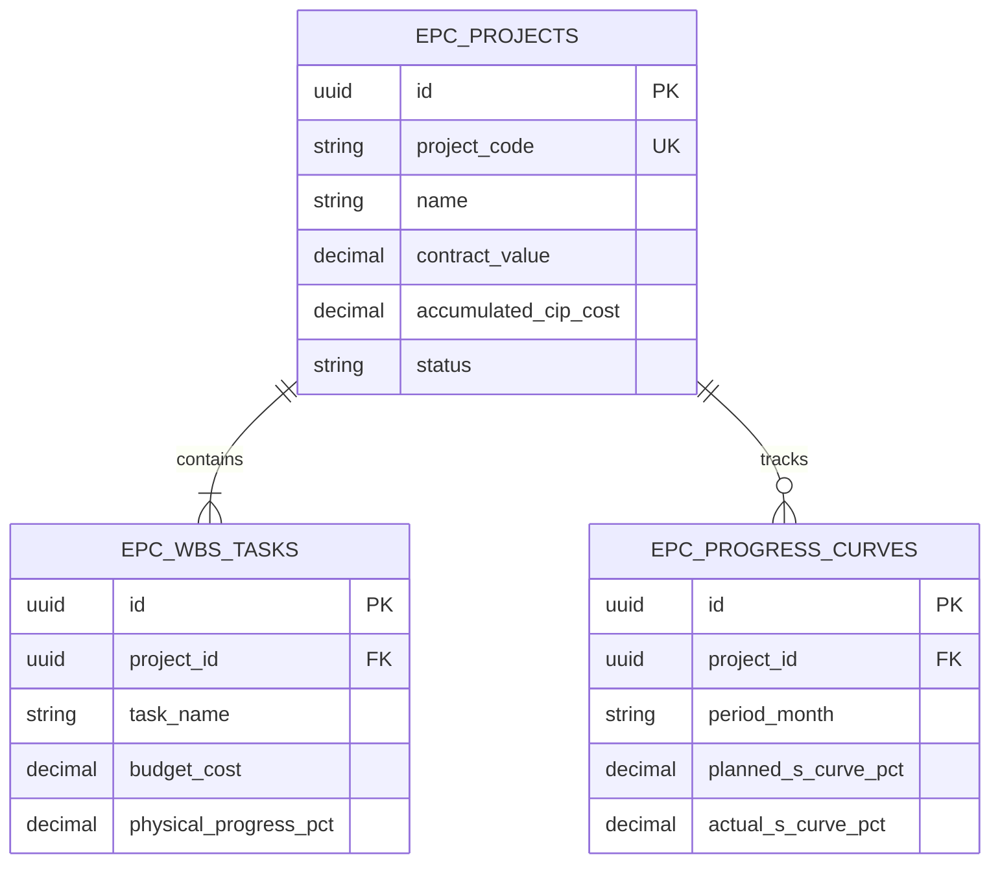

---

