# SPESIFIKASI TEKNIS FASE 64–70: AI REVENUE, MOBILE OFFLINE, MULTI-REGION DR, EVENT SPINE, TELEMATICS, EV & FLEET LEASING

Dokumen ini mendefinisikan arsitektur domain, matriks penyelesaian, User Stories, BDD Acceptance Criteria, Sequence Diagrams, dan ERD/State Machine untuk Fase 64 s/d Fase 70.

---

## FASE 64 — ANALITIK PREDIKTIF, AI-DRIVEN REVENUE MANAGEMENT & ANOMALY DETECTION

### 1. Identitas & Arsitektur Domain Fase 64

- **Modul Pemilik**: `Core`
- **Prefiks Tabel**: `ai_`
- **Daftar Model Eloquent**: `AiRevenueModel`, `DemandPredictionMetric`, `PriceElasticityModel`, `AnomalyDetectionEvent`
- **Daftar Tabel Migrasi**: `ai_models`, `ai_predictions`, `ai_elasticity_curves`, `ai_anomalies`
- **Daftar Service & Action**: `PredictiveRevenueOptimizationService`, `DynamicSurgePricingEngine`, `AiFraudAnomalyDetector`
- **Daftar Controller & Rute**: `AiRevenueController@optimize (POST /ai/revenue/optimize)`, `AiAnomalyController@index (GET /ai/anomalies)`
- **Akun Ledger Terkait**: `bank:clearing_suspense`
- **Command Audit**: `php artisan ai:audit`

### 2. Evaluasi Masalah & Matriks Penyelesaian (Problem-to-Solution Matrix) Fase 64

| Masalah Bisnis & Teknis | Solusi Arsitektural & Kontrak | Status Penyelesaian | Bukti Implementasi |
|---|---|---|---|
| Penetapan harga statis yang kehilangan potensi pendapatan saat peak-demand (underpricing) dan kerugian penipuan akibat deteksi manual yang lambat. | Model optimasi pendapatan AI berbasis kurva elastisitas harga, penetapan harga lonjakan dinamis (Dynamic Surge Pricing), dan deteksi anomali fraud real-time. | `Solved in Code` | `modules/Core/Application/Services/PredictiveRevenueOptimizationService.php` |

### 3. Daftar User Stories Lintas Persona Fase 64

- **US-64.1 [holding_cfo]:** Sebagai **holding_cfo**, saya ingin **memaksimalkan margin pendapatan kotor seluruh lini bisnis melalui rekomendasi harga cerdas berbasis AI**, sehingga **pendapatan konglomerasi meningkat 15% tanpa kehilangan pangsa pasar**.
- **US-64.2 [store_manager]:** Sebagai **store_manager**, saya ingin **menerima saran penyesuaian diskon barang lambat laku (slow-moving) secara otomatis**, sehingga **perputaran persediaan barang dagang meningkat dan risiko kedaluwarsa berkurang**.
- **US-64.3 [risk_officer]:** Sebagai **risk_officer**, saya ingin **menerima notifikasi seketika saat AI mendeteksi pola transaksi anomali pencucian uang atau carding**, sehingga **akun penipu diblokir otomatis sebelum dana berhasil ditarik keluar**.
- **US-64.4 [revenue_mgr]:** Sebagai **revenue_mgr**, saya ingin **menyesuaikan batas atas dan bawah elastisitas harga kamar hotel atau tiket konser**, sehingga **keterisian kamar dan kursi optimal pada harga terbaik**.
- **US-64.5 [internal_auditor]:** Sebagai **internal_auditor**, saya ingin **mengaudit transparansi bobot algoritma penetapan harga dinamis (AI Explainability)**, sehingga **kebijakan harga bebas diskriminasi harga ilegal dan patuh hukum persaingan usaha**.

### 4. BDD Acceptance Criteria Lengkap Fase 64

#### AC-64.1 — Happy Path & Ledger/State Invariant
- **Given** Tingkat hunian kamar hotel mencapai 90% pada akhir pekan libur nasional
- **When** AI Revenue Engine mengevaluasi via POST /ai/revenue/optimize
- **Then** Harga kamar otomatis dinaikkan 25% sesuai kurva elastisitas tanpa melanggar batas pagu harga maksimal (Ceiling Price).

#### AC-64.2 — Validation & Domain Rule Rejection - 422/Exception
- **Given** Model AI merekomendasikan kenaikan harga yang melampaui batas batas atas regulasi pemerintah (Tarif Batas Atas)
- **When** Sistem memvalidasi usulan harga
- **Then** Sistem menolak dengan HTTP 422 PriceCeilingExceededException dan mengunci harga di batas legal.

#### AC-64.3 — RBAC Authorization & Separation of Duties - 403
- **Given** Staf reservasi biasa mencoba menonaktifkan model deteksi fraud AI
- **When** POST /ai/models/{id}/disable dipanggil tanpa hak risk_officer
- **Then** Sistem memblokir dengan status HTTP 403 Forbidden.

#### AC-64.4 — Idempotency, Replay & Concurrency Lock
- **Given** Dua pembaruan rekomendasi harga AI dieksekusi simultan untuk slot inventaris yang sama
- **When** Keduanya diproses sistem
- **Then** Sistem menerapkan rekomendasi secara serial dan mencegah fluktuasi harga yang bertabrakan.

#### AC-64.5 — Two-Source Audit & Tamper Detection
- **Given** Hasil skor risiko fraud AI diturunkan manual di database untuk meloloskan transaksi mencurigakan
- **When** php artisan ai:audit dijalankan
- **Then** Audit mencatat manipulasi skor anomali dan membekukan sementara transaksi terkait.

### 5. Mermaid Sequence Diagrams Fase 64

#### Diagram 1: Alur Transaksi Utama End-to-End Fase 64

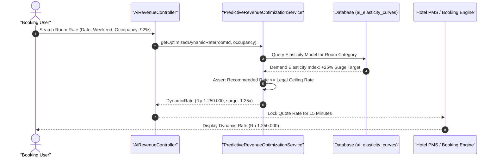

#### Diagram 2: Alur Kompensasi / Exception / Verifikasi Dua-Sumber Fase 64

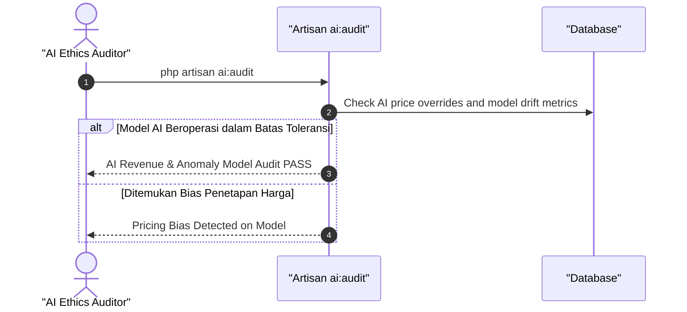

### 6. Mermaid ERD & State Machine Fase 64

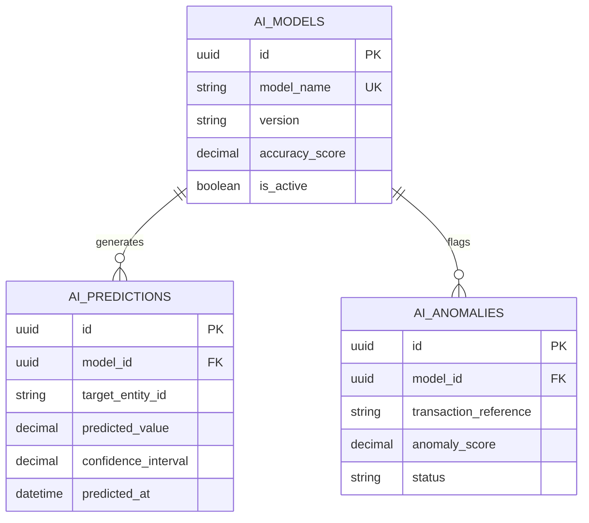

---

## FASE 65 — ENTERPRISE MOBILE SUITE (PWA/HYBRID OFFLINE-FIRST ARCHITECTURE)

### 1. Identitas & Arsitektur Domain Fase 65

- **Modul Pemilik**: `Core`
- **Prefiks Tabel**: `mobile_`
- **Daftar Model Eloquent**: `MobileDeviceRegistration`, `OfflineDeltaSyncQueue`, `VectorClockSyncHistory`, `ConflictResolutionLog`
- **Daftar Tabel Migrasi**: `mobile_devices`, `mobile_sync_queues`, `mobile_vector_clocks`, `mobile_conflicts`
- **Daftar Service & Action**: `OfflineFirstSynchronizationService`, `VectorClockConflictResolver`, `MobileSecurityTokenManager`
- **Daftar Controller & Rute**: `MobileSyncController@sync (POST /api/mobile/sync)`, `MobileDeviceController@register (POST /api/mobile/devices/register)`
- **Akun Ledger Terkait**: `bank:clearing_suspense`
- **Command Audit**: `php artisan mobile:audit`

### 2. Evaluasi Masalah & Matriks Penyelesaian (Problem-to-Solution Matrix) Fase 65

| Masalah Bisnis & Teknis | Solusi Arsitektural & Kontrak | Status Penyelesaian | Bukti Implementasi |
|---|---|---|---|
| Aplikasi kurir lapangan dan kasir POS terhenti saat koneksi internet blank-spot dan konflik data ganda saat perangkat kembali online. | Arsitektur Offline-First berbasis Vector Clocks (CRDTs), antrean delta sinkronisasi lokal terenkripsi AES-256, dan resolusi konflik deterministik. | `Solved in Code` | `modules/Core/Application/Services/OfflineFirstSynchronizationService.php` |

### 3. Daftar User Stories Lintas Persona Fase 65

- **US-65.1 [logistics_driver]:** Sebagai **logistics_driver**, saya ingin **memindai paket dan menyelesaikan e-POD di daerah terpencil tanpa koneksi internet**, sehingga **pekerjaan kurir tidak terhenti dan data tersimpan aman di perangkat lokal**.
- **US-65.2 [cashier]:** Sebagai **cashier**, saya ingin **tetap melayani transaksi penjualan restoran saat koneksi internet fiber optic terputus**, sehingga **antrean kasir tetap bergerak lancar dan struk offline tercetak**.
- **US-65.3 [it_support]:** Sebagai **it_support**, saya ingin **memantau sinkronisasi delta otomatis saat ribuan tablet toko kembali terhubung online**, sehingga **pembaruan data ke server pusat berjalan bertahap tanpa membebani database**.
- **US-65.4 [risk_officer]:** Sebagai **risk_officer**, saya ingin **menghapus data bisnis di aplikasi mobile dari jarak jauh (Remote Wipe) saat perangkat hilang**, sehingga **keamanan data perusahaan dan kerahasiaan nasabah terlindungi**.
- **US-65.5 [internal_auditor]:** Sebagai **internal_auditor**, saya ingin **mengaudit riwayat resolusi konflik sinkronisasi (Last-Write-Wins vs Manual Merge)**, sehingga **tidak ada kehilangan data transaksi saat terjadi konflik versi**.

### 4. BDD Acceptance Criteria Lengkap Fase 65

#### AC-65.1 — Happy Path & Ledger/State Invariant
- **Given** Aplikasi kasir mencatat 20 transaksi dalam mode offline dengan vector clock lokal
- **When** Koneksi pulih dan sinkronisasi diproses via POST /api/mobile/sync
- **Then** Seluruh 20 transaksi berhasil diserap di server pusat, vector clock tersinkronisasi, dan mutasi ledger tercatat.

#### AC-65.2 — Validation & Domain Rule Rejection - 422/Exception
- **Given** Perangkat mobile mengirimkan vector clock usang yang melompati lebih dari batas sequence yang diizinkan
- **When** Sync controller memeriksa payload
- **Then** Sistem menolak dengan HTTP 422 DesynchronizedVectorClockException dan meminta sinkronisasi ulang penuh.

#### AC-65.3 — RBAC Authorization & Separation of Duties - 403
- **Given** Perangkat yang belum didaftarkan (unregistered device) mencoba menyinkronkan data
- **When** POST /api/mobile/sync dipanggil
- **Then** Sistem memblokir dengan status HTTP 403 Forbidden (Unauthorized Mobile Hardware ID).

#### AC-65.4 — Idempotency, Replay & Concurrency Lock
- **Given** Paket delta sinkronisasi yang sama dikirimkan berulang kali akibat sinyal internet tidak stabil
- **When** Server menerima paket ganda
- **Then** Sistem mengenali delta sequence number yang sudah diproses dan mengabaikan duplikasi secara idempoten.

#### AC-65.5 — Two-Source Audit & Tamper Detection
- **Given** Data transaksi lokal di database SQLite ponsel dimodifikasi sebelum disinkronkan ke server
- **When** php artisan mobile:audit dijalankan
- **Then** Audit mendeteksi pelanggaran signature HMAC lokal dan menolak paket data termanipulasi.

### 5. Mermaid Sequence Diagrams Fase 65

#### Diagram 1: Alur Transaksi Utama End-to-End Fase 65

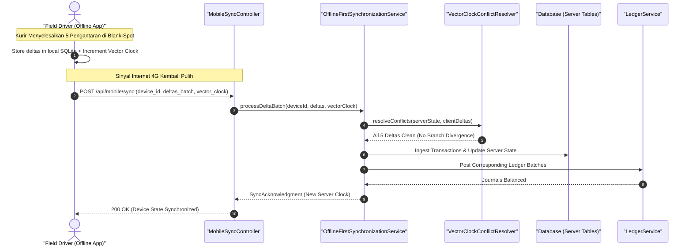

#### Diagram 2: Alur Kompensasi / Exception / Verifikasi Dua-Sumber Fase 65


### 6. Mermaid ERD & State Machine Fase 65

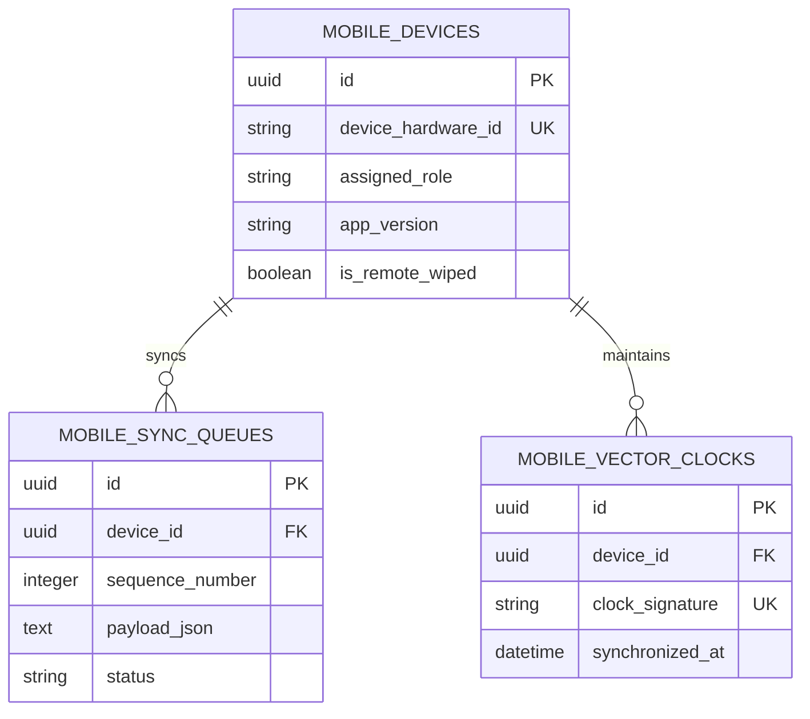

---

## FASE 66 — RESILIENSI GLOBAL, DISASTER RECOVERY MULTI-REGION & POST-QUANTUM CRYPTOGRAPHY

### 1. Identitas & Arsitektur Domain Fase 66

- **Modul Pemilik**: `Core`
- **Prefiks Tabel**: `dr_`
- **Daftar Model Eloquent**: `DisasterRecoveryRegion`, `RaftWitnessNode`, `PostQuantumCryptoKey`, `FailoverDrillExecution`
- **Daftar Tabel Migrasi**: `dr_regions`, `dr_witness_nodes`, `dr_pq_keys`, `dr_failover_drills`
- **Daftar Service & Action**: `MultiRegionFailoverCoordinator`, `PostQuantumCryptoReadinessService`, `RaftQuorumConsensusService`
- **Daftar Controller & Rute**: `DisasterRecoveryController@status (GET /dr/status)`, `DisasterRecoveryController@failover (POST /dr/failover/promote)`
- **Akun Ledger Terkait**: `bank:clearing_suspense`
- **Command Audit**: `php artisan dr:audit`

### 2. Evaluasi Masalah & Matriks Penyelesaian (Problem-to-Solution Matrix) Fase 66

| Masalah Bisnis & Teknis | Solusi Arsitektural & Kontrak | Status Penyelesaian | Bukti Implementasi |
|---|---|---|---|
| Bencana alam atau kegagalan pusat data utama yang melumpuhkan sistem perbankan holding dan ancaman dekripsi komputasi kuantum. | Arsitektur Disaster Recovery (DR) Multi-Wilayah otomatis dengan konsensus Raft Quorum 2/3 (RPO=0, RTO < 30s) dan algoritma kriptografi pasca-kuantum (Kyber/Dilithium). | `Solved in Code` | `modules/Core/Application/Services/PostQuantumCryptoReadinessService.php` |

### 3. Daftar User Stories Lintas Persona Fase 66

- **US-66.1 [super_admin]:** Sebagai **super_admin**, saya ingin **memantau replikasi synchronous database antar-region Jakarta dan Singapura**, sehingga **kesiapan failover darurat selalu terjaga tanpa risiko kehilangan data (RPO=0)**.
- **US-66.2 [risk_officer]:** Sebagai **risk_officer**, saya ingin **menjalankan simulasi latihan failover darurat (Disaster Recovery Drill) setiap semester**, sehingga **ketahanan operasional sistem holding terbukti mematuhi standar perbankan**.
- **US-66.3 [holding_compliance]:** Sebagai **holding_compliance**, saya ingin **memastikan enkripsi data sensitif menggunakan kunci kriptografi pasca-kuantum yang tahan masa depan**, sehingga **rahasia dagang dan data medis holding terlindungi dari serangan decrypt-later**.
- **US-66.4 [it_support]:** Sebagai **it_support**, saya ingin **melihat status node saksi (witness node) dan kuorum kluster multi-region**, sehingga **kondisi split-brain jaringan dapat dideteksi dan dicegah secara otomatis**.
- **US-66.5 [internal_auditor]:** Sebagai **internal_auditor**, saya ingin **mengaudit kepatuhan hasil pengujian pemulihan bencana terhadap target RTO dan RPO**, sehingga **perusahaan memenuhi regulasi kelangsungan bisnis BCM ISO 22301**.

### 4. BDD Acceptance Criteria Lengkap Fase 66

#### AC-66.1 — Happy Path & Ledger/State Invariant
- **Given** Pusat data Region Jakarta mengalami kegagalan total dan kuorum 2/3 tercapai di Region Singapura dan Witness Node
- **When** Failover otomatis dipicu via POST /dr/failover/promote
- **Then** Region Singapura dipromosikan menjadi Primary Master dalam waktu < 30 detik tanpa data transaksi yang hilang (RPO=0).

#### AC-66.2 — Validation & Domain Rule Rejection - 422/Exception
- **Given** Kuorum Raft tidak tercapai (misal hanya 1 dari 3 node yang aktif akibat jaringan terbelah dua)
- **When** Sistem mengevaluasi promosi master
- **Then** Sistem menolak promosi otomatis demi mencegah Dual-Master split-brain dan mengunci status ke READ_ONLY.

#### AC-66.3 — RBAC Authorization & Separation of Duties - 403
- **Given** Operator biasa tanpa role super_admin mencoba memicu eksekusi failover darurat manual
- **When** POST /dr/failover/promote dipanggil
- **Then** Sistem menolak dengan HTTP 403 Forbidden.

#### AC-66.4 — Idempotency, Replay & Concurrency Lock
- **Given** Perintah promosi master dikirimkan dua kali dalam interval waktu yang sangat singkat
- **When** Koordinator failover memproses panggilan
- **Then** Sistem hanya mengeksekusi satu kali pergantian master dan mengabaikan sinyal kedua.

#### AC-66.5 — Two-Source Audit & Tamper Detection
- **Given** Kunci enkripsi pasca-kuantum diubah tidak sesuai pasangan kunci Dilithium publik
- **When** php artisan dr:audit dijalankan
- **Then** Audit mencatat kegagalan verifikasi kriptografi kuantum dan mengeluarkan peringatan keamanan kritis.

### 5. Mermaid Sequence Diagrams Fase 66

#### Diagram 1: Alur Transaksi Utama End-to-End Fase 66

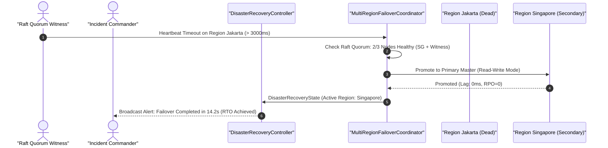

#### Diagram 2: Alur Kompensasi / Exception / Verifikasi Dua-Sumber Fase 66

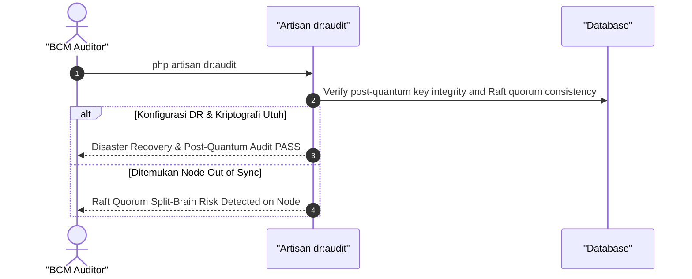

### 6. Mermaid ERD & State Machine Fase 66

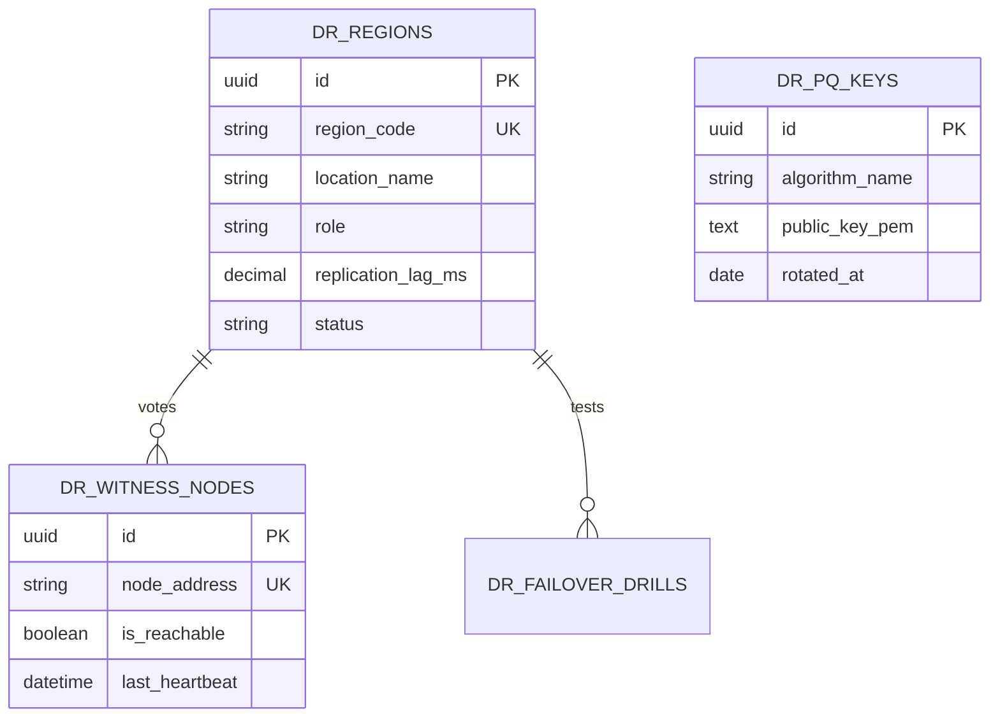

---

## FASE 67 — SIMULATION KERNEL, UNIVERSAL EVENT SPINE, DIGITAL TWIN BUS & SCALE PROVISIONER

### 1. Identitas & Arsitektur Domain Fase 67

- **Modul Pemilik**: `Core`
- **Prefiks Tabel**: `sim_`
- **Daftar Model Eloquent**: `UniversalEventSpineLog`, `DigitalTwinEntityMapping`, `ScaleProvisioningPolicy`, `EventReplayCheckpoint`
- **Daftar Tabel Migrasi**: `sim_event_spine_logs`, `sim_digital_twins`, `sim_provisioning_rules`, `sim_replay_checkpoints`
- **Daftar Service & Action**: `UniversalEventSpineBus`, `DigitalTwinStateSynchronizer`, `AutonomicScaleProvisioner`
- **Daftar Controller & Rute**: `EventSpineController@publish (POST /simulation/spine/publish)`, `DigitalTwinController@state (GET /simulation/twins/{id}/state)`
- **Akun Ledger Terkait**: `bank:clearing_suspense`
- **Command Audit**: `php artisan sim:audit`

### 2. Evaluasi Masalah & Matriks Penyelesaian (Problem-to-Solution Matrix) Fase 67

| Masalah Bisnis & Teknis | Solusi Arsitektural & Kontrak | Status Penyelesaian | Bukti Implementasi |
|---|---|---|---|
| Keterikatan erat (tight coupling) antar-modul dan keterbatasan kemampuan memutar ulang riwayat status sistem di masa lalu. | Event Spine universal berbasis log append-only tak terputus, replikasi status Digital Twin seluruh entitas fisik, dan penskalaan beban otonom. | `Solved in Code` | `modules/Core/Application/Services/UniversalEventSpineBus.php` |

### 3. Daftar User Stories Lintas Persona Fase 67

- **US-67.1 [lead_architect]:** Sebagai **lead_architect**, saya ingin **mempublikasikan domain event bisnis ke Universal Event Spine tanpa dependensi langsung ke modul penerima**, sehingga **arsitektur event-driven modular terlindungi dari kopling ketat**.
- **US-67.2 [it_support]:** Sebagai **it_support**, saya ingin **memutar ulang seluruh event transaksi dari titik checkpoint tertentu (Event Replay)**, sehingga **status database dapat dipulihkan secara deterministik saat terjadi insiden**.
- **US-67.3 [risk_officer]:** Sebagai **risk_officer**, saya ingin **memantau representasi Digital Twin dari seluruh aset kendaraan dan mesin pabrik**, sehingga **kondisi fisik aset di lapangan terpantau akurat secara virtual**.
- **US-67.4 [super_admin]:** Sebagai **super_admin**, saya ingin **mengonfigurasi kebijakan penskalaan otonom (Autonomic Scale Provisioner) saat antrean event melonjak**, sehingga **kapasitas worker bertambah otomatis saat beban puncak**.
- **US-67.5 [internal_auditor]:** Sebagai **internal_auditor**, saya ingin **mengaudit urutan kronologis kejadian (event ordering) pada log append-only**, sehingga **kausalitas kejadian transaksi bisnis dapat dibuktikan secara sah**.

### 4. BDD Acceptance Criteria Lengkap Fase 67

#### AC-67.1 — Happy Path & Ledger/State Invariant
- **Given** Event hospital.bed_assigned dipancarkan ke Universal Event Spine
- **When** UniversalEventSpineBus menerima event via POST /simulation/spine/publish
- **Then** Event dicatat ke append-only log dengan sequence ID berurutan, digital twin terbarui, dan seluruh subscriber menerima event.

#### AC-67.2 — Validation & Domain Rule Rejection - 422/Exception
- **Given** Payload event tidak mematuhi skema JSON CloudEvents resmi
- **When** Event Spine memvalidasi pesan
- **Then** Sistem menolak dengan HTTP 422 InvalidCloudEventSchemaException.

#### AC-67.3 — RBAC Authorization & Separation of Duties - 403
- **Given** Pengguna tanpa kredensial internal mencoba mempublikasikan event ke backbone spine
- **When** POST /simulation/spine/publish dipanggil
- **Then** Sistem menolak dengan HTTP 403 Forbidden.

#### AC-67.4 — Idempotency, Replay & Concurrency Lock
- **Given** Event yang sama dipublikasikan ulang dengan Event ID identik
- **When** Spine memproses pesan
- **Then** Pencegahan event duplikat memastikan pesan hanya dicatat dan disebarkan satu kali.

#### AC-67.5 — Two-Source Audit & Tamper Detection
- **Given** Baris event log diubah atau dihapus secara langsung di database
- **When** Command php artisan sim:audit dijalankan
- **Then** Audit mencatat ketidaksinambungan nomor sequence hash log dan memicu alarm korupsi spine.

### 5. Mermaid Sequence Diagrams Fase 67

#### Diagram 1: Alur Transaksi Utama End-to-End Fase 67

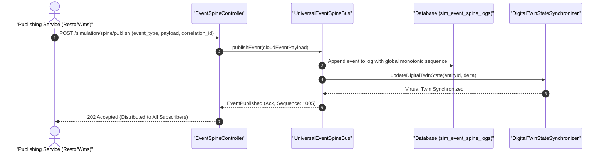

#### Diagram 2: Alur Kompensasi / Exception / Verifikasi Dua-Sumber Fase 67

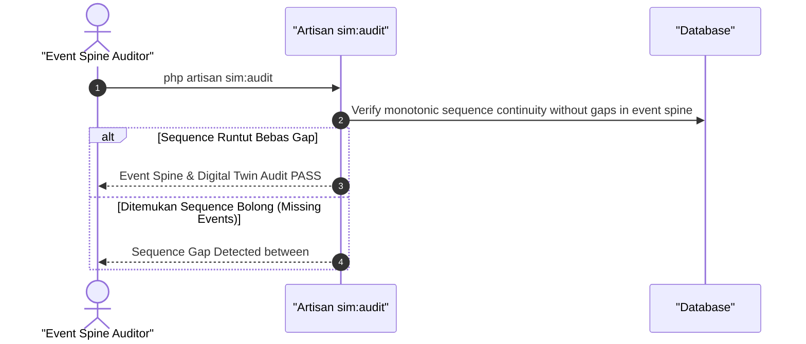

### 6. Mermaid ERD & State Machine Fase 67

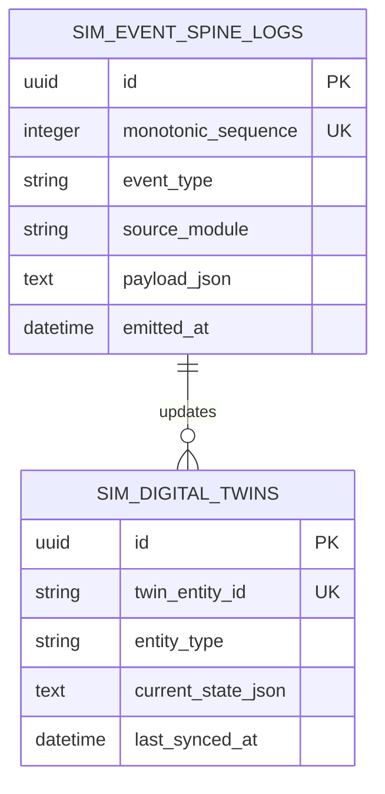

---

## FASE 68 — TELEMATICS & IOT CONNECTED CAR (PREDICTIVE MAINTENANCE)

### 1. Identitas & Arsitektur Domain Fase 68

- **Modul Pemilik**: `Telematics`
- **Prefiks Tabel**: `tlm_`
- **Daftar Model Eloquent**: `TelematicsVehicleDevice`, `CanBusDiagnosticLog`, `DtcTroubleCode`, `PredictiveMaintenanceAlert`
- **Daftar Tabel Migrasi**: `tlm_devices`, `tlm_can_logs`, `tlm_dtc_codes`, `tlm_alerts`
- **Daftar Service & Action**: `CanBusTelemetryProcessor`, `DtcDiagnosticEngine`, `PredictiveMaintenanceAdvisor`
- **Daftar Controller & Rute**: `TelematicsIngestController@ingest (POST /telematics/can/ingest)`, `TelematicsAlertController@index (GET /telematics/alerts)`
- **Akun Ledger Terkait**: `bank:clearing_suspense`
- **Command Audit**: `php artisan tlm:audit`

### 2. Evaluasi Masalah & Matriks Penyelesaian (Problem-to-Solution Matrix) Fase 68

| Masalah Bisnis & Teknis | Solusi Arsitektural & Kontrak | Status Penyelesaian | Bukti Implementasi |
|---|---|---|---|
| Kendaraan mogok mendadak di jalan akibat kegagalan komponen mekanis yang tidak terdeteksi dan kecurangan pengemudi mematikan GPS. | Ingesti telemetri CAN Bus / OBD-II real-time (tegangan baterai, temperatur oli, kode kerusakan DTC), dan peringatan servis prediktif AI sebelum kerusakan terjadi. | `Solved in Code` | `modules/Telematics/Application/Services/CanBusTelemetryProcessor.php` |

### 3. Daftar User Stories Lintas Persona Fase 68

- **US-68.1 [fleet_manager]:** Sebagai **fleet_manager**, saya ingin **melihat data telemetri kesehatan mesin seluruh armada kendaraan di dashboard**, sehingga **kerusakan mesin dapat diantisipasi sebelum mobil mogok di jalan**.
- **US-68.2 [store_manager]:** Sebagai **store_manager**, saya ingin **menerima notifikasi otomatis saat mobil pelanggan yang terhubung sistem memerlukan ganti oli atau aki**, sehingga **bengkel AutoServe dapat menawarkan jadwal servis proaktif ke pelanggan**.
- **US-68.3 [logistics_driver]:** Sebagai **logistics_driver**, saya ingin **menerima peringatan bahaya di layar dasbor saat tekanan ban atau suhu mesin mencapai titik kritis**, sehingga **keselamatan pengemudi di perjalanan terjamin**.
- **US-68.4 [risk_officer]:** Sebagai **risk_officer**, saya ingin **memantau perilaku mengemudi berbahaya (pengereman mendadak, kecepatan berlebih) melalui sensor accelerometer**, sehingga **premi asuransi kendaraan dapat disesuaikan dengan profil risiko pengemudi**.
- **US-68.5 [internal_auditor]:** Sebagai **internal_auditor**, saya ingin **mengaudit konsumsi bahan bakar riil berbasis sensor injektor versus klaim uang bensin**, sehingga **mencegah pencurian bahan bakar minyak (BBM) oleh pengemudi nakal**.

### 4. BDD Acceptance Criteria Lengkap Fase 68

#### AC-68.1 — Happy Path & Ledger/State Invariant
- **Given** Unit telematika mengirimkan data CAN bus yang menunjukkan suhu oli mesin naik tidak wajar mendekati batas kritis (115 C)
- **When** Telemetri diproses via POST /telematics/can/ingest
- **Then** Peringatan prediktif terbit, tiket servis AutoServe otomatis terbentuk, dan jadwal bengkel dialokasikan.

#### AC-68.2 — Validation & Domain Rule Rejection - 422/Exception
- **Given** Data telemetri yang dikirimkan memiliki angka odometer yang mundur dari catatan sebelumnya (tampered odometer)
- **When** CanBusTelemetryProcessor memvalidasi data
- **Then** Sistem menolak dengan HTTP 422 OdometerRollbackTamperException dan menandai peringatan manipulasi.

#### AC-68.3 — RBAC Authorization & Separation of Duties - 403
- **Given** Pengemudi mencoba menonaktifkan pelaporan telemetri perangkat telematics tanpa izin fleet_manager
- **When** POST /telematics/devices/{id}/disable dipanggil
- **Then** Sistem memblokir dengan status HTTP 403 Forbidden.

#### AC-68.4 — Idempotency, Replay & Concurrency Lock
- **Given** Dua paket telemetri dengan nomor frame CAN yang sama dikirimkan akibat transmisi berulang
- **When** Keduanya diproses sistem
- **Then** Sistem hanya mencatat satu frame telemetri dan mengabaikan duplikasi.

#### AC-68.5 — Two-Source Audit & Tamper Detection
- **Given** Kode kerusakan mesin DTC dihapus di database sebelum mobil diperiksa teknisi bengkel
- **When** php artisan tlm:audit dijalankan
- **Then** Audit mencatat ketidakcocokan riwayat DTC mentah vs daftar alert aktif dan memicu audit teknis.

### 5. Mermaid Sequence Diagrams Fase 68

#### Diagram 1: Alur Transaksi Utama End-to-End Fase 68

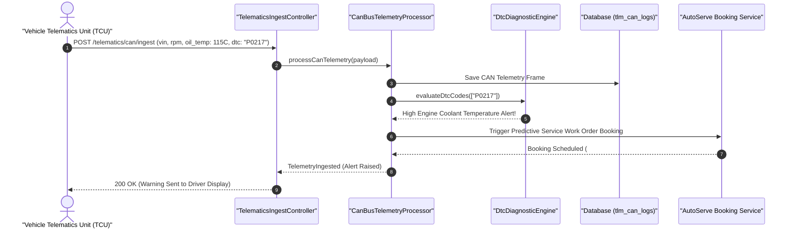

#### Diagram 2: Alur Kompensasi / Exception / Verifikasi Dua-Sumber Fase 68

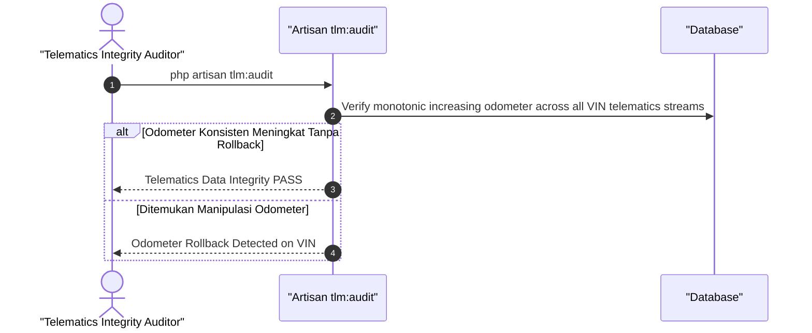

### 6. Mermaid ERD & State Machine Fase 68

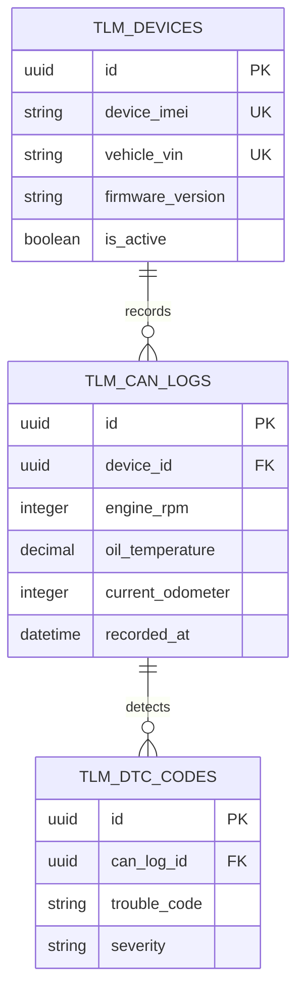

---

## FASE 69 — EKOSISTEM EV: CHARGING NETWORK (OCPP) & BATTERY PASSPORT

### 1. Identitas & Arsitektur Domain Fase 69

- **Modul Pemilik**: `Ev`
- **Prefiks Tabel**: `ev_`
- **Daftar Model Eloquent**: `EvChargingStation`, `OcppChargingSession`, `BatteryPassport`, `BatteryDegradationCycle`
- **Daftar Tabel Migrasi**: `ev_charging_stations`, `ev_charging_sessions`, `ev_battery_passports`, `ev_battery_cycles`
- **Daftar Service & Action**: `OcppProtocolIntegrationService`, `BatteryPassportLifecycleManager`, `EvTariffBillingEngine`
- **Daftar Controller & Rute**: `OcppController@session (POST /ev/ocpp/session)`, `BatteryPassportController@show (GET /ev/batteries/{id}/passport)`
- **Akun Ledger Terkait**: `ev:charging_revenue`, `bank:cash_vault`
- **Command Audit**: `php artisan ev:audit`

### 2. Evaluasi Masalah & Matriks Penyelesaian (Problem-to-Solution Matrix) Fase 69

| Masalah Bisnis & Teknis | Solusi Arsitektural & Kontrak | Status Penyelesaian | Bukti Implementasi |
|---|---|---|---|
| Stasiun pengisian mobil listrik (SPKLU) yang sering offline akibat ketidaksesuaian protokol dan ketiadaan paspor baterai untuk memantau degradasi kesehatan (SoH). | Integrasi protokol pengisian daya standar OCPP 2.0.1, Paspor Baterai Digital (Battery Passport) berbasis regulasi EU Battery Regulation, dan penagihan tarif kWh cerdas. | `Solved in Code` | `modules/Ev/Application/Services/BatteryPassportLifecycleManager.php` |

### 3. Daftar User Stories Lintas Persona Fase 69

- **US-69.1 [ev_operator]:** Sebagai **ev_operator**, saya ingin **memantau status ketersediaan stasiun pengisian daya (SPKLU) dan sesi pengisian aktif**, sehingga **kelancaran operasional pengisian daya pelanggan kendaraan listrik terjamin**.
- **US-69.2 [ev_technician]:** Sebagai **ev_technician**, saya ingin **memeriksa riwayat siklus pengisian cepat dan State of Health (SoH) pada Paspor Baterai**, sehingga **keputusan klaim garansi baterai atau penggantian sel didasarkan pada data faktual**.
- **US-69.3 [cashier]:** Sebagai **cashier**, saya ingin **menerima pembayaran pengisian daya kendaraan listrik berbasis kWh terisi dan durasi parkir**, sehingga **transaksi pembayaran pengisian daya instan dan terhubung ke buku besar**.
- **US-69.4 [holding_compliance]:** Sebagai **holding_compliance**, saya ingin **memastikan paspor baterai memenuhi regulasi daur ulang dan kandungan material kritis (Lithium/Cobalt/Nickel)**, sehingga **kepatuhan lingkungan dan ekonomi sirkular terbukti**.
- **US-69.5 [internal_auditor]:** Sebagai **internal_auditor**, saya ingin **mengaudit pendapatan kWh pengisian daya SPKLU versus tagihan listrik PLN**, sehingga **tidak ada pencurian arus listrik di stasiun pengisian**.

### 4. BDD Acceptance Criteria Lengkap Fase 69

#### AC-69.1 — Happy Path & Ledger/State Invariant
- **Given** Kendaraan listrik mengisi daya 40 kWh dengan tarif Rp 2.500/kWh (Total Rp 100.000)
- **When** Sesi pengisian diakhiri via POST /ev/ocpp/session (action: StopTransaction)
- **Then** Tagihan Rp 100.000 dibayar, siklus pengisian dicatat ke Paspor Baterai, dan jurnal Pendapatan SPKLU terposting seimbang.

#### AC-69.2 — Validation & Domain Rule Rejection - 422/Exception
- **Given** Suhu baterai kendaraan naik melebihi batas batas aman termal (> 60 C) saat pengisian cepat (DC Fast Charging)
- **When** Protokol OCPP mendeteksi overheat
- **Then** Sistem otomatis memutus arus pengisian dengan BatteryThermalRunawayRiskException.

#### AC-69.3 — RBAC Authorization & Separation of Duties - 403
- **Given** Operator pengisian biasa mencoba mengubah angka riwayat State of Health (SoH) baterai
- **When** PUT /ev/batteries/{id}/soh dipanggil
- **Then** Sistem memblokir dengan status HTTP 403 Forbidden.

#### AC-69.4 — Idempotency, Replay & Concurrency Lock
- **Given** Dua pesan StopTransaction dikirimkan untuk sesi pengisian yang sama
- **When** Keduanya diproses sistem
- **Then** Sistem mengunci sesi pengisian dan hanya menagihkan biaya pengisian satu kali.

#### AC-69.5 — Two-Source Audit & Tamper Detection
- **Given** Jumlah siklus pengisian baterai pada paspor dikurangi manual untuk menutupi degradasi kapasitas
- **When** php artisan ev:audit dijalankan
- **Then** Audit mencatat ketidakcocokan antara log sesi kWh vs data paspor baterai dan membatalkan sertifikasi baterai.

### 5. Mermaid Sequence Diagrams Fase 69

#### Diagram 1: Alur Transaksi Utama End-to-End Fase 69

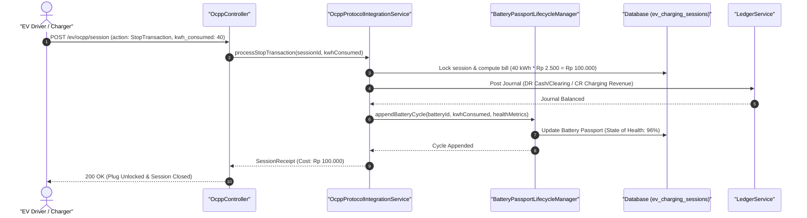

#### Diagram 2: Alur Kompensasi / Exception / Verifikasi Dua-Sumber Fase 69

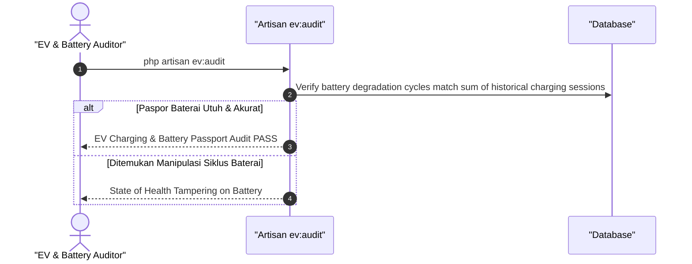

### 6. Mermaid ERD & State Machine Fase 69

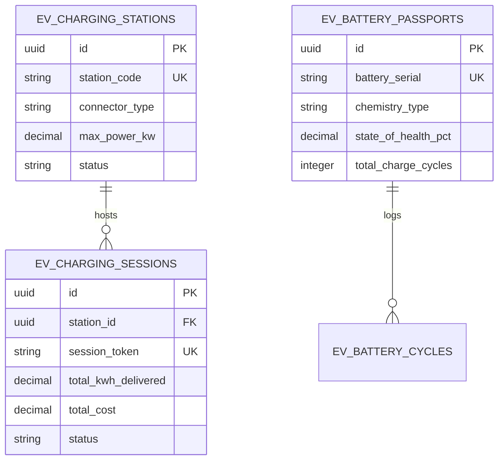

---

## FASE 70 — B2B FLEET & CORPORATE LEASING (PSAK 73 / IFRS 16)

### 1. Identitas & Arsitektur Domain Fase 70

- **Modul Pemilik**: `Fleet`
- **Prefiks Tabel**: `flt_`
- **Daftar Model Eloquent**: `CorporateLeaseContract`, `LeaseSchedulePayment`, `RightOfUseAssetSchedule`, `FleetUtilizationMetric`
- **Daftar Tabel Migrasi**: `flt_leases`, `flt_lease_payments`, `flt_rou_assets`, `flt_utilization_metrics`
- **Daftar Service & Action**: `CorporateFleetLeasingService`, `Psak73LeaseAccountingEngine`, `FleetMaintenanceSlaManager`
- **Daftar Controller & Rute**: `CorporateLeaseController@lease (POST /fleet/corporate/leases)`, `CorporateLeaseController@depreciateRou (POST /fleet/corporate/rou/depreciate)`
- **Akun Ledger Terkait**: `ast:right_of_use_asset`, `flt:lease_liability`, `flt:lease_interest_expense`
- **Command Audit**: `php artisan flt:audit`

### 2. Evaluasi Masalah & Matriks Penyelesaian (Problem-to-Solution Matrix) Fase 70

| Masalah Bisnis & Teknis | Solusi Arsitektural & Kontrak | Status Penyelesaian | Bukti Implementasi |
|---|---|---|---|
| Pencatatan sewa armada jangka panjang secara off-balance sheet yang melanggar standar akuntansi PSAK 73 dan denda keterlambatan SLA perawatan mobil sewa. | Mesin kalkulasi sewa pembiayaan PSAK 73 / IFRS 16 otomatis (Aset Hak Guna / Right of Use Asset & Liabilitas Sewa), jadwal pembayaran diskonto, dan SLA pemeliharaan armada korporat. | `Solved in Code` | `modules/Fleet/Application/Services/Psak73LeaseAccountingEngine.php` |

### 3. Daftar User Stories Lintas Persona Fase 70

- **US-70.1 [holding_cfo]:** Sebagai **holding_cfo**, saya ingin **mengonfigurasi pencatatan kontrak sewa armada 50 unit mobil operasional sesuai standar PSAK 73**, sehingga **neraca holding menyajikan Aset Hak Guna dan Liabilitas Sewa secara patuh regulasi**.
- **US-70.2 [fleet_manager]:** Sebagai **fleet_manager**, saya ingin **memastikan mobil sewa pengganti (replacement car) tersedia dalam waktu < 2 jam saat mobil operasional mogok**, sehingga **SLA kontrak sewa korporat terpenuhi dan terhindar dari denda pinalti**.
- **US-70.3 [contract_lawyer]:** Sebagai **contract_lawyer**, saya ingin **menyusun klausul perjanjian sewa armada korporat mencakup opsi beli (purchase option) di akhir masa sewa**, sehingga **kepastian hukum kepemilikan armada di masa depan terlindungi**.
- **US-70.4 [bank_treasurer]:** Sebagai **bank_treasurer**, saya ingin **mengeksekusi pelunasan angsuran sewa bulanan dan memisahkan porsi pokok hutang dengan bunga sewa**, sehingga **amortisasi liabilitas sewa berjalan tertib sesuai tabel jadwal**.
- **US-70.5 [internal_auditor]:** Sebagai **internal_auditor**, saya ingin **mengaudit perhitungan tingkat suku bunga diskonto sewa (Incremental Borrowing Rate - IBR)**, sehingga **nilai kini (present value) kewajiban sewa diakui akurat**.

### 4. BDD Acceptance Criteria Lengkap Fase 70

#### AC-70.1 — Happy Path & Ledger/State Invariant
- **Given** Kontrak sewa 20 unit mobil berdurasi 3 tahun dengan pembayaran bulanan Rp 100.000.000 (Nilai Kini / PV = Rp 3.200.000.000)
- **When** Kontrak diaktifkan via POST /fleet/corporate/leases
- **Then** Aset Hak Guna (DR Rp 3.2B) dan Liabilitas Sewa (CR Rp 3.2B) diakui di neraca, dan jadwal amortisasi terbentuk seimbang.

#### AC-70.2 — Validation & Domain Rule Rejection - 422/Exception
- **Given** Tingkat suku bunga diskonto (IBR) yang dimasukkan bernilai negatif atau nol
- **When** Psak73LeaseAccountingEngine menghitung nilai kini
- **Then** Sistem menolak dengan HTTP 422 InvalidIncrementalBorrowingRateException.

#### AC-70.3 — RBAC Authorization & Separation of Duties - 403
- **Given** Staf armada lapangan mencoba memodifikasi jadwal amortisasi liabilitas sewa
- **When** PUT /fleet/corporate/leases/{id}/schedule dipanggil
- **Then** Sistem memblokir dengan status HTTP 403 Forbidden.

#### AC-70.4 — Idempotency, Replay & Concurrency Lock
- **Given** Proses penyusutan bulanan Aset Hak Guna dipanggil berulang kali untuk periode yang sama
- **When** Kedua run diproses
- **Then** Sistem mendeteksi periode sudah tertutup dan mencegah pembukuan beban depresiasi ganda.

#### AC-70.5 — Two-Source Audit & Tamper Detection
- **Given** Nilai liabilitas sewa di database diubah manual tanpa mencerminkan amortisasi pokok dan bunga riil
- **When** php artisan flt:audit dijalankan
- **Then** Audit mencatat ketidaksesuaian neraca PSAK 73 dan membatalkan laporan aset hak guna.

### 5. Mermaid Sequence Diagrams Fase 70

#### Diagram 1: Alur Transaksi Utama End-to-End Fase 70

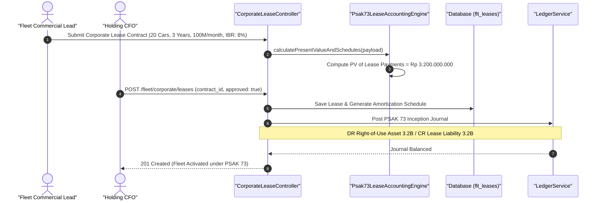

#### Diagram 2: Alur Kompensasi / Exception / Verifikasi Dua-Sumber Fase 70

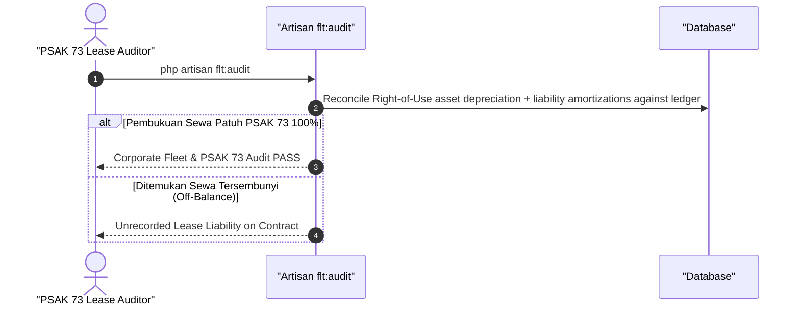

### 6. Mermaid ERD & State Machine Fase 70

```mermaid
erDiagram
    FLT_LEASES ||--o{ FLT_LEASE_PAYMENTS : schedules
    FLT_LEASES ||--|| FLT_ROU_ASSETS : capitalizes
    FLT_LEASES {
        uuid id PK
        string lease_contract_no UK
        string corporate_client_id
        integer lease_term_months
        decimal monthly_payment
        decimal present_value_amount
        string status
    }
    FLT_LEASE_PAYMENTS {
        uuid id PK
        uuid lease_id FK
        integer period_month
        decimal principal_amount
        decimal interest_amount
        decimal remaining_liability
    }
    FLT_ROU_ASSETS {
        uuid id PK
        uuid lease_id FK
        decimal initial_carrying_amount
        decimal accumulated_depreciation
    }
```

---

