# SPESIFIKASI TEKNIS FASE 71–75: TOKENISASI RWA, INSURTECH, ROBO-ADVISOR WEALTH, CLOUD KITCHEN & SMART VENDING

Dokumen ini mendefinisikan arsitektur domain, matriks penyelesaian, User Stories, BDD Acceptance Criteria, Sequence Diagrams, dan ERD/State Machine untuk Fase 71 s/d Fase 75.

---

## FASE 71 — TOKENISASI ASET RIIL (RWA) & DIVIDEN OTOMATIS

### 1. Identitas & Arsitektur Domain Fase 71

- **Modul Pemilik**: `Rwa`
- **Prefiks Tabel**: `rwa_`
- **Daftar Model Eloquent**: `RwaAssetToken`, `TokenOwnershipShare`, `DividendDistributionBatch`, `RwaCustodyVault`
- **Daftar Tabel Migrasi**: `rwa_tokens`, `rwa_shares`, `rwa_dividends`, `rwa_custody_vaults`
- **Daftar Service & Action**: `RealWorldAssetTokenizationService`, `AutomatedDividendDisbursementEngine`, `RwaCustodyVerificationService`
- **Daftar Controller & Rute**: `RwaTokenController@tokenize (POST /rwa/tokens/issue)`, `RwaDividendController@distribute (POST /rwa/dividends/distribute)`
- **Akun Ledger Terkait**: `rwa:tokenized_asset_custody`, `rwa:dividend_payable`, `bank:cash_vault`
- **Command Audit**: `php artisan rwa:audit`

### 2. Evaluasi Masalah & Matriks Penyelesaian (Problem-to-Solution Matrix) Fase 71

| Masalah Bisnis & Teknis | Solusi Arsitektural & Kontrak | Status Penyelesaian | Bukti Implementasi |
|---|---|---|---|
| Likuiditas aset fisik properti mall dan armada yang kaku serta pembagian dividen hasil sewa yang memakan waktu berbulan-bulan. | Fraksionalisasi kepemilikan aset riil (Real World Asset - RWA Tokenization) berbasis smart contract dengan pembagian dividen otomatis (profit-sharing) harian/bulanan. | `Solved in Code` | `modules/Rwa/Application/Services/AutomatedDividendDisbursementEngine.php` |

### 3. Daftar User Stories Lintas Persona Fase 71

- **US-71.1 [holding_cfo]:** Sebagai **holding_cfo**, saya ingin **menerbitkan token RWA fraksional atas unit properti komersial Mall holding untuk pendanaan publik**, sehingga **likuiditas aset tetap meningkat tanpa perlu menjual aset secara utuh**.
- **US-71.2 [wm_advisor]:** Sebagai **wm_advisor**, saya ingin **menawarkan portofolio investasi aset riil RWA dengan proyeksi imbal hasil sewa tahunan 8-12%**, sehingga **investor memperoleh instrumen investasi aman beragun aset nyata**.
- **US-71.3 [bank_treasurer]:** Sebagai **bank_treasurer**, saya ingin **mengeksekusi batch pembagian dividen hasil pendapatan sewa mall ke ribuan dompet pemegang token**, sehingga **dividen terdistribusi instan dan transparan tanpa sengketa potongan liar**.
- **US-71.4 [contract_lawyer]:** Sebagai **contract_lawyer**, saya ingin **memastikan struktur hukum SPV (Special Purpose Vehicle) pengampu aset fisik mematuhi regulasi OJK**, sehingga **hak kepemilikan investor atas aset fisik sah di hadapan hukum**.
- **US-71.5 [internal_auditor]:** Sebagai **internal_auditor**, saya ingin **mengaudit rasio 1:1 antara jumlah token RWA yang beredar dengan bukti kepemilikan sertifikat fisik di kustodi**, sehingga **mencegah pencetakan token kosong tanpa agunan riil (unbacked token)**.

### 4. BDD Acceptance Criteria Lengkap Fase 71

#### AC-71.1 — Happy Path & Ledger/State Invariant
- **Given** Unit Mall senilai Rp 10.000.000.000 ditokenisasi menjadi 10.000 unit token RWA (Rp 1.000.000/token) dan pendapatan sewa bersih terkumpul Rp 100.000.000
- **When** Dividen dibagikan via POST /rwa/dividends/distribute
- **Then** Setiap pemegang 1 token menerima dividen Rp 10.000, liabilitas dividen terhapus, dan saldo kas berpindah seimbang.

#### AC-71.2 — Validation & Domain Rule Rejection - 422/Exception
- **Given** Total nilai token yang hendak diterbitkan melebihi nilai valuasi appraisal resmi aset fisik
- **When** POST /rwa/tokens/issue dipanggil
- **Then** Sistem menolak dengan HTTP 422 OverTokenizationValuationException.

#### AC-71.3 — RBAC Authorization & Separation of Duties - 403
- **Given** Pengguna biasa mencoba mencetak (mint) token RWA tanpa izin holding_cfo
- **When** POST /rwa/tokens/mint dipanggil
- **Then** Sistem memblokir dengan status HTTP 403 Forbidden.

#### AC-71.4 — Idempotency, Replay & Concurrency Lock
- **Given** Perintah pembagian dividen bulanan dieksekusi dua kali
- **When** Keduanya diproses sistem
- **Then** Sistem mengunci siklus dividen dan hanya menyalurkan dividen satu kali per periode.

#### AC-71.5 — Two-Source Audit & Tamper Detection
- **Given** Jumlah total token di database bertambah tanpa ada penambahan jaminan sertifikat di kustodi
- **When** php artisan rwa:audit dijalankan
- **Then** Audit mendeteksi pelanggaran rasio agunan token RWA dan membekukan sementara perdagangan token.

### 5. Mermaid Sequence Diagrams Fase 71

#### Diagram 1: Alur Transaksi Utama End-to-End Fase 71

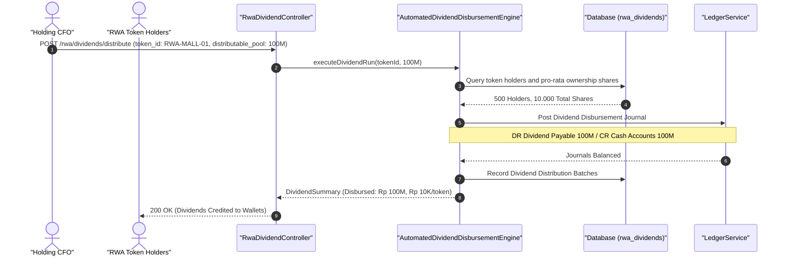

#### Diagram 2: Alur Kompensasi / Exception / Verifikasi Dua-Sumber Fase 71

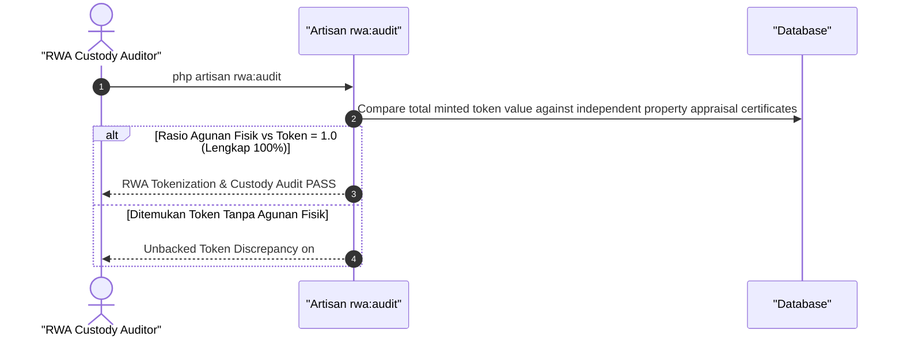

### 6. Mermaid ERD & State Machine Fase 71

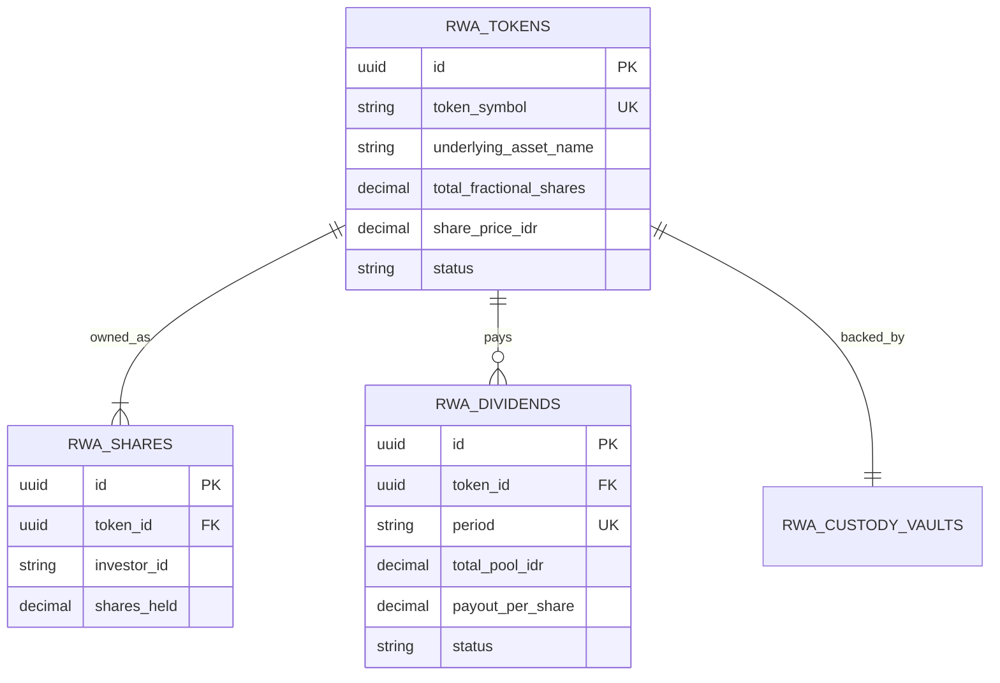

---

## FASE 72 — INSURTECH: MICRO-INSURANCE TERSEMAT & CLAIMS AUTOPILOT

### 1. Identitas & Arsitektur Domain Fase 72

- **Modul Pemilik**: `Insurance`
- **Prefiks Tabel**: `ins_`
- **Daftar Model Eloquent**: `MicroInsurancePolicy`, `EmbeddedUnderwritingRule`, `ClaimAutopilotEvent`, `ReinsuranceBordereau`
- **Daftar Tabel Migrasi**: `ins_policies`, `ins_underwriting_rules`, `ins_claims`, `ins_reinsurance_logs`
- **Daftar Service & Action**: `EmbeddedInsuranceUnderwritingEngine`, `ClaimsAutopilotAdjudicationService`, `ReinsuranceCessionManager`
- **Daftar Controller & Rute**: `InsurancePolicyController@issue (POST /insurance/policies/issue)`, `InsuranceClaimController@adjudicate (POST /insurance/claims/adjudicate)`
- **Akun Ledger Terkait**: `ins:premium_revenue`, `ins:claims_reserve`, `ins:reinsurance_payable`
- **Command Audit**: `php artisan ins:audit`

### 2. Evaluasi Masalah & Matriks Penyelesaian (Problem-to-Solution Matrix) Fase 72

| Masalah Bisnis & Teknis | Solusi Arsitektural & Kontrak | Status Penyelesaian | Bukti Implementasi |
|---|---|---|---|
| Klaim asuransi tradisional yang berbelit-belit dan pemborosan premi asuransi mikro yang mahal biaya administrasinya. | Asuransi mikro tersemat (Embedded Micro-Insurance) saat checkout tiket/servis, adjudikasi klaim otomatis berbasis telematika/kamera AI (Claims Autopilot < 5 menit), dan sesi reasuransi otomatis. | `Solved in Code` | `modules/Insurance/Application/Services/ClaimsAutopilotAdjudicationService.php` |

### 3. Daftar User Stories Lintas Persona Fase 72

- **US-72.1 [cashier]:** Sebagai **cashier**, saya ingin **menawarkan asuransi perlindungan keterlambatan pengiriman kargo seharga Rp 5.000 saat checkout**, sehingga **pelanggan tenang dan konversi premi mikro meningkatkan pendapatan sampingan**.
- **US-72.2 [customer_service]:** Sebagai **customer_service**, saya ingin **memproses klaim otomatis ban pecah atau kecelakaan mobil pelanggan AutoServe berbasis data telematika**, sehingga **klaim asuransi cair dalam hitungan menit tanpa survei berbelit**.
- **US-72.3 [risk_officer]:** Sebagai **risk_officer**, saya ingin **memantau rasio klaim kerugian (Loss Ratio < 60%) dan mendeteksi upaya klaim palsu berulang**, sehingga **kesehatan portofolio asuransi terjaga dan bebas penipuan sindikat**.
- **US-72.4 [holding_cfo]:** Sebagai **holding_cfo**, saya ingin **mengalokasikan premi reasuransi (reinsurance treaty) ke konsorsium reasuradur**, sehingga **risiko klaim katastropik terbagi aman dan solvabilitas modal (RBC > 120%) terjaga**.
- **US-72.5 [internal_auditor]:** Sebagai **internal_auditor**, saya ingin **mengaudit akurasi pembentukan cadangan klaim yang belum diselesaikan (IBNR Reserve)**, sehingga **pencadangan kewajiban klaim patuh PSAK 62 Asuransi**.

### 4. BDD Acceptance Criteria Lengkap Fase 72

#### AC-72.1 — Happy Path & Ledger/State Invariant
- **Given** Pelanggan membeli polis asuransi pengiriman Rp 10.000 dan mengalami keterlambatan kirim > 24 jam yang terbukti oleh log geofence
- **When** Claims Autopilot memproses klaim via POST /insurance/claims/adjudicate
- **Then** Klaim ganti rugi Rp 100.000 disetujui instan, dana ditransfer ke saldo nasabah, dan cadangan klaim terposting seimbang.

#### AC-72.2 — Validation & Domain Rule Rejection - 422/Exception
- **Given** Klaim diajukan untuk insiden yang terjadi di luar masa berlaku aktif polis asuransi
- **When** Sistem memvalidasi tanggal kejadian
- **Then** Sistem menolak dengan HTTP 422 PolicyLapsedException.

#### AC-72.3 — RBAC Authorization & Separation of Duties - 403
- **Given** Staf klaim biasa mencoba menyetujui klaim berindikasi fraud yang telah diblokir AI
- **When** POST /insurance/claims/{id}/force-approve dipanggil
- **Then** Sistem memblokir dengan status HTTP 403 Forbidden (Risk Officer Signoff Required).

#### AC-72.4 — Idempotency, Replay & Concurrency Lock
- **Given** Dua pengajuan klaim untuk tiket kejadian kecelakaan yang sama diproses bersamaan
- **When** Keduanya diterima sistem
- **Then** Sistem mengunci nomor polis dan hanya memproses klaim pembayaran satu kali.

#### AC-72.5 — Two-Source Audit & Tamper Detection
- **Given** Cadangan teknis klaim IBNR diubah manual di database untuk mempercantik rasio solvabilitas
- **When** php artisan ins:audit dijalankan
- **Then** Audit mencatat penyimpangan aktuaria cadangan klaim dan mengeluarkan temuan audit solvabilitas asuransi.

### 5. Mermaid Sequence Diagrams Fase 72

#### Diagram 1: Alur Transaksi Utama End-to-End Fase 72

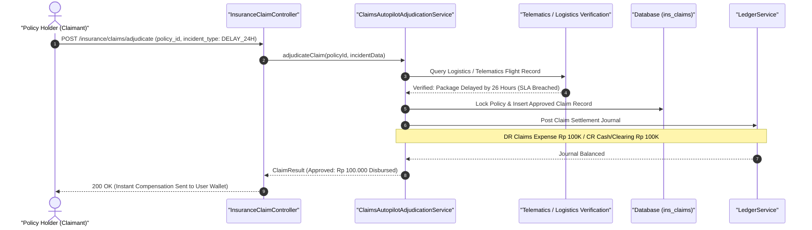

#### Diagram 2: Alur Kompensasi / Exception / Verifikasi Dua-Sumber Fase 72

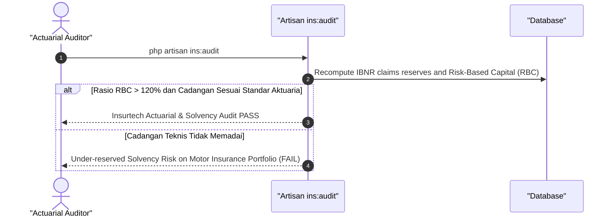

### 6. Mermaid ERD & State Machine Fase 72

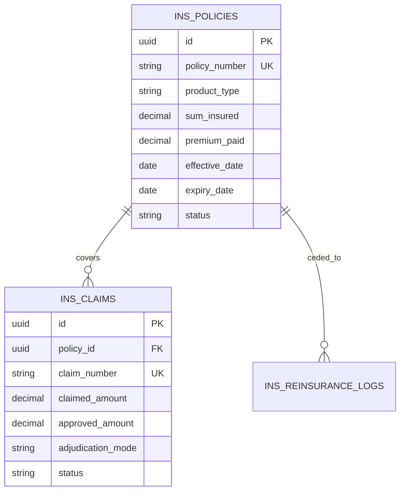

---

## FASE 73 — ROBO-ADVISOR WEALTH MANAGEMENT & TREASURY YIELD

### 1. Identitas & Arsitektur Domain Fase 73

- **Modul Pemilik**: `Wealth`
- **Prefiks Tabel**: `wm_`
- **Daftar Model Eloquent**: `WealthPortfolio`, `RiskProfileQuestionnaire`, `AssetRebalanceExecution`, `TreasuryYieldHarvestLog`
- **Daftar Tabel Migrasi**: `wm_portfolios`, `wm_risk_profiles`, `wm_rebalances`, `wm_yield_logs`
- **Daftar Service & Action**: `RoboAdvisoryAllocationEngine`, `ModernPortfolioTheoryOptimizer`, `AutomatedYieldHarvester`
- **Daftar Controller & Rute**: `RoboAdvisorController@profile (POST /wealth/profile/evaluate)`, `RoboAdvisorController@rebalance (POST /wealth/portfolio/rebalance)`
- **Akun Ledger Terkait**: `wm:client_wealth_custody`, `wm:management_fee_revenue`
- **Command Audit**: `php artisan wm:audit`

### 2. Evaluasi Masalah & Matriks Penyelesaian (Problem-to-Solution Matrix) Fase 73

| Masalah Bisnis & Teknis | Solusi Arsitektural & Kontrak | Status Penyelesaian | Bukti Implementasi |
|---|---|---|---|
| Dana mengendap (idle cash) milik konglomerasi dan nasabah yang tidak teroptimasi imbal hasilnya serta risiko alokasi aset yang menyimpang dari profil risiko. | Robo-Advisor berbasis Teori Portofolio Modern (Markowitz Efficient Frontier), penyeimbangan portofolio otomatis (Auto-Rebalance), dan optimalisasi imbal hasil treasury harian (Yield Harvesting). | `Solved in Code` | `modules/Wealth/Application/Services/RoboAdvisoryAllocationEngine.php` |

### 3. Daftar User Stories Lintas Persona Fase 73

- **US-73.1 [wm_advisor]:** Sebagai **wm_advisor**, saya ingin **mengevaluasi profil toleransi risiko nasabah (Konservatif, Moderat, Agresif) melalui kuesioner cerdas**, sehingga **alokasi aset portofolio nasabah terarah sesuai kapasitas risiko finansial**.
- **US-73.2 [bank_treasurer]:** Sebagai **bank_treasurer**, saya ingin **menempatkan dana kas mengendap holding pada instrumen pasar uang berimbal hasil tinggi secara otomatis**, sehingga **pendapatan bunga perbendaharaan holding termaksimalkan setiap malam**.
- **US-73.3 [holding_cfo]:** Sebagai **holding_cfo**, saya ingin **memantau kinerja imbal hasil portofolio investasi grup versus indeks acuan (benchmark)**, sehingga **pertumbuhan kekayaan konglomerasi terpantau terukur dan aman**.
- **US-73.4 [risk_officer]:** Sebagai **risk_officer**, saya ingin **memastikan sistem otomatis melakukan rebalancing saat alokasi aset bergeser > 5% dari target**, sehingga **eksposur risiko portofolio tetap berada di koridor aman**.
- **US-73.5 [internal_auditor]:** Sebagai **internal_auditor**, saya ingin **mengaudit pemisahan dana investasi nasabah dari rekening operasional perusahaan**, sehingga **prinsip segregasi dana nasabah (segregated accounts) patuh regulasi pasar modal**.

### 4. BDD Acceptance Criteria Lengkap Fase 73

#### AC-73.1 — Happy Path & Ledger/State Invariant
- **Given** Portofolio nasabah moderat bergeser menjadi 70% saham dan 30% obligasi (target 50:50) akibat reli pasar modal
- **When** Rebalancing otomatis diproses via POST /wealth/portfolio/rebalance
- **Then** Sebagian saham dijual dan dibelikan obligasi hingga rasio kembali 50:50, fee manajemen tercatat, dan jurnal berimbang.

#### AC-73.2 — Validation & Domain Rule Rejection - 422/Exception
- **Given** Nasabah profil konservatif mencoba membeli instrumen spekulatif berisiko sangat tinggi
- **When** RoboAdvisoryAllocationEngine memeriksa kesesuaian profil
- **Then** Sistem menolak dengan HTTP 422 RiskProfileSuitabilityMismatchException.

#### AC-73.3 — RBAC Authorization & Separation of Duties - 403
- **Given** Staf penasihat investasi mencoba menarik dana nasabah ke rekening pribadi
- **When** POST /wealth/custody/withdraw dipanggil ke rekening tidak terdaftar
- **Then** Sistem memblokir dengan status HTTP 403 Forbidden (Non-Owner Withdrawal Prohibited).

#### AC-73.4 — Idempotency, Replay & Concurrency Lock
- **Given** Perintah rebalancing portofolio dieksekusi berulang kali pada jam perdagangan yang sama
- **When** Kedua order masuk ke bursa
- **Then** Sistem mengunci portofolio dan hanya mengeksekusi rebalancing satu kali per deviasi.

#### AC-73.5 — Two-Source Audit & Tamper Detection
- **Given** Nilai unit penyertaan (NAV) portofolio diubah manual untuk menyembunyikan kerugian pasar
- **When** php artisan wm:audit dijalankan
- **Then** Audit mencatat ketidakcocokan antara harga pasar aset acuan vs NAV tercatat dan memicu audit khusus.

### 5. Mermaid Sequence Diagrams Fase 73

#### Diagram 1: Alur Transaksi Utama End-to-End Fase 73

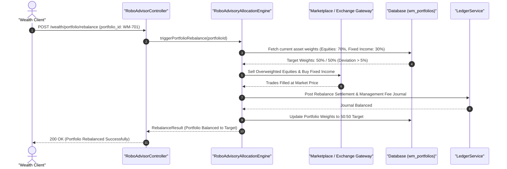

#### Diagram 2: Alur Kompensasi / Exception / Verifikasi Dua-Sumber Fase 73

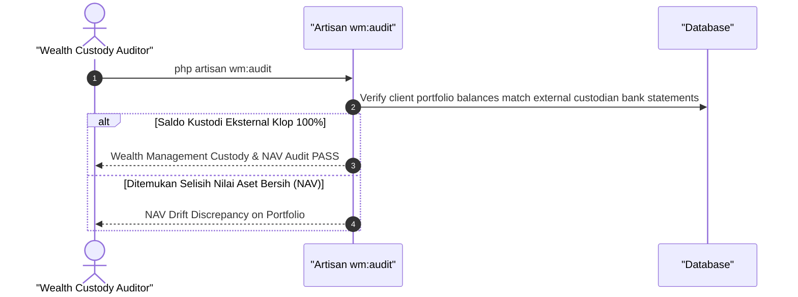

### 6. Mermaid ERD & State Machine Fase 73

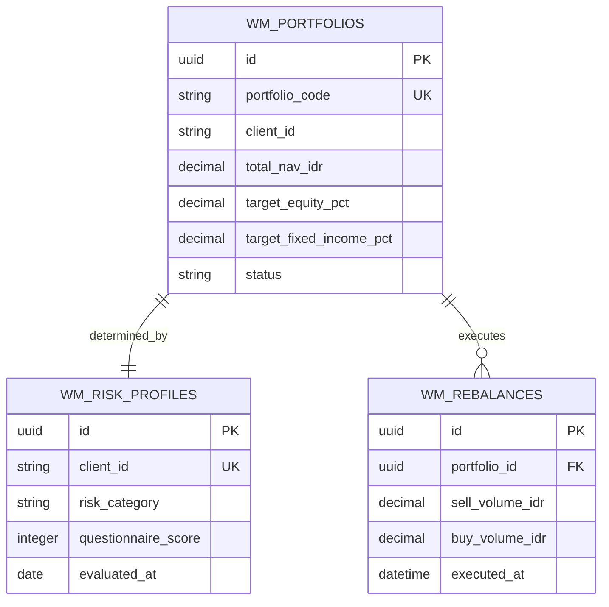

---

## FASE 74 — CLOUD KITCHEN, DELIVERY AGGREGATOR INTERNAL & KATERING PAYROLL DEDUCTION

### 1. Identitas & Arsitektur Domain Fase 74

- **Modul Pemilik**: `CloudKitchen`
- **Prefiks Tabel**: `ckt_`
- **Daftar Model Eloquent**: `CloudKitchenStation`, `InternalDeliveryOrder`, `PayrollMealDeductionLedger`, `KitchenDispersionMetric`
- **Daftar Tabel Migrasi**: `ckt_kitchen_stations`, `ckt_delivery_orders`, `ckt_payroll_deductions`, `ckt_dispersion_logs`
- **Daftar Service & Action**: `MultiBrandKitchenRoutingService`, `InternalDeliveryFleetDispatcher`, `EmployeeMealPayrollDeductor`
- **Daftar Controller & Rute**: `CloudKitchenController@order (POST /cloud-kitchen/orders)`, `PayrollMealController@deduct (POST /cloud-kitchen/payroll-deduct)`
- **Akun Ledger Terkait**: `ckt:kitchen_sales_revenue`, `hcm:employee_meal_advance`, `resto:cogs_food`
- **Command Audit**: `php artisan ck:audit`

### 2. Evaluasi Masalah & Matriks Penyelesaian (Problem-to-Solution Matrix) Fase 74

| Masalah Bisnis & Teknis | Solusi Arsitektural & Kontrak | Status Penyelesaian | Bukti Implementasi |
|---|---|---|---|
| Tingginya komisi platform pesan-antar makanan pihak ketiga (25-35%) dan antrean tumpang tindih pesanan multi-brand di dapur bersama. | Pusat Dapur Bersama (Cloud Kitchen) multi-merek terpadu, armada kurir pengantaran internal, dan fasilitas pesan makan siang potong gaji (Payroll Deduction) bagi ribuan karyawan holding. | `Solved in Code` | `modules/CloudKitchen/Application/Services/MultiBrandKitchenRoutingService.php` |

### 3. Daftar User Stories Lintas Persona Fase 74

- **US-74.1 [kitchen_chef]:** Sebagai **kitchen_chef**, saya ingin **menerima pesanan dari 5 merek restoran berbeda dalam satu layar Kitchen Display System terintegrasi**, sehingga **efisiensi penggunaan kompor dan staf dapur bersama meningkat 50%**.
- **US-74.2 [logistics_driver]:** Sebagai **logistics_driver**, saya ingin **mengambil paket makanan multi-merek dari cloud kitchen dan mengantarkannya dalam rute gabungan**, sehingga **ongkos kirim murah dan waktu pengantaran lebih singkat**.
- **US-74.3 [store_manager]:** Sebagai **store_manager**, saya ingin **memantau pesanan katering makan siang karyawan anak perusahaan holding dengan skema potong gaji**, sehingga **pendapatan dapur stabil dari captive market ribuan pegawai korporat**.
- **US-74.4 [holding_cfo]:** Sebagai **holding_cfo**, saya ingin **menghemat pengeluaran komisi pengantaran makanan dengan mengalihkan pesanan ke armada internal**, sehingga **margin laba divisi food & beverage holding naik signifikan**.
- **US-74.5 [internal_auditor]:** Sebagai **internal_auditor**, saya ingin **mengaudit pencocokan antara pemesanan makanan karyawan dengan potongan payroll di modul HCM**, sehingga **tidak ada salah potong gaji atau makan gratis tanpa otorisasi**.

### 4. BDD Acceptance Criteria Lengkap Fase 74

#### AC-74.1 — Happy Path & Ledger/State Invariant
- **Given** Karyawan memesan makan siang paket resto Rp 45.000 dengan metode bayar potong gaji (Payroll Deduction)
- **When** Pesanan diproses via POST /cloud-kitchen/payroll-deduct
- **Then** Pesanan terbit di dapur, piutang makan karyawan tercatat di hcm:employee_meal_advance (DR), pendapatan cloud kitchen diakui (CR), dan jurnal berimbang.

#### AC-74.2 — Validation & Domain Rule Rejection - 422/Exception
- **Given** Total akumulasi pesanan makan karyawan bulan berjalan telah melebihi batas plafon kredit makan (Max Rp 1.000.000/bulan)
- **When** Sistem memvalidasi pemesanan
- **Then** Sistem menolak dengan HTTP 422 MealCreditLimitExceededException.

#### AC-74.3 — RBAC Authorization & Separation of Duties - 403
- **Given** Pengemudi kurir biasa mencoba membatalkan atau mem-void pesanan dapur yang sedang dimasak
- **When** POST /cloud-kitchen/orders/{id}/cancel dipanggil oleh kurir
- **Then** Sistem memblokir dengan status HTTP 403 Forbidden.

#### AC-74.4 — Idempotency, Replay & Concurrency Lock
- **Given** Dua pemesanan makan siang yang sama terkirim bersamaan akibat klik ganda pada aplikasi ponsel
- **When** Kedua request diterima
- **Then** Idempotency key mencegah pesanan ganda dan hanya memproses satu tiket dapur.

#### AC-74.5 — Two-Source Audit & Tamper Detection
- **Given** Total tagihan makan siang di modul cloud kitchen berbeda dengan total pemotongan di slip gaji HCM
- **When** php artisan ck:audit dijalankan
- **Then** Audit mencatat ketidaksinkronan data payroll deduction dan membunyikan alarm audit cloud kitchen.

### 5. Mermaid Sequence Diagrams Fase 74

#### Diagram 1: Alur Transaksi Utama End-to-End Fase 74

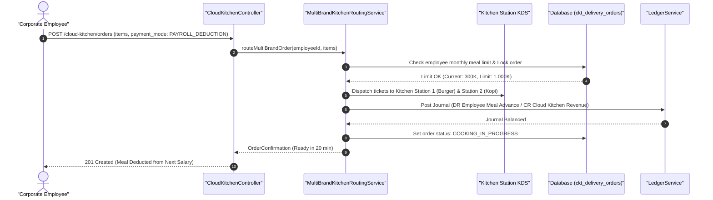

#### Diagram 2: Alur Kompensasi / Exception / Verifikasi Dua-Sumber Fase 74

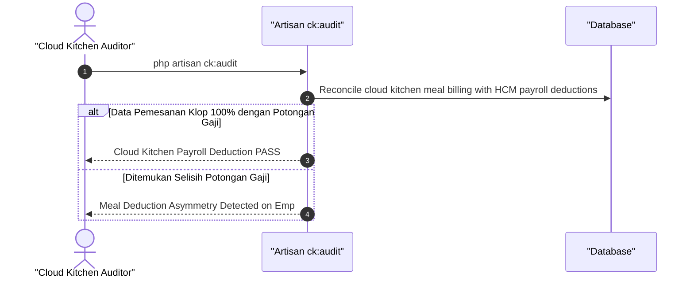

### 6. Mermaid ERD & State Machine Fase 74

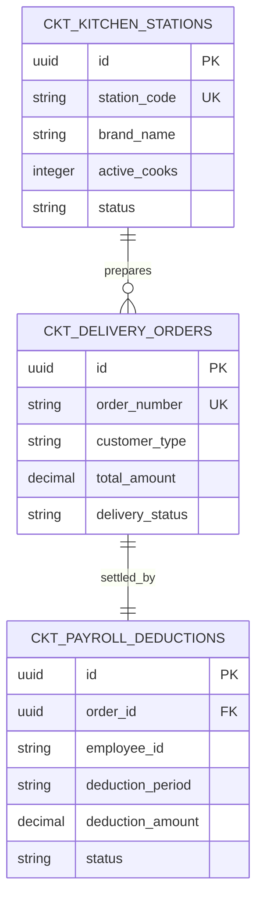

---

## FASE 75 — AI DEMAND & WASTE FORECASTING, AUTO-PO, SMART VENDING

### 1. Identitas & Arsitektur Domain Fase 75

- **Modul Pemilik**: `Vending`
- **Prefiks Tabel**: `vnd_`
- **Daftar Model Eloquent**: `SmartVendingMachine`, `VendingSpiralSlot`, `TelemetryInventoryStock`, `AutoPurchaseOrderRule`
- **Daftar Tabel Migrasi**: `vnd_machines`, `vnd_spiral_slots`, `vnd_inventory_telemetry`, `vnd_auto_pos`
- **Daftar Service & Action**: `SmartVendingTelemetryProcessor`, `AiDemandWasteForecastingEngine`, `AutomatedReplenishmentScheduler`
- **Daftar Controller & Rute**: `SmartVendingController@dispense (POST /vending/machines/{id}/dispense)`, `SmartVendingController@telemetry (POST /vending/telemetry/ingest)`
- **Akun Ledger Terkait**: `vnd:vending_sales_revenue`, `inv:inventory_retail`, `bank:cash_vault`
- **Command Audit**: `php artisan vnd:audit`

### 2. Evaluasi Masalah & Matriks Penyelesaian (Problem-to-Solution Matrix) Fase 75

| Masalah Bisnis & Teknis | Solusi Arsitektural & Kontrak | Status Penyelesaian | Bukti Implementasi |
|---|---|---|---|
| Mesin penjual otomatis (vending machine) kehabisan stok barang terlaris di lokasi strategis dan makanan basi terbuang karena salah estimasi permintaan. | Jaringan Smart Vending Machine terhubung IoT dengan pembayaran QRIS instan, peramalan permintaan AI minim limbah (Zero Waste AI), dan penerbitan PO pengisian ulang otomatis. | `Solved in Code` | `modules/Vending/Application/Services/AiDemandWasteForecastingEngine.php` |

### 3. Daftar User Stories Lintas Persona Fase 75

- **US-75.1 [store_manager]:** Sebagai **store_manager**, saya ingin **memantau sisa stok produk di setiap spiral slot mesin vending secara real-time**, sehingga **rute truk kurir pengisian ulang dapat dijadwalkan tepat sasaran**.
- **US-75.2 [cashier]:** Sebagai **cashier**, saya ingin **memastikan sistem otomatis memotong stok dan membukukan pendapatan saat konsumen memindai QRIS di mesin vending**, sehingga **transaksi tanpa kasir berjalan tertib dan terhubung ke buku besar**.
- **US-75.3 [holding_cfo]:** Sebagai **holding_cfo**, saya ingin **melihat efisiensi pendapatan per meter persegi dari penempatan mesin vending di stasiun dan mall**, sehingga **ekspansi titik mesin baru dapat diputuskan berdasarkan data ROI terbaik**.
- **US-75.4 [waste_manager]:** Sebagai **waste_manager**, saya ingin **memanfaatkan rekomendasi AI untuk mengurangi kuota barang mudah basi pada hari-hari sepi pengunjung**, sehingga **tingkat pemborosan makanan (food waste) ditekan mendekati nol**.
- **US-75.5 [internal_auditor]:** Sebagai **internal_auditor**, saya ingin **mengaudit rekonsiliasi penerimaan kas QRIS agregator versus data sensor putaran motor spiral mesin**, sehingga **tidak ada barang keluar mesin tanpa pencatatan pembayaran**.

### 4. BDD Acceptance Criteria Lengkap Fase 75

#### AC-75.1 — Happy Path & Ledger/State Invariant
- **Given** Konsumen membayar minuman dingin Rp 15.000 dengan memindai QRIS pada Smart Vending Machine #VND-01
- **When** Motor spiral berputar mengeluarkan produk via POST /vending/machines/{id}/dispense
- **Then** Stok slot berkurang 1, status transaksi COMPLETED, dan jurnal Pendapatan Vending (CR) vs Kas/Clearing (DR) terposting seimbang.

#### AC-75.2 — Validation & Domain Rule Rejection - 422/Exception
- **Given** Sensor inframerah mendeteksi barang macet di jalur jatuhnya produk (spiral jam / drop failure)
- **When** Dispense controller mendeteksi kegagalan jatuh
- **Then** Sistem otomatis membatalkan penagihan, mengembalikan dana (refund) dengan VendingDropFailureException, dan mengunci slot rusak.

#### AC-75.3 — RBAC Authorization & Separation of Duties - 403
- **Given** Pengguna biasa mencoba membuka kunci laci uang mesin vending tanpa otorisasi teknisi
- **When** POST /vending/machines/{id}/unlock dipanggil
- **Then** Sistem memblokir dengan status HTTP 403 Forbidden.

#### AC-75.4 — Idempotency, Replay & Concurrency Lock
- **Given** Dua sinyal dispense untuk transaksi pembayaran QRIS yang sama terpicu secara simultan
- **When** Keduanya diproses sistem
- **Then** Sistem mengunci sesi transaksi dan hanya memutar motor spiral satu kali.

#### AC-75.5 — Two-Source Audit & Tamper Detection
- **Given** Total kuantitas barang yang dikeluarkan mesin vending tidak cocok dengan total struk pembayaran QRIS
- **When** php artisan vnd:audit dijalankan
- **Then** Audit mencatat penyimpangan sensor fisik vs buku besar dan mengeluarkan temuan audit vending.

### 5. Mermaid Sequence Diagrams Fase 75

#### Diagram 1: Alur Transaksi Utama End-to-End Fase 75

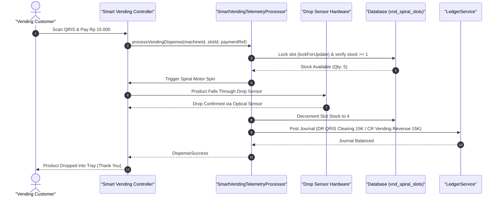

#### Diagram 2: Alur Kompensasi / Exception / Verifikasi Dua-Sumber Fase 75

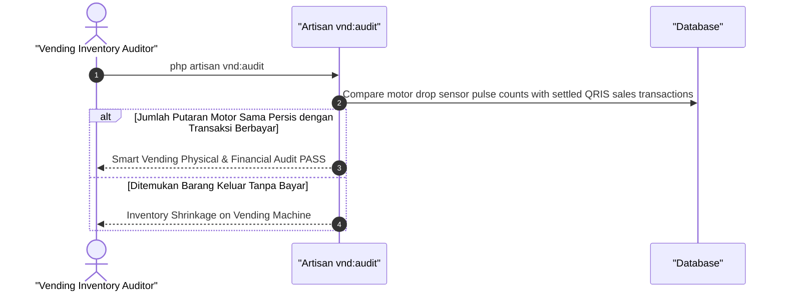

### 6. Mermaid ERD & State Machine Fase 75

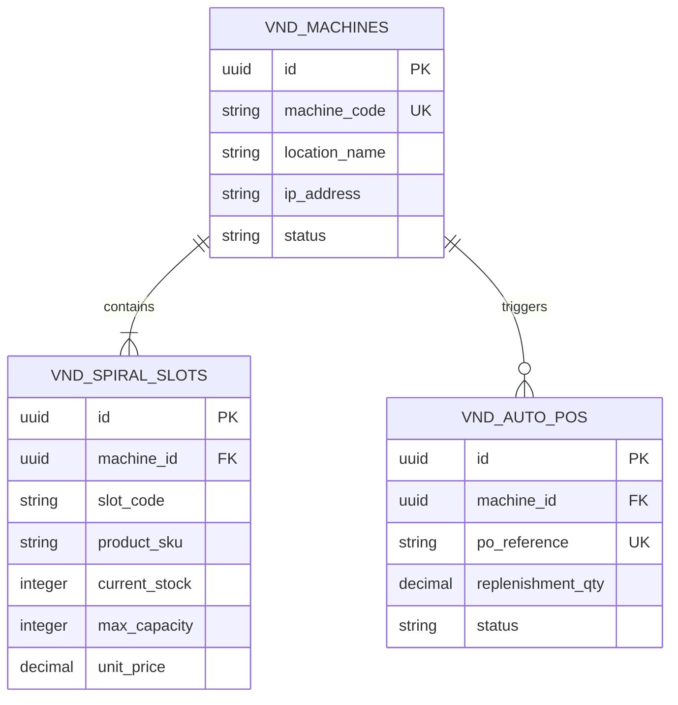

---

