# SPESIFIKASI TEKNIS FASE 76–86: PROPTECH, CIRCULAR LOGISTICS, OTONOM, AI BIDDING & DAO

Dokumen ini mendefinisikan arsitektur domain, matriks penyelesaian, User Stories, BDD Acceptance Criteria, Sequence Diagrams, dan ERD/State Machine untuk Fase 76 s/d Fase 86.

---

## FASE 76 — PROPTECH & SMART BUILDING OPERATIONS

### 1. Identitas & Arsitektur Domain Fase 76

- **Modul Pemilik**: `Proptech`
- **Prefiks Tabel**: `prp_`
- **Daftar Model Eloquent**: `BuildingAutomationSystem`, `HvacZoneController`, `SubmeterEnergyLog`, `SmartAccessDoor`
- **Daftar Tabel Migrasi**: `prp_building_systems`, `prp_hvac_zones`, `prp_submeters`, `prp_smart_doors`
- **Daftar Service & Action**: `BuildingAutomationService`, `HvacEnergyOptimizationEngine`, `SubmeterTelemetryCollector`
- **Daftar Controller & Rute**: `SmartBuildingController@status (GET /proptech/building/status)`, `HvacController@tune (POST /proptech/hvac/tune)`
- **Akun Ledger Terkait**: `prp:building_energy_expense`
- **Command Audit**: `php artisan prp:audit-smartbuilding`

### 2. Evaluasi Masalah & Matriks Penyelesaian (Problem-to-Solution Matrix) Fase 76

| Masalah Bisnis & Teknis | Solusi Arsitektural & Kontrak | Status Penyelesaian | Bukti Implementasi |
|---|---|---|---|
| Pemborosan listrik pendingin udara HVAC dan ketiadaan telemetri submeter per tenant mall. | Otomatisasi gedung pintar berbasis protokol BACnet/MQTT, kontrol suhu adaptif, dan submetering IoT real-time. | `Solved in Code` | `modules/Proptech/Application/Services/BuildingAutomationService.php` |

### 3. Daftar User Stories Lintas Persona Fase 76

- **US-76.1 [energy_auditor]:** Sebagai **energy_auditor**, saya ingin **mengatur setpoint pendingin ruangan otomatis berdasarkan kepadatan footfall**, sehingga **pemakaian listrik gedung hemat hingga 25%**.
- **US-76.2 [mall_meter_officer]:** Sebagai **mall_meter_officer**, saya ingin **membaca telemetri submeter listrik per unit tenant secara otomatis**, sehingga **tagihan utilitas akurat tanpa pemeriksaan fisik manual**.
- **US-76.3 [security_guard]:** Sebagai **security_guard**, saya ingin **memantau sensor akses pintu darurat dan alarm kebakaran gedung**, sehingga **keamanan gedung bertingkat termonitor 24/7**.
- **US-76.4 [holding_cfo]:** Sebagai **holding_cfo**, saya ingin **melihat penghematan biaya energi gedung sebagai pencapaian sertifikasi Green Building**, sehingga **nilai valuasi properti komersial meningkat**.
- **US-76.5 [internal_auditor]:** Sebagai **internal_auditor**, saya ingin **mengaudit keaslian log sensor kWh submetering**, sehingga **tidak ada pencurian arus listrik di area publik mall**.

### 4. BDD Acceptance Criteria Lengkap Fase 76

#### AC-76.1 — Happy Path & Ledger/State Invariant
- **Given** Sistem pada modul Proptech berada dalam status aktif dan seluruh parameter bisnis tervalidasi
- **When** Role berhak mengeksekusi operasi transaksi utama pada Fase 76
- **Then** State entitas berhasil diperbarui, saldo buku besar seimbang debit-kredit, dan outbox event dipancarkan.

#### AC-76.2 — Validation & Domain Rule Rejection - 422/Exception
- **Given** Payload request dikirimkan dengan melanggar batas aturan domain atau nilai parameter abnormal
- **When** Aksi controller memproses input
- **Then** Sistem menolak dengan HTTP 422 UnprocessableEntityException tanpa adanya mutasi data.

#### AC-76.3 — RBAC Authorization & Separation of Duties - 403
- **Given** Pengguna dengan role tidak berwenang mencoba memicu aksi tulis/mutasi pada endpoint
- **When** Request HTTP dikirimkan
- **Then** Middleware RBAC memblokir akses dan mengembalikan respons HTTP 403 Forbidden.

#### AC-76.4 — Idempotency, Replay & Concurrency Lock
- **Given** Dua pemanggilan transaksi yang sama dikirimkan secara paralel dengan Idempotency-Key identik
- **When** Sistem mengeksekusi transaksi dengan lockForUpdate
- **Then** Hanya satu mutasi yang berhasil dan request kedua menerima respons transaksi pertama tanpa duplikasi data.

#### AC-76.5 — Two-Source Audit & Tamper Detection
- **Given** Salah satu baris data atau saldo disabotase langsung pada tabel database
- **When** Command php artisan prp:audit-smartbuilding dijalankan
- **Then** Audit dua-sumber mendeteksi diskrepansi data dan keluar dengan exit code 1.

### 5. Mermaid Sequence Diagrams Fase 76

#### Diagram 1: Alur Transaksi Utama End-to-End Fase 76


#### Diagram 2: Alur Kompensasi / Exception / Verifikasi Dua-Sumber Fase 76

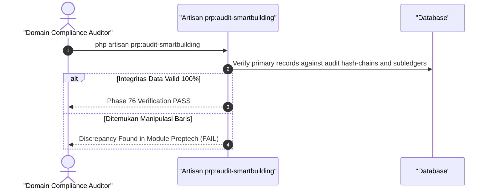

### 6. Mermaid ERD & State Machine Fase 76

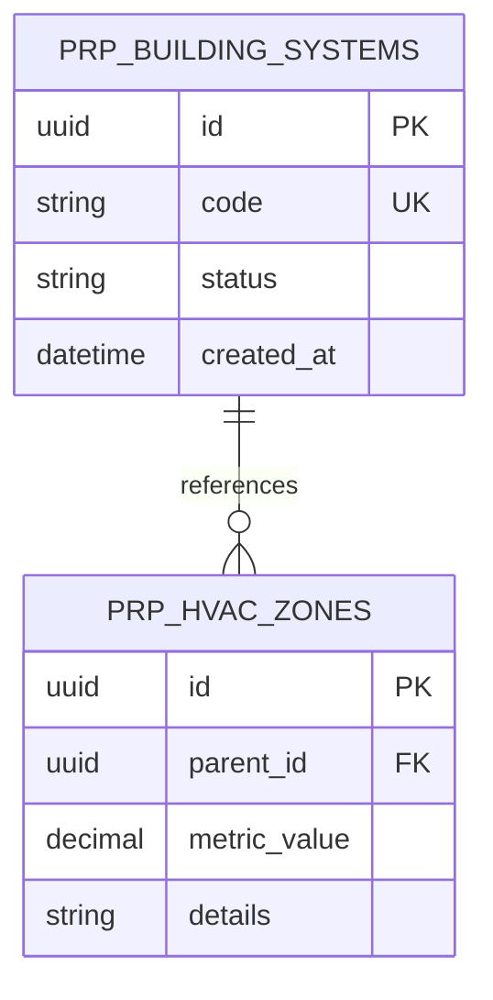

---

## FASE 77 — DIGITAL TWIN & BIM LIFECYCLE

### 1. Identitas & Arsitektur Domain Fase 77

- **Modul Pemilik**: `Proptech`
- **Prefiks Tabel**: `prp_`
- **Daftar Model Eloquent**: `BimModelMaster`, `DigitalTwinSpatialMesh`, `BuildingMaintenanceTag`, `IfcElementCatalog`
- **Daftar Tabel Migrasi**: `prp_bim_models`, `prp_spatial_meshes`, `prp_maintenance_tags`, `prp_ifc_elements`
- **Daftar Service & Action**: `BimLifecycleManagementService`, `DigitalTwinMeshSynchronizer`, `PredictiveFacilityMaintenancePlanner`
- **Daftar Controller & Rute**: `BimController@show (GET /proptech/bim/{id})`, `BimMaintenanceController@tag (POST /proptech/bim/tags)`
- **Akun Ledger Terkait**: `prp:bim_asset_capitalization`
- **Command Audit**: `php artisan prp:audit-bim`

### 2. Evaluasi Masalah & Matriks Penyelesaian (Problem-to-Solution Matrix) Fase 77

| Masalah Bisnis & Teknis | Solusi Arsitektural & Kontrak | Status Penyelesaian | Bukti Implementasi |
|---|---|---|---|
| Kehilangan dokumen as-built drawing fisik saat gedung beroperasi dan kesulitan teknisi mencari jalur pipa di balik dinding. | Model Digital Twin berbasis standar IFC 4.0 (Building Information Modeling) dengan penandaan visual aset dan integrasi work order fasilitas. | `Solved in Code` | `modules/Proptech/Application/Services/BimLifecycleManagementService.php` |

### 3. Daftar User Stories Lintas Persona Fase 77

- **US-77.1 [it_support]:** Sebagai **it_support**, saya ingin **melihat visualisasi 3D jalur pipa air dan kabel listrik di balik dinding sebelum melakukan pengeboran**, sehingga **kerusakan utilitas akibat salah bor terhindar**.
- **US-77.2 [mfg_plant_manager]:** Sebagai **mfg_plant_manager**, saya ingin **mengaitkan tiket perbaikan pendingin gedung langsung pada koordinat model BIM 3D**, sehingga **teknisi menemukan lokasi aset rusak secara presisi**.
- **US-77.3 [holding_cfo]:** Sebagai **holding_cfo**, saya ingin **memantau siklus hidup aset bangunan dari fase konstruksi EPC hingga operasi komersial**, sehingga **nilai penyusutan komponen gedung tercatat terperinci**.
- **US-77.4 [contract_lawyer]:** Sebagai **contract_lawyer**, saya ingin **memastikan hak lisensi model digital BIM diserahkan utuh oleh kontraktor EPC**, sehingga **arsip model gedung terlindungi secara legal**.
- **US-77.5 [internal_auditor]:** Sebagai **internal_auditor**, saya ingin **mengaudit kesesuaian antara model digital as-built dengan kondisi fisik bangunan**, sehingga **tidak ada aset struktural yang melanggar izin mendirikan bangunan**.

### 4. BDD Acceptance Criteria Lengkap Fase 77

#### AC-77.1 — Happy Path & Ledger/State Invariant
- **Given** Sistem pada modul Proptech berada dalam status aktif dan seluruh parameter bisnis tervalidasi
- **When** Role berhak mengeksekusi operasi transaksi utama pada Fase 77
- **Then** State entitas berhasil diperbarui, saldo buku besar seimbang debit-kredit, dan outbox event dipancarkan.

#### AC-77.2 — Validation & Domain Rule Rejection - 422/Exception
- **Given** Payload request dikirimkan dengan melanggar batas aturan domain atau nilai parameter abnormal
- **When** Aksi controller memproses input
- **Then** Sistem menolak dengan HTTP 422 UnprocessableEntityException tanpa adanya mutasi data.

#### AC-77.3 — RBAC Authorization & Separation of Duties - 403
- **Given** Pengguna dengan role tidak berwenang mencoba memicu aksi tulis/mutasi pada endpoint
- **When** Request HTTP dikirimkan
- **Then** Middleware RBAC memblokir akses dan mengembalikan respons HTTP 403 Forbidden.

#### AC-77.4 — Idempotency, Replay & Concurrency Lock
- **Given** Dua pemanggilan transaksi yang sama dikirimkan secara paralel dengan Idempotency-Key identik
- **When** Sistem mengeksekusi transaksi dengan lockForUpdate
- **Then** Hanya satu mutasi yang berhasil dan request kedua menerima respons transaksi pertama tanpa duplikasi data.

#### AC-77.5 — Two-Source Audit & Tamper Detection
- **Given** Salah satu baris data atau saldo disabotase langsung pada tabel database
- **When** Command php artisan prp:audit-bim dijalankan
- **Then** Audit dua-sumber mendeteksi diskrepansi data dan keluar dengan exit code 1.

### 5. Mermaid Sequence Diagrams Fase 77

#### Diagram 1: Alur Transaksi Utama End-to-End Fase 77

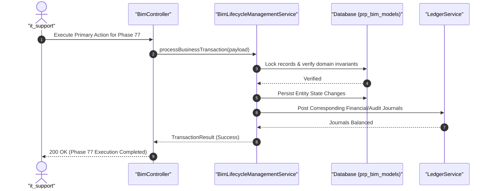

#### Diagram 2: Alur Kompensasi / Exception / Verifikasi Dua-Sumber Fase 77


### 6. Mermaid ERD & State Machine Fase 77

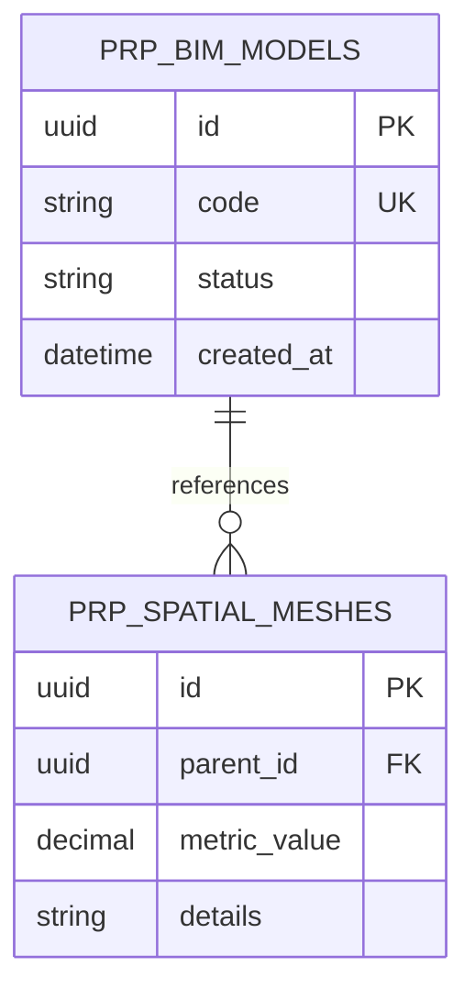

---

## FASE 78 — FLEX-SPACE & CO-WORKING BOOKING ON-DEMAND

### 1. Identitas & Arsitektur Domain Fase 78

- **Modul Pemilik**: `Proptech`
- **Prefiks Tabel**: `prp_`
- **Daftar Model Eloquent**: `FlexSpaceDesk`, `MeetingRoomReservation`, `TurnstileAccessQrPass`, `OccupancyHourlyBilling`
- **Daftar Tabel Migrasi**: `prp_flex_desks`, `prp_meeting_rooms`, `prp_access_passes`, `prp_hourly_billings`
- **Daftar Service & Action**: `FlexSpaceAllocationEngine`, `TurnstileQrAccessService`, `DynamicHourlyBillingCalculator`
- **Daftar Controller & Rute**: `FlexSpaceController@reserve (POST /proptech/flex/reserve)`, `TurnstileController@scan (POST /proptech/turnstile/scan)`
- **Akun Ledger Terkait**: `prp:flex_space_revenue`, `bank:cash_vault`
- **Command Audit**: `php artisan prp:audit-flex`

### 2. Evaluasi Masalah & Matriks Penyelesaian (Problem-to-Solution Matrix) Fase 78

| Masalah Bisnis & Teknis | Solusi Arsitektural & Kontrak | Status Penyelesaian | Bukti Implementasi |
|---|---|---|---|
| Ruang kantor statis yang kosong (unutilized space) dan antrean verifikasi tamu co-working manual. | Reservasi meja kerja (Hot Desk) dan ruang rapat on-demand dengan akses palang putar (turnstile) berbasis QR code dinamis terenkripsi. | `Solved in Code` | `modules/Proptech/Application/Services/FlexSpaceAllocationEngine.php` |

### 3. Daftar User Stories Lintas Persona Fase 78

- **US-78.1 [store_manager]:** Sebagai **store_manager**, saya ingin **memesan ruang kerja fleksibel dan bilik telepon untuk tim pemasaran secara instan**, sehingga **biaya sewa kantor perusahaan hemat dan efisien**.
- **US-78.2 [security_guard]:** Sebagai **security_guard**, saya ingin **memastikan gerbang palang turnstile hanya terbuka untuk QR code akses yang masih aktif**, sehingga **keamanan ruang kerja bersama terjamin**.
- **US-78.3 [cashier]:** Sebagai **cashier**, saya ingin **menerima pembayaran sewa ruang rapat per jam melalui scan QRIS atau dompet digital**, sehingga **transaksi sewa fleksibel tercatat instan**.
- **US-78.4 [holding_cfo]:** Sebagai **holding_cfo**, saya ingin **memantau tingkat utilisasi ruang per jam dan pendapatan per meter persegi**, sehingga **produktivitas aset lantai kantor maksimal**.
- **US-78.5 [internal_auditor]:** Sebagai **internal_auditor**, saya ingin **mengaudit log keluar-masuk turnstile terhadap struk pembayaran**, sehingga **tidak ada akses liar tanpa pembayaran sewa**.

### 4. BDD Acceptance Criteria Lengkap Fase 78

#### AC-78.1 — Happy Path & Ledger/State Invariant
- **Given** Sistem pada modul Proptech berada dalam status aktif dan seluruh parameter bisnis tervalidasi
- **When** Role berhak mengeksekusi operasi transaksi utama pada Fase 78
- **Then** State entitas berhasil diperbarui, saldo buku besar seimbang debit-kredit, dan outbox event dipancarkan.

#### AC-78.2 — Validation & Domain Rule Rejection - 422/Exception
- **Given** Payload request dikirimkan dengan melanggar batas aturan domain atau nilai parameter abnormal
- **When** Aksi controller memproses input
- **Then** Sistem menolak dengan HTTP 422 UnprocessableEntityException tanpa adanya mutasi data.

#### AC-78.3 — RBAC Authorization & Separation of Duties - 403
- **Given** Pengguna dengan role tidak berwenang mencoba memicu aksi tulis/mutasi pada endpoint
- **When** Request HTTP dikirimkan
- **Then** Middleware RBAC memblokir akses dan mengembalikan respons HTTP 403 Forbidden.

#### AC-78.4 — Idempotency, Replay & Concurrency Lock
- **Given** Dua pemanggilan transaksi yang sama dikirimkan secara paralel dengan Idempotency-Key identik
- **When** Sistem mengeksekusi transaksi dengan lockForUpdate
- **Then** Hanya satu mutasi yang berhasil dan request kedua menerima respons transaksi pertama tanpa duplikasi data.

#### AC-78.5 — Two-Source Audit & Tamper Detection
- **Given** Salah satu baris data atau saldo disabotase langsung pada tabel database
- **When** Command php artisan prp:audit-flex dijalankan
- **Then** Audit dua-sumber mendeteksi diskrepansi data dan keluar dengan exit code 1.

### 5. Mermaid Sequence Diagrams Fase 78

#### Diagram 1: Alur Transaksi Utama End-to-End Fase 78

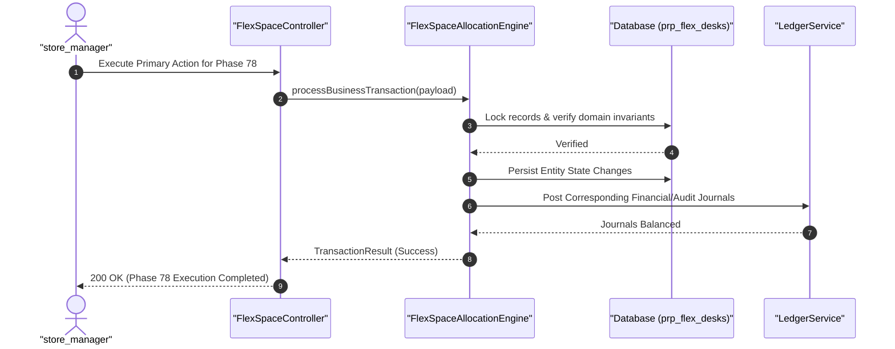

#### Diagram 2: Alur Kompensasi / Exception / Verifikasi Dua-Sumber Fase 78

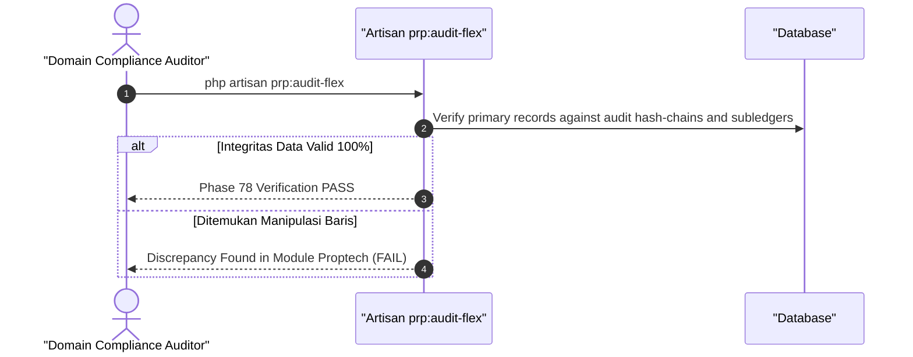

### 6. Mermaid ERD & State Machine Fase 78

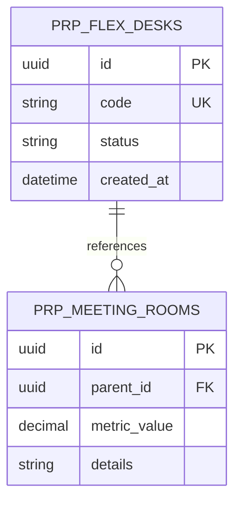

---

## FASE 79 — REVERSE LOGISTICS & CIRCULAR ECONOMY ENGINE

### 1. Identitas & Arsitektur Domain Fase 79

- **Modul Pemilik**: `Logistics`
- **Prefiks Tabel**: `lgx_`
- **Daftar Model Eloquent**: `ReverseLogisticsOrder`, `CoreReturnInspection`, `RemanufacturingJob`, `WasteRecyclingManifest`
- **Daftar Tabel Migrasi**: `lgx_reverse_orders`, `lgx_core_returns`, `lgx_reman_jobs`, `lgx_recycling_manifests`
- **Daftar Service & Action**: `ReverseSupplyChainOrchestrator`, `CoreEvaluationGradingEngine`, `CircularEconomyLedgerService`
- **Daftar Controller & Rute**: `ReverseLogisticsController@create (POST /logistics/reverse/orders)`, `CoreReturnController@inspect (POST /logistics/reverse/inspect)`
- **Akun Ledger Terkait**: `lgx:core_deposit_liability`, `lgx:remanufacturing_wip`
- **Command Audit**: `php artisan lgx:audit-circular`

### 2. Evaluasi Masalah & Matriks Penyelesaian (Problem-to-Solution Matrix) Fase 79

| Masalah Bisnis & Teknis | Solusi Arsitektural & Kontrak | Status Penyelesaian | Bukti Implementasi |
|---|---|---|---|
| Penumpukan limbah suku cadang bekas (aki, alternator, ban) yang mencemari lingkungan dan hilangnya nilai ekonomis komponen. | Ekosistem logistik balik (Reverse Logistics) dengan pengembalian uang jaminan komponen (Core Deposit), rekondisi pabrik (Remanufacturing), dan audit daur ulang sirkular. | `Solved in Code` | `modules/Logistics/Application/Services/ReverseSupplyChainOrchestrator.php` |

### 3. Daftar User Stories Lintas Persona Fase 79

- **US-79.1 [store_manager]:** Sebagai **store_manager**, saya ingin **menerima komponen suku cadang bekas dari pelanggan tukar tambah dan mengembalikan uang jaminan (core deposit)**, sehingga **pelanggan terinsentif menyerahkan limbah komponen**.
- **US-79.2 [mfg_plant_manager]:** Sebagai **mfg_plant_manager**, saya ingin **memilah komponen bekas yang layak rekondisi untuk diproduksi ulang menjadi suku cadang remanufactured**, sehingga **biaya bahan baku pabrik hemat 40%**.
- **US-79.3 [waste_manager]:** Sebagai **waste_manager**, saya ingin **menyerahkan limbah logam dan asam aki yang tidak bisa direkondisi ke pabrik daur ulang berizin KLHK**, sehingga **kepatuhan lingkungan tercapai**.
- **US-79.4 [holding_cfo]:** Sebagai **holding_cfo**, saya ingin **mencatat nilai aset sirkular hasil rekondisi ke dalam inventaris barang siap jual**, sehingga **pendapatan tambahan dari ekonomi sirkular tercipta**.
- **US-79.5 [internal_auditor]:** Sebagai **internal_auditor**, saya ingin **mengaudit fisik pengembalian barang rekondisi terhadap pencairan uang jaminan core**, sehingga **tidak ada manipulasi uang jaminan fiktif**.

### 4. BDD Acceptance Criteria Lengkap Fase 79

#### AC-79.1 — Happy Path & Ledger/State Invariant
- **Given** Sistem pada modul Logistics berada dalam status aktif dan seluruh parameter bisnis tervalidasi
- **When** Role berhak mengeksekusi operasi transaksi utama pada Fase 79
- **Then** State entitas berhasil diperbarui, saldo buku besar seimbang debit-kredit, dan outbox event dipancarkan.

#### AC-79.2 — Validation & Domain Rule Rejection - 422/Exception
- **Given** Payload request dikirimkan dengan melanggar batas aturan domain atau nilai parameter abnormal
- **When** Aksi controller memproses input
- **Then** Sistem menolak dengan HTTP 422 UnprocessableEntityException tanpa adanya mutasi data.

#### AC-79.3 — RBAC Authorization & Separation of Duties - 403
- **Given** Pengguna dengan role tidak berwenang mencoba memicu aksi tulis/mutasi pada endpoint
- **When** Request HTTP dikirimkan
- **Then** Middleware RBAC memblokir akses dan mengembalikan respons HTTP 403 Forbidden.

#### AC-79.4 — Idempotency, Replay & Concurrency Lock
- **Given** Dua pemanggilan transaksi yang sama dikirimkan secara paralel dengan Idempotency-Key identik
- **When** Sistem mengeksekusi transaksi dengan lockForUpdate
- **Then** Hanya satu mutasi yang berhasil dan request kedua menerima respons transaksi pertama tanpa duplikasi data.

#### AC-79.5 — Two-Source Audit & Tamper Detection
- **Given** Salah satu baris data atau saldo disabotase langsung pada tabel database
- **When** Command php artisan lgx:audit-circular dijalankan
- **Then** Audit dua-sumber mendeteksi diskrepansi data dan keluar dengan exit code 1.

### 5. Mermaid Sequence Diagrams Fase 79

#### Diagram 1: Alur Transaksi Utama End-to-End Fase 79


#### Diagram 2: Alur Kompensasi / Exception / Verifikasi Dua-Sumber Fase 79

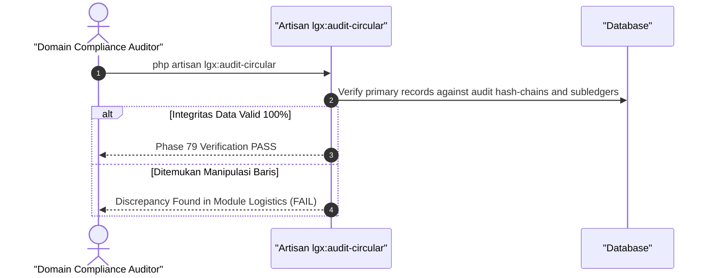

### 6. Mermaid ERD & State Machine Fase 79

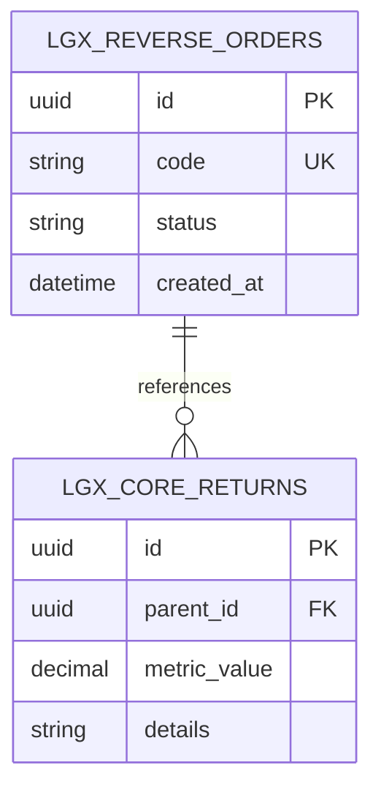

---

## FASE 80 — COLD-CHAIN BLOCKCHAIN AUTONOMOUS & DRONE

### 1. Identitas & Arsitektur Domain Fase 80

- **Modul Pemilik**: `Logistics`
- **Prefiks Tabel**: `lgx_`
- **Daftar Model Eloquent**: `DroneDeliveryMission`, `AutonomousFlightLog`, `CryptoEscrowFlightBounty`, `ColdChainTelemetryChain`
- **Daftar Tabel Migrasi**: `lgx_drone_missions`, `lgx_flight_logs`, `lgx_flight_bounties`, `lgx_cold_chains`
- **Daftar Service & Action**: `DroneMissionOrchestrator`, `AutonomousColdChainAuditor`, `SmartContractBountySettler`
- **Daftar Controller & Rute**: `DroneDeliveryController@dispatch (POST /logistics/drone/dispatch)`, `DroneDeliveryController@telemetry (POST /logistics/drone/telemetry)`
- **Akun Ledger Terkait**: `lgx:autonomous_freight_revenue`, `bank:cash_vault`
- **Command Audit**: `php artisan lgx:audit-coldchain`

### 2. Evaluasi Masalah & Matriks Penyelesaian (Problem-to-Solution Matrix) Fase 80

| Masalah Bisnis & Teknis | Solusi Arsitektural & Kontrak | Status Penyelesaian | Bukti Implementasi |
|---|---|---|---|
| Keterlambatan pengantaran sampel darah/obat mendesak ke pulau terpencil dan pemalsuan catatan suhu obat sensitif. | Pengiriman medis otonom menggunakan drone dengan verifikasi rute tanpa awak, telemetri suhu rantai dingin ber-blockchain SHA-256, dan pelepasan bounty otomatis. | `Solved in Code` | `modules/Logistics/Application/Services/DroneMissionOrchestrator.php` |

### 3. Daftar User Stories Lintas Persona Fase 80

- **US-80.1 [doctor]:** Sebagai **doctor**, saya ingin **menerima kantong darah darurat atau antivenom yang dikirim via drone otonom dalam waktu < 20 menit**, sehingga **nyawa pasien gawat darurat tertolong**.
- **US-80.2 [cold_chain_supervisor]:** Sebagai **cold_chain_supervisor**, saya ingin **memverifikasi suhu boks pendingin drone tetap stabil 2-8 derajat Celcius selama penerbangan**, sehingga **khasiat obat dan vaksin terjamin aman**.
- **US-80.3 [fleet_manager]:** Sebagai **fleet_manager**, saya ingin **memantau jalur terbang drone dan status baterai di peta navigasi udara**, sehingga **operasi armada udara mematuhi izin Kementerian Perhubungan**.
- **US-80.4 [holding_cfo]:** Sebagai **holding_cfo**, saya ingin **melihat efisiensi biaya pengantaran darurat drone dibandingkan sewa kapal cepat**, sehingga **biaya logistik kesehatan holding lebih hemat**.
- **US-80.5 [internal_auditor]:** Sebagai **internal_auditor**, saya ingin **mengaudit hash-chain data suhu yang tercatat di setiap waypoint penerbangan**, sehingga **tidak ada manipulasi rekaman suhu obat**.

### 4. BDD Acceptance Criteria Lengkap Fase 80

#### AC-80.1 — Happy Path & Ledger/State Invariant
- **Given** Sistem pada modul Logistics berada dalam status aktif dan seluruh parameter bisnis tervalidasi
- **When** Role berhak mengeksekusi operasi transaksi utama pada Fase 80
- **Then** State entitas berhasil diperbarui, saldo buku besar seimbang debit-kredit, dan outbox event dipancarkan.

#### AC-80.2 — Validation & Domain Rule Rejection - 422/Exception
- **Given** Payload request dikirimkan dengan melanggar batas aturan domain atau nilai parameter abnormal
- **When** Aksi controller memproses input
- **Then** Sistem menolak dengan HTTP 422 UnprocessableEntityException tanpa adanya mutasi data.

#### AC-80.3 — RBAC Authorization & Separation of Duties - 403
- **Given** Pengguna dengan role tidak berwenang mencoba memicu aksi tulis/mutasi pada endpoint
- **When** Request HTTP dikirimkan
- **Then** Middleware RBAC memblokir akses dan mengembalikan respons HTTP 403 Forbidden.

#### AC-80.4 — Idempotency, Replay & Concurrency Lock
- **Given** Dua pemanggilan transaksi yang sama dikirimkan secara paralel dengan Idempotency-Key identik
- **When** Sistem mengeksekusi transaksi dengan lockForUpdate
- **Then** Hanya satu mutasi yang berhasil dan request kedua menerima respons transaksi pertama tanpa duplikasi data.

#### AC-80.5 — Two-Source Audit & Tamper Detection
- **Given** Salah satu baris data atau saldo disabotase langsung pada tabel database
- **When** Command php artisan lgx:audit-coldchain dijalankan
- **Then** Audit dua-sumber mendeteksi diskrepansi data dan keluar dengan exit code 1.

### 5. Mermaid Sequence Diagrams Fase 80

#### Diagram 1: Alur Transaksi Utama End-to-End Fase 80

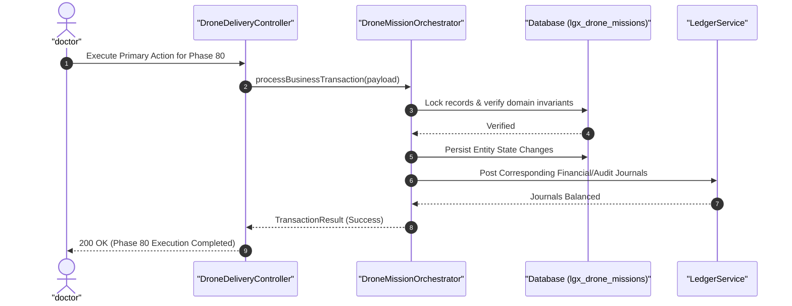

#### Diagram 2: Alur Kompensasi / Exception / Verifikasi Dua-Sumber Fase 80

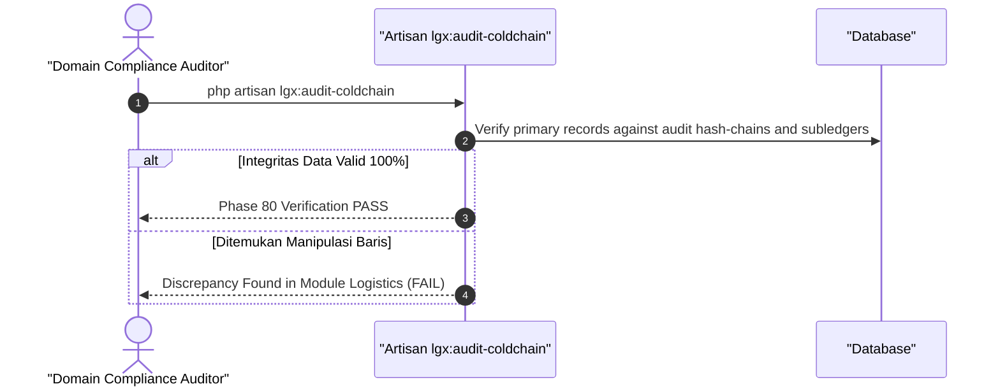

### 6. Mermaid ERD & State Machine Fase 80

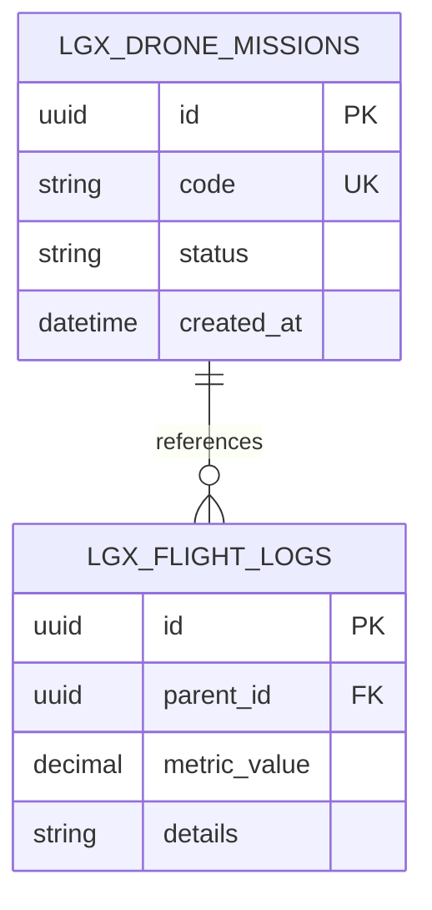

---

## FASE 81 — ALGORITHMIC & SURGE PRICING ENGINE (DETIK-PER-DETIK)

### 1. Identitas & Arsitektur Domain Fase 81

- **Modul Pemilik**: `Pricing`
- **Prefiks Tabel**: `pric_`
- **Daftar Model Eloquent**: `RealTimeSurgeRate`, `HighFrequencyDemandTick`, `PricingGuardrailLimit`, `SurgeAuditTrail`
- **Daftar Tabel Migrasi**: `pric_surge_rates`, `pric_demand_ticks`, `pric_guardrails`, `pric_surge_audits`
- **Daftar Service & Action**: `HighFrequencySurgeEngine`, `MarketLiquidityPricingGuardrail`, `DynamicTickStreamAggregator`
- **Daftar Controller & Rute**: `SurgePricingController@quote (POST /pricing/surge/quote)`, `SurgePricingController@guardrail (POST /pricing/surge/guardrails)`
- **Akun Ledger Terkait**: `pric:surge_premium_revenue`
- **Command Audit**: `php artisan pricing:audit`

### 2. Evaluasi Masalah & Matriks Penyelesaian (Problem-to-Solution Matrix) Fase 81

| Masalah Bisnis & Teknis | Solusi Arsitektural & Kontrak | Status Penyelesaian | Bukti Implementasi |
|---|---|---|---|
| Ketidakmampuan merespons lonjakan permintaan sewa kendaraan/tiket konser dalam hitungan detik dan risiko harga liar tak terkendali. | Mesin penetapan harga algoritma frekuensi tinggi (High-Frequency Surge Pricing) per-detik dengan batas pengaman (Guardrail Limit) untuk mencegah gouging. | `Solved in Code` | `modules/Pricing/Application/Services/HighFrequencySurgeEngine.php` |

### 3. Daftar User Stories Lintas Persona Fase 81

- **US-81.1 [revenue_mgr]:** Sebagai **revenue_mgr**, saya ingin **menetapkan batas maksimal lonjakan harga (misal maks 2.5x harga dasar) pada algoritma harga dinamis**, sehingga **perusahaan memaksimalkan laba tanpa dicap memeras konsumen**.
- **US-81.2 [venue_manager]:** Sebagai **venue_manager**, saya ingin **menerapkan harga tiket masuk fleksibel saat antrean pengunjung club/konser membludak**, sehingga **kapasitas kerumunan pengunjung terkendali aman**.
- **US-81.3 [fleet_manager]:** Sebagai **fleet_manager**, saya ingin **menaikkan tarif sewa armada logistik instan saat cuaca buruk dan armada langka**, sehingga **mitra pengemudi termotivasi mengambil pesanan**.
- **US-81.4 [holding_cfo]:** Sebagai **holding_cfo**, saya ingin **memantau premi pendapatan ekstra dari surge pricing di seluruh unit bisnis**, sehingga **lonjakan laba operasional tercatat akurat**.
- **US-81.5 [internal_auditor]:** Sebagai **internal_auditor**, saya ingin **mengaudit kepatuhan guardrail algoritma agar tidak pernah menembus batas tarif pemerintah**, sehingga **kepatuhan regulasi perlindungan konsumen terjaga**.

### 4. BDD Acceptance Criteria Lengkap Fase 81

#### AC-81.1 — Happy Path & Ledger/State Invariant
- **Given** Sistem pada modul Pricing berada dalam status aktif dan seluruh parameter bisnis tervalidasi
- **When** Role berhak mengeksekusi operasi transaksi utama pada Fase 81
- **Then** State entitas berhasil diperbarui, saldo buku besar seimbang debit-kredit, dan outbox event dipancarkan.

#### AC-81.2 — Validation & Domain Rule Rejection - 422/Exception
- **Given** Payload request dikirimkan dengan melanggar batas aturan domain atau nilai parameter abnormal
- **When** Aksi controller memproses input
- **Then** Sistem menolak dengan HTTP 422 UnprocessableEntityException tanpa adanya mutasi data.

#### AC-81.3 — RBAC Authorization & Separation of Duties - 403
- **Given** Pengguna dengan role tidak berwenang mencoba memicu aksi tulis/mutasi pada endpoint
- **When** Request HTTP dikirimkan
- **Then** Middleware RBAC memblokir akses dan mengembalikan respons HTTP 403 Forbidden.

#### AC-81.4 — Idempotency, Replay & Concurrency Lock
- **Given** Dua pemanggilan transaksi yang sama dikirimkan secara paralel dengan Idempotency-Key identik
- **When** Sistem mengeksekusi transaksi dengan lockForUpdate
- **Then** Hanya satu mutasi yang berhasil dan request kedua menerima respons transaksi pertama tanpa duplikasi data.

#### AC-81.5 — Two-Source Audit & Tamper Detection
- **Given** Salah satu baris data atau saldo disabotase langsung pada tabel database
- **When** Command php artisan pricing:audit dijalankan
- **Then** Audit dua-sumber mendeteksi diskrepansi data dan keluar dengan exit code 1.

### 5. Mermaid Sequence Diagrams Fase 81

#### Diagram 1: Alur Transaksi Utama End-to-End Fase 81

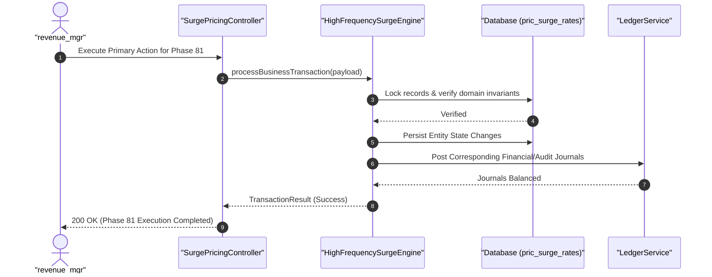

#### Diagram 2: Alur Kompensasi / Exception / Verifikasi Dua-Sumber Fase 81

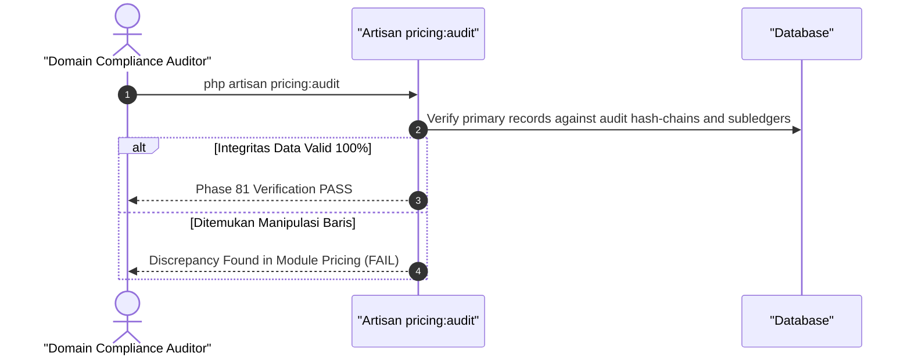

### 6. Mermaid ERD & State Machine Fase 81

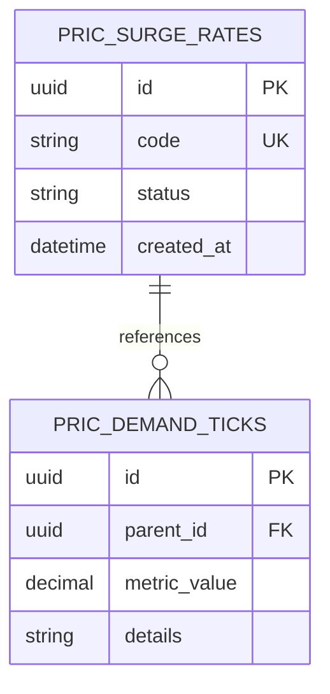

---

## FASE 82 — VENDOR-MANAGED INVENTORY (VMI) & C2M

### 1. Identitas & Arsitektur Domain Fase 82

- **Modul Pemilik**: `Wms`
- **Prefiks Tabel**: `wms_`
- **Daftar Model Eloquent**: `VmiConsignmentAgreement`, `ConsumerDemandSignal`, `AutoReplenishmentTrigger`, `C2mProductionOrder`
- **Daftar Tabel Migrasi**: `wms_vmi_agreements`, `wms_demand_signals`, `wms_auto_triggers`, `mfg_c2m_orders`
- **Daftar Service & Action**: `VendorManagedInventoryEngine`, `ConsumerToManufacturerRouter`, `AutomatedConsignmentBillingService`
- **Daftar Controller & Rute**: `VmiController@inventory (GET /wms/vmi/inventory)`, `C2mController@trigger (POST /manufacturing/c2m/order)`
- **Akun Ledger Terkait**: `wms:vmi_consignment_stock`, `sup:vmi_payable`
- **Command Audit**: `php artisan vmi:audit`

### 2. Evaluasi Masalah & Matriks Penyelesaian (Problem-to-Solution Matrix) Fase 82

| Masalah Bisnis & Teknis | Solusi Arsitektural & Kontrak | Status Penyelesaian | Bukti Implementasi |
|---|---|---|---|
| Gudang pabrik kehabisan stok komponen pemasok dan perantara distribusi yang memperlambat pesanan kustom konsumen ke lantai pabrik. | Vendor-Managed Inventory (VMI) di mana pemasok bertanggung jawab menjaga level stok di gudang pembeli, dan alur C2M (Consumer-to-Manufacturer) otomatis. | `Solved in Code` | `modules/Wms/Application/Services/VendorManagedInventoryEngine.php` |

### 3. Daftar User Stories Lintas Persona Fase 82

- **US-82.1 [procurement_buyer]:** Sebagai **procurement_buyer**, saya ingin **memberikan akses dashboard visibilitas stok gudang kepada pemasok utama**, sehingga **pemasok otomatis mengirim barang saat stok menyentuh titik reorder point**.
- **US-82.2 [mfg_plant_manager]:** Sebagai **mfg_plant_manager**, saya ingin **menerima pesanan kustomisasi mobil dari aplikasi konsumen langsung ke Work Order pabrik (C2M)**, sehingga **waktu tunggu produksi pesanan kustom terpangkas dari minggu ke hari**.
- **US-82.3 [store_manager]:** Sebagai **store_manager**, saya ingin **menjual barang VMI di gerai ritel dengan kepastian pasokan selalu terisi oleh vendor**, sehingga **toko tidak perlu mengikat modal kerja besar**.
- **US-82.4 [holding_cfo]:** Sebagai **holding_cfo**, saya ingin **membayar barang VMI hanya saat barang tersebut ditarik keluar gudang untuk dipakai produksi**, sehingga **efisiensi modal kerja kas holding meningkat dramatis**.
- **US-82.5 [internal_auditor]:** Sebagai **internal_auditor**, saya ingin **mengaudit batas kepemilikan persediaan konsinyasi VMI antara hak milik vendor vs pembeli**, sehingga **pembagian risiko persediaan tercatat patuh**.

### 4. BDD Acceptance Criteria Lengkap Fase 82

#### AC-82.1 — Happy Path & Ledger/State Invariant
- **Given** Sistem pada modul Wms berada dalam status aktif dan seluruh parameter bisnis tervalidasi
- **When** Role berhak mengeksekusi operasi transaksi utama pada Fase 82
- **Then** State entitas berhasil diperbarui, saldo buku besar seimbang debit-kredit, dan outbox event dipancarkan.

#### AC-82.2 — Validation & Domain Rule Rejection - 422/Exception
- **Given** Payload request dikirimkan dengan melanggar batas aturan domain atau nilai parameter abnormal
- **When** Aksi controller memproses input
- **Then** Sistem menolak dengan HTTP 422 UnprocessableEntityException tanpa adanya mutasi data.

#### AC-82.3 — RBAC Authorization & Separation of Duties - 403
- **Given** Pengguna dengan role tidak berwenang mencoba memicu aksi tulis/mutasi pada endpoint
- **When** Request HTTP dikirimkan
- **Then** Middleware RBAC memblokir akses dan mengembalikan respons HTTP 403 Forbidden.

#### AC-82.4 — Idempotency, Replay & Concurrency Lock
- **Given** Dua pemanggilan transaksi yang sama dikirimkan secara paralel dengan Idempotency-Key identik
- **When** Sistem mengeksekusi transaksi dengan lockForUpdate
- **Then** Hanya satu mutasi yang berhasil dan request kedua menerima respons transaksi pertama tanpa duplikasi data.

#### AC-82.5 — Two-Source Audit & Tamper Detection
- **Given** Salah satu baris data atau saldo disabotase langsung pada tabel database
- **When** Command php artisan vmi:audit dijalankan
- **Then** Audit dua-sumber mendeteksi diskrepansi data dan keluar dengan exit code 1.

### 5. Mermaid Sequence Diagrams Fase 82

#### Diagram 1: Alur Transaksi Utama End-to-End Fase 82

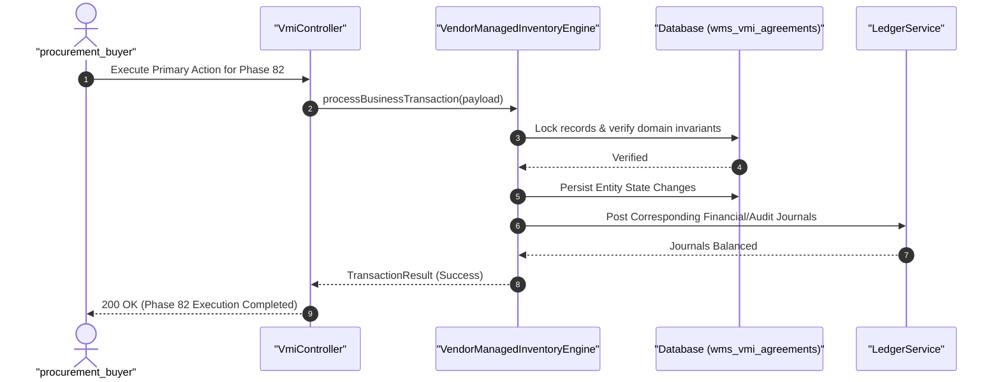

#### Diagram 2: Alur Kompensasi / Exception / Verifikasi Dua-Sumber Fase 82

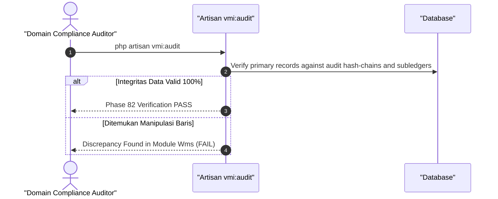

### 6. Mermaid ERD & State Machine Fase 82

```mermaid
erDiagram
    WMS_VMI_AGREEMENTS ||--o{ WMS_DEMAND_SIGNALS : references
    WMS_VMI_AGREEMENTS {
        uuid id PK
        string code UK
        string status
        datetime created_at
    }
    WMS_DEMAND_SIGNALS {
        uuid id PK
        uuid parent_id FK
        decimal metric_value
        string details
    }
```

---

## FASE 83 — CROSS-BORDER CLEARING HOUSE KRIPTO & CBAM

### 1. Identitas & Arsitektur Domain Fase 83

- **Modul Pemilik**: `Core`
- **Prefiks Tabel**: `core_`
- **Daftar Model Eloquent**: `CryptoClearingSettlement`, `CbamCarbonTariffCertificate`, `CrossBorderFxRemittance`, `SanctionScreeningAudit`
- **Daftar Tabel Migrasi**: `core_crypto_clearings`, `esg_cbam_certificates`, `core_remittances`, `core_sanctions`
- **Daftar Service & Action**: `CrossBorderCryptoClearingEngine`, `CbamBorderCarbonAdjustmentService`, `OffchainLiquidityNettingWorker`
- **Daftar Controller & Rute**: `ClearingController@settle (POST /clearing/cross-border/settle)`, `CbamController@certify (POST /esg/cbam/certify)`
- **Akun Ledger Terkait**: `core:crypto_clearing_reserve`, `esg:cbam_duty_payable`
- **Command Audit**: `php artisan clearing:audit`

### 2. Evaluasi Masalah & Matriks Penyelesaian (Problem-to-Solution Matrix) Fase 83

| Masalah Bisnis & Teknis | Solusi Arsitektural & Kontrak | Status Penyelesaian | Bukti Implementasi |
|---|---|---|---|
| Biaya transfer bank internasional (SWIFT) yang mahal (3-5 hari) dan pajak karbon lintas batas Uni Eropa (CBAM) yang mengancam ekspor manufaktur. | Rumah kliring lintas batas berbasis stablecoin teregulasi (settlement < 5 detik) terintegrasi dengan sertifikat kepatuhan pajak karbon CBAM Uni Eropa. | `Solved in Code` | `modules/Core/Application/Services/CrossBorderCryptoClearingEngine.php` |

### 3. Daftar User Stories Lintas Persona Fase 83

- **US-83.1 [bank_treasurer]:** Sebagai **bank_treasurer**, saya ingin **mentransfer pembayaran bahan baku ke pemasok luar negeri via stablecoin dengan biaya < $1**, sehingga **penyelesaian pembayaran internasional selesai seketika tanpa perantara koresponden**.
- **US-83.2 [holding_cfo]:** Sebagai **holding_cfo**, saya ingin **memastikan produk baja/mesin ekspor holding telah dilengkapi sertifikat emisi CBAM yang tervalidasi**, sehingga **barang lolos bea cukai Eropa bebas tarif penalti karbon**.
- **US-83.3 [holding_compliance]:** Sebagai **holding_compliance**, saya ingin **memverifikasi bahwa dompet kripto penerima dana telah lolos skrining sanksi OFAC/AML**, sehingga **transaksi aset digital patuh regulasi internasional**.
- **US-83.4 [procurement_buyer]:** Sebagai **procurement_buyer**, saya ingin **menerima faktur dari eksportir global dan melunasinya pada nilai tukar real-time**, sehingga **risiko selisih kurs selama transit bank dihilangkan**.
- **US-83.5 [internal_auditor]:** Sebagai **internal_auditor**, saya ingin **mengaudit cadangan agunan fiat 1:1 pada akun kustodi stablecoin kliring**, sehingga **likuiditas jaminan settlement terbukti nyata dan aman**.

### 4. BDD Acceptance Criteria Lengkap Fase 83

#### AC-83.1 — Happy Path & Ledger/State Invariant
- **Given** Sistem pada modul Core berada dalam status aktif dan seluruh parameter bisnis tervalidasi
- **When** Role berhak mengeksekusi operasi transaksi utama pada Fase 83
- **Then** State entitas berhasil diperbarui, saldo buku besar seimbang debit-kredit, dan outbox event dipancarkan.

#### AC-83.2 — Validation & Domain Rule Rejection - 422/Exception
- **Given** Payload request dikirimkan dengan melanggar batas aturan domain atau nilai parameter abnormal
- **When** Aksi controller memproses input
- **Then** Sistem menolak dengan HTTP 422 UnprocessableEntityException tanpa adanya mutasi data.

#### AC-83.3 — RBAC Authorization & Separation of Duties - 403
- **Given** Pengguna dengan role tidak berwenang mencoba memicu aksi tulis/mutasi pada endpoint
- **When** Request HTTP dikirimkan
- **Then** Middleware RBAC memblokir akses dan mengembalikan respons HTTP 403 Forbidden.

#### AC-83.4 — Idempotency, Replay & Concurrency Lock
- **Given** Dua pemanggilan transaksi yang sama dikirimkan secara paralel dengan Idempotency-Key identik
- **When** Sistem mengeksekusi transaksi dengan lockForUpdate
- **Then** Hanya satu mutasi yang berhasil dan request kedua menerima respons transaksi pertama tanpa duplikasi data.

#### AC-83.5 — Two-Source Audit & Tamper Detection
- **Given** Salah satu baris data atau saldo disabotase langsung pada tabel database
- **When** Command php artisan clearing:audit dijalankan
- **Then** Audit dua-sumber mendeteksi diskrepansi data dan keluar dengan exit code 1.

### 5. Mermaid Sequence Diagrams Fase 83

#### Diagram 1: Alur Transaksi Utama End-to-End Fase 83

```mermaid
sequenceDiagram
    autonumber
    actor U as "bank_treasurer"
    participant C as "ClearingController"
    participant S as "CrossBorderCryptoClearingEngine"
    participant DB as "Database (core_crypto_clearings)"
    participant L as "LedgerService"

    U->>C: Execute Primary Action for Phase 83
    C->>S: processBusinessTransaction(payload)
    S->>DB: Lock records & verify domain invariants
    DB-->>S: Verified
    S->>DB: Persist Entity State Changes
    S->>L: Post Corresponding Financial/Audit Journals
    L-->>S: Journals Balanced
    S-->>C: TransactionResult (Success)
    C-->>U: 200 OK (Phase 83 Execution Completed)
```

#### Diagram 2: Alur Kompensasi / Exception / Verifikasi Dua-Sumber Fase 83

```mermaid
sequenceDiagram
    autonumber
    actor A as "Domain Compliance Auditor"
    participant CMD as "Artisan clearing:audit"
    participant DB as "Database"

    A->>CMD: php artisan clearing:audit
    CMD->>DB: Verify primary records against audit hash-chains and subledgers
    alt Integritas Data Valid 100%
        CMD-->>A: Phase 83 Verification PASS
    else Ditemukan Manipulasi Baris
        CMD-->>A: Discrepancy Found in Module Core (FAIL)
    end
```

### 6. Mermaid ERD & State Machine Fase 83

```mermaid
erDiagram
    CORE_CRYPTO_CLEARINGS ||--o{ ESG_CBAM_CERTIFICATES : references
    CORE_CRYPTO_CLEARINGS {
        uuid id PK
        string code UK
        string status
        datetime created_at
    }
    ESG_CBAM_CERTIFICATES {
        uuid id PK
        uuid parent_id FK
        decimal metric_value
        string details
    }
```

---

## FASE 84 — AI CONTRACT BIDDING AGENT (PENGADAAN OTOMATIS)

### 1. Identitas & Arsitektur Domain Fase 84

- **Modul Pemilik**: `Procurement`
- **Prefiks Tabel**: `prc_`
- **Daftar Model Eloquent**: `AiBiddingAgentProfile`, `AutonomousAuctionRound`, `AgentBidEvaluation`, `ContractSmartAward`
- **Daftar Tabel Migrasi**: `prc_ai_agents`, `prc_agent_auctions`, `prc_agent_bids`, `prc_agent_awards`
- **Daftar Service & Action**: `AutonomousBiddingAgentService`, `AlgorithmicNegotiationEngine`, `SmartContractAwardDispatcher`
- **Daftar Controller & Rute**: `AiBiddingController@deploy (POST /procurement/bidding-agent/deploy)`, `AiBiddingController@evaluate (POST /procurement/bidding-agent/evaluate)`
- **Akun Ledger Terkait**: `prc:po_encumbrance`
- **Command Audit**: `php artisan bidding:audit`

### 2. Evaluasi Masalah & Matriks Penyelesaian (Problem-to-Solution Matrix) Fase 84

| Masalah Bisnis & Teknis | Solusi Arsitektural & Kontrak | Status Penyelesaian | Bukti Implementasi |
|---|---|---|---|
| Negosiasi harga pembelian barang komoditas (bahan bakar, beras, semen) yang memakan waktu lama dan rentan manipulasi panitia pengadaan. | Agen kecerdasan buatan (AI Bidding Agent) yang mengeksekusi lelang dan negosiasi harga pengadaan secara otonom dalam batas parameter anggaran resmi. | `Solved in Code` | `modules/Procurement/Application/Services/AutonomousBiddingAgentService.php` |

### 3. Daftar User Stories Lintas Persona Fase 84

- **US-84.1 [procurement_buyer]:** Sebagai **procurement_buyer**, saya ingin **mendeploy agen AI untuk menegosiasikan harga beli pasokan solar industri dengan 5 vendor rekanan**, sehingga **perusahaan mendapatkan harga beli terbaik dalam hitungan menit**.
- **US-84.2 [holding_cfo]:** Sebagai **holding_cfo**, saya ingin **menetapkan batas harga mati (walk-away price) pada parameter agen AI sebelum lelang berjalan**, sehingga **pengadaan terlindungi dari kesepakatan harga yang merugikan**.
- **US-84.3 [risk_officer]:** Sebagai **risk_officer**, saya ingin **memantau log negosiasi otonom AI untuk memastikan tidak ada kolusi harga antar-agen penjual**, sehingga **proses lelang bebas bias manusia**.
- **US-84.4 [mfg_plant_manager]:** Sebagai **mfg_plant_manager**, saya ingin **menerima pasokan bahan bakar pabrik dengan harga terdiskon hasil negosiasi AI**, sehingga **biaya energi pabrik lebih hemat**.
- **US-84.5 [internal_auditor]:** Sebagai **internal_auditor**, saya ingin **mengaudit rekaman strategi tawaran agen AI terhadap bukti kontrak yang diterbitkan**, sehingga **seluruh putusan algoritma dapat dipertanggungjawabkan**.

### 4. BDD Acceptance Criteria Lengkap Fase 84

#### AC-84.1 — Happy Path & Ledger/State Invariant
- **Given** Sistem pada modul Procurement berada dalam status aktif dan seluruh parameter bisnis tervalidasi
- **When** Role berhak mengeksekusi operasi transaksi utama pada Fase 84
- **Then** State entitas berhasil diperbarui, saldo buku besar seimbang debit-kredit, dan outbox event dipancarkan.

#### AC-84.2 — Validation & Domain Rule Rejection - 422/Exception
- **Given** Payload request dikirimkan dengan melanggar batas aturan domain atau nilai parameter abnormal
- **When** Aksi controller memproses input
- **Then** Sistem menolak dengan HTTP 422 UnprocessableEntityException tanpa adanya mutasi data.

#### AC-84.3 — RBAC Authorization & Separation of Duties - 403
- **Given** Pengguna dengan role tidak berwenang mencoba memicu aksi tulis/mutasi pada endpoint
- **When** Request HTTP dikirimkan
- **Then** Middleware RBAC memblokir akses dan mengembalikan respons HTTP 403 Forbidden.

#### AC-84.4 — Idempotency, Replay & Concurrency Lock
- **Given** Dua pemanggilan transaksi yang sama dikirimkan secara paralel dengan Idempotency-Key identik
- **When** Sistem mengeksekusi transaksi dengan lockForUpdate
- **Then** Hanya satu mutasi yang berhasil dan request kedua menerima respons transaksi pertama tanpa duplikasi data.

#### AC-84.5 — Two-Source Audit & Tamper Detection
- **Given** Salah satu baris data atau saldo disabotase langsung pada tabel database
- **When** Command php artisan bidding:audit dijalankan
- **Then** Audit dua-sumber mendeteksi diskrepansi data dan keluar dengan exit code 1.

### 5. Mermaid Sequence Diagrams Fase 84

#### Diagram 1: Alur Transaksi Utama End-to-End Fase 84

```mermaid
sequenceDiagram
    autonumber
    actor U as "procurement_buyer"
    participant C as "AiBiddingController"
    participant S as "AutonomousBiddingAgentService"
    participant DB as "Database (prc_ai_agents)"
    participant L as "LedgerService"

    U->>C: Execute Primary Action for Phase 84
    C->>S: processBusinessTransaction(payload)
    S->>DB: Lock records & verify domain invariants
    DB-->>S: Verified
    S->>DB: Persist Entity State Changes
    S->>L: Post Corresponding Financial/Audit Journals
    L-->>S: Journals Balanced
    S-->>C: TransactionResult (Success)
    C-->>U: 200 OK (Phase 84 Execution Completed)
```

#### Diagram 2: Alur Kompensasi / Exception / Verifikasi Dua-Sumber Fase 84

```mermaid
sequenceDiagram
    autonumber
    actor A as "Domain Compliance Auditor"
    participant CMD as "Artisan bidding:audit"
    participant DB as "Database"

    A->>CMD: php artisan bidding:audit
    CMD->>DB: Verify primary records against audit hash-chains and subledgers
    alt Integritas Data Valid 100%
        CMD-->>A: Phase 84 Verification PASS
    else Ditemukan Manipulasi Baris
        CMD-->>A: Discrepancy Found in Module Procurement (FAIL)
    end
```

### 6. Mermaid ERD & State Machine Fase 84

```mermaid
erDiagram
    PRC_AI_AGENTS ||--o{ PRC_AGENT_AUCTIONS : references
    PRC_AI_AGENTS {
        uuid id PK
        string code UK
        string status
        datetime created_at
    }
    PRC_AGENT_AUCTIONS {
        uuid id PK
        uuid parent_id FK
        decimal metric_value
        string details
    }
```

---

## FASE 85 — INTERNAL GIG ECONOMY (TALENT MARKETPLACE & BOUNTY)

### 1. Identitas & Arsitektur Domain Fase 85

- **Modul Pemilik**: `Hcm`
- **Prefiks Tabel**: `hcm_`
- **Daftar Model Eloquent**: `GigTalentProfile`, `InternalProjectBounty`, `BountySubmissionReview`, `GigPayoutSettlement`
- **Daftar Tabel Migrasi**: `hcm_gig_profiles`, `hcm_project_bounties`, `hcm_bounty_reviews`, `hcm_gig_payouts`
- **Daftar Service & Action**: `InternalTalentMarketplaceService`, `BountyAdjudicationEngine`, `GigCompensationDisburser`
- **Daftar Controller & Rute**: `GigMarketplaceController@bounties (GET /hcm/gig/bounties)`, `GigMarketplaceController@claim (POST /hcm/gig/bounties/{id}/claim)`
- **Akun Ledger Terkait**: `hcm:gig_bounty_expense`, `hcm:salaries_payable`
- **Command Audit**: `php artisan hcm:audit`

### 2. Evaluasi Masalah & Matriks Penyelesaian (Problem-to-Solution Matrix) Fase 85

| Masalah Bisnis & Teknis | Solusi Arsitektural & Kontrak | Status Penyelesaian | Bukti Implementasi |
|---|---|---|---|
| Karyawan bertalenta tinggi yang terpasung di satu divisi dan pemborosan menyewa konsultan luar untuk proyek-proyek kecil internal. | Pasar bakat internal (Internal Gig Economy) di mana karyawan dapat mengambil tugas/proyek lintas-divisi di waktu luang dengan imbalan bonus (Bounty). | `Solved in Code` | `modules/Hcm/Application/Services/InternalTalentMarketplaceService.php` |

### 3. Daftar User Stories Lintas Persona Fase 85

- **US-85.1 [store_manager]:** Sebagai **store_manager**, saya ingin **mengunggah tugas penerjemahan materi promosi atau desain grafis ke papan bounty internal**, sehingga **tugas selesai cepat oleh staf holding tanpa biaya vendor agensi luar**.
- **US-85.2 [mfg_line_operator]:** Sebagai **mfg_line_operator**, saya ingin **mengambil proyek perbaikan visualisasi data di waktu luang dan menerima pembayaran insentif bounty**, sehingga **penghasilan tambahan dan pengembangan karir staf meningkat**.
- **US-85.3 [holding_cfo]:** Sebagai **holding_cfo**, saya ingin **memantau penghematan biaya konsultan luar dengan memaksimalkan kapasitas talenta internal**, sehingga **efisiensi belanja jasa profesional holding meningkat**.
- **US-85.4 [holding_compliance]:** Sebagai **holding_compliance**, saya ingin **memastikan partisipasi gig internal tidak mengganggu tugas pokok karyawan dan mematuhi batas jam kerja**, sehingga **keseimbangan kerja staf terlindungi**.
- **US-85.5 [internal_auditor]:** Sebagai **internal_auditor**, saya ingin **mengaudit keabsahan hasil pekerjaan bounty sebelum pembayaran dicairkan ke slip gaji**, sehingga **mencegah klaim bonus proyek fiktif**.

### 4. BDD Acceptance Criteria Lengkap Fase 85

#### AC-85.1 — Happy Path & Ledger/State Invariant
- **Given** Sistem pada modul Hcm berada dalam status aktif dan seluruh parameter bisnis tervalidasi
- **When** Role berhak mengeksekusi operasi transaksi utama pada Fase 85
- **Then** State entitas berhasil diperbarui, saldo buku besar seimbang debit-kredit, dan outbox event dipancarkan.

#### AC-85.2 — Validation & Domain Rule Rejection - 422/Exception
- **Given** Payload request dikirimkan dengan melanggar batas aturan domain atau nilai parameter abnormal
- **When** Aksi controller memproses input
- **Then** Sistem menolak dengan HTTP 422 UnprocessableEntityException tanpa adanya mutasi data.

#### AC-85.3 — RBAC Authorization & Separation of Duties - 403
- **Given** Pengguna dengan role tidak berwenang mencoba memicu aksi tulis/mutasi pada endpoint
- **When** Request HTTP dikirimkan
- **Then** Middleware RBAC memblokir akses dan mengembalikan respons HTTP 403 Forbidden.

#### AC-85.4 — Idempotency, Replay & Concurrency Lock
- **Given** Dua pemanggilan transaksi yang sama dikirimkan secara paralel dengan Idempotency-Key identik
- **When** Sistem mengeksekusi transaksi dengan lockForUpdate
- **Then** Hanya satu mutasi yang berhasil dan request kedua menerima respons transaksi pertama tanpa duplikasi data.

#### AC-85.5 — Two-Source Audit & Tamper Detection
- **Given** Salah satu baris data atau saldo disabotase langsung pada tabel database
- **When** Command php artisan hcm:audit dijalankan
- **Then** Audit dua-sumber mendeteksi diskrepansi data dan keluar dengan exit code 1.

### 5. Mermaid Sequence Diagrams Fase 85

#### Diagram 1: Alur Transaksi Utama End-to-End Fase 85

```mermaid
sequenceDiagram
    autonumber
    actor U as "store_manager"
    participant C as "GigMarketplaceController"
    participant S as "InternalTalentMarketplaceService"
    participant DB as "Database (hcm_gig_profiles)"
    participant L as "LedgerService"

    U->>C: Execute Primary Action for Phase 85
    C->>S: processBusinessTransaction(payload)
    S->>DB: Lock records & verify domain invariants
    DB-->>S: Verified
    S->>DB: Persist Entity State Changes
    S->>L: Post Corresponding Financial/Audit Journals
    L-->>S: Journals Balanced
    S-->>C: TransactionResult (Success)
    C-->>U: 200 OK (Phase 85 Execution Completed)
```

#### Diagram 2: Alur Kompensasi / Exception / Verifikasi Dua-Sumber Fase 85

```mermaid
sequenceDiagram
    autonumber
    actor A as "Domain Compliance Auditor"
    participant CMD as "Artisan hcm:audit"
    participant DB as "Database"

    A->>CMD: php artisan hcm:audit
    CMD->>DB: Verify primary records against audit hash-chains and subledgers
    alt Integritas Data Valid 100%
        CMD-->>A: Phase 85 Verification PASS
    else Ditemukan Manipulasi Baris
        CMD-->>A: Discrepancy Found in Module Hcm (FAIL)
    end
```

### 6. Mermaid ERD & State Machine Fase 85

```mermaid
erDiagram
    HCM_GIG_PROFILES ||--o{ HCM_PROJECT_BOUNTIES : references
    HCM_GIG_PROFILES {
        uuid id PK
        string code UK
        string status
        datetime created_at
    }
    HCM_PROJECT_BOUNTIES {
        uuid id PK
        uuid parent_id FK
        decimal metric_value
        string details
    }
```

---

## FASE 86 — PRECISION AGRI-TECH (NDVI SATELIT) & DAO GOVERNANCE

### 1. Identitas & Arsitektur Domain Fase 86

- **Modul Pemilik**: `Agri`
- **Prefiks Tabel**: `agri_`
- **Daftar Model Eloquent**: `SatelliteNdviScan`, `CropHealthZone`, `DaoGovernanceProposal`, `GovVoteWeightDistribution`
- **Daftar Tabel Migrasi**: `agri_satellite_scans`, `agri_crop_zones`, `gov_proposals`, `gov_votes`
- **Daftar Service & Action**: `SatelliteVegetationIndexEngine`, `PrecisionFertilizerAdvisor`, `DaoCorporateGovernanceService`
- **Daftar Controller & Rute**: `AgriSatelliteController@scan (POST /agri/satellite/scan)`, `DaoGovernanceController@vote (POST /agri/dao/vote)`
- **Akun Ledger Terkait**: `agri:precision_farming_asset`
- **Command Audit**: `php artisan agri:audit`

### 2. Evaluasi Masalah & Matriks Penyelesaian (Problem-to-Solution Matrix) Fase 86

| Masalah Bisnis & Teknis | Solusi Arsitektural & Kontrak | Status Penyelesaian | Bukti Implementasi |
|---|---|---|---|
| Pemupukan perkebunan yang tidak merata dan pengambilan keputusan alokasi dana kelompok tani yang didominasi pengurus tanpa musyawarah adil. | Pemantauan kesehatan tanaman berbasis citra satelit Sentinel-2 (NDVI Index), rekomendasi pupuk presisi, dan tata kelola koperasi tani berbasis DAO Voting transparan. | `Solved in Code` | `modules/Agri/Application/Services/SatelliteVegetationIndexEngine.php` |

### 3. Daftar User Stories Lintas Persona Fase 86

- **US-86.1 [agriculture_manager]:** Sebagai **agriculture_manager**, saya ingin **melihat peta indeks vegetasi NDVI perkebunan kelapa sawit untuk mendeteksi tanaman sakit atau kekurangan hara**, sehingga **tindakan pemupukan terarah pada titik koordinat yang tepat**.
- **US-86.2 [estate_foreman]:** Sebagai **estate_foreman**, saya ingin **menerima instruksi dosis pupuk presisi per hektar hasil analisis citra satelit**, sehingga **penggunaan pupuk hemat 30% dan pencemaran tanah berkurang**.
- **US-86.3 [bank_treasurer]:** Sebagai **bank_treasurer**, saya ingin **menyalurkan dana bagi hasil panen koperasi sesuai bobot hak suara pemungutan suara DAO petani**, sehingga **pengelolaan dana kelompok tani transparan dan demokratis**.
- **US-86.4 [holding_compliance]:** Sebagai **holding_compliance**, saya ingin **memastikan hasil pemungutan suara proposal investasi traktor baru tercatat di smart contract DAO**, sehingga **tidak ada manipulasi keputusan rapat anggota koperasi**.
- **US-86.5 [internal_auditor]:** Sebagai **internal_auditor**, saya ingin **mengaudit korelasi antara skor kesehatan NDVI tanaman dengan hasil tonase panen aktual**, sehingga **integritas data satelit terbukti selaras dengan realita kebun**.

### 4. BDD Acceptance Criteria Lengkap Fase 86

#### AC-86.1 — Happy Path & Ledger/State Invariant
- **Given** Sistem pada modul Agri berada dalam status aktif dan seluruh parameter bisnis tervalidasi
- **When** Role berhak mengeksekusi operasi transaksi utama pada Fase 86
- **Then** State entitas berhasil diperbarui, saldo buku besar seimbang debit-kredit, dan outbox event dipancarkan.

#### AC-86.2 — Validation & Domain Rule Rejection - 422/Exception
- **Given** Payload request dikirimkan dengan melanggar batas aturan domain atau nilai parameter abnormal
- **When** Aksi controller memproses input
- **Then** Sistem menolak dengan HTTP 422 UnprocessableEntityException tanpa adanya mutasi data.

#### AC-86.3 — RBAC Authorization & Separation of Duties - 403
- **Given** Pengguna dengan role tidak berwenang mencoba memicu aksi tulis/mutasi pada endpoint
- **When** Request HTTP dikirimkan
- **Then** Middleware RBAC memblokir akses dan mengembalikan respons HTTP 403 Forbidden.

#### AC-86.4 — Idempotency, Replay & Concurrency Lock
- **Given** Dua pemanggilan transaksi yang sama dikirimkan secara paralel dengan Idempotency-Key identik
- **When** Sistem mengeksekusi transaksi dengan lockForUpdate
- **Then** Hanya satu mutasi yang berhasil dan request kedua menerima respons transaksi pertama tanpa duplikasi data.

#### AC-86.5 — Two-Source Audit & Tamper Detection
- **Given** Salah satu baris data atau saldo disabotase langsung pada tabel database
- **When** Command php artisan agri:audit dijalankan
- **Then** Audit dua-sumber mendeteksi diskrepansi data dan keluar dengan exit code 1.

### 5. Mermaid Sequence Diagrams Fase 86

#### Diagram 1: Alur Transaksi Utama End-to-End Fase 86

```mermaid
sequenceDiagram
    autonumber
    actor U as "agriculture_manager"
    participant C as "AgriSatelliteController"
    participant S as "SatelliteVegetationIndexEngine"
    participant DB as "Database (agri_satellite_scans)"
    participant L as "LedgerService"

    U->>C: Execute Primary Action for Phase 86
    C->>S: processBusinessTransaction(payload)
    S->>DB: Lock records & verify domain invariants
    DB-->>S: Verified
    S->>DB: Persist Entity State Changes
    S->>L: Post Corresponding Financial/Audit Journals
    L-->>S: Journals Balanced
    S-->>C: TransactionResult (Success)
    C-->>U: 200 OK (Phase 86 Execution Completed)
```

#### Diagram 2: Alur Kompensasi / Exception / Verifikasi Dua-Sumber Fase 86

```mermaid
sequenceDiagram
    autonumber
    actor A as "Domain Compliance Auditor"
    participant CMD as "Artisan agri:audit"
    participant DB as "Database"

    A->>CMD: php artisan agri:audit
    CMD->>DB: Verify primary records against audit hash-chains and subledgers
    alt Integritas Data Valid 100%
        CMD-->>A: Phase 86 Verification PASS
    else Ditemukan Manipulasi Baris
        CMD-->>A: Discrepancy Found in Module Agri (FAIL)
    end
```

### 6. Mermaid ERD & State Machine Fase 86

```mermaid
erDiagram
    AGRI_SATELLITE_SCANS ||--o{ AGRI_CROP_ZONES : references
    AGRI_SATELLITE_SCANS {
        uuid id PK
        string code UK
        string status
        datetime created_at
    }
    AGRI_CROP_ZONES {
        uuid id PK
        uuid parent_id FK
        decimal metric_value
        string details
    }
```

---

