# SPESIFIKASI TEKNIS FASE 87–94: RUMAH SAKIT, VENUE & BEACH CLUB, PERHOTELAN & PERTAMBANGAN

Dokumen ini mendefinisikan arsitektur domain, matriks penyelesaian, User Stories, BDD Acceptance Criteria, Sequence Diagrams, dan ERD/State Machine untuk Fase 87 s/d Fase 94.

---

## FASE 87 — RUMAH SAKIT I: IDENTITAS PASIEN, EMR, BED MANAGEMENT & TRIASE

### 1. Identitas & Arsitektur Domain Fase 87

- **Modul Pemilik**: `Hospital`
- **Prefiks Tabel**: `hsp_`
- **Daftar Model Eloquent**: `PatientMaster`, `EncryptedMedicalRecord`, `HospitalBedRoom`, `EmergencyTriageQueue`
- **Daftar Tabel Migrasi**: `hsp_patients`, `hsp_patient_records`, `hsp_beds`, `hsp_triage_queues`
- **Daftar Service & Action**: `PatientRegistryService`, `MedicalRecordEncryptionEngine`, `EmergencyTriageDispatcher`
- **Daftar Controller & Rute**: `HospitalController@patients (GET /hospital/patients)`, `EmergencyTriageController@admit (POST /hospital/triage/admit)`
- **Akun Ledger Terkait**: `hsp:unbilled_treatment_receivable`
- **Command Audit**: `php artisan hsp:audit`

### 2. Evaluasi Masalah & Matriks Penyelesaian (Problem-to-Solution Matrix) Fase 87

| Masalah Bisnis & Teknis | Solusi Arsitektural & Kontrak | Status Penyelesaian | Bukti Implementasi |
|---|---|---|---|
| Kebocoran data rekam medis pasien (data breach) dan kematian pasien darurat akibat keterlambatan triase IGD. | Identitas pasien unik (MRN) terenkripsi AES-256 (PII Blind Index), sistem triase IGD adaptif (ESI 1-5), dan Bed Management real-time. | `Solved in Code` | `modules/Hospital/Application/Services/PatientRegistryService.php` |

### 3. Daftar User Stories Lintas Persona Fase 87

- **US-87.1 [nurse]:** Sebagai **nurse**, saya ingin **mencatat tanda-tanda vital pasien di IGD dan menetapkan skor triase gawat darurat (ESI Level 1-5)**, sehingga **pasien prioritas kritis langsung mendapatkan penanganan dokter tanpa antre**.
- **US-87.2 [doctor]:** Sebagai **doctor**, saya ingin **membuka dan menulis catatan rekam medis (EMR) pasien dengan dekripsi kunci sesi aman**, sehingga **riwayat alergi dan diagnosis pasien masa lalu terbaca jelas**.
- **US-87.3 [rs_admin]:** Sebagai **rs_admin**, saya ingin **mengalokasikan tempat tidur rawat inap (Bed Management) yang bersih dan siap pakai**, sehingga **waktu tunggu transfer pasien dari IGD ke bangsal rawat inap lebih cepat**.
- **US-87.4 [holding_compliance]:** Sebagai **holding_compliance**, saya ingin **memastikan seluruh kolom rekam medis dan NIK pasien terlindungi enkripsi AES-256 dan blind index**, sehingga **kepatuhan Undang-Undang Perlindungan Data Pribadi (UU PDP) terpenuhi 100%**.
- **US-87.5 [internal_auditor]:** Sebagai **internal_auditor**, saya ingin **mengaudit jejak log akses staf rumah sakit ke berkas rekam medis pasien**, sehingga **tidak ada pengintipan data medis pasien di luar staf medis berhak**.

### 4. BDD Acceptance Criteria Lengkap Fase 87

#### AC-87.1 — Happy Path & Ledger/State Invariant
- **Given** Entitas pada domain Hospital Fase 87 berstatus operasional aktif dan data input tervalidasi
- **When** Role berhak memproses alur transaksi utama pada endpoint HospitalController
- **Then** Entitas berhasil diperbarui, saldo jurnal ledger terposting seimbang, dan event outbox dipancarkan.

#### AC-87.2 — Validation & Domain Rule Rejection - 422/Exception
- **Given** Input request melanggar ambang batas domain teknis atau kuantitas bernilai negatif
- **When** Aksi controller memproses permintaan
- **Then** Sistem menolak dengan HTTP 422 UnprocessableEntityException tanpa mutasi data.

#### AC-87.3 — RBAC Authorization & Separation of Duties - 403
- **Given** Role pengguna tidak berwenang mencoba mengakses rute modifikasi data
- **When** Request HTTP dikirimkan
- **Then** Middleware RBAC memblokir akses dan mengembalikan respons HTTP 403 Forbidden.

#### AC-87.4 — Idempotency, Replay & Concurrency Lock
- **Given** Dua pemanggilan transaksi yang sama dikirimkan secara paralel dengan Idempotency-Key identik
- **When** Sistem mengeksekusi transaksi dengan lockForUpdate
- **Then** Hanya satu mutasi yang berhasil dan request kedua menerima respons transaksi pertama tanpa duplikasi data.

#### AC-87.5 — Two-Source Audit & Tamper Detection
- **Given** Data baris disabotase langsung di database tanpa riwayat transaksi sah
- **When** Command php artisan hsp:audit dijalankan
- **Then** Audit dua-sumber mendeteksi diskrepansi data dan keluar dengan exit code 1.

### 5. Mermaid Sequence Diagrams Fase 87

#### Diagram 1: Alur Transaksi Utama End-to-End Fase 87

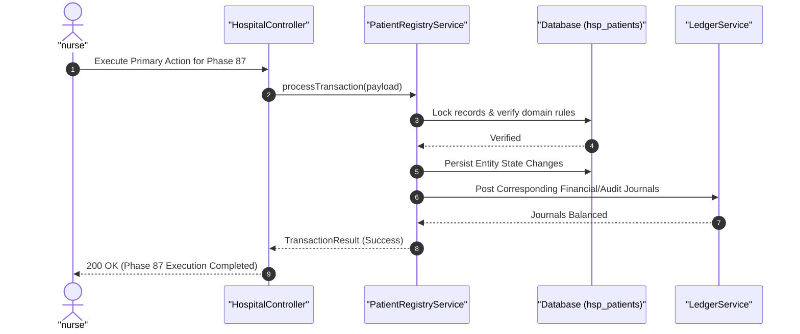

#### Diagram 2: Alur Kompensasi / Exception / Verifikasi Dua-Sumber Fase 87


### 6. Mermaid ERD & State Machine Fase 87

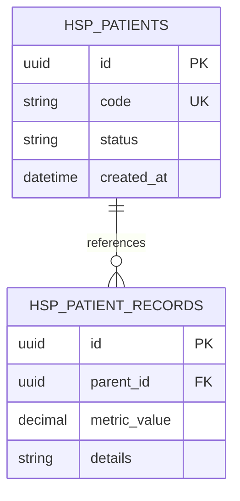

---

## FASE 88 — RUMAH SAKIT II: ORDER-TO-CASH, FARMASI, LAB & KLAIM BPJS

### 1. Identitas & Arsitektur Domain Fase 88

- **Modul Pemilik**: `Hospital`
- **Prefiks Tabel**: `hsp_`
- **Daftar Model Eloquent**: `PrescriptionDispense`, `LabTestOrder`, `BpjsClaimSubmission`, `MedicalBiohazardManifest`
- **Daftar Tabel Migrasi**: `hsp_prescriptions`, `hsp_lab_orders`, `hsp_claims`, `hsp_waste_manifests`
- **Daftar Service & Action**: `HospitalOrderToCashEngine`, `ElectronicPrescriptionDispenser`, `BpjsClaimClearingService`
- **Daftar Controller & Rute**: `HospitalBillingController@invoice (POST /hospital/billing/invoice)`, `HospitalPharmacyController@dispense (POST /hospital/pharmacy/dispense)`
- **Akun Ledger Terkait**: `hsp:patient_billing_revenue`, `hsp:bpjs_receivable`, `hsp:pharmacy_cogs`
- **Command Audit**: `php artisan hsp:audit`

### 2. Evaluasi Masalah & Matriks Penyelesaian (Problem-to-Solution Matrix) Fase 88

| Masalah Bisnis & Teknis | Solusi Arsitektural & Kontrak | Status Penyelesaian | Bukti Implementasi |
|---|---|---|---|
| Penolakan klaim asuransi BPJS Kesehatan akibat ketidaksesuaian koding INA-CBG dan kekeliruan pemberian dosis obat. | Siklus Order-to-Cash rumah sakit terpadu, E-Resep dengan validasi interaksi obat ganda, integrasi kliring klaim BPJS, dan manifest limbah medis B3 ber-barcode. | `Solved in Code` | `modules/Hospital/Application/Services/HospitalOrderToCashEngine.php` |

### 3. Daftar User Stories Lintas Persona Fase 88

- **US-88.1 [pharmacist]:** Sebagai **pharmacist**, saya ingin **memvalidasi resep digital dokter dan memeriksa potensi interaksi berbahaya antar-obat**, sehingga **pasien menerima obat yang tepat dan aman dari efek samping fatal**.
- **US-88.2 [lab_analyst]:** Sebagai **lab_analyst**, saya ingin **menginput hasil tes laboratorium darah pasien yang langsung terhubung ke lembar tagihan rumah sakit**, sehingga **hasil diagnostik cepat tersedia dan biaya otomatis terakumulasi**.
- **US-88.3 [rs_admin]:** Sebagai **rs_admin**, saya ingin **menyusun berkas klaim BPJS Kesehatan lengkap dengan resume medis dan koding ICD-10/INA-CBGs**, sehingga **klaim disetujui penuh oleh verifikator BPJS tanpa pending dispute**.
- **US-88.4 [waste_manager]:** Sebagai **waste_manager**, saya ingin **menerbitkan manifes limbah medis B3 (jarum suntik, botol infus) sebelum diserahkan ke jasa insinerator berizin**, sehingga **kepatuhan lingkungan hidup KLHK terjamin**.
- **US-88.5 [internal_auditor]:** Sebagai **internal_auditor**, saya ingin **mengaudit rekonsiliasi piutang BPJS Kesehatan versus pembayaran klaim di rekening bank**, sehingga **arus kas rumah sakit terpantau bebas piutang macet**.

### 4. BDD Acceptance Criteria Lengkap Fase 88

#### AC-88.1 — Happy Path & Ledger/State Invariant
- **Given** Entitas pada domain Hospital Fase 88 berstatus operasional aktif dan data input tervalidasi
- **When** Role berhak memproses alur transaksi utama pada endpoint HospitalBillingController
- **Then** Entitas berhasil diperbarui, saldo jurnal ledger terposting seimbang, dan event outbox dipancarkan.

#### AC-88.2 — Validation & Domain Rule Rejection - 422/Exception
- **Given** Input request melanggar ambang batas domain teknis atau kuantitas bernilai negatif
- **When** Aksi controller memproses permintaan
- **Then** Sistem menolak dengan HTTP 422 UnprocessableEntityException tanpa mutasi data.

#### AC-88.3 — RBAC Authorization & Separation of Duties - 403
- **Given** Role pengguna tidak berwenang mencoba mengakses rute modifikasi data
- **When** Request HTTP dikirimkan
- **Then** Middleware RBAC memblokir akses dan mengembalikan respons HTTP 403 Forbidden.

#### AC-88.4 — Idempotency, Replay & Concurrency Lock
- **Given** Dua pemanggilan transaksi yang sama dikirimkan secara paralel dengan Idempotency-Key identik
- **When** Sistem mengeksekusi transaksi dengan lockForUpdate
- **Then** Hanya satu mutasi yang berhasil dan request kedua menerima respons transaksi pertama tanpa duplikasi data.

#### AC-88.5 — Two-Source Audit & Tamper Detection
- **Given** Data baris disabotase langsung di database tanpa riwayat transaksi sah
- **When** Command php artisan hsp:audit dijalankan
- **Then** Audit dua-sumber mendeteksi diskrepansi data dan keluar dengan exit code 1.

### 5. Mermaid Sequence Diagrams Fase 88

#### Diagram 1: Alur Transaksi Utama End-to-End Fase 88

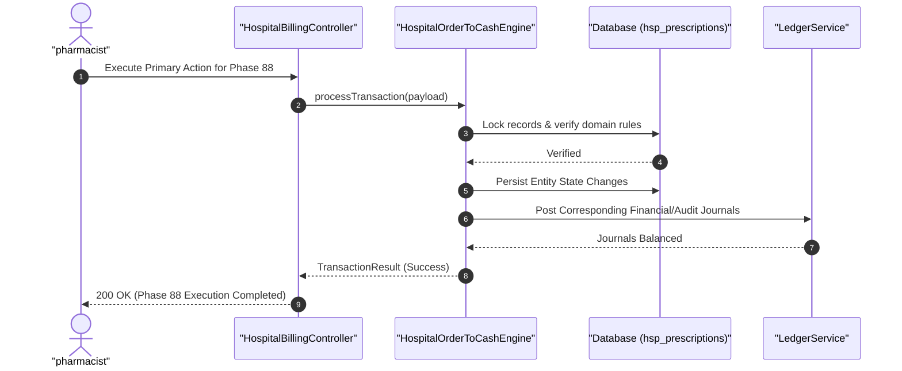

#### Diagram 2: Alur Kompensasi / Exception / Verifikasi Dua-Sumber Fase 88


### 6. Mermaid ERD & State Machine Fase 88

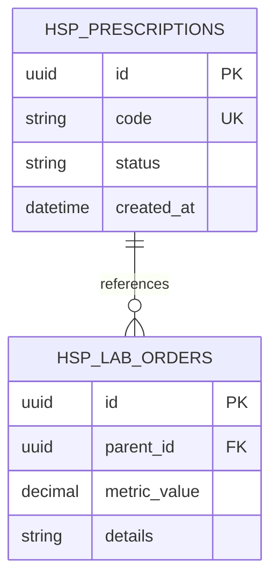

---

## FASE 89 — BEACH CLUB & CLUBS I: TICKETING, AGE GATE & TABLE MIN-SPEND

### 1. Identitas & Arsitektur Domain Fase 89

- **Modul Pemilik**: `Venue`
- **Prefiks Tabel**: `ven_`
- **Daftar Model Eloquent**: `VenueTicketMaster`, `AgeVerificationGate`, `VipTableBooking`, `TableMinimumSpendDeposit`
- **Daftar Tabel Migrasi**: `ven_tickets`, `ven_age_verifications`, `ven_tables`, `ven_deposits`
- **Daftar Service & Action**: `VenueAccessControlService`, `AgeGateVerificationEngine`, `VipTableReservationEngine`
- **Daftar Controller & Rute**: `VenueTicketController@scan (POST /venue/tickets/scan)`, `VipTableController@reserve (POST /venue/tables/reserve)`
- **Akun Ledger Terkait**: `ven:ticket_sales_revenue`, `ven:table_deposit_liability`
- **Command Audit**: `php artisan ven:audit`

### 2. Evaluasi Masalah & Matriks Penyelesaian (Problem-to-Solution Matrix) Fase 89

| Masalah Bisnis & Teknis | Solusi Arsitektural & Kontrak | Status Penyelesaian | Bukti Implementasi |
|---|---|---|---|
| Pengunjung di bawah umur yang menyusup ke area klub malam berizin miras dan keributan sengketa meja VIP minimum spend. | Sistem kontrol akses turnstile gerbang pintu masuk ber-pindai KTP/Paspor (Age Gate 21+), tiket barcode anti-screenshot, dan escrow uang jaminan meja VIP. | `Solved in Code` | `modules/Venue/Application/Services/VenueAccessControlService.php` |

### 3. Daftar User Stories Lintas Persona Fase 89

- **US-89.1 [venue_staff]:** Sebagai **venue_staff**, saya ingin **memindai gelang barcode tiket pengunjung dan memverifikasi usia 21+ melalui pemindai kartu identitas**, sehingga **hanya pengunjung dewasa berizin yang dapat masuk ke area klub**.
- **US-89.2 [venue_manager]:** Sebagai **venue_manager**, saya ingin **mengunci reservasi meja sofa VIP tepi pantai dengan uang muka deposit minimum spend Rp 10.000.000**, sehingga **pendapatan meja premium terjamin aman dari pembatalan sepihak**.
- **US-89.3 [cashier]:** Sebagai **cashier**, saya ingin **memotong tagihan pesanan makanan dan minuman dari saldo uang jaminan deposit meja VIP**, sehingga **tamu menikmati layanan tanpa harus berulang kali menggesek kartu**.
- **US-89.4 [crowd_safety]:** Sebagai **crowd_safety**, saya ingin **memantau kapasitas pengunjung di dalam venue secara real-time untuk mencegah kelebihan muatan kerumunan**, sehingga **keselamatan pengunjung dari risiko desak-desakan terjamin**.
- **US-89.5 [internal_auditor]:** Sebagai **internal_auditor**, saya ingin **mengaudit rekonsiliasi penjualan tiket harian versus jumlah orang yang melewati turnstile pintu masuk**, sehingga **kebocoran tiket masuk bebas oleh oknum satpam terungkap**.

### 4. BDD Acceptance Criteria Lengkap Fase 89

#### AC-89.1 — Happy Path & Ledger/State Invariant
- **Given** Entitas pada domain Venue Fase 89 berstatus operasional aktif dan data input tervalidasi
- **When** Role berhak memproses alur transaksi utama pada endpoint VenueTicketController
- **Then** Entitas berhasil diperbarui, saldo jurnal ledger terposting seimbang, dan event outbox dipancarkan.

#### AC-89.2 — Validation & Domain Rule Rejection - 422/Exception
- **Given** Input request melanggar ambang batas domain teknis atau kuantitas bernilai negatif
- **When** Aksi controller memproses permintaan
- **Then** Sistem menolak dengan HTTP 422 UnprocessableEntityException tanpa mutasi data.

#### AC-89.3 — RBAC Authorization & Separation of Duties - 403
- **Given** Role pengguna tidak berwenang mencoba mengakses rute modifikasi data
- **When** Request HTTP dikirimkan
- **Then** Middleware RBAC memblokir akses dan mengembalikan respons HTTP 403 Forbidden.

#### AC-89.4 — Idempotency, Replay & Concurrency Lock
- **Given** Dua pemanggilan transaksi yang sama dikirimkan secara paralel dengan Idempotency-Key identik
- **When** Sistem mengeksekusi transaksi dengan lockForUpdate
- **Then** Hanya satu mutasi yang berhasil dan request kedua menerima respons transaksi pertama tanpa duplikasi data.

#### AC-89.5 — Two-Source Audit & Tamper Detection
- **Given** Data baris disabotase langsung di database tanpa riwayat transaksi sah
- **When** Command php artisan ven:audit dijalankan
- **Then** Audit dua-sumber mendeteksi diskrepansi data dan keluar dengan exit code 1.

### 5. Mermaid Sequence Diagrams Fase 89

#### Diagram 1: Alur Transaksi Utama End-to-End Fase 89

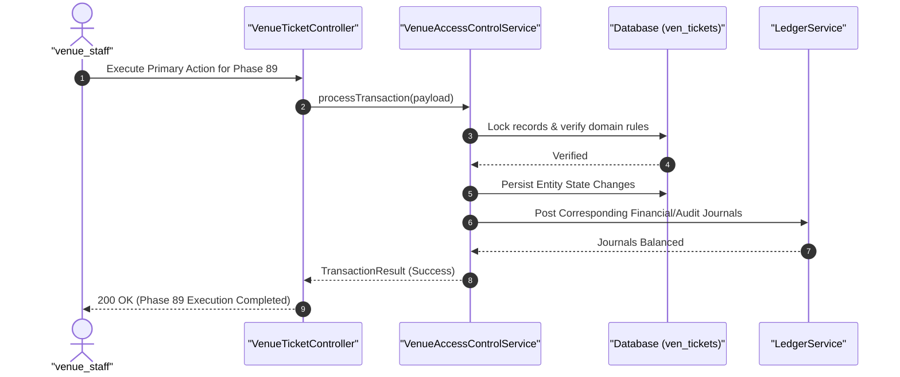

#### Diagram 2: Alur Kompensasi / Exception / Verifikasi Dua-Sumber Fase 89

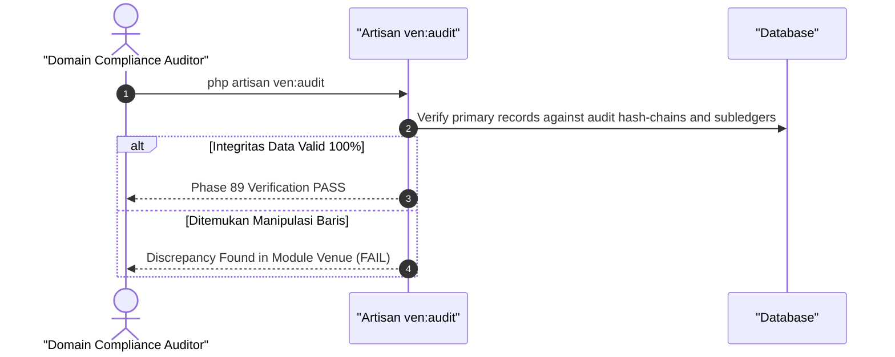

### 6. Mermaid ERD & State Machine Fase 89

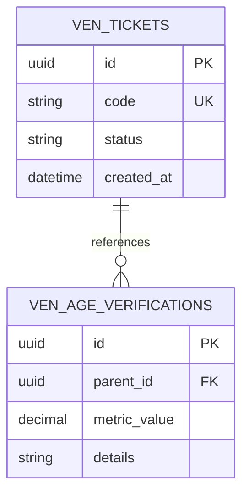

---

## FASE 90 — BEACH CLUB & CLUBS II: ARTIST CONTRACTS, RIDER INVENTORY & VIP

### 1. Identitas & Arsitektur Domain Fase 90

- **Modul Pemilik**: `Venue`
- **Prefiks Tabel**: `ven_`
- **Daftar Model Eloquent**: `ArtistBookingContract`, `HospitalityRiderInventory`, `PourCostBeverageAudit`, `VipMembershipTier`
- **Daftar Tabel Migrasi**: `ven_artist_contracts`, `ven_rider_inventories`, `ven_pour_costs`, `ven_vip_memberships`
- **Daftar Service & Action**: `ArtistRiderFulfillmentService`, `PourCostAnalyticsEngine`, `VipLoyaltyRecognitionManager`
- **Daftar Controller & Rute**: `ArtistContractController@book (POST /venue/artists/book)`, `BarInventoryController@pourCost (POST /venue/bar/pour-cost)`
- **Akun Ledger Terkait**: `ven:artist_fee_expense`, `ven:beverage_cogs`, `ven:vip_membership_revenue`
- **Command Audit**: `php artisan ven:audit`

### 2. Evaluasi Masalah & Matriks Penyelesaian (Problem-to-Solution Matrix) Fase 90

| Masalah Bisnis & Teknis | Solusi Arsitektural & Kontrak | Status Penyelesaian | Bukti Implementasi |
|---|---|---|---|
| Pemborosan biaya permintaan khusus artis tamu (hospitality rider) dan kebocoran botol minuman keras mahal (pour-cost > 22%). | Manajemen kontrak artis internasional dengan klausul escrow fee berjenjang, pemantauan stok botol bar ber-timbangan digital (Pour-Cost tracking < 18%), dan membership VIP NFT. | `Solved in Code` | `modules/Venue/Application/Services/PourCostAnalyticsEngine.php` |

### 3. Daftar User Stories Lintas Persona Fase 90

- **US-90.1 [artist_relations]:** Sebagai **artist_relations**, saya ingin **memastikan rider teknis (sound system DJ) dan konsumsi minuman artis di ruang tunggu terpenuhi sesuai kontrak**, sehingga **penampilan artis kelas dunia berjalan mulus dan sukses**.
- **US-90.2 [store_manager]:** Sebagai **store_manager**, saya ingin **memantau rasio biaya tuang (pour-cost) minuman beralkohol di bar utama setiap pergantian shift**, sehingga **kebocoran atau penuangan berlebih (over-pouring) oleh bartender terdeteksi**.
- **US-90.3 [holding_cfo]:** Sebagai **holding_cfo**, saya ingin **mengunci pembayaran honorarium artis DJ luar negeri di rekening escrow hingga konser selesai**, sehingga **uang perusahaan aman jika artis membatalkan penampilan (no-show)**.
- **US-90.4 [venue_manager]:** Sebagai **venue_manager**, saya ingin **memberikan fasilitas akses jalur ekspres dan lounge pribadi bagi anggota keanggotaan VIP Platinum**, sehingga **loyalitas pelanggan berkantong tebal terjaga tinggi**.
- **US-90.5 [internal_auditor]:** Sebagai **internal_auditor**, saya ingin **mengaudit inventaris fisik botol minuman keras bermerek di gudang bar berpendingin**, sehingga **tidak ada pencurian atau penukaran botol minuman mahal dengan barang tiruan**.

### 4. BDD Acceptance Criteria Lengkap Fase 90

#### AC-90.1 — Happy Path & Ledger/State Invariant
- **Given** Entitas pada domain Venue Fase 90 berstatus operasional aktif dan data input tervalidasi
- **When** Role berhak memproses alur transaksi utama pada endpoint ArtistContractController
- **Then** Entitas berhasil diperbarui, saldo jurnal ledger terposting seimbang, dan event outbox dipancarkan.

#### AC-90.2 — Validation & Domain Rule Rejection - 422/Exception
- **Given** Input request melanggar ambang batas domain teknis atau kuantitas bernilai negatif
- **When** Aksi controller memproses permintaan
- **Then** Sistem menolak dengan HTTP 422 UnprocessableEntityException tanpa mutasi data.

#### AC-90.3 — RBAC Authorization & Separation of Duties - 403
- **Given** Role pengguna tidak berwenang mencoba mengakses rute modifikasi data
- **When** Request HTTP dikirimkan
- **Then** Middleware RBAC memblokir akses dan mengembalikan respons HTTP 403 Forbidden.

#### AC-90.4 — Idempotency, Replay & Concurrency Lock
- **Given** Dua pemanggilan transaksi yang sama dikirimkan secara paralel dengan Idempotency-Key identik
- **When** Sistem mengeksekusi transaksi dengan lockForUpdate
- **Then** Hanya satu mutasi yang berhasil dan request kedua menerima respons transaksi pertama tanpa duplikasi data.

#### AC-90.5 — Two-Source Audit & Tamper Detection
- **Given** Data baris disabotase langsung di database tanpa riwayat transaksi sah
- **When** Command php artisan ven:audit dijalankan
- **Then** Audit dua-sumber mendeteksi diskrepansi data dan keluar dengan exit code 1.

### 5. Mermaid Sequence Diagrams Fase 90

#### Diagram 1: Alur Transaksi Utama End-to-End Fase 90

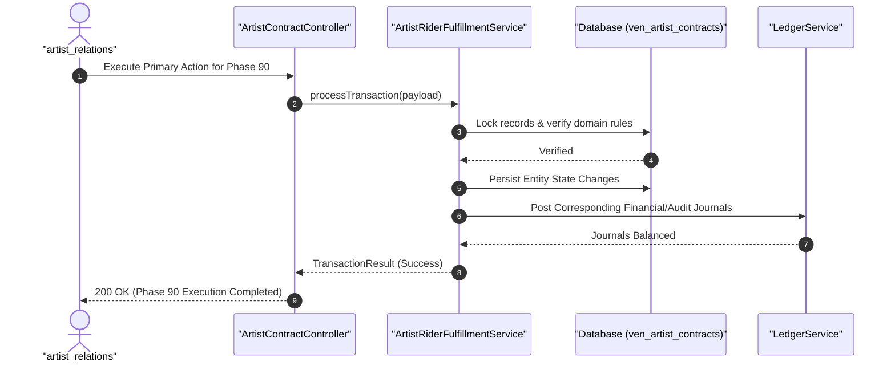

#### Diagram 2: Alur Kompensasi / Exception / Verifikasi Dua-Sumber Fase 90


### 6. Mermaid ERD & State Machine Fase 90

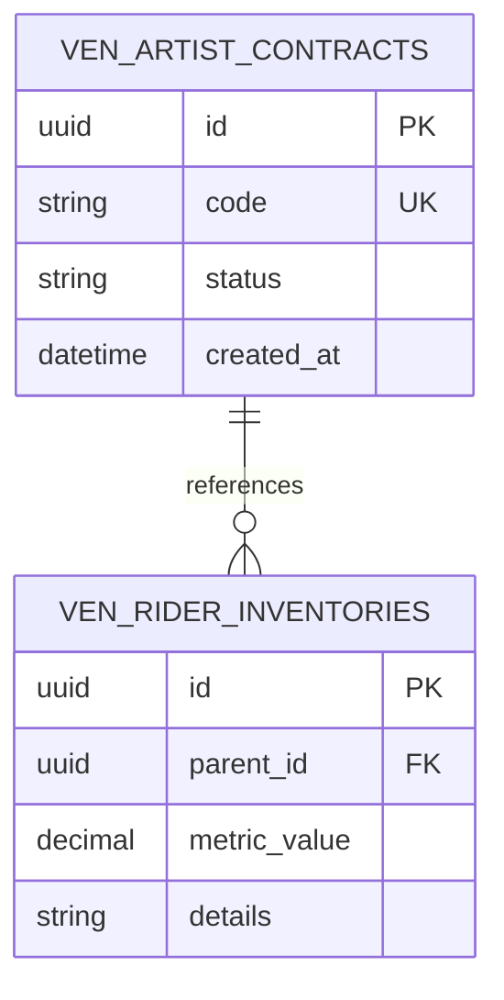

---

## FASE 91 — PERHOTELAN I: PMS, CRS, RATE MANAGEMENT & SMART ROOM

### 1. Identitas & Arsitektur Domain Fase 91

- **Modul Pemilik**: `Hotel`
- **Prefiks Tabel**: `htl_`
- **Daftar Model Eloquent**: `HotelRoomInventory`, `CentralReservationBooking`, `BestAvailableRatePolicy`, `SmartRoomIoTDevice`
- **Daftar Tabel Migrasi**: `htl_rooms`, `htl_reservations`, `htl_rates`, `htl_iot_devices`
- **Daftar Service & Action**: `PropertyManagementSystemService`, `CentralReservationEngine`, `SmartRoomAutomationService`
- **Daftar Controller & Rute**: `HotelBookingController@book (POST /hotel/reservations)`, `SmartRoomController@climate (POST /hotel/rooms/{id}/climate)`
- **Akun Ledger Terkait**: `htl:room_sales_revenue`, `htl:guest_deposit_liability`
- **Command Audit**: `php artisan htl:audit`

### 2. Evaluasi Masalah & Matriks Penyelesaian (Problem-to-Solution Matrix) Fase 91

| Masalah Bisnis & Teknis | Solusi Arsitektural & Kontrak | Status Penyelesaian | Bukti Implementasi |
|---|---|---|---|
| Kelebihan pemesanan kamar (overbooking) akibat ketidaksinkronan dengan agen perjalanan online (OTA) dan kamar dingin boros listrik saat tamu keluar. | Sistem manajemen properti hotel (PMS) terhubung Central Reservation System (CRS) dua-arah real-time, strategi harga Best Available Rate (BAR), dan otomatisasi kamar pintar IoT. | `Solved in Code` | `modules/Hotel/Application/Services/PropertyManagementSystemService.php` |

### 3. Daftar User Stories Lintas Persona Fase 91

- **US-91.1 [front_office]:** Sebagai **front_office**, saya ingin **melakukan check-in tamu hotel secara cepat dengan penerbitan kartu kunci pintu elektronik (Keycard)**, sehingga **tamu merasa disambut ramah dan waktu tunggu lobi singkat**.
- **US-91.2 [revenue_mgr]:** Sebagai **revenue_mgr**, saya ingin **menyesuaikan tarif kamar Best Available Rate (BAR) secara otomatis saat tingkat okupansi hotel melampaui 80%**, sehingga **pendapatan rata-rata per kamar tersedia (RevPAR) maksimal**.
- **US-91.3 [housekeeping]:** Sebagai **housekeeping**, saya ingin **memperbarui status kebersihan kamar (Clean/Inspected) melalui aplikasi ponsel begitu kamar selesai dibersihkan**, sehingga **kamar segera siap dijual kembali ke tamu baru**.
- **US-91.4 [energy_auditor]:** Sebagai **energy_auditor**, saya ingin **mengaktifkan mode hemat daya kamar pintar yang otomatis mematikan AC dan lampu saat sensor mendeteksi kamar kosong**, sehingga **biaya operasional listrik hotel hemat 30%**.
- **US-91.5 [internal_auditor]:** Sebagai **internal_auditor**, saya ingin **mengaudit pembatalan reservasi menit-menit terakhir dan pengembalian uang jaminan deposit tamu**, sehingga **tidak ada penggelapan uang sewa kamar oleh resepsionis**.

### 4. BDD Acceptance Criteria Lengkap Fase 91

#### AC-91.1 — Happy Path & Ledger/State Invariant
- **Given** Entitas pada domain Hotel Fase 91 berstatus operasional aktif dan data input tervalidasi
- **When** Role berhak memproses alur transaksi utama pada endpoint HotelBookingController
- **Then** Entitas berhasil diperbarui, saldo jurnal ledger terposting seimbang, dan event outbox dipancarkan.

#### AC-91.2 — Validation & Domain Rule Rejection - 422/Exception
- **Given** Input request melanggar ambang batas domain teknis atau kuantitas bernilai negatif
- **When** Aksi controller memproses permintaan
- **Then** Sistem menolak dengan HTTP 422 UnprocessableEntityException tanpa mutasi data.

#### AC-91.3 — RBAC Authorization & Separation of Duties - 403
- **Given** Role pengguna tidak berwenang mencoba mengakses rute modifikasi data
- **When** Request HTTP dikirimkan
- **Then** Middleware RBAC memblokir akses dan mengembalikan respons HTTP 403 Forbidden.

#### AC-91.4 — Idempotency, Replay & Concurrency Lock
- **Given** Dua pemanggilan transaksi yang sama dikirimkan secara paralel dengan Idempotency-Key identik
- **When** Sistem mengeksekusi transaksi dengan lockForUpdate
- **Then** Hanya satu mutasi yang berhasil dan request kedua menerima respons transaksi pertama tanpa duplikasi data.

#### AC-91.5 — Two-Source Audit & Tamper Detection
- **Given** Data baris disabotase langsung di database tanpa riwayat transaksi sah
- **When** Command php artisan htl:audit dijalankan
- **Then** Audit dua-sumber mendeteksi diskrepansi data dan keluar dengan exit code 1.

### 5. Mermaid Sequence Diagrams Fase 91

#### Diagram 1: Alur Transaksi Utama End-to-End Fase 91

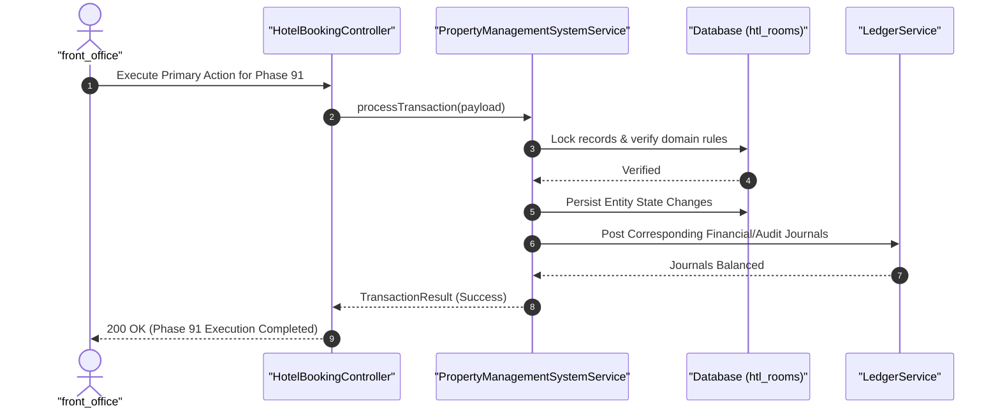

#### Diagram 2: Alur Kompensasi / Exception / Verifikasi Dua-Sumber Fase 91

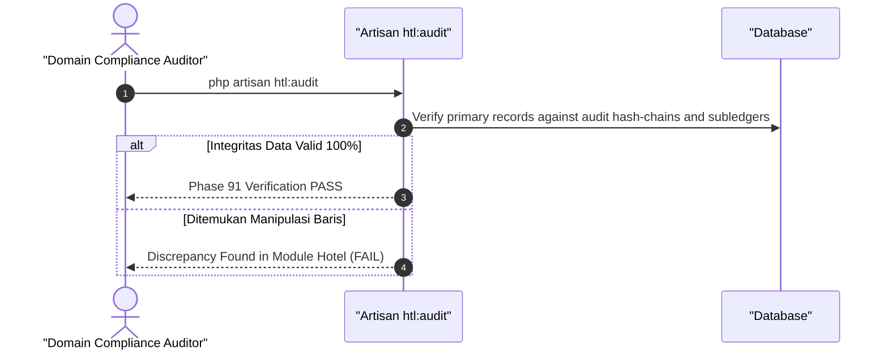

### 6. Mermaid ERD & State Machine Fase 91

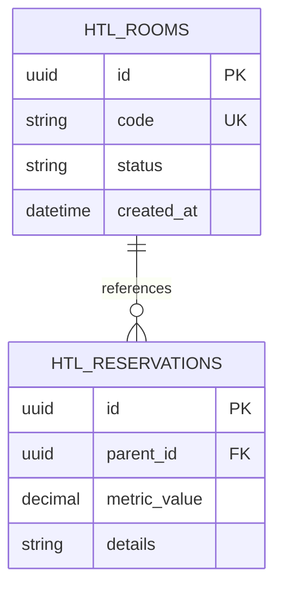

---

## FASE 92 — PERHOTELAN II: NIGHT AUDIT, SPLIT FOLIO & BANQUET

### 1. Identitas & Arsitektur Domain Fase 92

- **Modul Pemilik**: `Hotel`
- **Prefiks Tabel**: `htl_`
- **Daftar Model Eloquent**: `GuestFolioMaster`, `NightAuditDailyBalance`, `BanquetMiceContract`, `TimesharePointShare`
- **Daftar Tabel Migrasi**: `htl_folios`, `htl_night_audits`, `htl_banquets`, `htl_timeshares`
- **Daftar Service & Action**: `NightAuditReconciliationService`, `GuestFolioBillingEngine`, `BanquetEventOrderManager`
- **Daftar Controller & Rute**: `NightAuditController@close (POST /hotel/night-audit/close)`, `BanquetController@book (POST /hotel/banquet/book)`
- **Akun Ledger Terkait**: `htl:night_audit_clearing`, `htl:banquet_revenue`
- **Command Audit**: `php artisan htl:audit`

### 2. Evaluasi Masalah & Matriks Penyelesaian (Problem-to-Solution Matrix) Fase 92

| Masalah Bisnis & Teknis | Solusi Arsitektural & Kontrak | Status Penyelesaian | Bukti Implementasi |
|---|---|---|---|
| Kegagalan penutupan pembukuan harian hotel (Night Audit macet) dan kerumitan pemisahan tagihan kamar rombongan korporat (Split Folio). | Mesin penutupan harian (Night Audit) otomatis yang memposting biaya kamar tepat tengah malam, pemisahan tagihan fleksibel (Split Folio tamu vs perusahaan), dan kontrak MICE Banquet. | `Solved in Code` | `modules/Hotel/Application/Services/NightAuditReconciliationService.php` |

### 3. Daftar User Stories Lintas Persona Fase 92

- **US-92.1 [front_office]:** Sebagai **front_office**, saya ingin **memisahkan tagihan menginap (ditanggung kantor) dengan tagihan minibar/laundry (dibayar pribadi tamu) pada folio terpisah**, sehingga **pelanggan korporat menerima invoice yang rapi dan siap reimburs**.
- **US-92.2 [bank_treasurer]:** Sebagai **bank_treasurer**, saya ingin **menjalankan penutupan harian Night Audit tepat pukul 02:00 pagi untuk mengunci seluruh pendapatan hotel hari itu**, sehingga **pembukuan tanggal berjalan tertutup rapi dan hari baru dibuka**.
- **US-92.3 [store_manager]:** Sebagai **store_manager**, saya ingin **mengelola pesanan makanan dan tata letak ruangan untuk acara pernikahan dan konferensi internasional (Banquet Event Order)**, sehingga **katering dan logistik MICE tersaji tepat waktu**.
- **US-92.4 [holding_cfo]:** Sebagai **holding_cfo**, saya ingin **memantau penjualan paket keanggotaan Timeshare liburan jangka panjang di seluruh resor grup**, sehingga **arus kas dana jangka panjang holding bertambah kuat**.
- **US-92.5 [internal_auditor]:** Sebagai **internal_auditor**, saya ingin **mengaudit catatan koreksi atau pemotongan tagihan tamu (folio allowance/rebate) pasca check-out**, sehingga **mencegah manipulasi penghapusan tagihan oleh staf hotel nakal**.

### 4. BDD Acceptance Criteria Lengkap Fase 92

#### AC-92.1 — Happy Path & Ledger/State Invariant
- **Given** Entitas pada domain Hotel Fase 92 berstatus operasional aktif dan data input tervalidasi
- **When** Role berhak memproses alur transaksi utama pada endpoint NightAuditController
- **Then** Entitas berhasil diperbarui, saldo jurnal ledger terposting seimbang, dan event outbox dipancarkan.

#### AC-92.2 — Validation & Domain Rule Rejection - 422/Exception
- **Given** Input request melanggar ambang batas domain teknis atau kuantitas bernilai negatif
- **When** Aksi controller memproses permintaan
- **Then** Sistem menolak dengan HTTP 422 UnprocessableEntityException tanpa mutasi data.

#### AC-92.3 — RBAC Authorization & Separation of Duties - 403
- **Given** Role pengguna tidak berwenang mencoba mengakses rute modifikasi data
- **When** Request HTTP dikirimkan
- **Then** Middleware RBAC memblokir akses dan mengembalikan respons HTTP 403 Forbidden.

#### AC-92.4 — Idempotency, Replay & Concurrency Lock
- **Given** Dua pemanggilan transaksi yang sama dikirimkan secara paralel dengan Idempotency-Key identik
- **When** Sistem mengeksekusi transaksi dengan lockForUpdate
- **Then** Hanya satu mutasi yang berhasil dan request kedua menerima respons transaksi pertama tanpa duplikasi data.

#### AC-92.5 — Two-Source Audit & Tamper Detection
- **Given** Data baris disabotase langsung di database tanpa riwayat transaksi sah
- **When** Command php artisan htl:audit dijalankan
- **Then** Audit dua-sumber mendeteksi diskrepansi data dan keluar dengan exit code 1.

### 5. Mermaid Sequence Diagrams Fase 92

#### Diagram 1: Alur Transaksi Utama End-to-End Fase 92

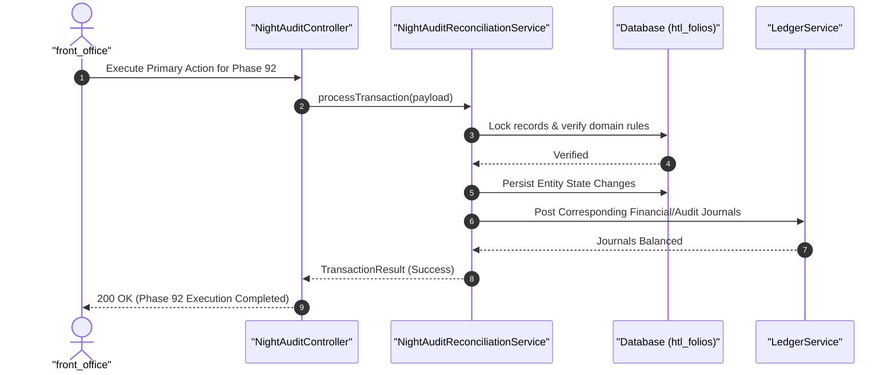

#### Diagram 2: Alur Kompensasi / Exception / Verifikasi Dua-Sumber Fase 92


### 6. Mermaid ERD & State Machine Fase 92

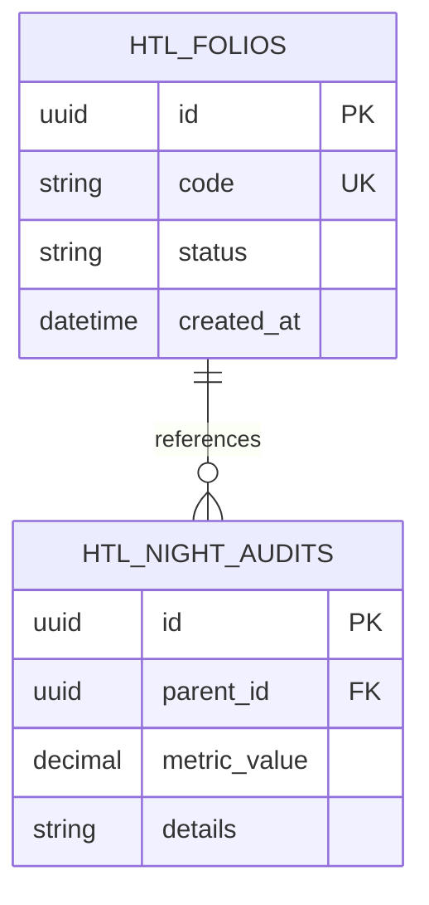

---

## FASE 93 — PERTAMBANGAN I: MINE PLANNING, FLEET DISPATCH & FUEL

### 1. Identitas & Arsitektur Domain Fase 93

- **Modul Pemilik**: `Mining`
- **Prefiks Tabel**: `min_`
- **Daftar Model Eloquent**: `MinePitBlock`, `HaulTruckTelemetry`, `PitToPortDispatchJob`, `FuelStorageTankSensor`
- **Daftar Tabel Migrasi**: `min_pits`, `min_haul_trucks`, `min_dispatch_jobs`, `min_fuel_tanks`
- **Daftar Service & Action**: `MinePlanningOptimizationEngine`, `HeavyFleetDispatchService`, `FuelConsumptionTelemetryMonitor`
- **Daftar Controller & Rute**: `MineDispatchController@dispatch (POST /mining/dispatch/truck)`, `MiningFuelController@dispense (POST /mining/fuel/dispense)`
- **Akun Ledger Terkait**: `min:mining_wip_ore`, `min:diesel_fuel_inventory`
- **Command Audit**: `php artisan min:audit`

### 2. Evaluasi Masalah & Matriks Penyelesaian (Problem-to-Solution Matrix) Fase 93

| Masalah Bisnis & Teknis | Solusi Arsitektural & Kontrak | Status Penyelesaian | Bukti Implementasi |
|---|---|---|---|
| Antrean truk angkut (haul truck) yang menumpuk di area tambang terbuka (pit) dan pencurian bahan bakar solar bernilai miliaran rupiah. | Perencanaan tambang terintegrasi (Mine Planning blok PIT), optimasi penugasan armada angkut PIT-ke-Pelabuhan berbasis GPS/telemetri, dan kontrol tangki BBM pintar. | `Solved in Code` | `modules/Mining/Application/Services/HeavyFleetDispatchService.php` |

### 3. Daftar User Stories Lintas Persona Fase 93

- **US-93.1 [mine_planner]:** Sebagai **mine_planner**, saya ingin **merancang urutan penggalian blok tambang batubara/nikel sesuai rasio pengupasan tanah (Stripping Ratio)**, sehingga **kadar bijih tambang yang digali optimal dan efisien**.
- **US-93.2 [fleet_dispatcher]:** Sebagai **fleet_dispatcher**, saya ingin **menugaskan truk angkut ke ekskavator yang antreannya paling sepi secara dinamis di layar kontrol**, sehingga **waktu tunggu armada berkurang dan produksi tonase per jam naik 20%**.
- **US-93.3 [hse_officer]:** Sebagai **hse_officer**, saya ingin **memantau kecepatan truk tambang di jalan angkut berdebu dan sensor kelelahan pengemudi (fatigue sensor)**, sehingga **kecelakaan tabrakan alat berat di area tambang dihindarkan**.
- **US-93.4 [holding_cfo]:** Sebagai **holding_cfo**, saya ingin **membandingkan konsumsi liter solar per ton muatan batubara terhadap standar efisiensi bahan bakar**, sehingga **biaya operasional tambang terkontrol ketat**.
- **US-93.5 [internal_auditor]:** Sebagai **internal_auditor**, saya ingin **mengaudit catatan telemetri tangki penyimpanan bahan bakar tambang terhadap pembelian faktur solar**, sehingga **tidak ada penggelapan bahan bakar solar subsidi/industri**.

### 4. BDD Acceptance Criteria Lengkap Fase 93

#### AC-93.1 — Happy Path & Ledger/State Invariant
- **Given** Entitas pada domain Mining Fase 93 berstatus operasional aktif dan data input tervalidasi
- **When** Role berhak memproses alur transaksi utama pada endpoint MineDispatchController
- **Then** Entitas berhasil diperbarui, saldo jurnal ledger terposting seimbang, dan event outbox dipancarkan.

#### AC-93.2 — Validation & Domain Rule Rejection - 422/Exception
- **Given** Input request melanggar ambang batas domain teknis atau kuantitas bernilai negatif
- **When** Aksi controller memproses permintaan
- **Then** Sistem menolak dengan HTTP 422 UnprocessableEntityException tanpa mutasi data.

#### AC-93.3 — RBAC Authorization & Separation of Duties - 403
- **Given** Role pengguna tidak berwenang mencoba mengakses rute modifikasi data
- **When** Request HTTP dikirimkan
- **Then** Middleware RBAC memblokir akses dan mengembalikan respons HTTP 403 Forbidden.

#### AC-93.4 — Idempotency, Replay & Concurrency Lock
- **Given** Dua pemanggilan transaksi yang sama dikirimkan secara paralel dengan Idempotency-Key identik
- **When** Sistem mengeksekusi transaksi dengan lockForUpdate
- **Then** Hanya satu mutasi yang berhasil dan request kedua menerima respons transaksi pertama tanpa duplikasi data.

#### AC-93.5 — Two-Source Audit & Tamper Detection
- **Given** Data baris disabotase langsung di database tanpa riwayat transaksi sah
- **When** Command php artisan min:audit dijalankan
- **Then** Audit dua-sumber mendeteksi diskrepansi data dan keluar dengan exit code 1.

### 5. Mermaid Sequence Diagrams Fase 93

#### Diagram 1: Alur Transaksi Utama End-to-End Fase 93

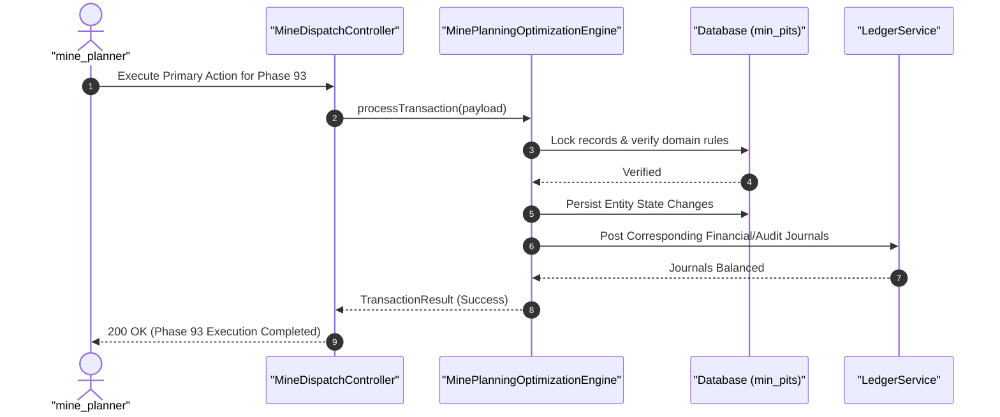

#### Diagram 2: Alur Kompensasi / Exception / Verifikasi Dua-Sumber Fase 93

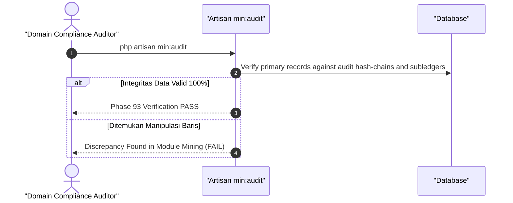

### 6. Mermaid ERD & State Machine Fase 93

```mermaid
erDiagram
    MIN_PITS ||--o{ MIN_HAUL_TRUCKS : references
    MIN_PITS {
        uuid id PK
        string code UK
        string status
        datetime created_at
    }
    MIN_HAUL_TRUCKS {
        uuid id PK
        uuid parent_id FK
        decimal metric_value
        string details
    }
```

---

## FASE 94 — PERTAMBANGAN II: WEIGHBRIDGE, ASSAY, ROYALTI & REKLAMASI

### 1. Identitas & Arsitektur Domain Fase 94

- **Modul Pemilik**: `Mining`
- **Prefiks Tabel**: `min_`
- **Daftar Model Eloquent**: `WeighbridgeTicketMaster`, `LaboratoryGradeAssay`, `PnbpRoyaltyObligation`, `MineReclamationGuarantee`
- **Daftar Tabel Migrasi**: `min_weighbridges`, `min_assays`, `min_royalties`, `min_reclamations`
- **Daftar Service & Action**: `WeighbridgeCalibrationService`, `GradeAssayReconciliationEngine`, `PnbpRoyaltyCalculationService`
- **Daftar Controller & Rute**: `WeighbridgeController@weigh (POST /mining/weighbridge/weigh)`, `MiningRoyaltyController@calculate (POST /mining/royalties/calculate)`
- **Akun Ledger Terkait**: `min:royalty_payable_esdm`, `min:reclamation_escrow_reserve`
- **Command Audit**: `php artisan min:audit`

### 2. Evaluasi Masalah & Matriks Penyelesaian (Problem-to-Solution Matrix) Fase 94

| Masalah Bisnis & Teknis | Solusi Arsitektural & Kontrak | Status Penyelesaian | Bukti Implementasi |
|---|---|---|---|
| Kecurangan timbangan truk angkut bijih tambang, perbedaan kadar logam hasil lab pelabuhan vs pabrik smelter, dan tunggakan royalti PNBP negara. | Jembatan timbang terkalibrasi otomatis dengan penanda RFID anti-manipulasi, rekonsiliasi kadar bijih (Grade Assay Reconciliation), dan kalkulator royalti PNBP ESDM otomatis. | `Solved in Code` | `modules/Mining/Application/Services/PnbpRoyaltyCalculationService.php` |

### 3. Daftar User Stories Lintas Persona Fase 94

- **US-94.1 [royalty_officer]:** Sebagai **royalty_officer**, saya ingin **menghitung kewajiban royalti iuran produksi PNBP mineral/batubara ke kas negara berbasis Harga Patokan Mineral (HPM)**, sehingga **perusahaan mematuhi regulasi Kementerian ESDM dan terbebas dari denda**.
- **US-94.2 [mine_surveyor]:** Sebagai **mine_surveyor**, saya ingin **memverifikasi timbangan muatan kapal tongkang (barge draft survey) sebelum kargo tambang berlayar**, sehingga **tonase kargo yang dikapalkan sesuai dengan kontrak penjualan**.
- **US-94.3 [lab_pathologist]:** Sebagai **lab_pathologist**, saya ingin **menganalisis kadar nikel atau kalori batubara pada sampel bor tambang di laboratorium kimia tambang**, sehingga **kualitas bijih terklasifikasi akurat sebelum masuk smelter**.
- **US-94.4 [holding_compliance]:** Sebagai **holding_compliance**, saya ingin **menempatkan dana jaminan reklamasi tambang di bank persepsi untuk pemulihan lingkungan pasca tambang**, sehingga **kewajiban reklamasi lahan hutan dan pelestarian alam dipenuhi**.
- **US-94.5 [internal_auditor]:** Sebagai **internal_auditor**, saya ingin **mengaudit keabsahan kalibrasi timbangan jembatan timbang (weighbridge) terhadap laporan pengapalan**, sehingga **tidak ada penggelapan tonase muatan tambang**.

### 4. BDD Acceptance Criteria Lengkap Fase 94

#### AC-94.1 — Happy Path & Ledger/State Invariant
- **Given** Entitas pada domain Mining Fase 94 berstatus operasional aktif dan data input tervalidasi
- **When** Role berhak memproses alur transaksi utama pada endpoint WeighbridgeController
- **Then** Entitas berhasil diperbarui, saldo jurnal ledger terposting seimbang, dan event outbox dipancarkan.

#### AC-94.2 — Validation & Domain Rule Rejection - 422/Exception
- **Given** Input request melanggar ambang batas domain teknis atau kuantitas bernilai negatif
- **When** Aksi controller memproses permintaan
- **Then** Sistem menolak dengan HTTP 422 UnprocessableEntityException tanpa mutasi data.

#### AC-94.3 — RBAC Authorization & Separation of Duties - 403
- **Given** Role pengguna tidak berwenang mencoba mengakses rute modifikasi data
- **When** Request HTTP dikirimkan
- **Then** Middleware RBAC memblokir akses dan mengembalikan respons HTTP 403 Forbidden.

#### AC-94.4 — Idempotency, Replay & Concurrency Lock
- **Given** Dua pemanggilan transaksi yang sama dikirimkan secara paralel dengan Idempotency-Key identik
- **When** Sistem mengeksekusi transaksi dengan lockForUpdate
- **Then** Hanya satu mutasi yang berhasil dan request kedua menerima respons transaksi pertama tanpa duplikasi data.

#### AC-94.5 — Two-Source Audit & Tamper Detection
- **Given** Data baris disabotase langsung di database tanpa riwayat transaksi sah
- **When** Command php artisan min:audit dijalankan
- **Then** Audit dua-sumber mendeteksi diskrepansi data dan keluar dengan exit code 1.

### 5. Mermaid Sequence Diagrams Fase 94

#### Diagram 1: Alur Transaksi Utama End-to-End Fase 94

```mermaid
sequenceDiagram
    autonumber
    actor U as "royalty_officer"
    participant C as "WeighbridgeController"
    participant S as "WeighbridgeCalibrationService"
    participant DB as "Database (min_weighbridges)"
    participant L as "LedgerService"

    U->>C: Execute Primary Action for Phase 94
    C->>S: processTransaction(payload)
    S->>DB: Lock records & verify domain rules
    DB-->>S: Verified
    S->>DB: Persist Entity State Changes
    S->>L: Post Corresponding Financial/Audit Journals
    L-->>S: Journals Balanced
    S-->>C: TransactionResult (Success)
    C-->>U: 200 OK (Phase 94 Execution Completed)
```

#### Diagram 2: Alur Kompensasi / Exception / Verifikasi Dua-Sumber Fase 94

```mermaid
sequenceDiagram
    autonumber
    actor A as "Domain Compliance Auditor"
    participant CMD as "Artisan min:audit"
    participant DB as "Database"

    A->>CMD: php artisan min:audit
    CMD->>DB: Verify primary records against audit hash-chains and subledgers
    alt Integritas Data Valid 100%
        CMD-->>A: Phase 94 Verification PASS
    else Ditemukan Manipulasi Baris
        CMD-->>A: Discrepancy Found in Module Mining (FAIL)
    end
```

### 6. Mermaid ERD & State Machine Fase 94

```mermaid
erDiagram
    MIN_WEIGHBRIDGES ||--o{ MIN_ASSAYS : references
    MIN_WEIGHBRIDGES {
        uuid id PK
        string code UK
        string status
        datetime created_at
    }
    MIN_ASSAYS {
        uuid id PK
        uuid parent_id FK
        decimal metric_value
        string details
    }
```

---

