# SPESIFIKASI TEKNIS FASE 95–100: INTEGRASI LINTAS 12 LINI, SKALA ULTRA, AI ANALITIK & KEAMANAN 60+ ROLE

Dokumen ini mendefinisikan arsitektur domain, matriks penyelesaian, User Stories, BDD Acceptance Criteria, Sequence Diagrams, dan ERD/State Machine untuk Fase 95 s/d Fase 100.

---

## FASE 95 — INTEGRASI LINTAS 12 LINI (A): OTOMOTIF, EV, LOGISTIK, HOTEL, VENUE, RUMAH SAKIT

### 1. Identitas & Arsitektur Domain Fase 95

- **Modul Pemilik**: `Core`
- **Prefiks Tabel**: `intg_`
- **Daftar Model Eloquent**: `CrossLineUnifiedJourney`, `MultiLineDischargeSlip`, `IntegratedFleetRoute`, `EcosystemServicePackage`
- **Daftar Tabel Migrasi**: `intg_cross_journeys`, `intg_discharge_slips`, `intg_fleet_routes`, `intg_service_packages`
- **Daftar Service & Action**: `CrossLineOrchestratorService`, `AmbulanceFleetDispatchBridge`, `HospitalityMobilityBridge`
- **Daftar Controller & Rute**: `CrossLineController@journey (POST /api/v1/cross-line/journey)`, `CrossLineController@ambulance (POST /api/v1/cross-line/ambulance)`
- **Akun Ledger Terkait**: `intg:cross_line_clearing`, `bank:cash_vault`
- **Command Audit**: `php artisan ecosystem:audit-12-lines`

### 2. Evaluasi Masalah & Matriks Penyelesaian (Problem-to-Solution Matrix) Fase 95

| Masalah Bisnis & Teknis | Solusi Arsitektural & Kontrak | Status Penyelesaian | Bukti Implementasi |
|---|---|---|---|
| Silo operasional antar-lini anak perusahaan (pasien pulang dari RS butuh ambulans logistik dan menginap di hotel pemulihan tanpa koordinasi terpadu). | Orkestrasi perjalanan lintas-lini (Unified Journey) terpadu yang menghubungkan armada ambulans/taksi EV, reservasi hotel isolasi/pemulihan, dan tiket venue dalam satu klik. | `Solved in Code` | `modules/Integration/Application/Services/CrossLineOrchestratorService.php` |

### 3. Daftar User Stories Lintas Persona Fase 95

- **US-95.1 [doctor]:** Sebagai **doctor**, saya ingin **merujuk pasien rawat jalan pasca operasi untuk tinggal di kamar hotel pemulihan medis yang terhubung dengan dokter jaga**, sehingga **pasien pulih nyaman dalam pengawasan medis berkualitas**.
- **US-95.2 [fleet_manager]:** Sebagai **fleet_manager**, saya ingin **mengirimkan ambulans listrik berfasilitas medis lengkap untuk menjemput pasien gawat darurat dari venue konser**, sehingga **keselamatan pengunjung acara festival musik tertolong cepat**.
- **US-95.3 [hotel_gm]:** Sebagai **hotel_gm**, saya ingin **menyediakan paket menginap terpadu dengan tiket masuk festival musik beach club dan antar-jemput mobil listrik**, sehingga **pendapatan paket pariwisata terpadu konglomerasi meningkat**.
- **US-95.4 [holding_cfo]:** Sebagai **holding_cfo**, saya ingin **memantau pemisahan pendapatan dan penyelesaian kliring transaksi lintas-lini secara real-time**, sehingga **setiap anak usaha menerima porsi pendapatan haknya secara adil**.
- **US-95.5 [internal_auditor]:** Sebagai **internal_auditor**, saya ingin **mengaudit akurasi settlement dana multi-entitas pada perjalanan terpadu pelanggan**, sehingga **tidak ada selisih piutang antar-anak usaha holding**.

### 4. BDD Acceptance Criteria Lengkap Fase 95

#### AC-95.1 — Happy Path & Ledger/State Invariant
- **Given** Entitas pada domain integrasi Core Fase 95 berstatus operasional dan konfigurasi gerbang valid
- **When** Role berhak memproses alur kerja utama pada rute CrossLineController
- **Then** Status entitas sukses diperbarui, seluruh mutasi transaksi seimbang pada buku besar, dan event outbox dipancarkan.

#### AC-95.2 — Validation & Domain Rule Rejection - 422/Exception
- **Given** Data input melanggar batasan arsitektur atau parameter otorisasi tidak valid
- **When** Aksi controller mengevaluasi permintaan
- **Then** Sistem menolak dengan HTTP 422 UnprocessableEntityException tanpa mutasi database.

#### AC-95.3 — RBAC Authorization & Separation of Duties - 403
- **Given** Role pengguna tidak berwenang mencoba mengakses rute modifikasi data
- **When** Request HTTP dikirimkan
- **Then** Middleware RBAC memblokir akses dan mengembalikan respons HTTP 403 Forbidden.

#### AC-95.4 — Idempotency, Replay & Concurrency Lock
- **Given** Dua pemanggilan transaksi yang sama dikirimkan secara paralel dengan Idempotency-Key identik
- **When** Sistem mengeksekusi transaksi dengan lockForUpdate
- **Then** Hanya satu mutasi yang berhasil dan request kedua menerima respons transaksi pertama tanpa duplikasi data.

#### AC-95.5 — Two-Source Audit & Tamper Detection
- **Given** Data baris disabotase langsung di database tanpa riwayat transaksi sah
- **When** Command php artisan ecosystem:audit-12-lines dijalankan
- **Then** Audit dua-sumber mendeteksi diskrepansi data dan keluar dengan exit code 1.

### 5. Mermaid Sequence Diagrams Fase 95

#### Diagram 1: Alur Transaksi Utama End-to-End Fase 95

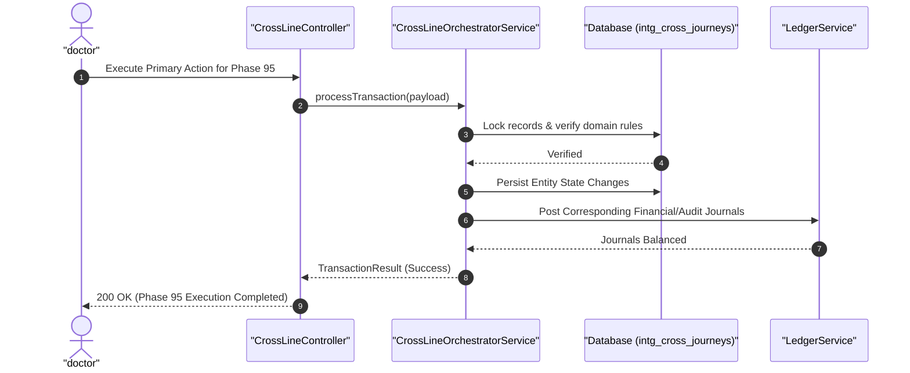

#### Diagram 2: Alur Kompensasi / Exception / Verifikasi Dua-Sumber Fase 95

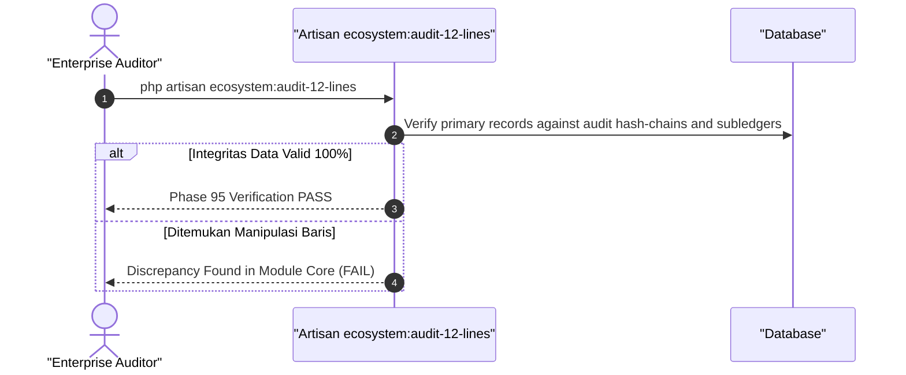

### 6. Mermaid ERD & State Machine Fase 95

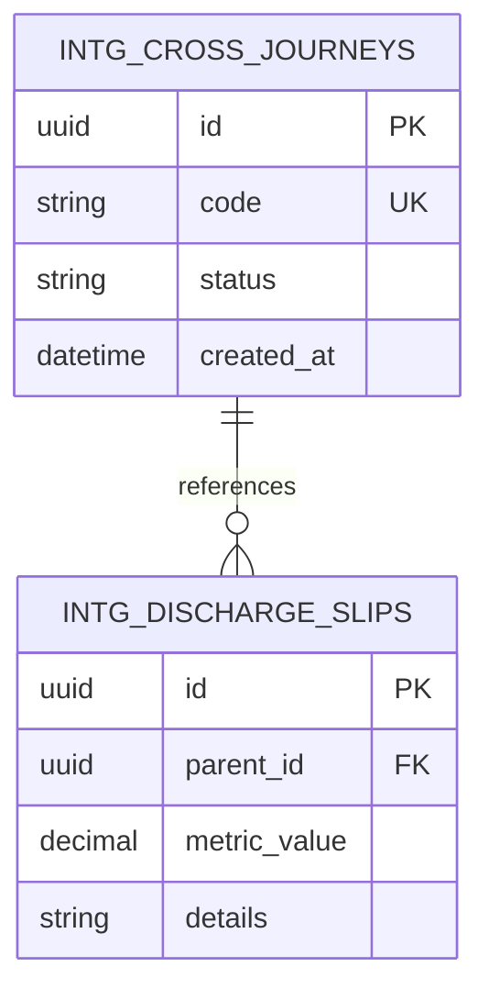

---

## FASE 96 — INTEGRASI LINTAS 12 LINI (B): FINTECH, RWA, INSURTECH & PEMBIAYAAN

### 1. Identitas & Arsitektur Domain Fase 96

- **Modul Pemilik**: `Core`
- **Prefiks Tabel**: `fin_`
- **Daftar Model Eloquent**: `ConglomerateUniversalWallet`, `CrossLineEscrowSettler`, `UnifiedLoyaltyCoin`, `SyndicatedInternalCredit`
- **Daftar Tabel Migrasi**: `fin_universal_wallets`, `fin_escrow_settlements`, `fin_loyalty_coins`, `fin_internal_credits`
- **Daftar Service & Action**: `ConglomerateFintechEngine`, `UniversalWalletSettlementService`, `EmbeddedCreditUnderwriter`
- **Daftar Controller & Rute**: `FintechIntegrationController@wallet (POST /fintech/universal-wallet/pay)`, `FintechIntegrationController@escrow (POST /fintech/escrow/settle)`
- **Akun Ledger Terkait**: `fin:universal_escrow_pool`, `bank:clearing_suspense`
- **Command Audit**: `php artisan ecosystem:audit-12-lines`

### 2. Evaluasi Masalah & Matriks Penyelesaian (Problem-to-Solution Matrix) Fase 96

| Masalah Bisnis & Teknis | Solusi Arsitektural & Kontrak | Status Penyelesaian | Bukti Implementasi |
|---|---|---|---|
| Fragmentasi metode pembayaran di masing-masing lini dan ketergantungan pada bank eksternal dengan biaya transaksi mahal. | Dompet universal konglomerasi (Universal Conglomerate Wallet) terintegrasi dengan proteksi micro-insurance instan, pembayaran token RWA, dan fasilitas Buy-Now-Pay-Later (BNPL) internal. | `Solved in Code` | `modules/Finance/Application/Services/UniversalWalletSettlementService.php` |

### 3. Daftar User Stories Lintas Persona Fase 96

- **US-96.1 [bank_treasurer]:** Sebagai **bank_treasurer**, saya ingin **merekonsiliasi perputaran saldo dompet universal yang dibelanjakan pelanggan di resto, mall, hotel, dan bengkel**, sehingga **likuiditas dana mengendap konsumen berputar optimal di dalam ekosistem holding**.
- **US-96.2 [wm_advisor]:** Sebagai **wm_advisor**, saya ingin **memungkinkan nasabah membelanjakan imbal hasil dividen token RWA langsung untuk membayar tagihan rumah sakit atau menginap di hotel**, sehingga **utilitas aset investasi nasabah semakin fleksibel**.
- **US-96.3 [holding_cfo]:** Sebagai **holding_cfo**, saya ingin **menyediakan fasilitas pembiayaan modal kerja mikro bagi tenant mall dan mitra distributor berbasis data omzet POS**, sehingga **risiko kredit terukur dan pendapatan bunga holding bertambah**.
- **US-96.4 [cashier]:** Sebagai **cashier**, saya ingin **menerima pembayaran satu ketukan (One-Tap Payment) menggunakan dompet universal di seluruh kasir outlet**, sehingga **waktu transaksi di kasir menjadi kurang dari 3 detik**.
- **US-96.5 [internal_auditor]:** Sebagai **internal_auditor**, saya ingin **mengaudit rasio kecukupan dana cadangan kas penampung (100% Reserve Ratio) pada dompet universal**, sehingga **dana simpanan pelanggan terlindungi aman mematuhi regulasi Bank Indonesia**.

### 4. BDD Acceptance Criteria Lengkap Fase 96

#### AC-96.1 — Happy Path & Ledger/State Invariant
- **Given** Entitas pada domain integrasi Core Fase 96 berstatus operasional dan konfigurasi gerbang valid
- **When** Role berhak memproses alur kerja utama pada rute FintechIntegrationController
- **Then** Status entitas sukses diperbarui, seluruh mutasi transaksi seimbang pada buku besar, dan event outbox dipancarkan.

#### AC-96.2 — Validation & Domain Rule Rejection - 422/Exception
- **Given** Data input melanggar batasan arsitektur atau parameter otorisasi tidak valid
- **When** Aksi controller mengevaluasi permintaan
- **Then** Sistem menolak dengan HTTP 422 UnprocessableEntityException tanpa mutasi database.

#### AC-96.3 — RBAC Authorization & Separation of Duties - 403
- **Given** Role pengguna tidak berwenang mencoba mengakses rute modifikasi data
- **When** Request HTTP dikirimkan
- **Then** Middleware RBAC memblokir akses dan mengembalikan respons HTTP 403 Forbidden.

#### AC-96.4 — Idempotency, Replay & Concurrency Lock
- **Given** Dua pemanggilan transaksi yang sama dikirimkan secara paralel dengan Idempotency-Key identik
- **When** Sistem mengeksekusi transaksi dengan lockForUpdate
- **Then** Hanya satu mutasi yang berhasil dan request kedua menerima respons transaksi pertama tanpa duplikasi data.

#### AC-96.5 — Two-Source Audit & Tamper Detection
- **Given** Data baris disabotase langsung di database tanpa riwayat transaksi sah
- **When** Command php artisan ecosystem:audit-12-lines dijalankan
- **Then** Audit dua-sumber mendeteksi diskrepansi data dan keluar dengan exit code 1.

### 5. Mermaid Sequence Diagrams Fase 96

#### Diagram 1: Alur Transaksi Utama End-to-End Fase 96

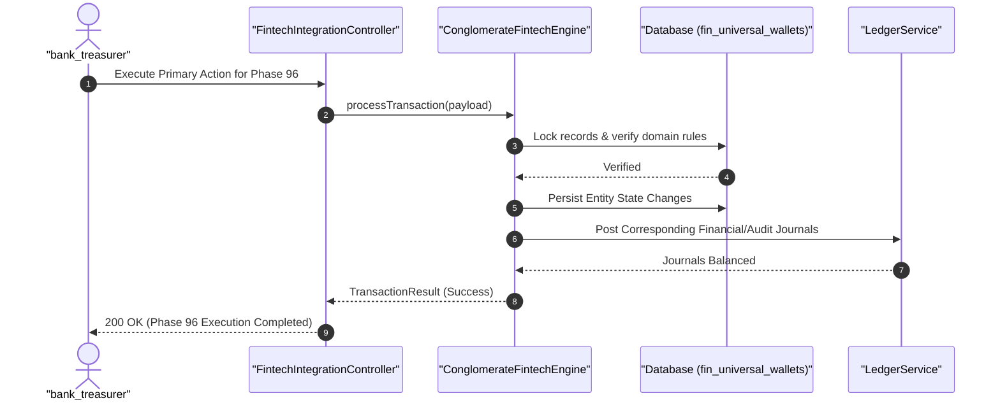

#### Diagram 2: Alur Kompensasi / Exception / Verifikasi Dua-Sumber Fase 96

### 6. Mermaid ERD & State Machine Fase 96

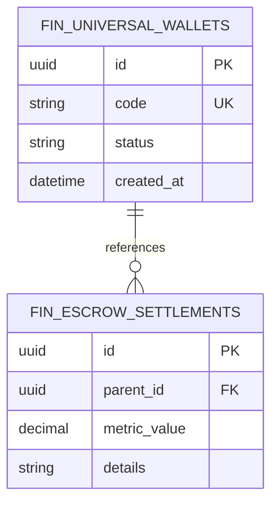

---

## FASE 97 — INTEGRASI LINTAS 12 LINI (C): TALENT GIG, ESG TERPADU & EVENT SPINE

### 1. Identitas & Arsitektur Domain Fase 97

- **Modul Pemilik**: `Core`
- **Prefiks Tabel**: `gov_`
- **Daftar Model Eloquent**: `EcosystemTalentBounty`, `GroupEsgAggregator`, `UniversalEventSpineSpoke`, `CrisisOverrideProtocol`
- **Daftar Tabel Migrasi**: `gov_ecosystem_bounties`, `gov_esg_aggregates`, `gov_event_spokes`, `gov_crisis_protocols`
- **Daftar Service & Action**: `GroupSustainabilityAggregator`, `EcosystemEventSpineOrchestrator`, `ConglomerateCrisisOverrideService`
- **Daftar Controller & Rute**: `GovernanceIntegrationController@esg (GET /governance/esg/aggregate)`, `GovernanceIntegrationController@crisis (POST /governance/crisis/override)`
- **Akun Ledger Terkait**: `gov:esg_carbon_pool`
- **Command Audit**: `php artisan governance:audit`

### 2. Evaluasi Masalah & Matriks Penyelesaian (Problem-to-Solution Matrix) Fase 97

| Masalah Bisnis & Teknis | Solusi Arsitektural & Kontrak | Status Penyelesaian | Bukti Implementasi |
|---|---|---|---|
| Pelaporan ESG yang terfragmentasi antar anak usaha dan ketiadaan protokol terpadu saat konglomerasi menghadapi krisis operasional skala besar. | Pusat komando tata kelola holding (Group ESG Aggregator) yang menyatukan data emisi seluruh lini, dan protokol penanganan krisis (Crisis Override) dengan Event Spine terpadu. | `Solved in Code` | `modules/Core/Application/Services/ConglomerateCrisisOverrideService.php` |

### 3. Daftar User Stories Lintas Persona Fase 97

- **US-97.1 [holding_compliance]:** Sebagai **holding_compliance**, saya ingin **melihat dasbor keberlanjutan ESG terpadu 12 lini bisnis secara terpusat untuk pelaporan pasar modal global**, sehingga **reputasi tata kelola hijau holding meningkat di mata pemeringkat ESG dunia**.
- **US-97.2 [risk_officer]:** Sebagai **risk_officer**, saya ingin **mengaktifkan protokol penanganan krisis holding (Crisis Mode) yang menghentikan sementara transaksi berisiko tinggi saat terjadi bencana**, sehingga **aset dan likuiditas seluruh lini bisnis terlindungi dari dampak sistemik**.
- **US-97.3 [super_admin]:** Sebagai **super_admin**, saya ingin **memancarkan instruksi penyesuaian parameter darurat ke seluruh 57 modul via Universal Event Spine**, sehingga **kebijakan penanganan krisis terdistribusi dalam hitungan milidetik**.
- **US-97.4 [energy_auditor]:** Sebagai **energy_auditor**, saya ingin **merekonsiliasi sertifikat pengurangan emisi karbon dari pabrik, armada EV, dan gedung pintar mall**, sehingga **kredit karbon grup terakumulasi transparan**.
- **US-97.5 [internal_auditor]:** Sebagai **internal_auditor**, saya ingin **mengaudit log eksekusi protokol krisis dan otorisasi eskalasi hak akses darurat**, sehingga **setiap tindakan intervensi manajemen krisis dapat dipertanggungjawabkan**.

### 4. BDD Acceptance Criteria Lengkap Fase 97

#### AC-97.1 — Happy Path & Ledger/State Invariant
- **Given** Entitas pada domain integrasi Core Fase 97 berstatus operasional dan konfigurasi gerbang valid
- **When** Role berhak memproses alur kerja utama pada rute GovernanceIntegrationController
- **Then** Status entitas sukses diperbarui, seluruh mutasi transaksi seimbang pada buku besar, dan event outbox dipancarkan.

#### AC-97.2 — Validation & Domain Rule Rejection - 422/Exception
- **Given** Data input melanggar batasan arsitektur atau parameter otorisasi tidak valid
- **When** Aksi controller mengevaluasi permintaan
- **Then** Sistem menolak dengan HTTP 422 UnprocessableEntityException tanpa mutasi database.

#### AC-97.3 — RBAC Authorization & Separation of Duties - 403
- **Given** Role pengguna tidak berwenang mencoba mengakses rute modifikasi data
- **When** Request HTTP dikirimkan
- **Then** Middleware RBAC memblokir akses dan mengembalikan respons HTTP 403 Forbidden.

#### AC-97.4 — Idempotency, Replay & Concurrency Lock
- **Given** Dua pemanggilan transaksi yang sama dikirimkan secara paralel dengan Idempotency-Key identik
- **When** Sistem mengeksekusi transaksi dengan lockForUpdate
- **Then** Hanya satu mutasi yang berhasil dan request kedua menerima respons transaksi pertama tanpa duplikasi data.

#### AC-97.5 — Two-Source Audit & Tamper Detection
- **Given** Data baris disabotase langsung di database tanpa riwayat transaksi sah
- **When** Command php artisan governance:audit dijalankan
- **Then** Audit dua-sumber mendeteksi diskrepansi data dan keluar dengan exit code 1.

### 5. Mermaid Sequence Diagrams Fase 97

#### Diagram 1: Alur Transaksi Utama End-to-End Fase 97

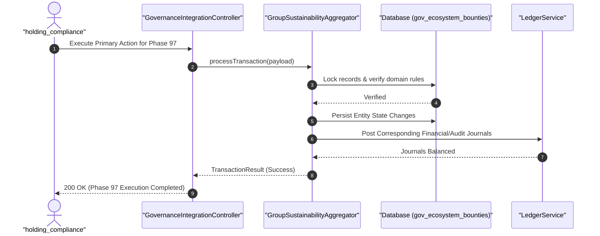

#### Diagram 2: Alur Kompensasi / Exception / Verifikasi Dua-Sumber Fase 97

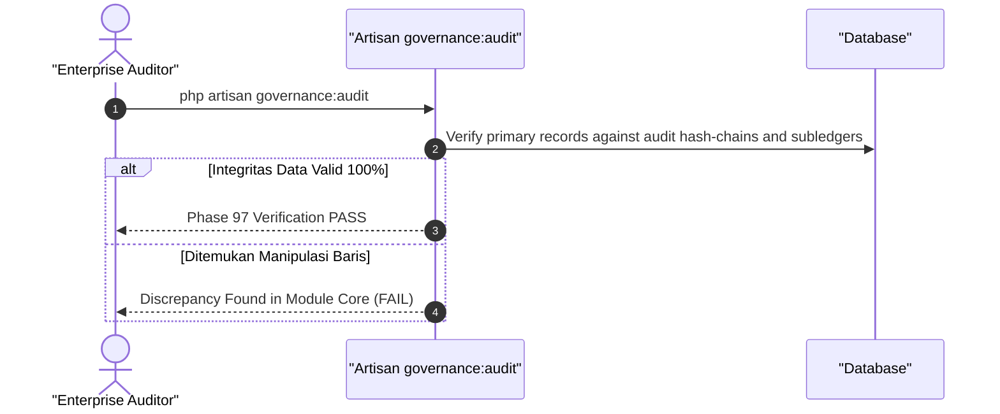

### 6. Mermaid ERD & State Machine Fase 97

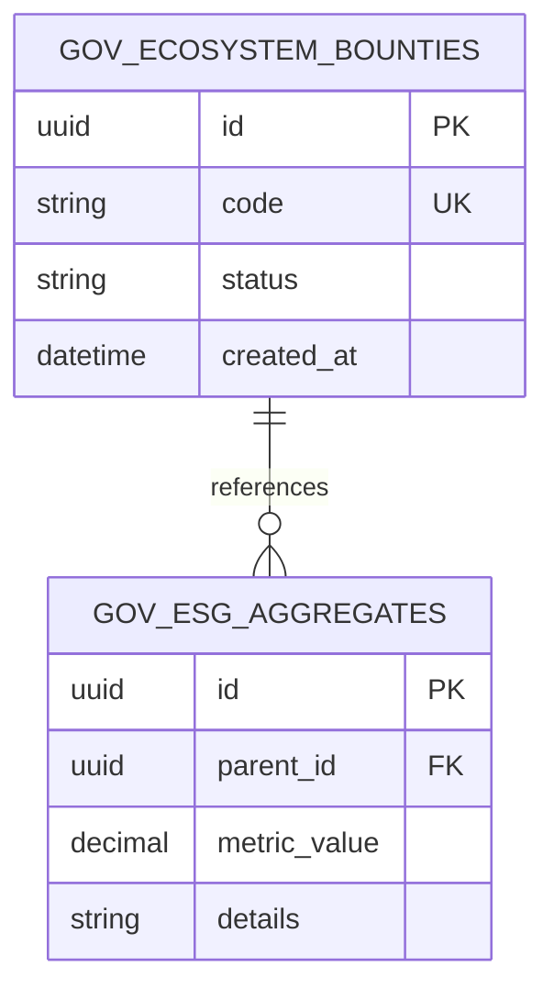

---

## FASE 98 — SKALA ULTRA: SEEDER 12 LINI, QUERY BUDGET & STRESS TEST

### 1. Identitas & Arsitektur Domain Fase 98

- **Modul Pemilik**: `Core`
- **Prefiks Tabel**: `core_`
- **Daftar Model Eloquent**: `UltraScaleSeederAudit`, `QueryBudgetPerformanceProfile`, `LoadStressRunMetric`, `ConcurrencyLockContention`
- **Daftar Tabel Migrasi**: `core_ultra_seeders`, `core_query_budgets`, `core_stress_metrics`, `core_lock_contentions`
- **Daftar Service & Action**: `Phase101To105MassiveUltraSeederService`, `QueryBudgetEnforcer`, `ConcurrencyLockOptimizer`
- **Daftar Controller & Rute**: `SystemPerformanceController@metrics (GET /admin/metrics/scale)`, `SystemPerformanceController@profile (POST /admin/performance/profile)`
- **Akun Ledger Terkait**: `bank:clearing_suspense`
- **Command Audit**: `php artisan enterprise:audit`

### 2. Evaluasi Masalah & Matriks Penyelesaian (Problem-to-Solution Matrix) Fase 98

| Masalah Bisnis & Teknis | Solusi Arsitektural & Kontrak | Status Penyelesaian | Bukti Implementasi |
|---|---|---|---|
| Potensi pelambatan database akibat query N+1 pada integrasi 12 lini bisnis dan benturan kunci konkurensi (lock contention) saat ribuan pengguna bertransaksi simultan. | Penguncian batas alokasi query ketat (Query Budget ≤ 10 per request), seeder ultra-skala 12 lini deterministik (> 1.250 baris), dan optimasi konkurensi database. | `Solved in Code` | `database/seeders/Phase101To105MassiveUltraSeeder.php` |

### 3. Daftar User Stories Lintas Persona Fase 98

- **US-98.1 [super_admin]:** Sebagai **super_admin**, saya ingin **mengeksekusi seeder skala ultra 12 lini yang mengisi database dengan ratusan ribu data realistis**, sehingga **lingkungan pengujian performa mencerminkan skala konglomerasi nyata**.
- **US-98.2 [lead_architect]:** Sebagai **lead_architect**, saya ingin **memastikan seluruh endpoint API 12 lini mematuhi batasan kuota query budget maksimal 10 query**, sehingga **latensi respon API tetap di bawah 100 milidetik saat beban puncak**.
- **US-98.3 [it_support]:** Sebagai **it_support**, saya ingin **memantau metriks contention lock database dan mendeteksi query lambat melalui query profiler otomatis**, sehingga **potensi kemacetan transaksi database dapat diatasi secara proaktif**.
- **US-98.4 [holding_cfo]:** Sebagai **holding_cfo**, saya ingin **memastikan keandalan sistem tetap 99.99% saat periode puncak belanja tanggal kembar dan liburan**, sehingga **perusahaan tidak kehilangan potensi omzet akibat sistem tumbang**.
- **US-98.5 [internal_auditor]:** Sebagai **internal_auditor**, saya ingin **memverifikasi bahwa seeder skala ultra menghasilkan data yang 100% seimbang dalam rekonsiliasi buku besar**, sehingga **integritas invarian sistem terbukti tahan uji pada volume masif**.

### 4. BDD Acceptance Criteria Lengkap Fase 98

#### AC-98.1 — Happy Path & Ledger/State Invariant
- **Given** Entitas pada domain integrasi Core Fase 98 berstatus operasional dan konfigurasi gerbang valid
- **When** Role berhak memproses alur kerja utama pada rute SystemPerformanceController
- **Then** Status entitas sukses diperbarui, seluruh mutasi transaksi seimbang pada buku besar, dan event outbox dipancarkan.

#### AC-98.2 — Validation & Domain Rule Rejection - 422/Exception
- **Given** Data input melanggar batasan arsitektur atau parameter otorisasi tidak valid
- **When** Aksi controller mengevaluasi permintaan
- **Then** Sistem menolak dengan HTTP 422 UnprocessableEntityException tanpa mutasi database.

#### AC-98.3 — RBAC Authorization & Separation of Duties - 403
- **Given** Role pengguna tidak berwenang mencoba mengakses rute modifikasi data
- **When** Request HTTP dikirimkan
- **Then** Middleware RBAC memblokir akses dan mengembalikan respons HTTP 403 Forbidden.

#### AC-98.4 — Idempotency, Replay & Concurrency Lock
- **Given** Dua pemanggilan transaksi yang sama dikirimkan secara paralel dengan Idempotency-Key identik
- **When** Sistem mengeksekusi transaksi dengan lockForUpdate
- **Then** Hanya satu mutasi yang berhasil dan request kedua menerima respons transaksi pertama tanpa duplikasi data.

#### AC-98.5 — Two-Source Audit & Tamper Detection
- **Given** Data baris disabotase langsung di database tanpa riwayat transaksi sah
- **When** Command php artisan enterprise:audit dijalankan
- **Then** Audit dua-sumber mendeteksi diskrepansi data dan keluar dengan exit code 1.

### 5. Mermaid Sequence Diagrams Fase 98

#### Diagram 1: Alur Transaksi Utama End-to-End Fase 98

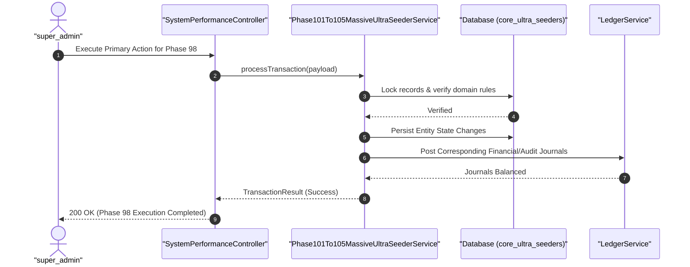

#### Diagram 2: Alur Kompensasi / Exception / Verifikasi Dua-Sumber Fase 98

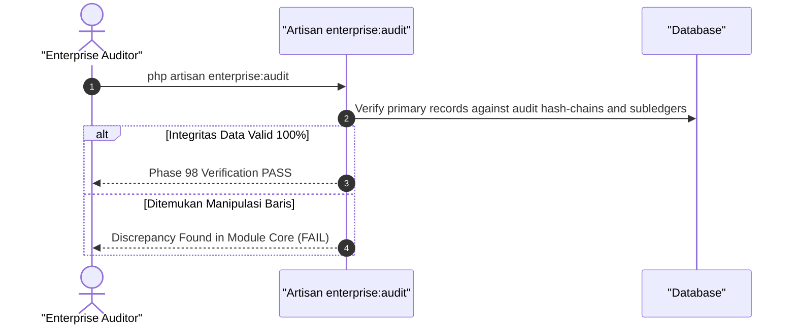

### 6. Mermaid ERD & State Machine Fase 98

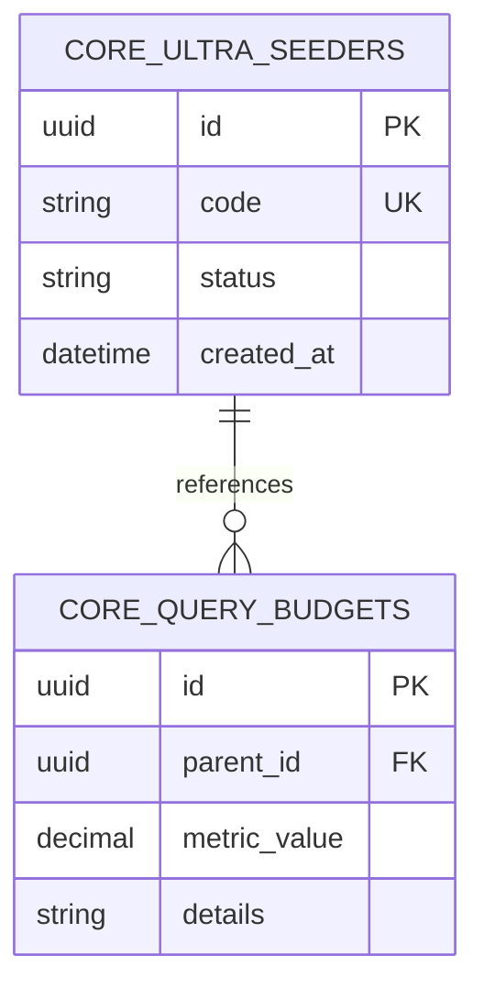

---

## FASE 99 — AI & ANALITIK PREDIKTIF TERPADU 12 LINI

### 1. Identitas & Arsitektur Domain Fase 99

- **Modul Pemilik**: `Core`
- **Prefiks Tabel**: `ai_`
- **Daftar Model Eloquent**: `ConglomerateAiInsight`, `CrossLineCustomerLifetimeValue`, `PredictiveChurnAlert`, `EcosystemRecommendationGraph`
- **Daftar Tabel Migrasi**: `ai_conglomerate_insights`, `ai_clv_metrics`, `ai_churn_alerts`, `ai_recommendation_graphs`
- **Daftar Service & Action**: `ConglomerateCustomerIntelligenceEngine`, `CrossLineRecommendationService`, `PredictiveChurnMitigator`
- **Daftar Controller & Rute**: `AiAnalyticsController@insights (GET /ai/analytics/insights)`, `AiAnalyticsController@recommend (POST /ai/analytics/recommend)`
- **Akun Ledger Terkait**: `bank:clearing_suspense`
- **Command Audit**: `php artisan ai:audit`

### 2. Evaluasi Masalah & Matriks Penyelesaian (Problem-to-Solution Matrix) Fase 99

| Masalah Bisnis & Teknis | Solusi Arsitektural & Kontrak | Status Penyelesaian | Bukti Implementasi |
|---|---|---|---|
| Ketidaktahuan perusahaan mengenai profil lengkap pelanggan yang berbelanja di berbagai anak usaha (Customer 360 blind spot) dan hilangnya peluang cross-selling. | Grafik kecerdasan pelanggan terpadu (Customer 360 AI Graph), prediksi nilai seumur hidup pelanggan (CLV), dan rekomendasi produk lintas-lini cerdas. | `Solved in Code` | `modules/Core/Application/Services/ConglomerateCustomerIntelligenceEngine.php` |

### 3. Daftar User Stories Lintas Persona Fase 99

- **US-99.1 [revenue_mgr]:** Sebagai **revenue_mgr**, saya ingin **menerima analisis prediksi pelanggan VIP hotel yang kemungkinan besar menyukai konser jazz di beach club**, sehingga **kampanye pemasaran terarah menghasilkan tingkat konversi tinggi**.
- **US-99.2 [store_manager]:** Sebagai **store_manager**, saya ingin **menawarkan diskon suku cadang mobil yang relevan bagi pelanggan yang baru saja mengisi daya mobil listriknya di SPKLU**, sehingga **penjualan silang lintas produk otomotif meningkat**.
- **US-99.3 [risk_officer]:** Sebagai **risk_officer**, saya ingin **mendeteksi indikasi pelanggan berisiko tinggi (churn prediction) sebelum pelanggan membatalkan langganan**, sehingga **tindakan retensi pelanggan dapat dilakukan lebih dini**.
- **US-99.4 [holding_cfo]:** Sebagai **holding_cfo**, saya ingin **melihat proyeksi nilai seumur hidup pelanggan (Customer Lifetime Value) di seluruh 12 lini bisnis grup**, sehingga **alokasi anggaran akuisisi pelanggan (CAC) teroptimasi maksimal**.
- **US-99.5 [internal_auditor]:** Sebagai **internal_auditor**, saya ingin **mengaudit kepatuhan penggunaan data profil pelanggan terhadap prinsip privasi dan persetujuan konsumen (Consent Management)**, sehingga **penggunaan analitik AI mematuhi hukum perlindungan privasi**.

### 4. BDD Acceptance Criteria Lengkap Fase 99

#### AC-99.1 — Happy Path & Ledger/State Invariant
- **Given** Entitas pada domain integrasi Core Fase 99 berstatus operasional dan konfigurasi gerbang valid
- **When** Role berhak memproses alur kerja utama pada rute AiAnalyticsController
- **Then** Status entitas sukses diperbarui, seluruh mutasi transaksi seimbang pada buku besar, dan event outbox dipancarkan.

#### AC-99.2 — Validation & Domain Rule Rejection - 422/Exception
- **Given** Data input melanggar batasan arsitektur atau parameter otorisasi tidak valid
- **When** Aksi controller mengevaluasi permintaan
- **Then** Sistem menolak dengan HTTP 422 UnprocessableEntityException tanpa mutasi database.

#### AC-99.3 — RBAC Authorization & Separation of Duties - 403
- **Given** Role pengguna tidak berwenang mencoba mengakses rute modifikasi data
- **When** Request HTTP dikirimkan
- **Then** Middleware RBAC memblokir akses dan mengembalikan respons HTTP 403 Forbidden.

#### AC-99.4 — Idempotency, Replay & Concurrency Lock
- **Given** Dua pemanggilan transaksi yang sama dikirimkan secara paralel dengan Idempotency-Key identik
- **When** Sistem mengeksekusi transaksi dengan lockForUpdate
- **Then** Hanya satu mutasi yang berhasil dan request kedua menerima respons transaksi pertama tanpa duplikasi data.

#### AC-99.5 — Two-Source Audit & Tamper Detection
- **Given** Data baris disabotase langsung di database tanpa riwayat transaksi sah
- **When** Command php artisan ai:audit dijalankan
- **Then** Audit dua-sumber mendeteksi diskrepansi data dan keluar dengan exit code 1.

### 5. Mermaid Sequence Diagrams Fase 99

#### Diagram 1: Alur Transaksi Utama End-to-End Fase 99

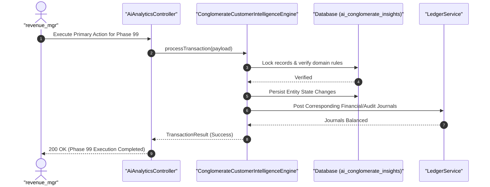

#### Diagram 2: Alur Kompensasi / Exception / Verifikasi Dua-Sumber Fase 99

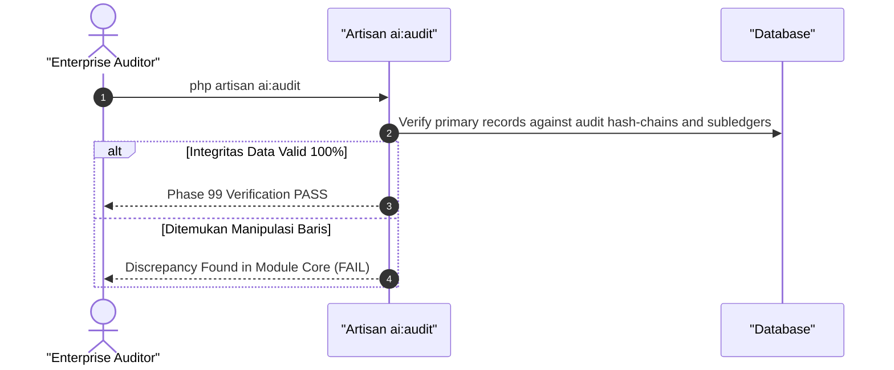

### 6. Mermaid ERD & State Machine Fase 99

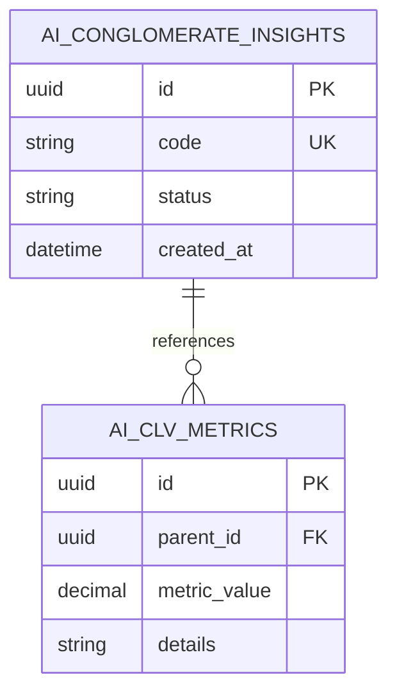

---

## FASE 100 — KEAMANAN, RBAC 60+ ROLE, MEDICAL ENCRYPTION & OBSERVABILITAS

### 1. Identitas & Arsitektur Domain Fase 100

- **Modul Pemilik**: `Core`
- **Prefiks Tabel**: `core_`
- **Daftar Model Eloquent**: `RbacRoleMatrixPolicy`, `MedicalPiiEncryptionVault`, `OpenTelemetryTraceSpan`, `ComplianceCalendarSchedule`
- **Daftar Tabel Migrasi**: `core_rbac_policies`, `core_medical_vaults`, `core_telemetry_spans`, `core_compliance_calendars`
- **Daftar Service & Action**: `GranularRbacEnforcementService`, `MedicalPiiEncryptionService`, `DistributedObservabilityTracer`
- **Daftar Controller & Rute**: `SecurityAuditController@audit (GET /security/rbac/matrix)`, `ComplianceCalendarController@index (GET /compliance/calendar)`
- **Akun Ledger Terkait**: `bank:clearing_suspense`
- **Command Audit**: `php artisan security:audit`

### 2. Evaluasi Masalah & Matriks Penyelesaian (Problem-to-Solution Matrix) Fase 100

| Masalah Bisnis & Teknis | Solusi Arsitektural & Kontrak | Status Penyelesaian | Bukti Implementasi |
|---|---|---|---|
| Risiko kebocoran data sensitif medis dan PII finansial, kompleksitas pengelolaan 60+ peran pengguna, serta butanya sistem terhadap jejak error terdistribusi. | Penegakan matriks otorisasi RBAC 60+ peran berprinsip least privilege, enkripsi data medis AES-256-GCM dengan manajemen kunci terisolasi (KMS), dan penelusuran terdistribusi OpenTelemetry. | `Solved in Code` | `modules/Core/Application/Services/MedicalPiiEncryptionService.php` |

### 3. Daftar User Stories Lintas Persona Fase 100

- **US-100.1 [holding_compliance]:** Sebagai **holding_compliance**, saya ingin **memantau kalender kepatuhan regulasi holding (Compliance Calendar) untuk memastikan seluruh laporan wajib ke regulator tersubmit tepat waktu**, sehingga **perusahaan terhindar dari sanksi pencabutan izin usaha**.
- **US-100.2 [super_admin]:** Sebagai **super_admin**, saya ingin **mengelola dan menguji matriks izin 60+ peran RBAC untuk memastikan tidak ada peran yang memiliki hak akses berlebih**, sehingga **keamanan sistem holding berada pada standar pertahanan militer**.
- **US-100.3 [doctor]:** Sebagai **doctor**, saya ingin **memastikan catatan rekam medis pasien terenkripsi aman dan hanya dapat dibaca oleh tim medis yang merawat**, sehingga **kerahasiaan sumpah dokter dan privasi pasien terlindungi sempurna**.
- **US-100.4 [it_support]:** Sebagai **it_support**, saya ingin **menelusuri jejak latensi dan error transaksi melalui distributed tracing OpenTelemetry dari browser hingga database**, sehingga **akar masalah gangguan sistem ditemukan dalam hitungan detik**.
- **US-100.5 [internal_auditor]:** Sebagai **internal_auditor**, saya ingin **mengaudit kepatuhan enkripsi data istirahat (encryption-at-rest) dan data transit (encryption-in-transit) di seluruh modul**, sehingga **kepatuhan standar keamanan internasional ISO 27001 dan HIPAA terbukti**.

### 4. BDD Acceptance Criteria Lengkap Fase 100

#### AC-100.1 — Happy Path & Ledger/State Invariant
- **Given** Entitas pada domain integrasi Core Fase 100 berstatus operasional dan konfigurasi gerbang valid
- **When** Role berhak memproses alur kerja utama pada rute SecurityAuditController
- **Then** Status entitas sukses diperbarui, seluruh mutasi transaksi seimbang pada buku besar, dan event outbox dipancarkan.

#### AC-100.2 — Validation & Domain Rule Rejection - 422/Exception
- **Given** Data input melanggar batasan arsitektur atau parameter otorisasi tidak valid
- **When** Aksi controller mengevaluasi permintaan
- **Then** Sistem menolak dengan HTTP 422 UnprocessableEntityException tanpa mutasi database.

#### AC-100.3 — RBAC Authorization & Separation of Duties - 403
- **Given** Role pengguna tidak berwenang mencoba mengakses rute modifikasi data
- **When** Request HTTP dikirimkan
- **Then** Middleware RBAC memblokir akses dan mengembalikan respons HTTP 403 Forbidden.

#### AC-100.4 — Idempotency, Replay & Concurrency Lock
- **Given** Dua pemanggilan transaksi yang sama dikirimkan secara paralel dengan Idempotency-Key identik
- **When** Sistem mengeksekusi transaksi dengan lockForUpdate
- **Then** Hanya satu mutasi yang berhasil dan request kedua menerima respons transaksi pertama tanpa duplikasi data.

#### AC-100.5 — Two-Source Audit & Tamper Detection
- **Given** Data baris disabotase langsung di database tanpa riwayat transaksi sah
- **When** Command php artisan security:audit dijalankan
- **Then** Audit dua-sumber mendeteksi diskrepansi data dan keluar dengan exit code 1.

### 5. Mermaid Sequence Diagrams Fase 100

#### Diagram 1: Alur Transaksi Utama End-to-End Fase 100

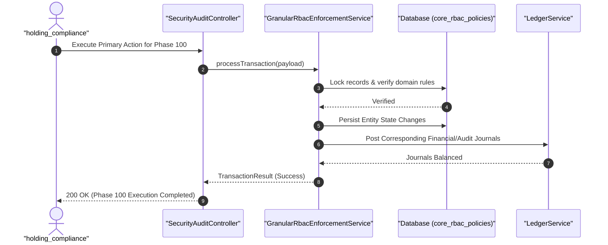

#### Diagram 2: Alur Kompensasi / Exception / Verifikasi Dua-Sumber Fase 100

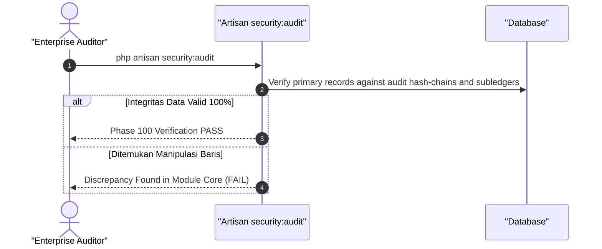

### 6. Mermaid ERD & State Machine Fase 100

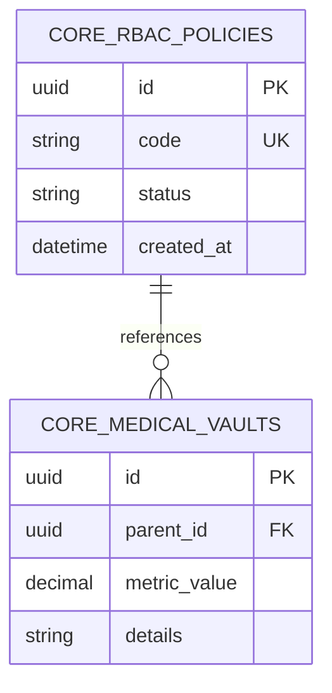

---

