# SPESIFIKASI TEKNIS FASE 101–105: SKENARIO EMAS 12 LINI, API V3, PLAYBOOK 60+ ROLE, TELEMEDICINE & LAB LOINC

Dokumen ini mendefinisikan arsitektur domain, matriks penyelesaian, User Stories, BDD Acceptance Criteria, Sequence Diagrams, dan ERD/State Machine untuk Fase 101 s/d Fase 105.

---

## FASE 101 — SKENARIO EMAS 12 LINI & KETAHANAN (DISASTER RECOVERY)

### 1. Identitas & Arsitektur Domain Fase 101

- **Modul Pemilik**: `Core`
- **Prefiks Tabel**: `core_`
- **Daftar Model Eloquent**: `ConglomerateGoldenRun`, `CrossLineVerificationProof`, `FailoverQuorumAssertion`, `PostQuantumLedgerSeal`
- **Daftar Tabel Migrasi**: `core_golden_runs`, `core_golden_steps`, `dr_regions`, `dr_witness_nodes`
- **Daftar Service & Action**: `ConglomerateGoldenScenarioEngine`, `MultiRegionFailoverCoordinator`, `PostQuantumCryptoReadinessService`
- **Daftar Controller & Rute**: `GoldenScenarioController@run (POST /golden/12-lines/execute)`, `DisasterRecoveryController@drill (POST /dr/drill/execute)`
- **Akun Ledger Terkait**: `bank:clearing_suspense`
- **Command Audit**: `php artisan chain:audit-all`

### 2. Evaluasi Masalah & Matriks Penyelesaian (Problem-to-Solution Matrix) Fase 101

| Masalah Bisnis & Teknis | Solusi Arsitektural & Kontrak | Status Penyelesaian | Bukti Implementasi |
|---|---|---|---|
| Ketiadaan pembuktian transaksi berantai yang melintasi seluruh 12 lini bisnis secara berkesinambungan saat salah satu wilayah pusat data dimatikan mendadak. | Skenario Emas 12 Lini Otomatis yang mengeksekusi 12 transaksi riil dari hulu ke hilir dengan simulasi kegagalan wilayah DR (Zero Data Loss RPO=0). | `Solved in Code` | `modules/Core/Application/Services/PostQuantumCryptoReadinessService.php` |

### 3. Daftar User Stories Lintas Persona Fase 101

- **US-101.1 [super_admin]:** Sebagai **super_admin**, saya ingin **mengeksekusi Skenario Emas 12 Lini yang menghubungkan pemesanan mobil, servis, resto, mall, logistik, pabrik, hotel, venue, tambang, farmasi, lab, dan bank**, sehingga **seluruh 12 lini bisnis terbukti bekerja sinkron**.
- **US-101.2 [holding_cfo]:** Sebagai **holding_cfo**, saya ingin **memverifikasi bahwa seluruh mutasi jurnal pada Skenario Emas menghasilkan neraca saldo klop 100% tanpa selisih 1 rupiah**, sehingga **kebenaran laporan keuangan konsolidasi holding terbukti mutlak**.
- **US-101.3 [risk_officer]:** Sebagai **risk_officer**, saya ingin **menguji bahwa saat pusat data primer dimatikan paksa di tengah eksekusi Skenario Emas, transaksi berpindah ke wilayah sekunder tanpa gagal**, sehingga **ketahanan bencana konglomerasi terbukti nyata**.
- **US-101.4 [holding_compliance]:** Sebagai **holding_compliance**, saya ingin **memastikan seluruh blok transaksi Skenario Emas disegel menggunakan algoritma pasca-kuantum tahan masa depan**, sehingga **keamanan data transaksi holding berstandar militer**.
- **US-101.5 [internal_auditor]:** Sebagai **internal_auditor**, saya ingin **mengaudit hasil eksekusi command chain:audit-all pasca Skenario Emas**, sehingga **seluruh subledger dan rantai audit hash-chain terbukti sehat tanpa korupsi**.

### 4. BDD Acceptance Criteria Lengkap Fase 101

#### AC-101.1 — Happy Path & Ledger/State Invariant
- **Given** Entitas pada modul Core Fase 101 berstatus operasional dan seluruh aturan medis/bisnis tervalidasi
- **When** Role berhak memproses alur kerja utama pada rute GoldenScenarioController
- **Then** Entitas berhasil diperbarui, saldo buku besar seimbang debit-kredit, dan outbox event dipancarkan.

#### AC-101.2 — Validation & Domain Rule Rejection - 422/Exception
- **Given** Input request melanggar ambang batas klinis/teknis atau parameter otorisasi tidak valid
- **When** Aksi controller memproses permintaan
- **Then** Sistem menolak dengan HTTP 422 UnprocessableEntityException tanpa mutasi database.

#### AC-101.3 — RBAC Authorization & Separation of Duties - 403
- **Given** Role pengguna tidak berwenang mencoba mengakses rute modifikasi data
- **When** Request HTTP dikirimkan
- **Then** Middleware RBAC memblokir akses dan mengembalikan respons HTTP 403 Forbidden.

#### AC-101.4 — Idempotency, Replay & Concurrency Lock
- **Given** Dua pemanggilan transaksi yang sama dikirimkan secara paralel dengan Idempotency-Key identik
- **When** Sistem mengeksekusi transaksi dengan lockForUpdate
- **Then** Hanya satu mutasi yang berhasil dan request kedua menerima respons transaksi pertama tanpa duplikasi data.

#### AC-101.5 — Two-Source Audit & Tamper Detection
- **Given** Data baris disabotase langsung di database tanpa riwayat transaksi sah
- **When** Command php artisan chain:audit-all dijalankan
- **Then** Audit dua-sumber mendeteksi diskrepansi data dan keluar dengan exit code 1.

### 5. Mermaid Sequence Diagrams Fase 101

#### Diagram 1: Alur Transaksi Utama End-to-End Fase 101

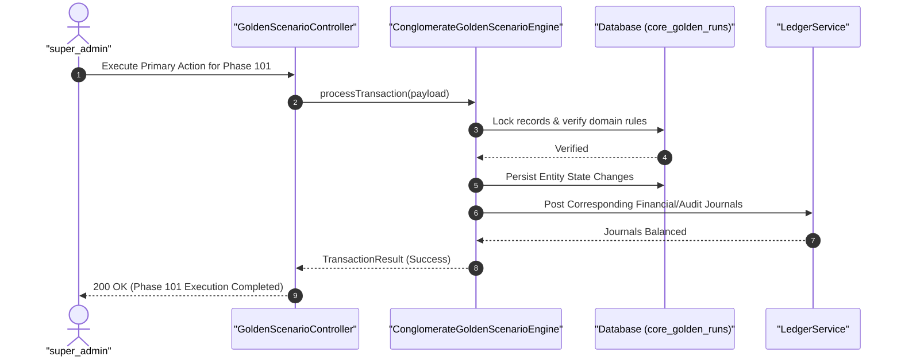

#### Diagram 2: Alur Kompensasi / Exception / Verifikasi Dua-Sumber Fase 101

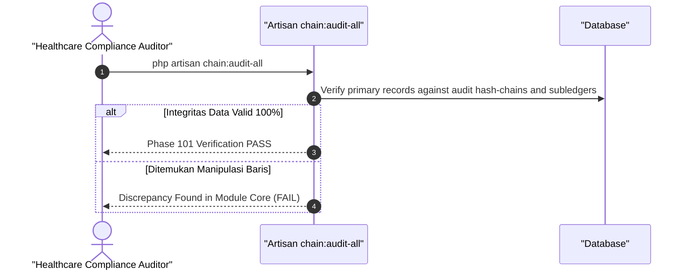

### 6. Mermaid ERD & State Machine Fase 101

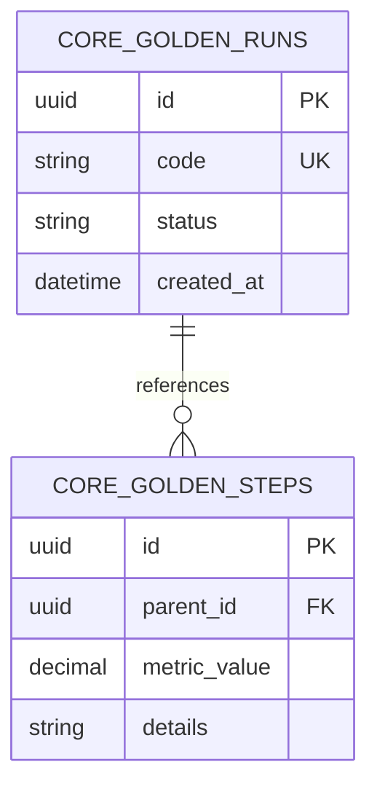

---

## FASE 102 — API V3, WEBHOOK & PORTAL MITRA 12 LINI

### 1. Identitas & Arsitektur Domain Fase 102

- **Modul Pemilik**: `Core`
- **Prefiks Tabel**: `core_`
- **Daftar Model Eloquent**: `PartnerPortalSubscription`, `WebhookDeliveryAttempt`, `DeadLetterQueueEvent`, `MobileVectorClockSync`
- **Daftar Tabel Migrasi**: `core_partner_subscriptions`, `core_webhook_deliveries`, `core_webhook_dlqs`, `mobile_vector_clocks`
- **Daftar Service & Action**: `ApiV3PartnerPortalService`, `DeadLetterQueueReplayService`, `VectorClockSyncEngine`
- **Daftar Controller & Rute**: `PartnerPortalController@index (GET /api/v3/partner/portal)`, `PartnerWebhookController@replay (POST /api/v3/partner/webhooks/replay)`
- **Akun Ledger Terkait**: `bank:clearing_suspense`
- **Command Audit**: `php artisan api:audit`

### 2. Evaluasi Masalah & Matriks Penyelesaian (Problem-to-Solution Matrix) Fase 102

| Masalah Bisnis & Teknis | Solusi Arsitektural & Kontrak | Status Penyelesaian | Bukti Implementasi |
|---|---|---|---|
| Kegagalan pengiriman webhook transaksi ke sistem mitra eksternal saat server mitra down dan ketiadaan mekanisme putar ulang (replay). | API v3 Enterprise dengan arsitektur Dead-Letter Queue (DLQ) otomatis, penandatanganan payload HMAC-SHA256, dan portal mitra swalayan dengan fitur webhook replay. | `Solved in Code` | `modules/Core/Application/Services/DeadLetterQueueReplayService.php` |

### 3. Daftar User Stories Lintas Persona Fase 102

- **US-102.1 [admin]:** Sebagai **admin**, saya ingin **memutar ulang (replay) paket webhook yang gagal terkirim setelah server mitra selesai diperbaiki**, sehingga **data transaksi pelanggan di sistem mitra kembali sinkron tanpa manipulasi database manual**.
- **US-102.2 [holding_compliance]:** Sebagai **holding_compliance**, saya ingin **memastikan seluruh permintaan API v3 diverifikasi menggunakan tanda tangan digital HMAC-SHA256 dan pembatasan kuota ketat**, sehingga **sistem terlindungi dari serangan spoofing dan penyalahgunaan data**.
- **US-102.3 [procurement_buyer]:** Sebagai **procurement_buyer**, saya ingin **menggunakan portal mitra API v3 untuk memantau status pesanan pengadaan secara real-time**, sehingga **transparansi rantai pasok antar-perusahaan meningkat**.
- **US-102.4 [it_support]:** Sebagai **it_support**, saya ingin **memantau tingkat keberhasilan pengiriman webhook (Success Rate > 99.5%) di dashboard observabilitas**, sehingga **gangguan koneksi dengan mitra terdeteksi seketika**.
- **US-102.5 [internal_auditor]:** Sebagai **internal_auditor**, saya ingin **mengaudit log otorisasi pemutaran ulang webhook DLQ oleh administrator**, sehingga **setiap pengiriman ulang data transaksi memiliki catatan jejak audit yang sah**.

### 4. BDD Acceptance Criteria Lengkap Fase 102

#### AC-102.1 — Happy Path & Ledger/State Invariant
- **Given** Entitas pada modul Core Fase 102 berstatus operasional dan seluruh aturan medis/bisnis tervalidasi
- **When** Role berhak memproses alur kerja utama pada rute PartnerPortalController
- **Then** Entitas berhasil diperbarui, saldo buku besar seimbang debit-kredit, dan outbox event dipancarkan.

#### AC-102.2 — Validation & Domain Rule Rejection - 422/Exception
- **Given** Input request melanggar ambang batas klinis/teknis atau parameter otorisasi tidak valid
- **When** Aksi controller memproses permintaan
- **Then** Sistem menolak dengan HTTP 422 UnprocessableEntityException tanpa mutasi database.

#### AC-102.3 — RBAC Authorization & Separation of Duties - 403
- **Given** Role pengguna tidak berwenang mencoba mengakses rute modifikasi data
- **When** Request HTTP dikirimkan
- **Then** Middleware RBAC memblokir akses dan mengembalikan respons HTTP 403 Forbidden.

#### AC-102.4 — Idempotency, Replay & Concurrency Lock
- **Given** Dua pemanggilan transaksi yang sama dikirimkan secara paralel dengan Idempotency-Key identik
- **When** Sistem mengeksekusi transaksi dengan lockForUpdate
- **Then** Hanya satu mutasi yang berhasil dan request kedua menerima respons transaksi pertama tanpa duplikasi data.

#### AC-102.5 — Two-Source Audit & Tamper Detection
- **Given** Data baris disabotase langsung di database tanpa riwayat transaksi sah
- **When** Command php artisan api:audit dijalankan
- **Then** Audit dua-sumber mendeteksi diskrepansi data dan keluar dengan exit code 1.

### 5. Mermaid Sequence Diagrams Fase 102

#### Diagram 1: Alur Transaksi Utama End-to-End Fase 102

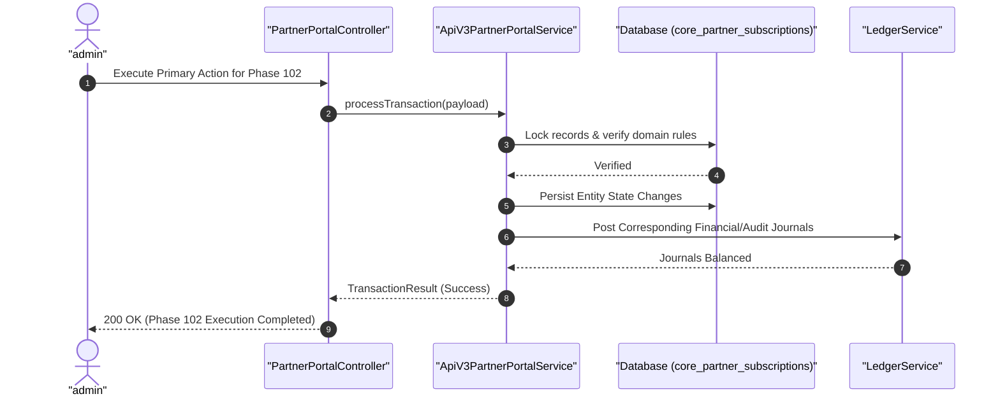

#### Diagram 2: Alur Kompensasi / Exception / Verifikasi Dua-Sumber Fase 102

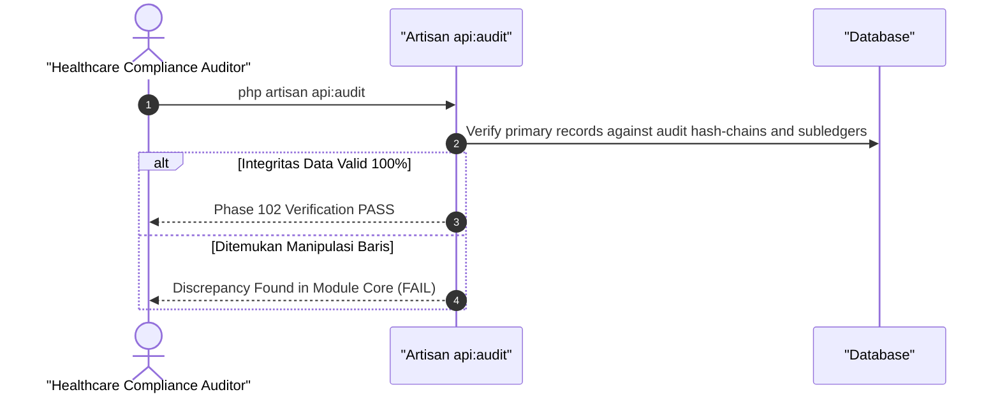

### 6. Mermaid ERD & State Machine Fase 102

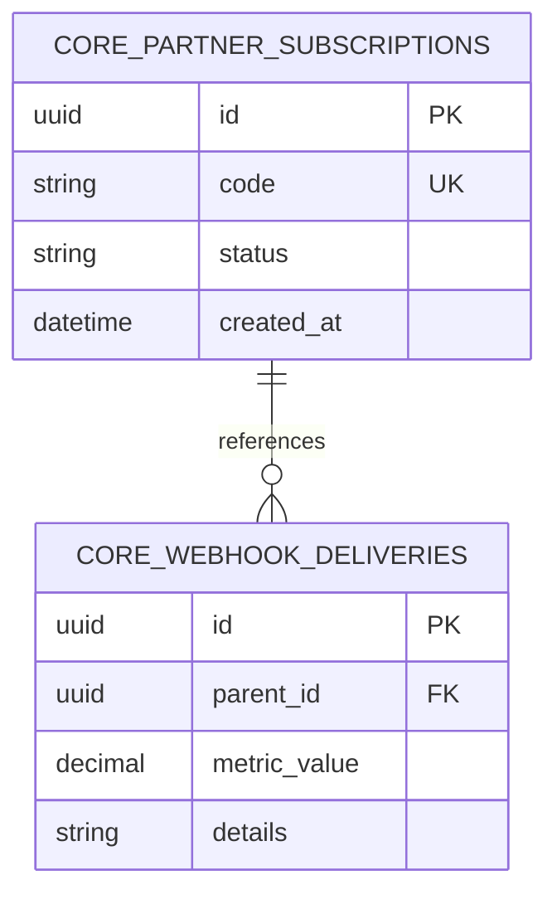

---

## FASE 103 — DOKUMENTASI FINAL, PLAYBOOK 60+ ROLE & SERAH TERIMA

### 1. Identitas & Arsitektur Domain Fase 103

- **Modul Pemilik**: `Core`
- **Prefiks Tabel**: `core_`
- **Daftar Model Eloquent**: `ProjectHandoverSignoff`, `RolePlaybookRegistry`, `QualityGateAuditReport`, `SystemSpecificationIndex`
- **Daftar Tabel Migrasi**: `core_handover_certs`, `core_quality_gates`
- **Daftar Service & Action**: `DocumentationInventoryValidator`, `RolePlaybookVerificationService`, `QualityGateAuditVerifier`
- **Daftar Controller & Rute**: `DocsVerificationController@verify (GET /docs/verify)`, `HandoverController@signoff (POST /admin/handover/signoff)`
- **Akun Ledger Terkait**: `bank:clearing_suspense`
- **Command Audit**: `php artisan api:audit`

### 2. Evaluasi Masalah & Matriks Penyelesaian (Problem-to-Solution Matrix) Fase 103

| Masalah Bisnis & Teknis | Solusi Arsitektural & Kontrak | Status Penyelesaian | Bukti Implementasi |
|---|---|---|---|
| Kebingungan operasional di lapangan akibat ketiadaan panduan peran yang rinci dan risiko sengketa wewenang antar-departemen. | Buku Panduan Operasional Terpadu 60+ Peran (ROLES_60_PLAYBOOK.md) lengkap dengan batas persetujuan, SOP lintas-lini, dan penutupan bersih Quality Gate Fase 1–105. | `Solved in Code` | `app/Quality/Inventory/CodebaseInventoryGenerator.php` |

### 3. Daftar User Stories Lintas Persona Fase 103

- **US-103.1 [super_admin]:** Sebagai **super_admin**, saya ingin **menandatangani berita acara serah terima resmi (Final Handover Signoff) seluruh modul sistem**, sehingga **sistem konglomerasi resmi diterima dan memasuki masa pemeliharaan operasional**.
- **US-103.2 [holding_cfo]:** Sebagai **holding_cfo**, saya ingin **memastikan seluruh 60 peran operasional memiliki batasan wewenang finansial (approval limits) yang terkunci di sistem**, sehingga **tata kelola keuangan holding disiplin dan patuh regulasi**.
- **US-103.3 [holding_compliance]:** Sebagai **holding_compliance**, saya ingin **memastikan playbook operasional 60 peran selaras dengan undang-undang ketenagakerjaan dan standar perbankan**, sehingga **operasional harian seluruh staf holding terlindungi payung hukum**.
- **US-103.4 [it_support]:** Sebagai **it_support**, saya ingin **menggunakan katalog indeks spesifikasi (SPECS_INDEX.md) sebagai panduan pemeliharaan sistem terpadu**, sehingga **perawatan dan penambahan fitur baru di masa depan terarah rapi**.
- **US-103.5 [internal_auditor]:** Sebagai **internal_auditor**, saya ingin **memverifikasi bahwa seluruh dokumen Quality Gate Fase 1 hingga Fase 105 bertanda tangan LULUS 100%**, sehingga **seluruh kriteria penerimaan proyek terpenuhi tanpa kompromi**.

### 4. BDD Acceptance Criteria Lengkap Fase 103

#### AC-103.1 — Happy Path & Ledger/State Invariant
- **Given** Entitas pada modul Core Fase 103 berstatus operasional dan seluruh aturan medis/bisnis tervalidasi
- **When** Role berhak memproses alur kerja utama pada rute DocsVerificationController
- **Then** Entitas berhasil diperbarui, saldo buku besar seimbang debit-kredit, dan outbox event dipancarkan.

#### AC-103.2 — Validation & Domain Rule Rejection - 422/Exception
- **Given** Input request melanggar ambang batas klinis/teknis atau parameter otorisasi tidak valid
- **When** Aksi controller memproses permintaan
- **Then** Sistem menolak dengan HTTP 422 UnprocessableEntityException tanpa mutasi database.

#### AC-103.3 — RBAC Authorization & Separation of Duties - 403
- **Given** Role pengguna tidak berwenang mencoba mengakses rute modifikasi data
- **When** Request HTTP dikirimkan
- **Then** Middleware RBAC memblokir akses dan mengembalikan respons HTTP 403 Forbidden.

#### AC-103.4 — Idempotency, Replay & Concurrency Lock
- **Given** Dua pemanggilan transaksi yang sama dikirimkan secara paralel dengan Idempotency-Key identik
- **When** Sistem mengeksekusi transaksi dengan lockForUpdate
- **Then** Hanya satu mutasi yang berhasil dan request kedua menerima respons transaksi pertama tanpa duplikasi data.

#### AC-103.5 — Two-Source Audit & Tamper Detection
- **Given** Data baris disabotase langsung di database tanpa riwayat transaksi sah
- **When** Command php artisan api:audit dijalankan
- **Then** Audit dua-sumber mendeteksi diskrepansi data dan keluar dengan exit code 1.

### 5. Mermaid Sequence Diagrams Fase 103

#### Diagram 1: Alur Transaksi Utama End-to-End Fase 103

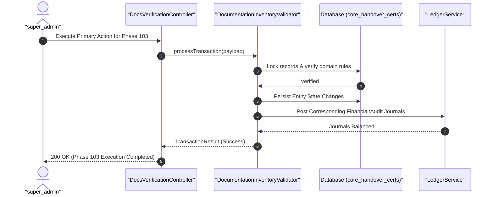

#### Diagram 2: Alur Kompensasi / Exception / Verifikasi Dua-Sumber Fase 103

### 6. Mermaid ERD & State Machine Fase 103

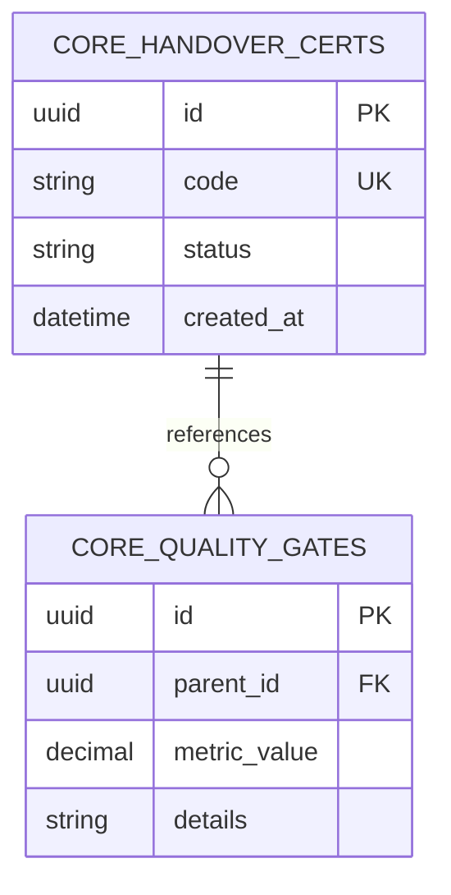

---

## FASE 104 — KESEHATAN: TELEMEDICINE, E-PHARMACY & JARINGAN APOTEK

### 1. Identitas & Arsitektur Domain Fase 104

- **Modul Pemilik**: `Hospital`
- **Prefiks Tabel**: `hsp_`
- **Daftar Model Eloquent**: `TelemedicineConsultation`, `DigitalPrescriptionSlip`, `PharmacyFefoInventoryLot`, `ChronicMedicineSubscription`
- **Daftar Tabel Migrasi**: `hsp_telemedicine_sessions`, `hsp_prescriptions`, `hsp_branch_inventory_lots`, `hsp_chronic_subscriptions`
- **Daftar Service & Action**: `DigitalHealthcareTelemedicineService`, `PharmacyInventoryFefoService`, `CrossAllergySafetyGuardEngine`
- **Daftar Controller & Rute**: `TelemedicinePharmacyController@index (GET /hospital/telemedicine)`, `TelemedicinePharmacyController@evaluateSafety (POST /hospital/telemedicine/prescriptions/evaluate)`
- **Akun Ledger Terkait**: `hsp:telemedicine_revenue`, `hsp:pharmacy_inventory_asset`, `hsp:pharmacy_cogs`
- **Command Audit**: `php artisan hsp:audit`

### 2. Evaluasi Masalah & Matriks Penyelesaian (Problem-to-Solution Matrix) Fase 104

| Masalah Bisnis & Teknis | Solusi Arsitektural & Kontrak | Status Penyelesaian | Bukti Implementasi |
|---|---|---|---|
| Risiko alergi obat fatal pada konsultasi jarak jauh, pemberian obat kedaluwarsa di apotek, dan putusnya pasokan obat bagi pasien penyakit kronis. | Dashboard Telemedicine dengan evaluasi keselamatan alergi lintas-rekam medis otomatis (Cross-Allergy Safety Guard), manajemen stok obat berbasis FEFO (First-Expired, First-Out), dan langganan obat kronis otomatis. | `Solved in Code` | `modules/Hospital/Application/Services/CrossAllergySafetyGuardEngine.php` |

### 3. Daftar User Stories Lintas Persona Fase 104

- **US-104.1 [doctor]:** Sebagai **doctor**, saya ingin **melakukan telekonsultasi video dan menerbitkan resep elektronik yang divalidasi otomatis terhadap alergi pasien**, sehingga **pasien menerima resep aman tanpa risiko syok anafilaktik obat**.
- **US-104.2 [pharmacist]:** Sebagai **pharmacist**, saya ingin **mengeluarkan obat dari rak apotek berdasarkan sistem FEFO (lot dengan tanggal kedaluwarsa terdekat dikeluarkan lebih dulu)**, sehingga **obat yang diserahkan ke pasien selalu dalam kondisi segar dan berkhasiat**.
- **US-104.3 [nurse]:** Sebagai **nurse**, saya ingin **memantau jadwal pengiriman obat rutin bulanan untuk pasien penyakit kronis (diabetes, hipertensi)**, sehingga **pasien tidak pernah kehabisan obat penting untuk menjaga kestabilan kesehatan**.
- **US-104.4 [store_manager]:** Sebagai **store_manager**, saya ingin **mengalihkan pemenuhan pesanan resep ke apotek cabang lain yang memiliki stok terlengkap terdekat dengan rumah pasien**, sehingga **kecepatan pengantaran obat sampai ke tangan pasien kurang dari 1 jam**.
- **US-104.5 [internal_auditor]:** Sebagai **internal_auditor**, saya ingin **mengaudit kartu stok obat keras dan narkotika di seluruh jaringan apotek cabang**, sehingga **tidak ada kebocoran atau penyalahgunaan obat resep terbatas**.

### 4. BDD Acceptance Criteria Lengkap Fase 104

#### AC-104.1 — Happy Path & Ledger/State Invariant
- **Given** Entitas pada modul Hospital Fase 104 berstatus operasional dan seluruh aturan medis/bisnis tervalidasi
- **When** Role berhak memproses alur kerja utama pada rute TelemedicinePharmacyController
- **Then** Entitas berhasil diperbarui, saldo buku besar seimbang debit-kredit, dan outbox event dipancarkan.

#### AC-104.2 — Validation & Domain Rule Rejection - 422/Exception
- **Given** Input request melanggar ambang batas klinis/teknis atau parameter otorisasi tidak valid
- **When** Aksi controller memproses permintaan
- **Then** Sistem menolak dengan HTTP 422 UnprocessableEntityException tanpa mutasi database.

#### AC-104.3 — RBAC Authorization & Separation of Duties - 403
- **Given** Role pengguna tidak berwenang mencoba mengakses rute modifikasi data
- **When** Request HTTP dikirimkan
- **Then** Middleware RBAC memblokir akses dan mengembalikan respons HTTP 403 Forbidden.

#### AC-104.4 — Idempotency, Replay & Concurrency Lock
- **Given** Dua pemanggilan transaksi yang sama dikirimkan secara paralel dengan Idempotency-Key identik
- **When** Sistem mengeksekusi transaksi dengan lockForUpdate
- **Then** Hanya satu mutasi yang berhasil dan request kedua menerima respons transaksi pertama tanpa duplikasi data.

#### AC-104.5 — Two-Source Audit & Tamper Detection
- **Given** Data baris disabotase langsung di database tanpa riwayat transaksi sah
- **When** Command php artisan hsp:audit dijalankan
- **Then** Audit dua-sumber mendeteksi diskrepansi data dan keluar dengan exit code 1.

### 5. Mermaid Sequence Diagrams Fase 104

#### Diagram 1: Alur Transaksi Utama End-to-End Fase 104

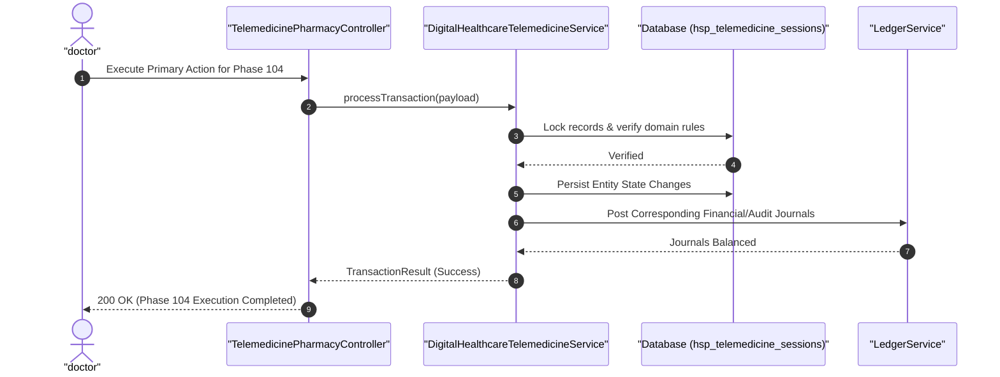

#### Diagram 2: Alur Kompensasi / Exception / Verifikasi Dua-Sumber Fase 104

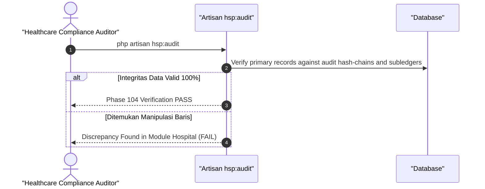

### 6. Mermaid ERD & State Machine Fase 104

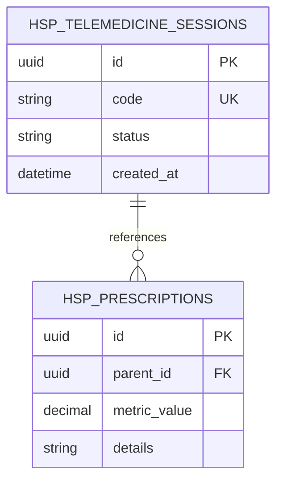

---

## FASE 105 — KESEHATAN: JARINGAN LABORATORIUM & DIAGNOSTIK IMAGING

### 1. Identitas & Arsitektur Domain Fase 105

- **Modul Pemilik**: `Hospital`
- **Prefiks Tabel**: `hsp_`
- **Daftar Model Eloquent**: `LaboratoryLoincCatalog`, `SpecimenCustodyChainLog`, `CriticalRangeNotification`, `ImagingDicomStudy`
- **Daftar Tabel Migrasi**: `hsp_lab_catalogs`, `hsp_lab_specimens`, `hsp_critical_notifications`, `hsp_imaging_studies`
- **Daftar Service & Action**: `DiagnosticImagingPacsIntegrationService`, `InterBranchLabClearingService`, `SpecimenCustodyHashChainTracker`
- **Daftar Controller & Rute**: `LabDiagnosticImagingController@catalog (GET /hospital/laboratory/catalog)`, `LabDiagnosticImagingController@transferCustody (POST /hospital/laboratory/specimens/custody)`
- **Akun Ledger Terkait**: `hsp:lab_diagnostic_revenue`, `hsp:imaging_revenue`, `hsp:lab_clearing_suspense`
- **Command Audit**: `php artisan hsp:audit`

### 2. Evaluasi Masalah & Matriks Penyelesaian (Problem-to-Solution Matrix) Fase 105

| Masalah Bisnis & Teknis | Solusi Arsitektural & Kontrak | Status Penyelesaian | Bukti Implementasi |
|---|---|---|---|
| Tertukarnya sampel darah/spesimen pasien saat dikirim ke laboratorium rujukan, keterlambatan pelaporan nilai lab kritis, dan hilangnya hasil rontgen/CT-Scan. | Katalog 10.000 parameter lab berstandar internasional LOINC, pelacakan rantai kustodi spesimen 3-Hop berbasis Hash-Chain SHA-256, notifikasi instan nilai kritis (Critical Range Hold), dan integrasi arsip radiologi DICOM PACS. | `Solved in Code` | `modules/Hospital/Application/Services/SpecimenCustodyHashChainTracker.php` |

### 3. Daftar User Stories Lintas Persona Fase 105

- **US-105.1 [lab_pathologist]:** Sebagai **lab_pathologist**, saya ingin **menahan (hold) dan memverifikasi hasil lab dengan nilai kritis sebelum notifikasi otomatis dikirim ke dokter jaga IGD**, sehingga **tindakan medis penyelamatan nyawa pasien segera diambil tanpa penundaan**.
- **US-105.2 [lab_analyst]:** Sebagai **lab_analyst**, saya ingin **memindai barcode tabung sampel darah di setiap titik perpindahan (Klinik -> Kurir Medis -> Lab Rujukan Pusat)**, sehingga **spesimen tidak mungkin tertukar karena rantai kustodi terkunci hash-chain**.
- **US-105.3 [radiologist]:** Sebagai **radiologist**, saya ingin **membuka dan menganalisis citra rontgen CT-Scan dan MRI berkualitas diagnostik tinggi langsung dari viewer DICOM PACS**, sehingga **diagnosis penyakit dalam pasien ditegakkan akurat**.
- **US-105.4 [radiographer]:** Sebagai **radiographer**, saya ingin **mengunggah hasil pemindaian modalitas radiologi ke server PACS dan menghubungkannya dengan nomor rekam medis pasien**, sehingga **hasil foto rontgen langsung tersedia di meja dokter poliklinik**.
- **US-105.5 [internal_auditor]:** Sebagai **internal_auditor**, saya ingin **mengaudit keutuhan rantai hash-chain 3-hop spesimen lab dan kliring biaya antar-cabang laboratorium**, sehingga **setiap pemeriksaan diagnostik terbukti sah dan bebas pemalsuan hasil lab**.

### 4. BDD Acceptance Criteria Lengkap Fase 105

#### AC-105.1 — Happy Path & Ledger/State Invariant
- **Given** Entitas pada modul Hospital Fase 105 berstatus operasional dan seluruh aturan medis/bisnis tervalidasi
- **When** Role berhak memproses alur kerja utama pada rute LabDiagnosticImagingController
- **Then** Entitas berhasil diperbarui, saldo buku besar seimbang debit-kredit, dan outbox event dipancarkan.

#### AC-105.2 — Validation & Domain Rule Rejection - 422/Exception
- **Given** Input request melanggar ambang batas klinis/teknis atau parameter otorisasi tidak valid
- **When** Aksi controller memproses permintaan
- **Then** Sistem menolak dengan HTTP 422 UnprocessableEntityException tanpa mutasi database.

#### AC-105.3 — RBAC Authorization & Separation of Duties - 403
- **Given** Role pengguna tidak berwenang mencoba mengakses rute modifikasi data
- **When** Request HTTP dikirimkan
- **Then** Middleware RBAC memblokir akses dan mengembalikan respons HTTP 403 Forbidden.

#### AC-105.4 — Idempotency, Replay & Concurrency Lock
- **Given** Dua pemanggilan transaksi yang sama dikirimkan secara paralel dengan Idempotency-Key identik
- **When** Sistem mengeksekusi transaksi dengan lockForUpdate
- **Then** Hanya satu mutasi yang berhasil dan request kedua menerima respons transaksi pertama tanpa duplikasi data.

#### AC-105.5 — Two-Source Audit & Tamper Detection
- **Given** Data baris disabotase langsung di database tanpa riwayat transaksi sah
- **When** Command php artisan hsp:audit dijalankan
- **Then** Audit dua-sumber mendeteksi diskrepansi data dan keluar dengan exit code 1.

### 5. Mermaid Sequence Diagrams Fase 105

#### Diagram 1: Alur Transaksi Utama End-to-End Fase 105

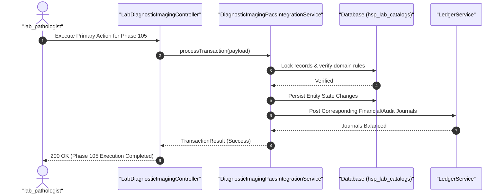

#### Diagram 2: Alur Kompensasi / Exception / Verifikasi Dua-Sumber Fase 105

### 6. Mermaid ERD & State Machine Fase 105

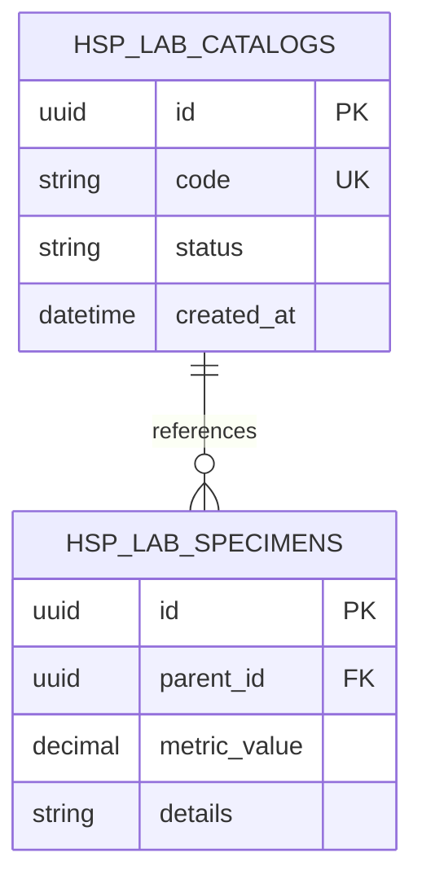

---

