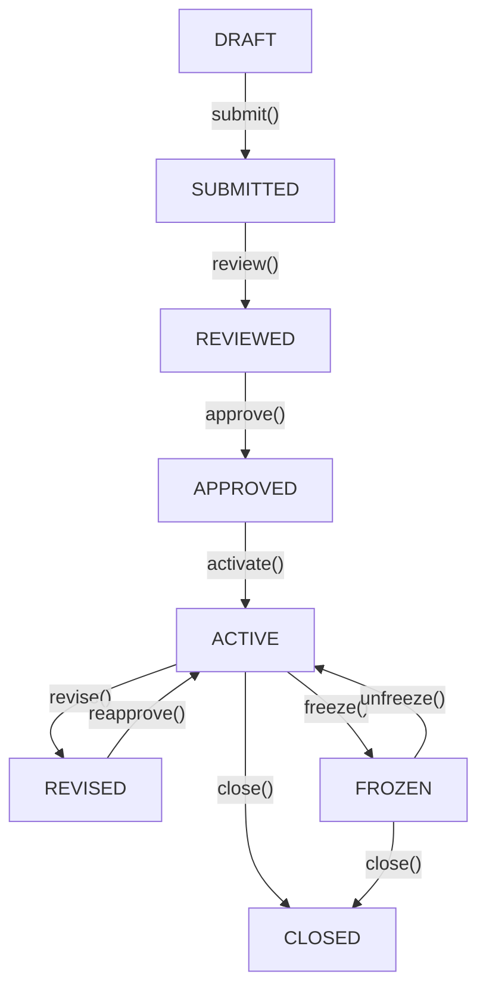

# Spesifikasi State Machine: EnterpriseBudgetCycleStateMachine

## 1. Identitas & Definisi Status
- **Nama Kelas**: `Modules\EnterpriseFinance\Domain\StateMachines\EnterpriseBudgetCycleStateMachine`
- **Model Terkait**: `Modules\EnterpriseFinance\Domain\Models\EnterpriseBudget`
- **Total Status**: Tepat 8 status kanonikal

| Status | Kode Status | Deskripsi Fungsional |
|---|---|---|
| **DRAFT** | `DRAFT` | Perumusan usulan pagu belanja awal oleh unit kerja departemen. |
| **SUBMITTED** | `SUBMITTED` | Pengajuan formal dokumen anggaran ke Komite Anggaran Grup. |
| **REVIEWED** | `REVIEWED` | Penelaahan teknis dan keselarasan rencana kerja oleh Corporate Planning. |
| **APPROVED** | `APPROVED` | Pengesahan legal pagu anggaran oleh Dewan Direksi & Komisaris. |
| **ACTIVE** | `ACTIVE` | Pagu operasional aktif; reservasi komitmen dan realisasi belanja kas dibuka. |
| **REVISED** | `REVISED` | Penyesuaian pagu tengah tahun (*mid-year revision*) atau realokasi amplop. |
| **FROZEN** | `FROZEN` | Pembekuan hak belanja darurat; pencairan kas ditangguhkan sementara. |
| **CLOSED** | `CLOSED` | Penutupan tahun fiskal; pembukuan dikunci dan sisa pagu dihanguskan. |

---

## 2. Matriks Transisi yang Diizinkan (Allowed Transitions)
Setiap perubahan status wajib mengikuti matriks transisi resmi. Transisi di luar matriks ini melempar `BudgetInvalidTransitionException`:

---

## 3. Aturan Validasi Maker-Checker
- Pengesahan anggaran dari `REVIEWED` ke `APPROVED` wajib memenuhi aturan *Four-Eyes Principle*: ID operator yang menyetujui (`approved_by`) dilarang sama dengan ID pembuat usulan anggaran (`created_by`). Pelanggaran melempar `BudgetMakerCheckerViolationException`.
