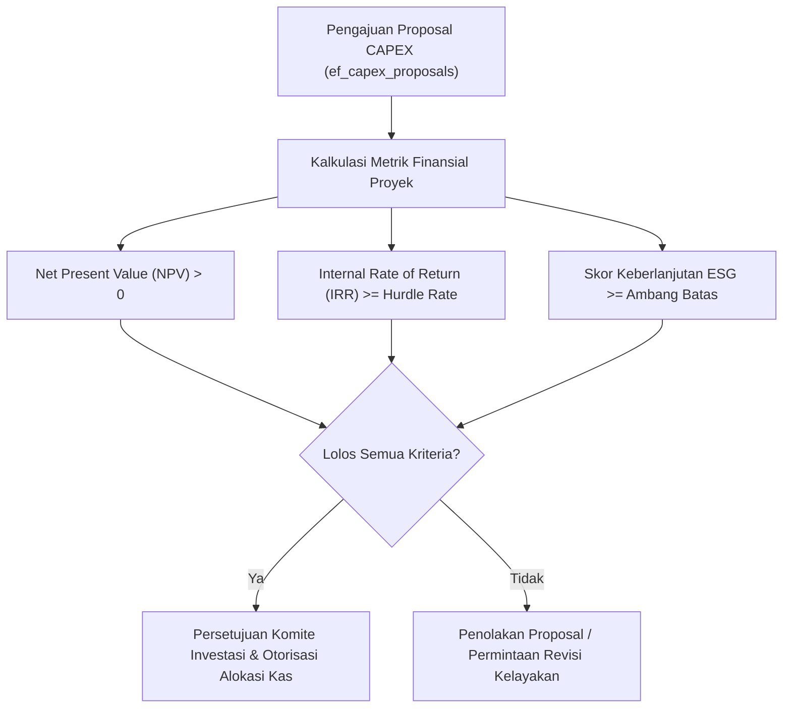

# Spesifikasi Evaluasi Belanja Modal (CAPEX): Metodologi Rasional NPV, IRR & ESG Hurdle Rate

## 1. Ikhtisar Alokasi Modal Strategis
Dalam konglomerasi dengan lini bisnis beragam, permintaan modal investasi anak perusahaan selalu melebihi kapasitas permodalan holding. Diperlukan kerangka seleksi kuantitatif terstandarisasi untuk memeringkat proposal belanja modal (*CAPEX proposals*) sebelum dana dialokasikan dari perbendaharaan holding.

---

## 2. Metodologi Perhitungan Matematis

### A. Net Present Value (NPV)
NPV dihitung dengan mendiskontokan seluruh proyeksi arus kas masa depan menggunakan biaya modal rata-rata tertimbang (*Weighted Average Cost of Capital / WACC*):
$$\text{NPV} = \sum_{t=1}^{n} \frac{\text{CashFlow}_t}{(1 + \text{WACC})^t} - \text{Investasi Awal}$$
- Proposal investasi hanya disetujui jika $\text{NPV} > 0$ dalam satuan rupiah minor unit.

### B. Internal Rate of Return (IRR)
IRR adalah tingkat diskonto yang menghasilkan $\text{NPV} = 0$:
$$0 = \sum_{t=1}^{n} \frac{\text{CashFlow}_t}{(1 + \text{IRR})^t} - \text{Investasi Awal}$$
- **Hurdle Rate Minimum**: Ditetapkan minimal $12,00\%$ ($1.200$ bps) untuk proyek berisiko rendah (efisiensi manufaktur), dan minimal $18,00\%$ ($1.800$ bps) untuk proyek ekspansi pasar baru.

### C. Skor Environmental, Social, and Governance (ESG)
Setiap proposal dinilai dengan skor ESG berskala 0–100:
- Mengukur pengurangan emisi karbon, kepatuhan keselamatan kerja (K3), dan transparansi pengadaan.
- Proposal dengan skor $\text{ESG} < 70,0$ ditolak secara otomatis kendati memiliki IRR finansial yang tinggi.

---

## 3. Tata Kelola Pemostingan Belanja Kas
Begitu proposal disetujui (`status = 'APPROVED'`), pengeluaran belanja kas bertahap dipantau secara ketat. Pengeluaran yang melampaui alokasi treasury yang disetujui (`allocated_treasury_budget_minor`) diblokir sistemik untuk mencegah pembengkakan biaya (*cost overrun*).
