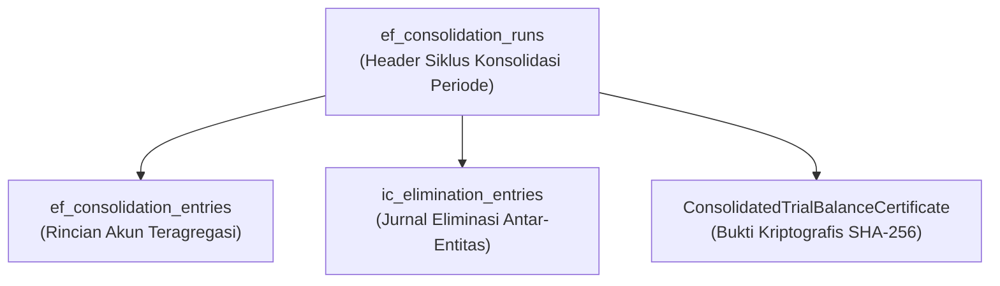

# Spesifikasi Model Data & Entitas Konsolidasi Finansial Multi-Entitas

## 1. Desain Skema Database Agregasi & Konsolidasi
Untuk mendukung auditibilitas penutupan buku konsolidasi, modul `EnterpriseFinance` memperluas tabel dengan entitas siklus konsolidasi:

---

## 2. Struktur Tabel `ef_consolidation_runs`
- `id` (bigint, PK)
- `run_code` (string, unique, format: `CR-YYYYMM-XXXX`)
- `period` (string, 7, format: `YYYY-MM`)
- `reporting_currency` (string, 3, default: `IDR`)
- `total_entities_count` (integer): Jumlah entitas anak yang tercakup dalam konsolidasi.
- `total_debit_minor` (bigint): Total nilai debit teragregasi dalam sen IDR.
- `total_credit_minor` (bigint): Total nilai kredit teragregasi dalam sen IDR.
- `elimination_total_minor` (bigint): Total nilai eliminasi timbal balik yang diterapkan.
- `is_balanced` (boolean): Menandakan apakah total debit tepat sama dengan total kredit.
- `sha256_hash` (string, 64): Hash integritas atas payload konsolidasi.
- `status` (string, 20): `draft`, `aggregated`, `verified`, `published`.
- `executed_by` (foreignId to `users`).
- `timestamps`

---

## 3. Struktur Tabel `ef_consolidation_entries`
- `id` (bigint, PK)
- `consolidation_run_id` (foreignId to `ef_consolidation_runs`, cascade)
- `entity_code` (string, 32): Kode entitas anak penyumbang saldo.
- `account_code` (string, 32): Kode akun grup kanonikal.
- `account_name` (string, 128): Nama deskriptif akun.
- `local_debit_minor` (bigint): Saldo debit dari buku besar lokal entitas.
- `local_credit_minor` (bigint): Saldo kredit dari buku besar lokal entitas.
- `elimination_debit_minor` (bigint): Penyesuaian eliminasi debit.
- `elimination_credit_minor` (bigint): Penyesuaian eliminasi kredit.
- `consolidated_net_minor` (bigint): Saldo bersih konsolidasi akhir akun.
- `timestamps`

---

## 4. Keamanan & Immutabilitas Data Konsolidasi
Begitu sebuah `consolidation_run` dipublikasikan (`status = 'published'`), seluruh entitas di dalamnya berstatus *read-only*. Perubahan di masa depan hanya diperbolehkan melalui jurnal penyesuaian periode berikutnya (*prior period adjustment*).
