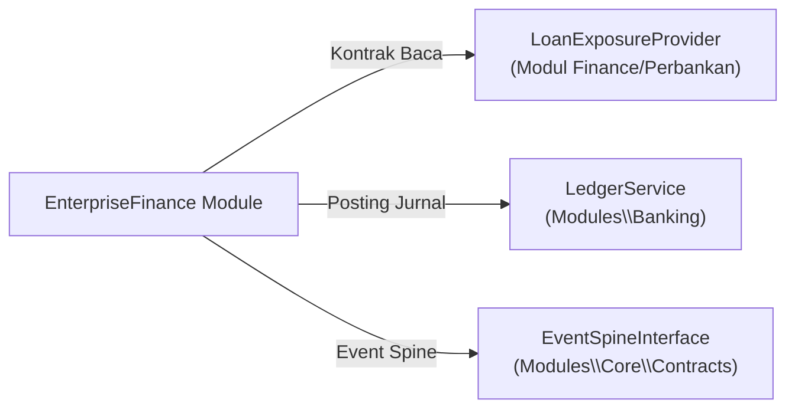

# Spesifikasi Kontrak Antarmuka & Event Spine Modul EnterpriseFinance

## 1. Ikhtisar Integrasi Antarmuka Lintas Modul
Sesuai prinsip desain batas modul (*bounded context*), modul `EnterpriseFinance` tidak mengakses tabel atau model internal modul lain secara langsung. Komunikasi keluar dilakukan melalui kontrak antarmuka (*interface*) resmi atau event bus terdistribusi.



---

## 2. Kontrak `LoanExposureProvider`
Modul `EnterpriseFinance` memantau total liabilitas kredit konsolidasi dari seluruh portofolio pinjaman:
```php
namespace Modules\EnterpriseFinance\Contracts;

interface LoanExposureProvider
{
    /**
     * Mengembalikan total saldo pokok utang berbunga dalam minor unit mata uang tertentu.
     */
    public function getTotalOutstandingDebtMinor(string $entityCode, string $currency = 'IDR'): int;

    /**
     * Mengembalikan total pokok pinjaman yang jatuh tempo dalam 12 bulan ke depan.
     */
    public function getUpcomingDebtServiceMinor(string $entityCode, string $currency = 'IDR'): int;
}
```

---

## 3. Integrasi Event Spine & Outbox Bus
Setiap kejadian keuangan material di tingkat korporat dipublikasikan ke event spine:
- `enterprise_finance.budget.breached`: Dipancarkan ketika percobaan transaksi ditolak akibat melampaui pagu *Hard-Stop*.
- `enterprise_finance.covenant.warning`: Dipancarkan ketika salah satu rasio utang sindikasi berada di zona kritis.
- `enterprise_finance.consolidation.completed`: Dipancarkan setelah siklus agregasi neraca saldo multi-entitas disahkan dan seimbang zero-sum.
