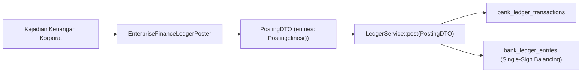

# Kebijakan Akuntansi Buku Besar & Standar Akun Kanonikal EnterpriseFinance

## 1. Prinsip Pembukuan Single-Sign & Aturan Saldo Normal
Seluruh transaksi moneter di dalam modul `EnterpriseFinance` diposting ke modul perbankan melalui `Modules\Banking\Application\Services\LedgerService` menggunakan konvensi single-sign balance:
- **Debit**: Bertanda negatif ($-$).
- **Kredit**: Bertanda positif ($+$).
- **Keseimbangan Transaksi**: Setiap transaksi wajib memiliki jumlah nilai debit yang sama persis dengan jumlah nilai kredit dalam mata uang yang sama ($\sum \text{Debit} + \sum \text{Kredit} = 0$).

---

## 2. Daftar Akun Kanonikal `EnterpriseFinanceAccounts`

| Kode Akun | Nama Akun | Karakteristik Saldo Normal | Keterangan Fungsional |
|---|---|---|---|
| `ef:department_expense:IDR` | Beban Operasional Departemen | Debit (-) | Akun penampung realisasi belanja departemen |
| `ef:capex_clearing:IDR` | Kliring Belanja Modal (CAPEX) | Kredit (+) | Kliring pembayaran aset tetap sebelum kapitalisasi |
| `ef:holding_dividend_receivable:IDR` | Piutang Dividen dari Anak Perusahaan | Debit (-) | Hak dividen yang telah dideklarasikan anak |
| `ef:holding_dividend_income:IDR` | Pendapatan Dividen Holding | Kredit (+) | Pengakuan laba dividen upstream holding |
| `ef:syndicated_loan_cash:IDR` | Kas Hasil Penarikan Pinjaman Sindikasi | Debit (-) | Dana kas cair di rekening sindikasi |
| `ef:syndicated_loan_principal_liability:IDR` | Kewajiban Pokok Utang Sindikasi | Kredit (+) | Saldo liabilitas pokok kredit perbankan |
| `ef:syndicated_interest_expense:IDR` | Beban Bunga Pinjaman Sindikasi | Debit (-) | Beban bunga kuartalan yang diakrualkan |
| `ef:syndicated_interest_payable:IDR` | Utang Bunga Pinjaman Sindikasi | Kredit (+) | Kewajiban bunga yang siap dibayarkan |
| `ef:conglomerate_reserve:IDR` | Cadangan Modal Konglomerasi | Kredit (+) | Cadangan ekuitas umum grup |
| `ef:vat_payable:IDR` | Utang Pajak Pertambahan Nilai (PPN) | Kredit (+) | Provisi kewajiban PPN Kurang Bayar ke DJP |

---

## 3. Pendaftaran Akun pada Seeder
Seluruh akun kanonikal di atas didaftarkan secara permanen di `database/seeders/LedgerAccountsSeeder.php` melalui pemanggilan `EnterpriseFinanceAccounts::definitions()`, memastikan integritas relasi foreign key pada saat eksekusi posting.
