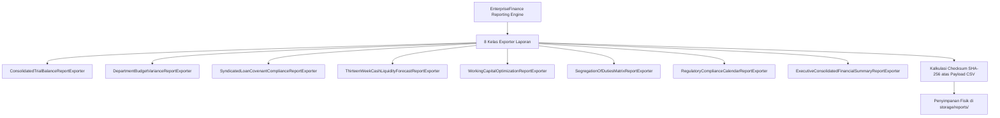

# Spesifikasi 8 Berkas Generator Laporan Finansial Korporat (CSV Report Exporters)

## 1. Standar Format & Verifikasi Integritas SHA-256
Seluruh generator laporan di `modules/EnterpriseFinance/Application/Reports/` menghasilkan artefak berekstensi CSV terstandarisasi RFC 4180 dengan baris ringkasan verifikasi integritas checksum SHA-256 pada bagian header atau footer. Artefak disimpan di direktori `storage/reports/enterprise_finance/`.

---

## 2. Rincian 8 Berkas Exporter Laporan

### 1. `ConsolidatedTrialBalanceReportExporter`
- **Tujuan**: Laporan neraca saldo teragregasi seluruh entitas holding, subholding, dan anak.
- **Kolom Utama**: `Entity_Code`, `Account_Code`, `Account_Name`, `Local_Currency`, `Debit_IDR`, `Credit_IDR`, `Net_Balance_IDR`, `Elimination_Adjustment_IDR`, `Consolidated_Balance_IDR`.

### 2. `DepartmentBudgetVarianceReportExporter`
- **Tujuan**: Analisis varians anggaran belanja vs realisasi kas dan komitmen encumbrance per departemen.
- **Kolom Utama**: `Cost_Center`, `Fiscal_Year`, `Account_Code`, `Allocated_IDR`, `Encumbered_IDR`, `Spent_IDR`, `Available_IDR`, `Variance_Permille`, `Control_Type`, `Status`.

### 3. `SyndicatedLoanCovenantComplianceReportExporter`
- **Tujuan**: Sertifikat kepatuhan kuartalan fasilitas kredit sindikasi untuk konsorsium bank kreditur.
- **Kolom Utama**: `Facility_Code`, `Period`, `EBITDA_IDR`, `Debt_Service_IDR`, `DSCR_Ratio`, `DSCR_Compliant`, `DER_Ratio`, `DER_Compliant`, `ISCR_Ratio`, `ISCR_Compliant`, `Current_Ratio`, `CR_Compliant`, `Overall_Compliant`, `SHA256_Signature`.

### 4. `ThirteenWeekCashLiquidityForecastReportExporter`
- **Tujuan**: Proyeksi arus kas likuiditas bergulir 13-minggu grup.
- **Kolom Utama**: `Week_Number`, `Start_Date`, `Projected_Inflow_IDR`, `Projected_Outflow_IDR`, `Net_Cashflow_IDR`, `Closing_Cash_Balance_IDR`, `Minimum_Operating_Threshold_IDR`, `Liquidity_Surplus_Deficit_IDR`.

### 5. `WorkingCapitalOptimizationReportExporter`
- **Tujuan**: Pelacakan metrik perputaran modal kerja anak perusahaan.
- **Kolom Utama**: `Entity_Code`, `Revenue_IDR`, `COGS_IDR`, `AR_Balance_IDR`, `Inventory_Balance_IDR`, `AP_Balance_IDR`, `DSO_Days`, `DIO_Days`, `DPO_Days`, `CCC_Days`, `Efficiency_Tier`.

### 6. `SegregationOfDutiesMatrixReportExporter`
- **Tujuan**: Audit kepatuhan pemisahan tugas peran pengguna aplikasi.
- **Kolom Utama**: `Rule_Code`, `Role_A`, `Role_B`, `Risk_Level`, `Conflicting_Users_Count`, `Description`, `Enforcement_Status`.

### 7. `RegulatoryComplianceCalendarReportExporter`
- **Tujuan**: Jadwal tenggat waktu kewajiban kepatuhan pajak, OJK, BI, dan penalti keterlambatan.
- **Kolom Utama**: `Item_Code`, `Regulatory_Authority`, `Title`, `Due_Date`, `Assigned_Role`, `Status`, `Days_Overdue`, `Estimated_Penalty_IDR`.

### 8. `ExecutiveConsolidatedFinancialSummaryReportExporter`
- **Tujuan**: Ringkasan eksekutif kesehatan finansial konsolidasi untuk Dewan Direksi dan RUPS.
- **Kolom Utama**: `Period_Quarter`, `Consolidated_Revenue_IDR`, `Consolidated_EBITDA_IDR`, `Net_Income_IDR`, `Total_Assets_IDR`, `Total_Debt_IDR`, `Equity_IDR`, `DER_Ratio`, `ROIC_Permille`, `CCC_Days`.
