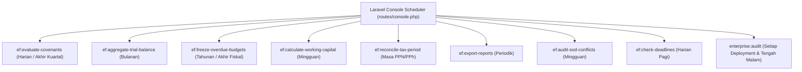

# Spesifikasi Perintah Terjadwal & Artisan Console Commands: Modul EnterpriseFinance

## 1. Ikhtisar Otomasi Console Commands
Modul `EnterpriseFinance` mengoperasikan 9 Artisan commands terjadwal untuk menjamin keberlanjutan kepatuhan tata kelola, pemantauan rasio kreditur, agregasi neraca saldo, dan rekonsiliasi buku besar otomatis.

---

## 2. Rincian 9 Artisan Commands Kanonikal

### 1. `ef:evaluate-covenants {--facility=} {--period=}`
Mengevaluasi rasio covenant finansial utang sindikasi (DSCR, DER, ISCR, Current Ratio) menggunakan Algoritma Bersertifikat D7. Menghasilkan sertifikat digital SHA-256 dan mendeteksi potensi breach.

### 2. `ef:aggregate-trial-balance {--period=} {--strict}`
Mengagregasikan neraca saldo seluruh unit bisnis konglomerasi menggunakan Algoritma Bersertifikat D8. Memvalidasi zero-sum balance ($\Sigma \text{Debit} = \Sigma \text{Kredit}$) dan menyimpan header di `ef_consolidation_runs`.

### 3. `ef:freeze-overdue-budgets {--fiscal-year=}`
Membekukan dan menutup siklus anggaran yang telah melewati tahun fiskal berjalan atau yang mengalami defisit likuiditas melalui transisi state machine ke `FROZEN` atau `CLOSED`.

### 4. `ef:calculate-working-capital {--entity=} {--period=}`
Menghitung empat metrik modal kerja: Days Sales Outstanding (DSO), Days Inventory Outstanding (DIO), Days Payable Outstanding (DPO), dan Cash Conversion Cycle (CCC) per anak perusahaan.

### 5. `ef:reconcile-tax-period {--period=} {--tax-type=}`
Merekonsiliasi Faktur Pajak Masukan dan Keluaran PPN serta bukti potong PPh Pasal 21/22/23/4(2) untuk memvalidasi posisi lebih/kurang bayar sebelum pelaporan SPT Masa ke DJP.

### 6. `ef:export-reports {--period=} {--all}`
Mengeksekusi 8 exporter laporan keuangan resmi berformat CSV di `modules/EnterpriseFinance/Application/Reports/` dan memverifikasi checksum SHA-256 pada masing-masing artefak.

### 7. `ef:audit-sod-conflicts`
Memindai database penugasan peran pengguna aktif terhadap matriks Segregation of Duties (SoD) dan mencatat setiap pelanggaran risiko `CRITICAL` ke log insiden keamanan korporat.

### 8. `ef:check-deadlines {--notify}`
Memeriksa kalender tenggat waktu kepatuhan regulasi (`ef_compliance_deadlines`). Memicu notifikasi eskalasi H-7 dan H-1, serta menghitung estimasi penalti keterlambatan jika status berubah menjadi `overdue`.

### 9. `enterprise:audit`
Audit dua sumber menyeluruh yang memverifikasi integritas internal modul `EnterpriseFinance` terhadap mutasi dan saldo transaksi pada buku besar perbankan `bank_ledger_transactions`. Exit 0 jika bersih, exit 1 jika ada diskrepansi.
