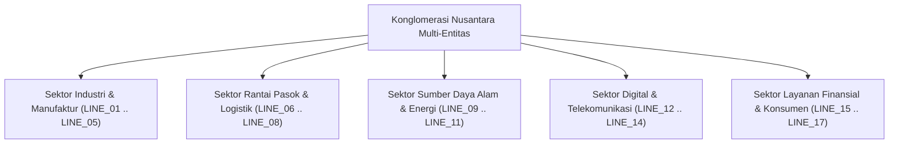

# Spesifikasi Pelaporan Segmen Usaha 17-Lini Konglomerasi Sesuai PSAK 5 / IFRS 8

## 1. Latar Belakang & Ruang Lingkup Segmen Operasi
Berdasarkan PSAK 5 (IFRS 8 *Operating Segments*), konglomerasi wajib menyajikan informasi keuangan yang memungkinkan pengguna laporan keuangan mengevaluasi sifat dan dampak keuangan dari aktivitas bisnis yang dilakukan serta lingkungan ekonomi tempat konglomerasi beroperasi.

Konglomerasi mengelompokkan portofolio bisnisnya ke dalam 17 Lini Usaha Strategis (*17 Strategic Business Lines*) yang diidentifikasi dari kode `LINE_01` hingga `LINE_17`.

---

## 2. Taksonomi 17 Lini Usaha Konglomerasi

| Kode Lini | Nama Lini Bisnis | Sektor Utama | Fokus Operasional |
|---|---|---|---|
| `LINE_01` | Otomotif & Komponen Mesin | Industri | Perakitan kendaraan niaga dan suku cadang mesin presisi. |
| `LINE_02` | Elektronika Mikro & Semikonduktor | Industri | Fabrikasi papan sirkuit dan sensor industri otomatisasi. |
| `LINE_03` | Fabrikasi Baja & Metalurgi Berat | Industri | Peleburan baja struktural untuk proyek infrastruktur. |
| `LINE_04` | Polimer, Plastik & Bahan Kimia Khusus | Industri | Produksi resin dan kemasan industri ramah lingkungan. |
| `LINE_05` | Tekstil Teknikal & Bahan Presisi | Industri | Serat sintetis untuk kebutuhan otomotif dan filtrasi udara. |
| `LINE_06` | Transportasi Darat & Distribusi Armada | Logistik | Pengoperasian 2.500 truk logistik antar-kota. |
| `LINE_07` | Pengapalan Laut & Operasi Terminal Curah | Logistik | Pelayaran kargo kontainer domestik dan internasional. |
| `LINE_08` | Pergudangan Rantai Dingin (Cold Storage) | Logistik | Hub penyimpanan beku untuk produk perikanan dan farmasi. |
| `LINE_09` | Pengolahan Nikel & Smelter Baterai EV | Energi | Ekstraksi feronikel untuk rantai pasok kendaraan listrik. |
| `LINE_10` | Perkebunan Kelapa Sawit & Oleokimia | Energi | Perkebunan berkelanjutan bersertifikat RSPO/ISPO. |
| `LINE_11` | Pembangkit Listrik Energi Terbarukan (EBT) | Energi | Pembangkit listrik tenaga surya (PLTS) dan hidro mikro. |
| `LINE_12` | Telekomunikasi Jaringan Fiber Optik | Digital | Penyedia *backbone* internet pita lebar antar-pulau. |
| `LINE_13` | Komputasi Awan & Infrastruktur Cloud ERP | Digital | Pusat data Tier-4 dan platform SaaS operasional grup. |
| `LINE_14` | Keamanan Siber & Integrasi Sistem AI | Digital | Layanan pertahanan siber korporat dan otomasi cerdas. |
| `LINE_15` | Pembiayaan Korporat & Finansial Digital | Layanan | Pembiayaan modal kerja vendor dan anjak piutang. |
| `LINE_16` | Properti Industri & Kawasan Ekonomi Khusus | Layanan | Pengelolaan kawasan industri ramah lingkungan (*Green Eco-Industrial Park*). |
| `LINE_17` | Jaringan Ritel Konsumen & FMCG | Layanan | Rantai toko serba ada dan distribusi sembako modern. |

---

## 3. Matriks Pelaporan Finansial Segmen
Setiap kuartal, modul `EnterpriseFinance` menghasilkan laporan segmen kuartalan (`ef_segment_financial_reports`) yang memuat:
1. **Pendapatan Eksternal**: Pendapatan yang diperoleh dari transaksi dengan pihak ketiga di luar grup.
2. **Pendapatan Antar-Segmen**: Nilai transaksi timbal balik antar-lini yang dieliminasi pada tingkat konsolidasi.
3. **EBITDA Segmen**: Laba operasional sebelum beban bunga, pajak, depresiasi, dan amortisasi.
4. **Alokasi Aset Segmen**: Nilai tercatat aset tetap dan modal kerja yang dipergunakan oleh masing-masing lini bisnis.
5. **Belanja Modal (CAPEX) Segmen**: Akumulasi pengeluaran investasi aset tetap baru per lini usaha sepanjang periode berjalan.
