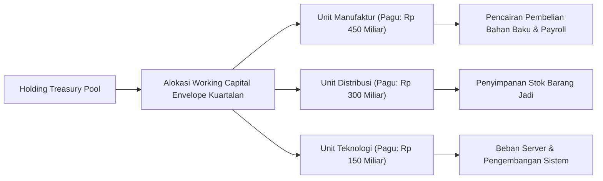

# Spesifikasi Alokasi Pagu Modal Kerja & Manajemen Piutang-Utang Grup

## 1. Filosofi Working Capital Envelope
*Working Capital Envelope* (Amplop Modal Kerja) adalah pagu maksimal sumber daya finansial jangka pendek yang dialokasikan oleh Holding kepada masing-masing unit bisnis anak perusahaan. Sistem ini membatasi penimbunan kas dan persediaan berlebih di anak perusahaan sekaligus memberikan kepastian ketersediaan dana untuk kelancaran operasional harian.

---

## 2. Aturan Penetapan Pagu & Metrik Efisiensi

### A. Komponen Perhitungan Envelope
Besaran amplop modal kerja dihitung menggunakan formula:
$$\text{Envelope}_{\text{minor}} = \text{intdiv}((\text{Target DSO} + \text{Target DIO} - \text{Target DPO}) \times \text{COGS Harian}, 1)$$
- **Target DSO**: Maksimal 45 hari untuk pelanggan ritel, maksimal 60 hari untuk institusi B2B.
- **Target DIO**: Maksimal 30 hari untuk bahan baku, maksimal 15 hari untuk barang jadi cepat putar (*fast-moving goods*).
- **Target DPO**: Minimal 60 hari untuk vendor material non-strategis, 45 hari untuk vendor utama.

### B. Kebijakan Piutang Dagang (Accounts Receivable Governance)
1. **Klasifikasi Umur Piutang (Aging Buckets)**:
   - *Current*: 0–30 hari (bebas risiko).
   - *Bucket 1*: 31–60 hari (pemantauan rutin).
   - *Bucket 2*: 61–90 hari (penghentian sementara plafon kredit penjualan).
   - *Overdue*: > 90 hari (penyerahan ke unit penagihan khusus & pembentukan cadangan penurunan nilai $100\%$).
2. **Cadangan Kerugian Penurunan Nilai (CKPN Sesuai PSAK 71)**:
   - Dihitung secara kolektif berdasar matriks probabilitas gagal bayar historis (*Probability of Default*).

---

## 3. Disiplin Pembayaran Utang Dagang (Accounts Payable Optimization)
- Pembayaran kepada vendor eksternal dijadwalkan secara terpusat pada dua hari proses per minggu (*batch payment runs*) untuk memaksimalkan saldo bunga harian holding.
- Diskon pelunasan cepat (*early payment discount*, misal $2/10\text{ net }30$) dimanfaatkan secara otomatis apabila imbal hasil diskon tahunan melampaui biaya dana perbankan (*cost of funds*).
