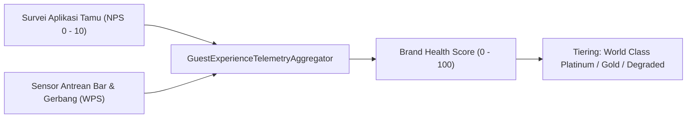

# Spesifikasi Antarmuka Telemetri NPS & Brand Scorecard Venue (Fase 117)

## 1. Ringkasan & Definisi Metrik Komposit

Dokumen spesifikasi ini menetapkan format data pertukaran, metode agregasi statistik, dan bobot normalisasi untuk menghitung **Brand Health Score** acara hiburan malam (KONSEP §10F, Fase 117.4). Skor komposit menggabungkan kepuasan subjektif tamu (Net Promoter Score) dengan efisiensi operasional objektif (Wait-per-Service / WPS).



---

## 2. Rumus Pembobotan Matematis Skor Brand

Skor Kesehatan Brand dihitung dengan perpaduan berbobot:

$$\text{Brand Health Score} = (\text{WPS}_{\text{index}} \times 0.60) + (\text{NPS}_{\text{normalized}} \times 0.40)$$

Di mana:
- $\text{WPS}_{\text{index}}$: Nilai rata-rata waktu tunggu terukur (skala 0 hingga 100), dihitung dari algoritma `WaitPerServiceGovernor (V15)`.
- $\text{NPS}_{\text{normalized}}$: Nilai NPS (rentang $-100$ hingga $+100$) yang dinormalisasi ke skala linear $0 - 100$:

$$\text{NPS}_{\text{normalized}} = \frac{\text{NPS} + 100}{2}$$

---

## 3. Skema Kontrak Data JSON (Scorecard Payload)

```json
{
  "venue_id": 101,
  "event_id": 502,
  "timestamp": "2026-11-08T02:30:00Z",
  "nps_metrics": {
    "sample_count": 842,
    "promoters_percent": 74.2,
    "passives_percent": 19.8,
    "detractors_percent": 6.0,
    "nps_score": 68.2
  },
  "operational_wps_metrics": {
    "stations_audited": 6,
    "average_wait_seconds": 42.5,
    "wps_efficiency_index": 88.4
  },
  "composite_brand_health": {
    "score": 86.7,
    "tier": "WORLD_CLASS_PLATINUM",
    "regulatory_compliance": true
  }
}
```

---

## 4. Klasifikasi Kategori Kinerja Venue

| Rentang Skor | Klasifikasi Mutu | Tindakan Manajemen Platform |
|---|---|---|
| $90.0 - 100.0$ | World Class Platinum | Insentif royalti dan prioritas kalender festival |
| $75.0 - 89.9$ | Excellence Gold | Operasional stabil tanpa intervensi khusus |
| $50.0 - 74.9$ | Standard Passable | Audit acak stasiun antrean pada acara berikutnya |
| $< 50.0$ | Degraded Action Required | Penundaan izin acara baru hingga CAPA disetujui |
