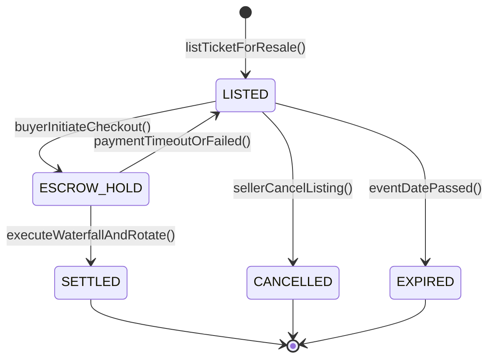

# Spesifikasi Arsitektur Pasar Sekunder & Dynamic Bundling

## 1. Arsitektur Komponen & Domain Model
Modul Pasar Sekunder Tiket & Dynamic Bundling pada Superweb Venue (Fase 116) dibangun di atas arsitektur Domain-Driven Design (DDD) yang terisolasi dengan batas domain (*bounded context*) yang tegas. Modul ini bertanggung jawab atas peredaran sekunder tiket hiburan, tata kelola daftar tunggu antrean, serta pengemasan produk lintas divisi.

Komponen-komponen utama dalam arsitektur ini meliputi:
1. **Entitas Pasar Sekunder (`TicketResale`):**
   Merekam daur hidup penawaran penjualan kembali tiket, dari pendaftaran (`LISTED`), penampungan dana pihak ketiga (`ESCROW_HOLD`), hingga penyelesaian transaksi final (`SETTLED`).
2. **Entitas Antrean Daftar Tunggu (`TicketWaitlist`):**
   Merekam urutan antrean pembeli potensial saat tiket terjual habis, dikelola secara dinamis oleh algoritma skor prioritas berbobot.
3. **Entitas Paket Bundling Dinamis (`DynamicBundlePackage`):**
   Mengemas tiket acara bersama inventaris perhotelan dan transportasi logistik dengan penegakan batas pengaman laba kotor.
4. **Buku Besar Sekunder (`SecondaryLedgerEntry`):**
   Menyimpan catatan pembukuan ganda tertutup untuk setiap rupiah yang mengalir dalam transaksi sekunder.

---

## 2. Daur Hidup State Machine Penjualan Sekunder
Transisi status transaksi penjualan tiket sekunder diatur secara ketat oleh `TicketResaleStateMachine`:

### 2.1. Penjelasan Status & Invarian Transisi
- `LISTED`: Tiket aktif terdaftar di bursa. Validasi memverifikasi bahwa tiket berstatus `ISSUED`, belum pernah diperdagangkan sebelumnya ($T = 0$), dan harga penawaran $\le 120\%$ dari face value asli.
- `ESCROW_HOLD`: Pembeli telah memulai proses pembayaran. Rekening penampungan menahan dana sebesar nilai transaksi kotor. Baris basis data dikunci secara pesimistik (*pessimistic row locking*) untuk mencegah kondisi balapan (*race condition*).
- `SETTLED`: Pembayaran terkonfirmasi. Algoritma `SecondaryMarketTaxWaterfallEngine` mengeksekusi pemotongan pajak daerah PBJT (10%), komisi platform (8%), royalti promotor (2%), dan mencairkan sisa saldo bersih (80%) ke akun penjual. Barcode lama dibatalkan permanen dan token berotasi baru diterbitkan.
- `CANCELLED`: Penjual membatalkan penawaran sebelum pembeli menaruh dana escrow.
- `EXPIRED`: Listing kadaluwarsa karena jadwal acara telah dimulai.

---

## 3. Protokol Keamanan & Kriptografi Barcode Berotasi
Untuk mencegah penipuan di mana penjual lama tetap mencoba menggunakan barcode asli di gerbang fisik (*double spending barcode attack*):
1. Kolom `ticket_hash` asli pada model `EntertainmentTicket` dilindungi oleh closure `static::updating()` yang melarang modifikasi hash asli.
2. Ketika transaksi berstatus `SETTLED`, token otorisasi baru dihitung menggunakan HMAC-SHA256 berderajat entropi tinggi dan disimpan pada kolom `ven_ticket_resales.new_ticket_hash`.
3. Mesin pemindai tiket di pintu gerbang fisik (`GateScanController`) memeriksa keberadaan transaksi sekunder `SETTLED`. Jika tiket pernah diperjualbelikan, pemindai menolak barcode lama dan hanya menerima token baru milik pembeli sah.

