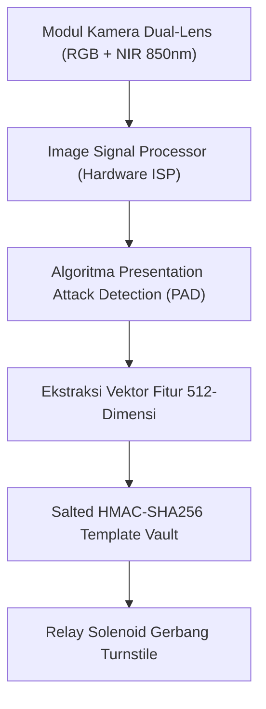

# Spesifikasi Integrasi Kamera Stereoscopic & Pembaca Face-ID Kios (Fase 117)

## 1. Arsitektur Optik & Spektrometri Sensor

Sistem verifikasi wajah tanpa sentuh pada Kios Turnstile (Fase 117.1) memanfaatkan modul optik ganda terintegrasi yang menggabungkan sensor RGB resolusi tinggi dan sensor inframerah dekat (Near-Infrared / NIR 850nm / 940nm) serta proyektor pola cahaya terstruktur (structured light dot projector).

---

## 2. Parameter Optik & Kondisi Operasional Lingkungan

| Parameter | Spesifikasi Minimum | Catatan Operasional Acara Hiburan |
|---|---|---|
| Sensor RGB | 2 Megapixel (1920 $\times$ 1080 @ 60 FPS) | Lensa wide-angle $85^\circ$ diagonal |
| Sensor Inframerah (NIR) | Global Shutter 1.3 Megapixel | Menyaring interferensi strobo laser konser |
| Titik Proyeksi Pola 3D | $\ge 15.000$ titik inframerah terstruktur | Memetakan kontur hidung, pipi, dan dagu subjek |
| Rentang Jarak Kerja | 0.4 meter hingga 1.2 meter | Jarak ideal saat tamu melangkah ke turnstile |
| Waktu Tanggap Pemindaian | $\le 250$ milidetik per subjek | Mencegah perlambatan antrean di gerbang masuk |
| Rentang Suhu Kerja | $-10^\circ\text{C}$ hingga $+55^\circ\text{C}$ | Tahan panas lingkungan festival pantai luar ruang |

---

## 3. Pipeline Anti-Spoofing Presentation Attack Detection (PAD)

Algoritma `BiometricLivenessMatcherEngine (V13)` dan `FacialAntiSpoofingAnalysisService` memeriksa 5 parameter fisiologis utama secara simultan:

1. **Reflektansi Inframerah Dekat (NIR Albedo)**:
   Kulit manusia asli memiliki spektrum penyerapan air dan hamburan cahaya sub-permukaan (subsurface scattering) yang khas pada panjang gelombang 850 nm dan 940 nm. Layar ponsel LCD/OLED dan kertas cetak akan memantulkan cahaya NIR secara seragam tanpa hamburan biologis.

2. **Analisis Frekuensi Pola Moire (Screen Moire Frequency)**:
   Ketika layar smartphone diarahkan ke sensor, interaksi antara kisi piksel layar dan kisi fotodioda sensor kamera menghasilkan pola interferensi Moire berfrekuensi tinggi (> 40 Hz). Algoritma FFT mendeteksi puncak frekuensi ini dan langsung menolak presentasi.

3. **Kedalaman Relatif 3D (Structured Light Depth Gradient)**:
   Foto cetak 2D atau tablet memiliki bidang kedalaman datar ($\Delta Z < 5\text{ mm}$). Wajah manusia asli memiliki variasi kedalaman hidung-ke-telinga sebesar $40\text{ mm}$ hingga $120\text{ mm}$.

4. **Mikro-Kedipan Fisiologis (Involuntary Micro-Blinking)**:
   Sensor mendeteksi perubahan kontur kelopak mata dalam jendela waktu observasi 300 ms tanpa memerlukan instruksi aktif dari tamu.

5. **Variansi Tekstur Porositas Kulit**:
   Analisis Local Binary Pattern (LBP) untuk membedakan pori-pori kulit asli dengan tekstur halus silikon atau lateks sintetis.
