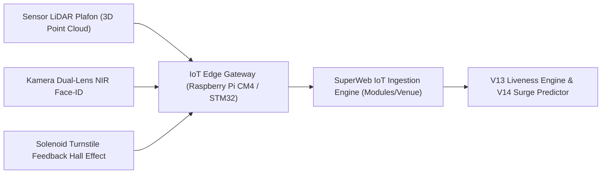

# Spesifikasi Teknis Sensor LiDAR & Turnstile IoT Gerbang Venue (Fase 117)

## 1. Lingkup & Arsitektur Perangkat Keras

Dokumen spesifikasi ini mendefinisikan standar antarmuka perangkat keras (hardware interfaces), protokol komunikasi serial IoT, dan pipeline pemrosesan telemetri gerbang pada sistem Venue & Entertainment SuperWeb.



---

## 2. Parameter Sensor Kepadatan Ruang (LiDAR & Stereoscopic)

| Parameter Teknis | Nilai Standar | Keterangan Toleransi |
|---|---|---|
| Bidang Pandang (FoV) | $120^\circ$ Horizontal $\times 90^\circ$ Vertikal | Pemasangan di plafon tinggi 4.5 – 6.0 meter |
| Resolusi Spasial | 0.05 meter per titik kisi | Deteksi kontur bahu dan kepala individu |
| Kecepatan Bingkai (Frame Rate) | 30 FPS kontinu | Sampling optical flow setiap 33 milidetik |
| Panjang Gelombang NIR | 850 nm & 940 nm | Kebal terhadap lampu sorot panggung dan efek strobo konser |
| Ketahanan Lingkungan | IP65 Weatherproof | Tahan debu, kabut asap panggung, dan percikan air pantai |

---

## 3. Protokol Komunikasi Gerbang Turnstile (Controller Relay)

Komunikasi antara server SuperWeb dan mikroprosesor gerbang turnstile menggunakan protokol terenkripsi mTLS melalui bus Ethernet industri atau CAN-bus:

### Format Perintah Kendali Gerbang (JSON Payload)
```json
{
  "hardware_identifier": "GATE-TURNSTILE-01-A",
  "command": "SET_MODE",
  "mode": "FAIL_SAFE_FREE",
  "solenoid_energized": false,
  "bidirectional_unlocked": true,
  "optical_feedback_interval_ms": 100,
  "cryptographic_hmac": "e3b0c44298fc1c149afbf4c8996fb92427ae41e4649b934ca495991b7852b855"
}
```

### Mekanisme Perlindungan Anti-Passback
1. Setiap tiket atau template biometrik yang berhasil memicu pelepasan solenoid gerbang diberi stempel waktu transaksi.
2. Template yang sama diblokir untuk memicu gerbang masuk yang sama atau berbeda selama interval cooldown **60 detik**.
3. Jika tamu mencoba memindai ulang kredensial yang sama dalam rentang cooldown, sistem membunyikan peringatan lokal dan menolak rotasi gerbang (`DECISION: REJECT_SERIAL_PASSBACK`).

---

## 4. Standar Kalibrasi Kecepatan Putar Mekanikal

- **Rotasi Normal Berbantuan Motor (Motorized Assist)**: 1,8 hingga 2,2 detik per orang.
- **Deteksi Macet (Mechanical Jam)**: Jika sensor hall-effect tidak mendeteksi penyelesaian putaran $120^\circ$ dalam 4,0 detik, pengontrol arus motor mematikan solenoid untuk mencegah cedera panggul tamu.
- **Pelepasan Darurat Bebas Hambatan (Emergency Free-Swing)**: Daya solenoid diputus total ($0\text{ Watt}$), lengan turnstile berputar bebas tanpa tahanan mekanis.
