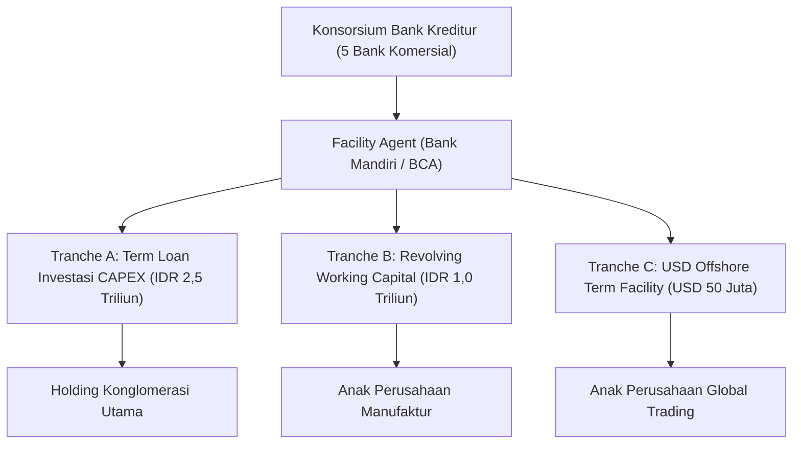

# Spesifikasi Fasilitas Pinjaman Sindikasi & Tranche Kredit Perbankan Korporat

## 1. Ikhtisar Struktur Fasilitas Utang Sindikasi
Fasilitas pinjaman sindikasi (*syndicated credit facility*) konglomerasi merupakan pembiayaan multi-bank berskala besar yang dikelola melalui agen fasilitas (*facility agent*) dan agen jaminan (*security agent*). Fasilitas ini dibagi menjadi beberapa tranche dengan karakteristik jatuh tempo, mata uang, dan suku bunga yang berbeda.

---

## 2. Karakteristik & Aturan Tranche

### A. Tranche A: Term Loan Belanja Modal (CAPEX)
- **Tujuan**: Pembiayaan proyek ekspansi pabrik baru dan modernisasi lini perakitan otomatis.
- **Tenor**: 7 tahun (84 bulan) dengan *grace period* pokok selama 24 bulan.
- **Struktur Bunga**: JIBOR 3-Bulan + Spread Risiko 225 bps ($2,25\%$).
- **Jadwal Pembayaran**: Bunga dibayar kuartalan; pokok diamortisasi secara merata setiap kuartal setelah grace period berakhir.
- **Covenant Khusus**: Pembatasan penjualan aset produktif utama (*negative pledge on key manufacturing assets*).

### B. Tranche B: Fasilitas Modal Kerja Bergulir (Revolving Credit)
- **Tujuan**: Menjaga ketersediaan likuiditas operasional kas harian saat fluktuasi persediaan.
- **Tenor**: 3 tahun dengan peninjauan perpanjangan tahunan (*annual rollover review*).
- **Struktur Bunga**: BI-Rate + Spread 175 bps.
- **Mekanisme Penarikan & Pelunasan**: Fleksibel (dapat ditarik dan dilunasi sewaktu-waktu sesuai kebutuhan arus kas).
- **Covenant Khusus**: Pemenuhan *Clean-Down Period* selama minimal 10 hari kerja berturut-turut di mana saldo penarikan wajib nol sekali per tahun kalender.

### C. Tranche C: Offshore Term Facility (USD)
- **Tujuan**: Pengadaan bahan baku impor dan mesin presisi dari luar negeri.
- **Tenor**: 5 tahun amortisasi semi-tahunan.
- **Struktur Bunga**: SOFR Term 3-Bulan + Spread 250 bps.
- **Lindung Nilai Wajib**: Perjanjian kredit mewajibkan proteksi risiko valuta asing minimal $80\%$ dari total pokok utang melalui kontrak forward atau cross-currency swap (bekerja sama dengan modul Treasury Fase 48).

---

## 3. Akuntansi & Pemostingan Buku Besar
Setiap penarikan fasilitas, amortisasi pokok, dan pembayaran bunga diposting secara single-sign balance pada `bank_ledger_transactions`:
1. **Penarikan Dana (Drawdown)**:
   - Debit `ef:syndicated_loan_cash:IDR` ($-$)
   - Kredit `ef:syndicated_loan_principal_liability:IDR` ($+$)
2. **Akrual Bunga Kuartalan**:
   - Debit `ef:syndicated_interest_expense:IDR` ($-$)
   - Kredit `ef:syndicated_interest_payable:IDR` ($+$)
3. **Pelunasan Angsuran Pokok**:
   - Debit `ef:syndicated_loan_principal_liability:IDR` ($-$)
   - Kredit `ef:syndicated_loan_cash:IDR` ($+$)
